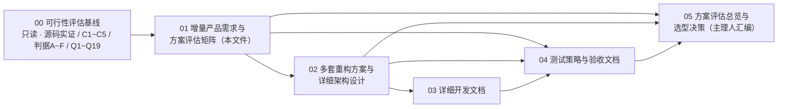
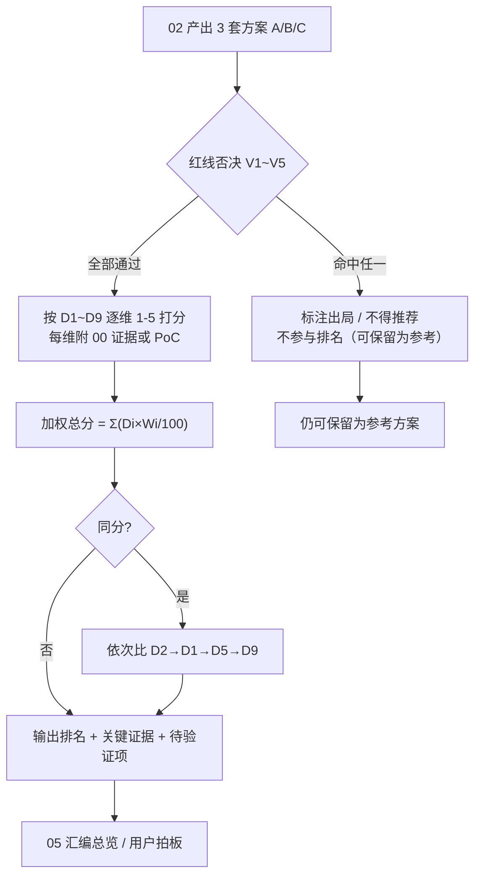

# 01 · 增量产品需求与方案评估矩阵（草案）

| 项 | 值 |
|---|---|
| 文档编号 | 01 |
| 版本 | **v0.1（草案）** |
| 日期 | **2026-11-12** |
| 作者 | **许清楚（Xu）· 产品经理（software-product-manager）** |
| 状态 | **草案** — 待主理人齐活林汇编；待用户对 Q1~Q19 拍板 |
| 上游基线 | `00-feasibility-baseline.md`（**只读**；硬约束 C1~C5、判据 A~F、源码实证、四大缺口、Q1~Q19 全以它为准） |
| 本轮范围 | 只产出方案与文档；**不改 `src/`、`android/` 任何源码，不写实现代码** |
| 主产出 | **§4 方案评估维度与权重矩阵**（供 02 给 3 套方案打分） |
| 语言 | 中文 |

**标记约定**（沿用上一轮）：**【明确】** = 用户原话可直接推导的要求；**【假设】** = 我基于产品判断给出的补充/默认建议，需用户拍板（§6 汇总）。

**变更记录**

| 版本 | 日期 | 作者 | 变更 |
|---|---|---|---|
| v0.1 | 2026-11-12 | 许清楚 | 初始草案。基于 00 归档基线，合并上一轮需求结构化清单；新增增量 PRD 三类边界、兼容红线 K1~K8、7+ 场景用户故事、重编号需求池（旧编号映射）、方案评估维度与权重矩阵（D1~D9 / 权重合计 100 / 逐档口径 / 否决规则 V1~V5）、三类方案体验预判、Q1~Q19 优先级合并表 |

**文档依赖**

| 文档 | 角色 | 与本文件的关系 | 状态 |
|---|---|---|---|
| 00 | 只读基线 | **上游**：所有实证、硬约束、缺口、默认假设以它为准，不得冲突 | 已归档 |
| 01 | 本文件 | — | 草案 |
| 02 | 多套重构方案与详细架构设计 | **下游**：用 §4 矩阵给 3 套方案打分并填 §4.5 模板；受 §1.2 红线、§6 默认答案约束 | 规划中 |
| 03 | 详细开发文档 | **下游**：按 §3 需求池拆任务与里程碑（参照 00 §9 M1~M5） | 规划中 |
| 04 | 测试策略与验收文档 | **下游**：按 §2 验收要点 + K1~K8 + 判据 A~F 设计用例 | 规划中 |
| 05 | 方案评估总览 / 选型决策 | **下游**：引用 §4 打分结果、§5 体验预判、§6 默认答案 | 规划中（主理人汇编） |

> 02/03/04/05 的编号与文件名为本轮规划，最终以主理人确认为准。

> **阅读顺序**：§1 定边界 → §2 定场景 → §3 定验收 → **§4 定评分（主产出）** → §5 预判 → §6 拍板清单。本文件**不做任何技术可行性结论**，可行性由 02 与真机 PoC 回答。

---

## 1. 增量 PRD：相对 v3.1 的「保留 / 重构 / 废弃」边界

### 1.1 三类边界总表

依据 00 §2「现状能力矩阵（源码实证）」与 §3 四大缺口划分。**【明确】**仅指用户要求本身；下列处置判断均为**【假设】**产品建议，需 02 复核。

#### A. 保留（Keep）— 已验证可用，重构时不得无故改动

| # | 保留资产 | 现状证据（00 §10 索引） | 保留理由 |
|---|---|---|---|
| K-01 | Windows WGC 主显示器采集（BGRA） | `WgcCapture.cs:69-85` | 可运行；最低档采集侧可用 |
| K-02 | OpenH264 软编（保底编码路径） | `OpenH264Encoder.cs:35-52,148` | 00 §6 判定 720p30 可达 |
| K-03 | Windows WebRTC 发送 + SIPSorcery FU-A + `iceServers=[]` | `PeerConnection.cs:48,53-56,224-236` | 纯 host candidate 在 LAN 已由 E2E 证明（00 §4） |
| K-04 | Windows mDNS 广播 + Zeroconf 浏览 | `DiscoveryService.cs:47-138` | 一键发现（K2）的既有基础 |
| K-05 | 浏览器免安装观看 H264 | `web/app.js:115-124`；`ScreenMirrorTests.cs:116-157` | 兼容红线 K3，E2E 已出帧 |
| K-06 | DataChannel 文件传输 + SHA256 | `src/UniLinker.Plugins.FileTransfer/` | 兼容红线 K4 |
| K-07 | WinUI 3 GUI、主题、中英双语 | `README.md` / `CLAUDE.md` | 兼容红线 K5 |
| K-08 | Android 接收渲染（SurfaceViewRenderer + addSink） | `ScreenMirrorTab.kt:103-112` | 渲染层可运行（信令对接需重构，见 R-01） |
| K-09 | 连接码 UDP 9528 | `ConnectionCodeStrategy.kt:59-117` | 兼容红线 K8 免账号直连心智 |
| K-10 | 零云 / 零账号 / 零中继 / 无遥测的总体架构原则 | 00 §4 | C2 天然合规，是产品差异点 |
| K-11 | 插件 SDK 抽象（DeviceRole / IConnectionStrategy） | `DeviceRole.cs:4-10`、`IConnectionStrategy.cs:13-32` | 抽象可保留，仅需接线（R-06） |

#### B. 重构（Refactor）— 能力在但需改造才能达标

| # | 重构项 | 现状缺陷（00 §10 索引） | 重构目标 |
|---|---|---|---|
| R-01 | 信令协议对齐（Q9 四缺陷） | `WebRTCService.kt:145-150,134,160-169`；`SignalingServer.cs:241-244,330-341`；answer 分支 `:199-208` | offer/answer 双向、补齐 `fromPeerId`/`capability`、阻塞等待 ICE 收集、peerId 一致、`/ice-pending` 可用 |
| R-02 | 去除公网 STUN | `WebRTCService.kt:76`、`web/app.js:112` | 置 `[]`，判据 D 方可通过（零功能损失） |
| R-03 | 信令网卡绑定收敛 | `SignalingServer.cs:60-66` `IPv6Any` DualMode | 私有网卡白名单 / 防火墙规则，满足 C3 |
| R-04 | 链路切换自愈 | `WebRTCService.kt:62` `disableNetworkMonitor=true` | 启用网络监视 + ICE restart，覆盖热点开关、Wi-Fi Direct 组成立、Wi-Fi↔USB |
| R-05 | Android 发现广播自身 + MulticastLock | `LanMdnsStrategy.kt:39-41`；00 §5 | 双 Android 可互发现；国产 ROM 组播过滤需 `acquire()` |
| R-06 | 角色 / 策略抽象接线 | `DeviceRole.cs`、`IConnectionStrategy.cs` 零实现类；`Models.kt:24` 零使用；`Platform.kt:64-77` 抛 `UnsupportedOperationException` | 对称角色协商、真实 peer 注册表 |
| R-07 | Windows 恒 SendOnly 改为按角色收发 | `PeerConnection.cs:38,55`；`PeerMesh.cs:420-425` | 场景②与双向能力前提 |
| R-08 | Android 控制通道 | `WebRTCService.kt:102` `onDataChannel` 空 | 承载控制消息（注入、坐标、授权） |
| R-09 | Android 权限声明与前台服务 | `AndroidManifest.xml:4-35` 零 `<service>`、缺 6 类权限 | FGS `mediaProjection` + 无障碍服务声明 + 通知/前台权限 |
| R-10 | SDP 显式 H264 参数 | `PeerConnection.cs:54`；`WebRTCService.kt:50` field trial | 显式 `profile-level-id`/`packetization-mode`，真机抓 SDP 比对（00 §6 互通风险） |
| R-11 | RTP 时间戳（**条件性**） | `PeerMesh.cs:464` 写死 `90000/30` | 仅当 Q13 判目标档硬性时重构，否则保留 |
| R-12 | Wi-Fi P2P 策略骨架（**条件性**） | `WifiP2pStrategy.kt:48,146,153-204` | 仅当 Q11 选 Wi-Fi Direct 时重构，否则降级/移除 |

#### C. 废弃 / 被更好设计覆盖（Drop & Replace）

| # | 废弃项 | 类型 | 理由 | 替代设计 |
|---|---|---|---|---|
| D-01 | 「Windows 恒 Sender / Android 恒 Receiver」硬编码单向角色 | **强制废弃** | 与场景②③、Android↔Android 冲突 | 对称角色协商 + 能力通告（R0-11） |
| D-02 | 「浏览器为唯一观看端」的假设 | **强制废弃** | 限制三端对等与后续扩展 | 统一渲染接口，Windows / Android / 浏览器对等 |
| D-03 | 双 Android 场景下 `Platform.kt:19-21` 把 mesh 指向 `localhost:9527` 的假信令 | **强制废弃** | 00 §3 缺口 2：无一方能当信令方，必失败 | 任一端可起本地信令服务端（R0-12） |
| D-04 | Wi-Fi Direct 依赖 mDNS 的旧思路 | **强制废弃** | 00 §5：GO 角色连接建立后才知道 | 热点优先；Wi-Fi Direct 走 `groupOwnerAddress` + 连接码确认 |
| D-05 | 旧 MediaFoundation SinkWriter 硬编复活路线 | **强制废弃** | `CLAUDE.md:66` 明确 `MFCreateMemoryByteStream` 不存在、不可复活 | 重新设计编码层（Q13 决定是否投入） |
| D-06 | `IPluginContext.peers` 直接抛异常的空接口 | **强制废弃** | 死接口 | 真实 peer 注册表（R-06） |
| D-07 | 「软编为唯一编码路径」 | **条件性废弃** | 00 §6：软编基本不产 High/CABAC，目标档不达标 | 仅当 Q13 判 1080p60/≤80ms 为硬性时废弃；否则保留为保底（K-02） |

### 1.2 允许「更好设计覆盖原有」时的兼容红线（K1~K8）

> 用户允许重构与覆盖，但下列**用户可见行为**不得回退。K1/K6 来自【明确】用户要求；其余为【假设】产品兼容要求。

| 编号 | 必须保持的用户可见行为 | 来源 | 可验证判定 | 可否降级 |
|---|---|---|---|---|
| K1 | 运行期零移动数据流量；无需互联网、账号、登录、激活 | 【明确】C1/C2；判据 A/B/D/F | 判据 A/B/D/F 全通过；抓包无公网 IP / 无外网 DNS | **否 — 违反即出局（V1）** |
| K2 | 一键自动发现：打开应用 ≤5s 列出同 LAN 设备 | 【假设】现状 mDNS + "等功能"隐含 | R0-01 验收；手动 IP / 连接码可作兜底 | 自动发现本身不可消失 |
| K3 | 浏览器 Chrome/Edge/Firefox **免安装**直接观看 H264 | 【假设】现状已具备 | E2E 出帧 + 免安装走查 | 否 |
| K4 | 局域网文件互传（含完整性校验） | 【假设】现状 DataChannel + SHA256 | 100 MB 校验一致，且与投屏并发不互斥 | 否 |
| K5 | WinUI 3 GUI 现有主题与中英双语 | 【假设】现状已具备 | 主题切换 + 双语切换走查通过 | 视觉可升级；主题与双语不可丢 |
| K6 | 断 WAN / 飞行模式 / 无 SIM 下全功能可用 | 【明确】C4/C5；判据 A/B/C | 判据 A/B/C 全通过 | **否 — 违反即出局（V2）** |
| K7 | 插件系统可扩展，第三方插件可挂载 | 【假设】现状架构 | 挂载 1 个示例插件成功 | 接口可重构，但须提供迁移层 |
| K8 | 免账号直连心智（扫码 / 输码即连，无云步骤） | 【假设】现状连接码 | 连接码配对成功、全程无账号步骤 | 可换 UI，不可引入账号 / 云 |

**红线优先级**：K1、K6 为【明确】用户硬要求 → 违反即方案出局；K2~K5、K7、K8 为【假设】产品兼容要求 → 违反须在 02 中显式说明并经用户确认，否则视为方案不合格（R0-15 门禁）。

### 1.3 增量边界一句话

- 【明确】用户新增要求：**先列出计划**、**允许重构**、**允许用更好设计覆盖原有**、**可阅读前沿论文落地最新技术**、**必须编写详细开发文档**、**要几个方案**。
- 【假设】本文件把这些翻译成：三类边界（§1.1）+ 兼容红线（§1.2）+ 重编号验收池（§3）+ 可复用评分矩阵（§4）+ 三方案体验预判（§5）+ 拍板清单（§6）；不改动源码、不做技术结论。

---

## 2. 用户故事（含验收要点）

| ID | 场景 | As a / I want / So that | 优先级 | 验收要点 |
|---|---|---|---|---|
| US-01 | ① Windows→Android | **As a** Windows 用户，**I want** 把 PC 屏幕一键投到同 LAN 的 Android（可选控制它），**So that** 不联网、不花流量即可演示与协助 | P0 | 判据 A/B/C/D/F；发现 ≤5s；720p30 / 2-4Mbps / ≤150ms / 文字可读 / 无色偏；连续 10 min 不中断；K1/K6 不破坏 |
| US-02 | ② Android→Windows | **As a** Android 用户，**I want** 把手机画面投到 PC 并用 PC 键鼠操作手机，**So that** 能在大屏上处理手机事务 | P1（Q3 默认） | Windows 接收端出帧；Android MediaProjection 授权弹窗可见；坐标映射落点误差 ≤1% 屏宽；UAC 安全桌面不可注入须显式提示（00 §7） |
| US-03 | ③ Android↔Android | **As a** 双 Android 用户，**I want** 两台设备在同一 LAN 互投并切换收发角色，**So that** 完全不依赖 PC | P0 单向 / P1 双向 | 任一端可起本地信令服务端并建连；角色切换 <3s；判据 A/C 通过；无 SIM 设备可作发送方 |
| US-04 | ④ 无路由器直连 | **As a** 无 AP/路由器环境的用户，**I want** 两台设备直连即投屏，**So that** 户外 / 会议 / 断网场景仍可用 | **P0** | 飞行模式 + 热点（或 Wi-Fi Direct）下判据 A 通过；首次配对 ≤30s；无公网 DNS；抓包目的地址均私有网段 |
| US-05 | ⑤ 被控授权与撤销 | **As a** 被控端用户，**I want** 首次连接显式确认、随时一键撤销、全程可见「正在被控制」，**So that** 隐私始终可控 | **P0** | 未确认前无法注入任何事件；撤销 ≤1s 生效；常驻状态指示；两次独立授权（Q10 默认）须合并为一次性引导流程 |
| US-06 | ⑥ 弱网降级 | **As a** 弱网 / LAN 拥塞用户，**I want** 画面自动降帧降码率而非花屏断连，**So that** 协作不中断 | P0 保底 / P1 全套 | 3% 丢包下连续播放、最长卡顿 <1s、无花屏；5% 丢包可自恢复；链路切换后 ≤3s 恢复出帧（ICE restart） |
| US-07 | ⑦ 有线 / USB | **As a** 无 Wi-Fi 或需稳定低延迟的用户，**I want** 用 USB 数据线 / USB 网络共享 / ADB 隧道连接，**So that** 不消耗任何无线与蜂窝流量 | P1（Q7 默认） | 判据 E 通过（关 Wi-Fi 与蜂窝、仅 USB 可用）；ADB / 开发者选项不作为普通用户默认路径（Q12 默认） |
| US-08 | 浏览器零安装观看（K3 兼容） | **As a** 临时观看者，**I want** 在 Chrome/Edge/Firefox 打开网址就看，**So that** 不必安装客户端 | P0（兼容红线） | 免安装、H264 出帧；去 STUN 后仍可观看（判据 D）；E2E 回归通过 |
| US-09 | 文件互传（K4 兼容） | **As a** 任意一端用户，**I want** 在投屏 / 控制的同时互传文件，**So that** 不用第三方工具 | P0（兼容红线） | 100 MB 文件校验一致；与投屏并发不互斥；无云端步骤 |
| US-10 | GUI 主题与双语（K5/K7 兼容） | **As a** 现有用户，**I want** 重构后仍能切换主题与中英双语、插件照常挂载，**So that** 升级不丢使用习惯 | P0（兼容红线） | 主题 + 双语切换走查通过；示例插件挂载成功；插件接口变更须有迁移层 |

---

## 3. 更新后的需求池（P0 / P1 / P2）

**编号规则**：新编号 `R0-xx`（P0）/ `R1-xx`（P1）/ `R2-xx`（P2），R = Redesign；「旧编号映射」列保留上一轮 `P0-1~10` / `P1-1~11` / `P2-1~5`，**「—（本轮新增）」**为重构后新增能力条目。
旧→新映射：P0-1→R0-01 … P0-10→R0-10；P1-1→R1-01 … P1-11→R1-11；P2-1→R2-01 … P2-5→R2-05。

### 3.1 P0 — 必需（验收线）

| 新编号 | 旧编号映射 | 需求 | 来源 | 可验证验收标准 |
|---|---|---|---|---|
| R0-01 | P0-1 | 设备发现与配对（mDNS / 手动 IP / 连接码 ≥2 种） | 【明确】+【假设】 | 同 LAN 内 ≤5s 列出对端；手动 IP 可连；连接码配对成功且无账号步骤（K8）；断线后可重连 |
| R0-02 | P0-2 | 零互联网 / 零蜂窝数据 / 仅本地链路（C1~C5） | 【明确】 | 判据 A/B/C/D/F 全通过；抓包无公网 IP、无外网 DNS（含去 2 处 STUN + 私有网卡白名单） |
| R0-03 | P0-3 | 同一 Wi-Fi LAN 无线链路（信令 + 媒体全本地） | 【明确】 | 判据 B/D 通过；9527 或替代信令抓包确认全部私有网段 |
| R0-04 | P0-4 | 无路由器直连（热点自组 LAN 或 Wi-Fi Direct ≥1 条） | 【明确】 | 判据 A 通过（飞行模式 + 直连）；④ 场景端到端走通；首次配对 ≤30s |
| R0-05 | P0-5 | ① Windows→Android 单向投屏 | 【明确】 | 连续 10 min 不中断；720p30 / 2-4Mbps / ≤150ms / 文字可读 / 无色偏 |
| R0-06 | P0-6 | ③④ Android→Android 单向投屏 | 【明确】 | 同上；④ 直连下达标；无 SIM 设备可作发送方 |
| R0-07 | P0-7 | 设备控制：触控注入 + 坐标映射与缩放（含旋转 / 黑边） | 【明确】 | 4 种宽高比 × 横竖屏旋转各测 20 次点击，落点误差 ≤1% 屏宽；滑动 / 长按生效；旋转后自动重算映射 |
| R0-08 | P0-8 | 被控端授权确认 + 随时撤销 + 常驻被控状态指示 | 【假设】 | 未确认前无法注入；撤销 ≤1s 生效；状态条全程可见；超时自动断开 |
| R0-09 | P0-9 | 无 SIM / 飞行模式设备全功能可用 | 【假设】 | 判据 A/C 通过 |
| R0-10 | P0-10 | 弱网降级不花屏、可自恢复 | 【假设】 | 3% 丢包下连续播放、最长卡顿 <1s、无花屏 |
| **R0-11** | —（**本轮新增**） | **对称角色协商与能力通告** | 【假设】 | 任一端可声明 Sender/Receiver/Both 能力；角色由协商结果决定而非硬编码；Windows 不再恒 SendOnly（`PeerMesh.cs:420-425`）；角色切换有状态回显 |
| **R0-12** | —（**本轮新增**） | **本地信令服务端双端对等** | 【假设】 | 双 Android 无 PC 时可建连（00 §3 缺口 2 / §8 Q9）；offer/answer 双向；`fromPeerId`/`capability` 字段齐；peerId 一致；`/ice-pending` 可用；**真机 PoC 报告通过** |
| **R0-13** | —（**本轮新增**） | **链路切换自愈与 ICE 重启** | 【假设】 | 热点开关 / Wi-Fi Direct 组成立 / Wi-Fi↔USB 切换后 ≤3s 恢复出帧；`disableNetworkMonitor` 已修；无需用户手动重连 |
| **R0-14** | —（**本轮新增**） | **Android 合规权限与前台服务声明** | 【假设】 | Manifest 含所需 `<service>` 与 FGS `mediaProjection` / 无障碍 / 通知权限（00 §2）；MediaProjection 每次授权弹窗可见；targetSdk 合规不崩溃 |
| **R0-15** | —（**本轮新增**） | **兼容红线 K1~K8 不回退（重构回归门禁）** | 【假设】 | K1~K8 逐条回归通过（浏览器免安装观看、文件传输、GUI 双语主题、一键发现、插件挂载、免账号直连）；任一失败视为方案不合格 |

> **P0 排期门禁 G1（不占编号）**：Q9「Android 现有接收是否真机可用」必须在**排期前**由真机 PoC 回答（00 §8 / §9）；未出报告不得进入里程碑估算。此项同时是 D9 风险维度的定价依据。

### 3.2 P1 — 增强

| 新编号 | 旧编号映射 | 需求 | 来源 | 可验证验收标准 |
|---|---|---|---|---|
| R1-01 | P1-1 | ② Android→Windows 投屏（Windows 作接收端） | 【明确】(歧义)/【假设】 | PC 端可渲染手机画面，达最低档指标 |
| R1-02 | P1-2 | 双向 / 反向投屏与双向控制（③ 互投互控） | 【假设】 | 两端可切换收发角色，切换 <3s |
| R1-03 | P1-3 | 目标档 1080p60 / ≤80ms / ABR | 【假设】 | 实测达标；8-12 Mbps 内自适应（Q13 决定是否升 P0） |
| R1-04 | P1-4 | 有线链路（USB 网络共享 / ADB 隧道 / USB 直连 ≥1 条） | 【明确】(有线)/【假设】 | 判据 E 通过；Q12 默认不作普通用户默认路径 |
| R1-05 | P1-5 | 系统键控制（返回/Home/多任务/音量/电源）+ 键鼠注入 | 【假设】 | 各键产生预期系统行为；平台级不可注入边界（00 §7）显式提示 |
| R1-06 | P1-6 | 剪贴板双向（文本） | 【假设】 | 2s 内可粘贴，中文 / emoji 不乱码 |
| R1-07 | P1-7 | 文件互传（双向） | 【假设】 | 100 MB 校验一致，速率可测（同时满足 K4） |
| R1-08 | P1-8 | 系统音频同步（可开关） | 【假设】 | 音画偏差 ≤40ms，可一键关闭 |
| R1-09 | P1-9 | 多显示器 / 指定窗口采集 | 【假设】 | 双屏可选其一；窗口级采集不泄露其他窗口内容 |
| R1-10 | P1-10 | 配对信任与安全传输（PIN/扫码 + DTLS-SRTP） | 【假设】 | 非配对设备无法注入；LAN 抓包无法还原明文画面（Q15 默认） |
| R1-11 | P1-11 | ABR / PLI / FIR / NACK、抗 5% 丢包 | 【假设】 | 丢包注入下 5s 内恢复清晰画面 |
| **R1-12** | —（**本轮新增**） | **编码层可插拔（为硬编预留）** | 【假设】 | 不改动采集 / 传输接口即可替换编码器；软编保底可一键回退；Q13 为硬性时升 P0 |
| **R1-13** | —（**本轮新增**） | **统一能力描述与协议版本协商** | 【假设】 | 协议含 `version` + `capabilities`；新增一项能力（如音频）不破坏旧端；能力不匹配给可读提示而非静默失败 |
| **R1-14** | —（**本轮新增**） | **端到端延迟可观测打点** | 【假设】 | 采用 `WgcCapture.cs:184-192 TimestampUs` 或等价时间戳；输出 P50/P95 延迟报告（Q19 默认） |
| **R1-15** | —（**本轮新增**） | **接收端实现形态可替换** | 【假设】 | Windows 接收可在 WebView2 复用 `web/app.js` 与原生解码间切换，用户可见观看体验不变（K3）；Q14 |

### 3.3 P2 — 可选

| 新编号 | 旧编号映射 | 需求 | 来源 | 可验证验收标准 |
|---|---|---|---|---|
| R2-01 | P2-1 | 4K / 2K / HDR / 4:4:4 | 【假设】 | 支持设备上主观 + 客观色彩校验通过 |
| R2-02 | P2-2 | ROOT 静默注入 / 免授权模式 | 【假设】 | root 设备免无障碍授权即可注入；**不作 P0 依赖** |
| R2-03 | P2-3 | 富媒体剪贴板 / 跨设备拖拽 | 【假设】 | 图片、文件跨端粘贴 / 拖拽成功 |
| R2-04 | P2-4 | 熄屏唤醒 / 旋转同步 / 多指手柄 / 会话录制回放 | 【假设】 | 逐项功能走查通过 |
| R2-05 | P2-5 | 多设备并发（1 控多 / 多观看端） | 【假设】 | ≥3 接收端同时观看，发送端 CPU 占用可测 |
| **R2-06** | —（**本轮新增**） | **前沿编解码 / 传输实验位（AV1、WebCodecs、QUIC/WebTransport 等）** | 【假设】 | 以可插拔模块接入，一键回退到 H264 / 现有传输；不破坏 K1/K3；论文收益须以 PoC 量化报告佐证 |
| **R2-07** | —（**本轮新增**） | **第三端接入预留（Linux/macOS/车机/电视等）** | 【假设】 | 通过统一能力描述新增一端时不改 Windows/Android 核心；至少完成 1 个第三端只读观看 PoC |

> 合计 37 条（旧 26 条沿用 + **11 条重构后新增能力**）：P0 15 / P1 15 / P2 7。

---

## 4. 方案评估维度与权重矩阵（本文件主产出）

> 用途：供 02 给「保守渐进 / 传输与架构升级 / 全新设计覆盖原有」3 套方案打分。**必须可复用、无歧义**；所有维度统一为「分数越高越优」。

### 4.1 使用规则（打分前必读）

1. **评分对象**：02 产出的 3 套方案，记为 A / B / C。
2. **方向统一**：所有维度均为**高分 = 更优**。成本型维度 **D6（开发/维护成本）** 与 **D9（风险）** 已反向定义（5 分 = 成本最低 / 风险最低），打分时**不得再反向换算**。
3. **分值**：每维仅取 **1–5 整数**，不允许 0 分、小数或「N/A」。
4. **证据强制**：每维打分必须附「00 文件章节 / §10 证据索引 / 真机 PoC 报告号」。**无证据的维度标注「待验证」并默认取 2 分**，02 不得自行给高分。
5. **红线前置**：先执行 §4.2 否决检查，通过后才打分。
6. **口径锁定**：Q4/Q13 未拍板前，D4 统一按「最低档为 P0 验收线」评估；若用户改判目标档为硬性，须整体重打 D4/D6/D8 并在 05 中说明。

### 4.2 红线否决规则（V1~V5，一票否决，先于打分）

| 编号 | 否决条件 | 判定 |
|---|---|---|
| V1 | 违反 C1/C2/C3 任一硬约束（需公网 STUN、云信令、中继、账号登录、遥测上报） | **直接出局** |
| V2 | 破坏 K1（零流量）或 K6（断 WAN / 飞行模式 / 无 SIM 全功能） | **直接出局** |
| V3 | 00 §3 四大缺口中有任意一项无法闭合且无等价替代路径 | **不得作为推荐方案**（可保留为参考） |
| V4 | D1（P0 覆盖度）< 3 分 | **不得作为推荐方案** |
| V5 | 以 ROOT / 系统签名作为 P0 设备控制的唯一路径（00 §7 平台不可行） | **直接出局** |

### 4.3 维度、权重与逐档评分口径（D1~D9，权重合计 100）

| 编号 | 维度 | 权重 | 1 分 | 2 分 | 3 分 | 4 分 | 5 分 | 一句话理由 |
|---|---|---:|---|---|---|---|---|---|
| **D1** | **P0 覆盖度** | **18** | 仅覆盖 ≤3 项 R0-xx，四大缺口均未解 | 覆盖 4–7 项 R0-xx，缺口未闭合 | 覆盖 8–11 项 R0-xx，缺口有替代路径但未完整补齐 | 覆盖 12–14 项 R0-xx，四大缺口全补齐，仅兼容红线待回归 | R0-01~R0-15 **全部满足**，且判据 A–F 全通过、K1~K8 回归通过 | 直接决定用户核心诉求能否交付，权重最高；按 §3.1 表逐条勾验计数，避免主观 |
| **D2** | **零流量合规**（C1~C5 / 判据 A~F） | **14** | 依赖公网 STUN / 云信令 / 中继 / 账号，判据 D 必失败 | 去 STUN 但仍绑定全部网卡（`IPv6Any` DualMode），A/D 有风险 | 去 STUN + 私有网卡白名单，A/B/D/F 通过，C/E 未验 | 判据 **A–F 全通过**（含 E 仅 USB），有抓包报告 | 4 分基础上，链路切换（Wi-Fi↔热点↔USB）时仍零公网流量且有自动化回归 | 用户唯一【明确】硬约束，违反即不可用；故设 V1 否决 + 高权重双重保障 |
| **D3** | **跨端对称性与多端可扩展**（含第三端） | **14** | 固定单向角色（Win=Sender / Android=Receiver），仅 2 端、浏览器为唯一观看端 | 单向角色，场景②③靠**双套独立实现**拼出 | 角色可协商，Windows/Android 双端对等；第三端需较大改造 | 三端（Win/Android/浏览器）对等，统一能力描述；第三端接入只需适配层 | 统一能力 / 协议版本协商，任意端即插即用（含 Linux/车机/电视），旧端可降级互通 | 一次把「对称性 + 第三端」投入到位可避免后续双套维护，直接影响 D6/D9 |
| **D4** | **画质 / 延迟上限** | **10** | 低于最低档（<720p30 或 >150ms 或频繁花屏） | 刚好达最低档 720p30 / 2-4Mbps / ≤150ms，无 ABR | 最低档 + 弱网自适应（降帧 / 降码率 / PLI/FIR） | 稳定 1080p30 / ≤120ms，含 ABR 与延迟可观测报告 | 达目标档 **1080p60 / ≤80ms**，含硬编 / ABR / 抗 5% 丢包与 P50/P95 延迟报告 | 把「高质量」从形容词变成可比档位；验收线由 Q4/Q13 拍板 |
| **D5** | **设备控制可达性与授权摩擦** | **12** | 无控制通道 / 无注入，或依赖 ROOT 才能用 | 可注入但无坐标映射 / 无授权撤销，或每次连接需 ≥3 次手动系统设置 | 触控注入 + 坐标映射 + 授权/撤销齐备，但两次独立授权分散引导（Q10 默认可接受） | 3 分基础上，两次授权**合并为一次性引导流程**，常驻被控指示，撤销 ≤1s | 4 分基础上，覆盖系统键 / 键鼠 / 剪贴板，且明确标注平台级不可注入边界（00 §7） | 四大缺口中最难、最影响首次可用率；授权摩擦决定普通用户能否独立完成 |
| **D6** | **开发 / 维护成本**（高分 = 成本更低） | **10** | 需重写双端 + 浏览器，工期 >2 个既有里程碑，长期双栈维护 | 双端均有较大改造，新增 ≥3 个长期模块 | 改造集中在 4 个缺口，新增 ≤2 个模块，里程碑可复用 00 §9 M1–M5 | 仅补齐缺口 + 少量协议对齐，单栈维护，无新增长期模块 | 以配置 / 接线为主，复用 00 §9 里程碑，无新增长期维护面 | 用户要求「先列出计划」，成本直接决定排期可信度；成本型已反向为高分=更低 |
| **D7** | **现有资产复用率**（高分 = 复用更多） | **8** | Windows 发送链路、浏览器观看、文件传输、WinUI GUI 全部重写 | 保留 ≤2 类已验证资产 | 保留 3–4 类（如 WGC / OpenH264 / 浏览器观看 / 文件传输） | 保留 §1.1-A「保留清单」**≥80%**，仅重构项改造 | 保留清单 **100%** + 插件迁移层，零用户可见行为回退（K1~K8 全过） | 保护 00 §2 中已由 E2E 证明可用的链路，避免重复投入与回归风险 |
| **D8** | **前沿技术收益** | **6** | 完全沿用现有 H264 / RTP / WebRTC，无论文 / 新技术落地 | 仅参数级优化（SDP / 时间戳 / ABR），无论文依据 | 引入 1 项**可回退**的前沿试验位（如 AV1 / WebCodecs / QUIC），有 PoC 收益数据 | ≥2 项前沿技术落地且有量化收益（码率 / 延迟 / 弱网），均可一键回退 | 形成可插拔编解码 / 传输抽象 + 论文结论复现报告，收益可迁移到后续功能 | 用户明确允许「阅读前沿论文落地最新技术」，但不得压过红线与当期交付，故权重最低且要求可回退 |
| **D9** | **风险与不确定性**（高分 = 风险更低） | **8** | 依赖未验证真机行为（Q9）且无 PoC 计划；或依赖 ROOT/系统签名；或 SDP 互通无验证 | 存在 1 项平台级不确定（硬编路线 / Wi-Fi Direct 骨架）且无缓解 | 已识别主要不确定性并有 PoC / 降级路径，但 ≥2 项待验证 | **Q9 已真机回答**；剩余不确定项均有降级路径与责任里程碑 | 4 分基础上，有自动化回归（判据 A–F + K1~K8）与第三方端互通测试 | 00 §8 指出 Q9 是最大工期未知项；风险须显式定价，避免乐观排期 |
| | **合计** | **100** | | | | | | 18+14+14+10+12+10+8+6+8 |

### 4.4 计算与裁决规则

| 项 | 规则 |
|---|---|
| 加权总分 | `Σ(Di × Wi / 100)`，满分 **5.00**，保留两位小数 |
| 顺序 | 先过 V1~V5 → 再逐维打分 → 再计算总分；命中任一否决者标注「出局 / 不得推荐」，**不参与排名** |
| 同分裁决 | 依次比较 **D2 → D1 → D5 → D9** 的单维分，高者胜；仍相同则并列，交主理人 / 用户按 §6 默认答案拍板 |
| 证据 | 每维附「00 章节 / §10 证据索引 / PoC 报告号」；标注「待验证」者默认取 2 分并在结果表备注 |
| 产出要求 | 02 必须完整填写 §4.5 模板（含每维证据列），否则 05 汇编不予采纳 |
| 复算 | 若 Q9 真机结果推翻 00 §8 静态推断，须同步修订 §1.1 保留清单、§5 预判表并**整体重打 D1/D6/D7/D9** |

### 4.5 打分结果模板（供 02 填写，05 引用）

| 方案 | V1~V5 | D1/18 | D2/14 | D3/14 | D4/10 | D5/12 | D6/10 | D7/8 | D8/6 | D9/8 | 加权总分 | 排名 | 关键证据 |
|---|---|---|---|---|---|---|---|---|---|---|---|---|
| A 保守渐进 | | | | | | | | | | | | | |
| B 传输与架构升级 | | | | | | | | | | | | | |
| C 全新设计覆盖原有 | | | | | | | | | | | | | |

### 4.6 评估流程

---

## 5. 三类方案的用户体验差异预判（**产品视角，非技术可行性结论**）

> ⚠️ 下表仅用于选型时权衡**用户价值**，**不构成任何技术可行性结论**；实际表现以 02 方案设计、真机 PoC 与 04 测试结果为准。所有预判基于 00 文件静态实证，若 Q9 真机结果推翻静态推断，本表须修订。

| 体验维度 | A 保守渐进 （沿用现有 WebRTC 插件架构全面补齐，00 §9 路线 A） | B 传输与架构升级 （换编码/传输/信令架构、角色对称化） | C 全新设计覆盖原有 （统一协议栈重做、可落地前沿技术） | 预判依据 |
|---|---|---|---|---|
| 首次配对耗时（发现→出帧） | **基准**（沿用 mDNS+9527，缺陷修完后接近现状水平） | 略优（角色协商 + 链路自愈，失败重试更少） | 初期可能更长（新协议/新授权引导），成熟后最短 | 00 §2 发现/信令、§5 热点、§4 `disableNetworkMonitor` |
| 首次授权次数（手动操作） | **最多**（MediaProjection + 无障碍 + 防火墙，且分散） | 中等（可编排为一次性引导） | 最少（统一授权编排），但受平台限制**无法降到 1 次以下** | 00 §7 两套独立授权、§2 权限声明 |
| 稳定性（断线 / 链路切换 / 弱网） | 基准偏弱（链路切换不刷新 candidate、无 ABR） | **明显改善**（ICE restart + ABR/PLI/FIR） | 设计上限最高（统一链路管理），但初期回归风险高 | 00 §4、§6 |
| 画质 / 延迟体验 | 达最低档 720p30/≤150ms；目标档**大概率不达标** | 可达 1080p30/≤120ms 或目标档（取决 Q13 是否换硬编） | 理论上限最高（可插拔硬编/AV1），需 PoC 佐证 | 00 §6 硬瓶颈（RTP 时间戳、软编、全帧 readback） |
| 设备控制可用范围 | P0 触控 + 坐标映射 + 授权（够用），系统键/键鼠/剪贴板靠后续 | 增加系统键、键鼠、剪贴板、与投屏并发 | 全能力 + 第三端控制，平台边界提示最完整 | 00 §3 缺口 4、§7 平台限制 |
| 后续功能扩展速度（新增一项能力的相对周期） | **最慢**（单向角色 + 双套实现，每次改两处） | 中等（对称角色 + 统一协议，改一处） | **最快**（能力描述 + 插件化），但前期投入最大 | 00 §2 角色抽象零实现类、`PeerMesh.cs:420-425` 恒 SendOnly |
| 老用户行为兼容（K1~K8） | **最好**（几乎不动已验证资产） | 较好（需回归浏览器观看与 GUI 双语） | **风险最高**（K3/K5/K7 需显式迁移层 + 回归门禁） | §1.2 红线；00 §2 浏览器 E2E |
| 首次可用率（普通用户独立完成） | 中（授权分散；Q9 未验证前可能连不通） | **较高**（一次性引导 + 链路自愈） | 初期低（新流程学习成本），成熟后高 | 00 §8 Q9、§7 授权 |

**产品视角结论（预判）**：A 在兼容性与首次交付确定性上占优，但扩展速度最慢；B 在稳定性、授权摩擦、扩展速度上均衡；C 上限最高但初期体验与兼容风险最大。**不推荐仅凭本表选型**，须以 §4 矩阵加权分 + 真机 PoC（G1）为准。

---

## 6. 待确认问题优先级表（Q1~Q19 合并，含建议默认答案）

> 合并 00 §1 的 Q1~Q8 与 00 §11 的 Q9~Q19，共 **19 条**。分组唯一，每条只出现一次。若用户不回复，**一律按「建议默认答案」推进**，并在 02/05 结论中标注「基于默认假设」。

### 组 A · 阻塞方案选型（7 条，不答则无法在 3 套方案间打分/选择）

| # | 编号 | 问题 | 为何阻塞 | 建议默认答案 | 关联 |
|---|---|---|---|---|---|
| A1 | Q13 | 1080p60 / ≤80ms 是否硬性？ | 决定是否必须换硬件编码，直接改变 D4 得分与 D6 成本 | **不硬性**；以最低档为 P0 验收线，目标档列 P1，由 B/C 视成本提供 | R1-03 / D4、D6 |
| A2 | Q18 | 是否坚持「发送方 = 控制方」单向角色？ | 决定是否必须对称角色协商（C 方案核心差异） | **不坚持**；改为角色可协商的对称架构，但 P0 业务流仍只交付单向 | R0-11 / D3 |
| A3 | Q9 | 现有 Android 接收链路真机是否可用？ | 决定 §1.1「保留清单」是否成立、A 方案基线是否可信 | 按 00 §8 静态推断**假定「不可用」**，以重做信令对接估算工期；**排期前必须真机 PoC 回答** | R0-12 / D9 / 门禁 G1 |
| A4 | Q11 | 接受「一台开热点」为默认，还是必须 Wi-Fi Direct？ | 决定直连链路与信令架构（00 §5 实证差异） | **热点自组 LAN 为默认**（可复用 mDNS + 9527）；Wi-Fi Direct 列 P1 | R0-04 / D2、D6 |
| A5 | Q10 | 是否接受两次独立授权（MediaProjection + 无障碍）？ | 决定控制方案 UX 上限（00 §7 平台不可合并） | **接受**；但产品上用一次性引导流程降低摩擦，被控授权必须可撤销、状态常驻 | US-05 / D5 |
| A6 | Q14 | Windows 接收端用 WebView2 复用 `web/app.js` 还是原生解码？ | 决定接收链路复用范围与 B/C 结构 | **优先 WebView2 复用**（保护 K3 与既有 E2E），原生解码列备选；由架构师按性能定 | R1-15 / D7 |
| A7 | Q16 | 是否允许修改 `web/app.js`？ | 去 STUN 必须改；决定 K3 兼容实现路径 | **允许修改**，但必须保持浏览器免安装观看（K3）与 E2E 出帧 | R0-02 / K3 / D2 |

### 组 B · 阻塞排期（10 条，不答则无法确定里程碑与工作量，但不影响选哪套架构）

| # | 编号 | 问题 | 为何阻塞 | 建议默认答案 | 关联 |
|---|---|---|---|---|---|
| B1 | Q1 | P0 是否只保单向屏幕共享？ | 决定 M1/M2 范围 | **是**（沿用 00 §1 Q1） | R0-05/06 |
| B2 | Q2 | P0 控制方向？（控 Android / 控 Windows） | 决定 Android 权限工作量 | **P0 = 控制 Android 被控端**；控制 Windows 列 P1 | R0-07 |
| B3 | Q3 | Android→Windows 是否 P0 必需？ | 决定 R1-01 是否升 P0 | **否**，列 P1，不阻塞 P0 | R1-01 |
| B4 | Q4 | 「高质量」验收线取最低档还是目标档？ | 定 D4 与 04 测试用例口径 | **最低档为 P0 验收线**；与 Q13 **成对回答**（Q4 定验收线，Q13 定是否为目标档投入硬编） | D4 |
| B5 | Q7 | P0 是否只保无线、有线列 P1？ | 决定判据 E 的排期位置 | **是**；P0 保无线（含无路由器直连），有线三型列 P1 | R1-04 |
| B6 | Q8 | Android 控制权限路径（无障碍 / ADB / ROOT）？ | 决定权限声明与引导文案 | **无障碍为主 + ADB 为辅，不依赖 ROOT**；多显示器/窗口采集列 P1 | R0-14 |
| B7 | Q12 | 有线链路是否允许依赖 ADB / 开发者选项 / PC 辅助？ | 决定 R1-04 的目标用户群 | **允许，但不作为普通用户默认路径**（00 §5：ADB reverse 仅适合 PC↔单设备） | R1-04 |
| B8 | Q15 | 是否保留 DTLS-SRTP 并追加应用层 PIN 配对？ | 决定 T01 安全改造范围 | **保留 DTLS-SRTP**；PIN/扫码配对列 P1 | R1-10 |
| B9 | Q17 | Windows 侧是否需要禁用蜂窝网卡？ | 决定 C3 合规改造做法 | **不做系统级禁用**；改为应用绑定私有网卡白名单（00 §4） | R0-02 |
| B10 | Q19 | 是否接受用 `WgcCapture.cs:184-192 TimestampUs` 做延迟打点？ | 决定延迟口径能否量化 | **接受**（Q4 延迟口径落地），列 P1 可观测 | R1-14 |

### 组 C · 可延后（2 条，不阻塞本轮方案选型与 M1~M5 主线）

| # | 编号 | 问题 | 为何可延后 | 建议默认答案 | 关联 |
|---|---|---|---|---|---|
| C1 | Q5 | 是否必须包含系统音频？ | 不影响 M1~M5 主线 | **否**，音频列 P1 可开关 | R1-08 |
| C2 | Q6 | 是否允许安装 / 首次授权阶段联网？ | 仅影响分发与引导文案，不影响运行期红线 | **允许安装/授权阶段联网；运行期零互联网、零移动数据**（C1/C2 仅约束运行时） | R0-02 |

> **联动提示**：① Q4 与 Q13 需成对回答；② Q9 是 P0 排期门禁 G1，若真机结果与 00 §8 静态推断相反，须同步修订 §1.1 保留清单、§5 预判表，并重打 D1/D6/D7/D9。

---

## 7. 给下游的交接清单（产品红线）

供 02 在设计 3 套方案时逐条遵守；05 汇编时逐条核对。

| 编号 | 产品红线 | 判定 |
|---|---|---|
| **PR-1** | **运行期零蜂窝流量**、零互联网 / 云信令 / 中继 / 账号 / 遥测；信令与媒体仅本地链路、无公网 IP 与外网 DNS；断 WAN / 飞行模式 / 无 SIM 全功能可用（C1~C5、判据 A~F） | 【明确】用户硬要求 → 违反即 **V1/V2 出局** |
| **PR-2** | **K1~K8 八条用户可见行为不得回退**，尤其 K3 浏览器免安装观看、K4 文件互传、K5 GUI 主题双语、K2 一键发现、K7 插件可扩展、K8 免账号直连；重构插件接口须提供迁移层 | 由 R0-15 回归门禁验收 |
| **PR-3** | 00 §3 **四大缺口必须全部闭合或有等价替代路径**；D1 < 3 分不得作为推荐方案 | V3 / V4 |
| **PR-4** | **不得以 ROOT / 系统签名作为 P0 设备控制的唯一路径**（00 §7 平台不可行项）；Android 两套独立授权须做一次性引导，被控授权必须可撤销且常驻状态可见 | V5 / R0-08 / D5 |
| **PR-5** | **Q9 真机 PoC 未回答前不得排期**（门禁 G1）；每维打分必须附 00 证据或 PoC 报告，无证据维度默认 2 分；Q1~Q19 未拍板时按 §6 默认答案推进并标注「基于默认假设」 | §4.1 / §4.4 / §6 |
| **PR-6** | **前沿技术（AV1 / WebCodecs / QUIC 等）必须可插拔、可一键回退**，不得压过红线与当期交付；不得为追求目标档牺牲 K1/K3；软编保底路径（K-02）在 Q13 未判硬性前不可废弃 | D8 / R2-06 / D-07 |

**编号速查**：硬约束 C1~C5、判据 A~F、Q1~Q19、§10 证据索引 → 见 `00-feasibility-baseline.md`；需求池 R0/R1/R2 → 见本文件 §3；评分 D1~D9 / V1~V5 → 见本文件 §4；兼容红线 K1~K8 → 见本文件 §1.2；产品红线 PR-1~PR-6 → 见本节。

---

> 状态：**草案 v0.1（2026-11-12）**。本文件未改动任何源码，未做技术可行性结论；待主理人汇编与用户对 Q1~Q19 拍板后升版。
