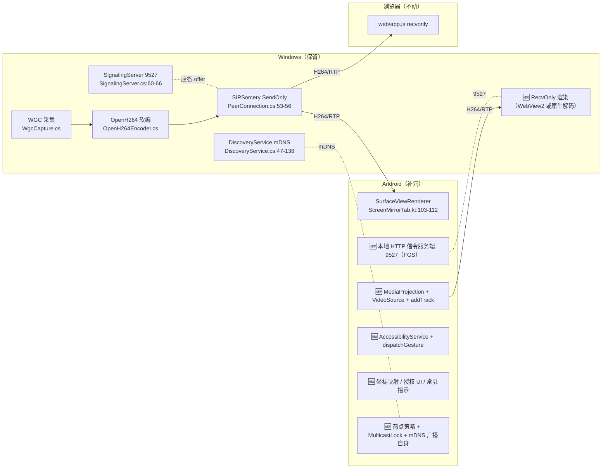
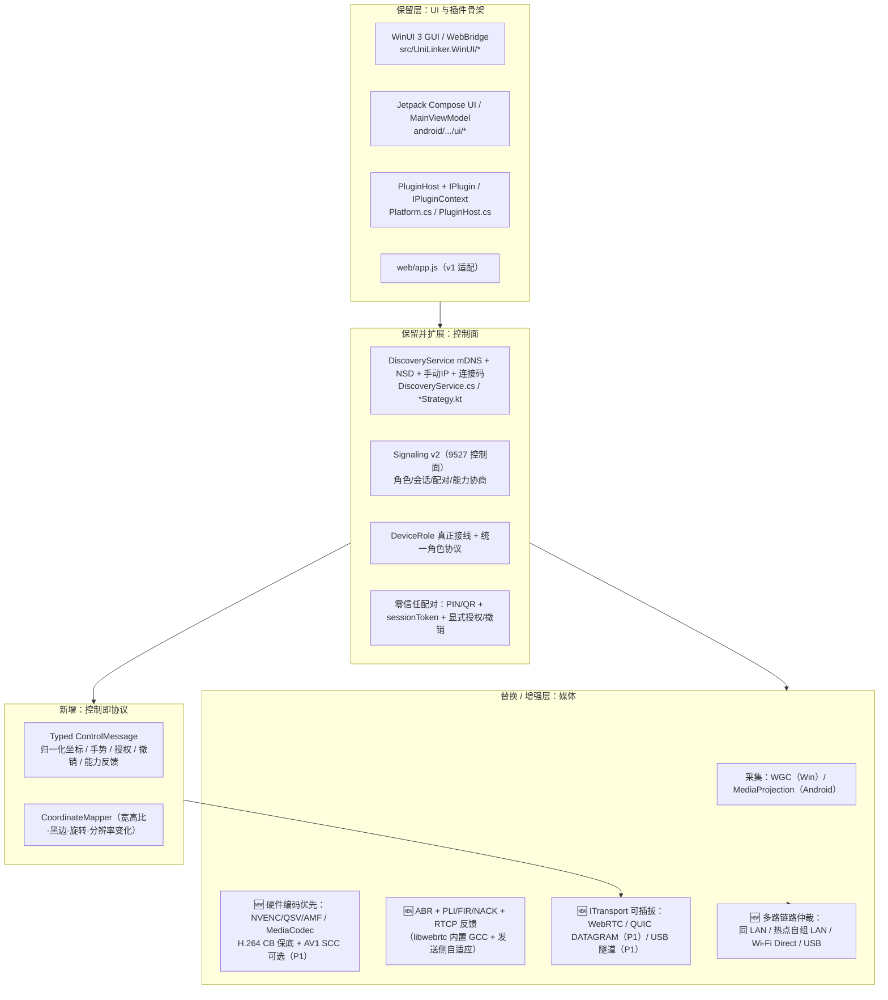
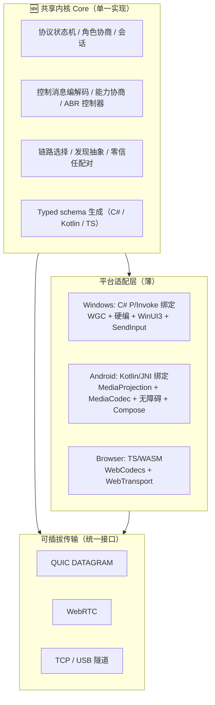

# 02 · 多套重构方案与前沿技术调研

> 本轮任务（阶段 1）：用户要求「先列出计划，可以重构，可以提供更好设计覆盖原来的，可以阅读前沿论文落地最新技术，但是记得编写详细开发文档。给我几个方案」。
> 本文件只产出**方案设计与选型依据**，不改 `src/`、`android/` 源码，不写实现代码，不做 git 操作。
> 基线：`docs/redesign/00-feasibility-baseline.md`（下称「基线」）。所有现状判断均附 `文件路径:行号`；静态推断显式标注。
> 作者：架构师高见远（Architect）｜日期：2026-11-12｜状态：供主理人汇编、供用户按编号选做。

---

## 0. 基线对齐声明与三处表述修正

本文件**不与基线已核实事实冲突**。基线 §2/§3/§4/§6/§7/§8 的源码实证（四大缺口、零流量结论、硬瓶颈、平台级不可行项、Q9 静态推断）全部沿用，并作为三套方案共同的出发点。

但复核源码后，发现基线有 **3 处表述需要收敛/补充**，在此明确指出（不改变结论方向，只改变置信度与措辞）：

| # | 基线原文位置 | 需修正处 | 源码证据 | 建议表述 |
|---|---|---|---|---|
| B-1 | §4「`DebugConnectionTest.cs:45` 与 `ScreenMirrorTests.cs:116-157` **证明**纯 host candidate 在 LAN 可建连」 | 「证明」过强 | `tests/UniLinker.E2E.Tests/Tests/DebugConnectionTest.cs:44-68` 用 `iceServers: []` 但**只做 SDP 交换并 dump answer，未断言 `connectionState === 'connected'`**；`web/app.js:111-113` 的浏览器观看页**仍配置 `stun:stun.l.google.com:19302`**，而 `ScreenMirrorTests.cs:116-157` 正是通过该页面在 localhost 跑通的。因此 E2E 证明的是「localhost 全链路出帧（浏览器端带 STUN 配置）」，不是「零 STUN 的 LAN/热点可建连」 | 降级为**高置信静态推断**：Windows 侧 `src/UniLinker.Core/PeerConnection.cs:48` 本就 `iceServers = []`，host candidate 必然产生；但「移除 Android/浏览器 STUN 后跨设备仍可建连」**需 M0 真机验证**。方案里把这项列为 T01 门禁而非既成事实 |
| B-2 | §2「连接码 UDP 9528 可跑 `ConnectionCodeStrategy.kt:59-117`」 | 遗漏「可跑但不可用」的一层 | `android/app/src/main/java/com/unilinker/android/core/strategies/ConnectionCodeStrategy.kt:64` 广播的是 `"$CODE_BROADCAST_PREFIX$code|$localIp:9527"`；而 Android 侧全项目无 9527 监听者（基线 §2 已确认「缺失服务端」）、`android/.../core/Platform.kt:19-21` 更把 mesh 指向 `http://localhost:9527` | 补注：UDP 广播机制本身可运行，但**双 Android 场景下广播出去的 `IP:9527` 无监听者**，故不能计入 P0-1/P0-4 的可用发现手段；须先补 Android 本地信令服务端 |
| B-3 | §9「上一轮推荐路线 A」 | 参照系 vs 本轮结论 | `docs/redesign/00-feasibility-baseline.md:95-99` 明示「供本轮方案对比的参照系」 | 本轮**允许推翻**；路线 A 等价于下文方案 ①，但本轮加权推荐为方案 ②，详见 §6 |

补充一条基线未点明、但影响方案排期的实证：`src/UniLinker.Core/PeerMesh.cs:464` 的 `const uint frameDurationRtp = 90000 / 30;` 是**发送侧 RTP 时间戳硬编码**，任何方案只要目标档含 60fps 都必须改这一行；`src/UniLinker.Plugins.ScreenMirror/WgcCapture.cs:465-468` 已声明 `CreateForWindow` 却未调用（实际只走 `:316-338,342-346` 的 `CreateForMonitor`），P1-9「指定窗口」属接线而非从零。

---

## 1. 三套方案一句话定位

| 编号 | 名称 | 一句话定位 | 取向 |
|---|---|---|---|
| **①** | **保守渐进 · 补洞不换骨** | 最大限度复用现有 WebRTC / 插件 / 9527 / mDNS / WGC+OpenH264，只把四大缺口逐一补上，目标是把 P0 验收线跑通 | 保守渐进 |
| **②** | **传输与架构升级 · 换芯不换壳**（**本轮推荐**） | 保留 WinUI/Compose UI 与插件骨架、发现与 9527 控制面，替换/增强编码层与媒体传输层，引入多路链路、统一角色协议、零信任配对、控制即协议 | 传输与架构升级 |
| **③** | **跨端统一 Core · 重铸内核** | 用一套共享内核（协议状态机 / 角色 / 控制 / 能力协商 / ABR / 选路）覆盖 C# 与 Kotlin 双实现，可插拔传输、硬件编码优先、三端Viewer 统一，允许替换技术栈 | 全新设计覆盖原有 |

三者差异不是「做多少」，而是**「改动落在哪一层」**：① 只动"缺口层"，② 动"传输/编码/协议层"但保住"UI/插件/发现层"，③ 动"全部层"并把双端业务逻辑收归一套内核。

---

## 2. 方案 ① 保守渐进 · 补洞不换骨

### 2.1 架构总览

核心特征：**不改变现有 WebRTC/9527 数据流实现**，只把「Android 也能当发送方 / 也能当信令方 / 也能被控」三件事按同一套现有协议补齐。
> ⚠️ **D-01 合规修订**（PM `01` §1.1 把「Windows 恒 Sender / Android 恒 Receiver 硬编码单向角色」列为**强制废弃**，并新增 P0 项 **R0-11 对称角色协商与能力通告**）：本方案初稿曾写「单向链路不变」，与 D-01 冲突。现修订为 **① 必须补一处最小改造**——接通既有 `DeviceRole.cs:4-10` 枚举做静态角色声明 + `/info` 能力通告（约 1 个文件、不重构传输层），满足 R0-11 的 P0 最低要求；**完整对称协商仍是方案 ② 的差异点**。§6.1/§6.3 的 ① 打分已按「含此修订」计。

### 2.2 关键技术选型

| 层 | 选型 | 理由 |
|---|---|---|
| 信令 | 沿用 `TcpListener` 手写 HTTP `SignalingServer.cs:60-66,414-491`，Android 侧用 Java `ServerSocket` 等价实现，端口 9527 | 零新增依赖、协议已验证 |
| 媒体 | SIPSorcery 8.0.12 / `io.getstream:stream-webrtc-android:1.1.1`（`android/app/build.gradle.kts:56`），H.264 `profile-level-id=42e01f` + `packetization-mode=1`（RFC 7742） | 双端已引入，互通成本最低 |
| 采集编码 | Windows WGC BGRA + OpenH264 软编（`OpenH264Encoder.cs:148 IsHardware:false`）；Android MediaProjection + `ScreenCapturerAndroid`/MediaCodec 硬编 | 沿用现栈 |
| 发现 | Windows mDNS 广播 + Android NSD 浏览（`LanMdnsStrategy.kt:47-81`）+ 手动 IP（`ManualIpStrategy.kt:34-45`）+ 连接码（`ConnectionCodeStrategy.kt:59-117`） | 三种现成策略 |
| 控制 | WebRTC DataChannel + `IIncomingChannelHandler` 分发（`Platform.cs:33-34,92-106`）+ `AccessibilityService.dispatchGesture` | 复用现有通道基座 |
| 渲染 | Windows 新增：优先 WebView2 复用 `web/app.js`（Q14 默认可选项） | 零解码器引入 |

### 2.3 与现有代码的关系（复用 / 改造 / 废弃清单）

| 类别 | 文件（相对路径） | 动作 |
|---|---|---|
| **复用（不改）** | `src/UniLinker.Plugins.ScreenMirror/WgcCapture.cs`、`OpenH264Encoder.cs`、`ScreenMirrorPlugin.cs`；`src/UniLinker.Core/DiscoveryService.cs`；`src/UniLinker.Plugins.FileTransfer/*`；`src/UniLinker.WinUI/*` 全部 UI；`android/.../plugins/screenmirror/ScreenMirrorTab.kt`（渲染）；`web/app.js`；`tests/UniLinker.E2E.Tests/Tests/ScreenMirrorTests.cs` | 保持 |
| **改造（小）** | `android/.../core/WebRTCService.kt`（`:74-80` 去 STUN、`:62` 开 NetworkMonitor、`:134-135` 修 ICE 等待、`:145-169` 补 `fromPeerId`/`capability`/peerId 关联、`:102` 实装 onDataChannel、`:125` offer 增加发送方向）；`web/app.js:111-113`（去 STUN）；`src/UniLinker.Core/SignalingServer.cs`（`:60` 网卡白名单、`:515-519` CORS 收敛、`:582-588` 扩 `role`/`sessionId`）；`src/UniLinker.Core/PeerConnection.cs`（`:53-56` 增 RecvOnly 轨道、`:54` 补 fmtp）；`src/UniLinker.Core/PeerMesh.cs:464`（时间戳按 fps 计算）；`src/UniLinker.Plugin.Sdk/DeviceRole.cs`（接线） | 局部修改 |
| **补齐（新增）** | `android/.../core/AndroidSignalingServer.kt`；`android/.../plugins/screenmirror/ScreenCaptureSource.kt`；`android/.../core/AccessibilityControlService.kt`；`android/.../core/CoordinateMapper.kt`；`android/.../core/strategies/HotspotLanStrategy.kt`；`android/app/src/main/AndroidManifest.xml`（补 FGS / MEDIA_PROJECTION / POST_NOTIFICATIONS / SYSTEM_ALERT_WINDOW / BIND_ACCESSIBILITY_SERVICE）；`src/UniLinker.WinUI/Services/RemoteViewService.cs` | 从零 |
| **废弃** | 无 | 兼容代价最低 |

### 2.4 四大缺口解法

| 缺口 | 解法 |
|---|---|
| ① Android 采集/编码/发送 | 新增 MediaProjection 授权 → VirtualDisplay → `ScreenCapturerAndroid` → `createVideoTrack` + `addTrack`；`WebRTCService.kt:125` 的 `OfferToReceiveVideo=true` 改为按角色决定方向 |
| ② Android 本地信令服务端 | 新增 `ServerSocket` HTTP 服务（FGS），端点与 `SignalingServer.cs:134-176` 对齐；修 `Platform.kt:19-21` 的 `localhost:9527` |
| ③ Windows 接收渲染 | 新增 RecvOnly 轨道 + WebView2 承载 `web/app.js`（或 SIPSorcery 解码 + WinUI 控件） |
| ④ 设备控制全栈 | DataChannel 控制消息 + `dispatchGesture` + 归一化坐标映射 + 授权弹窗/撤销/常驻通知 |

### 2.5 C1~C5 与判据 A~F 的满足方式

| 约束 | 满足方式 | 判据 | 满足方式 |
|---|---|---|---|
| C1 零蜂窝 | 去 STUN（`WebRTCService.kt:76`、`web/app.js:112`）+ `SignalingServer.cs:60` 网卡白名单 | A 飞行模式 | 热点策略 + 修 `disableNetworkMonitor=true`（`:62`）后 ICE restart |
| C2 无互联网 | 同上；代码本无云/账号/中继 | B 拔 WAN | 同上 |
| C3 仅本地 | 明文 HTTP `http://<私网IP>:9527` + ICE 仅 host candidate | C 拔 SIM | MediaProjection + 无障碍授权与 SIM 无关 |
| C4 无 SIM 全功能 | 补齐四大缺口后无平台障碍 | D 抓包 | 去 STUN 后无公网 DNS/UDP；信令明文可核验 |
| C5 断 WAN | 无外网依赖 | E 仅 USB | ❌ **不满足**，全项目零 USB/ADB/RNDIS 代码，仅列 P1 |
| — | — | F 无计费弹窗 | 具备（无账号/激活） |

> 结论：① 满足 C1~C5 与 A/B/C/D/F，**E 需另列 P1**（与基线 §4 一致）。

### 2.6 迁移路径与兼容性代价

- **路径**：单分支增量开发，`T01 合规+协议对齐 → T02 双端收发 → T03 热点直连 → T04 控制 → T05 质量`，每步都保持 `web/app.js` 浏览器观看与 `ScreenMirrorTests.cs` 的 SM01~SM05 通过。
- **协议兼容**：`/info`（`SignalingServer.cs:136-144`）增 `protocolVersions: ["v1","v1.1"]`；旧字段 `type/sdp/fromPeerId/capability` 全部保留，只**新增**可选 `role/sessionId`。v1 浏览器/旧 Android 不传新字段时走 fallback（现状 `:286-296` 已遍历 capabilities）。
- **插件 ABI**：`IPlugin`/`IPluginContext` 不变，外部 `plugins/` DLL **无需重编译**；但新增内置插件须与宿主同 `WinRT.Runtime` 版本（`CLAUDE.md:57`）。
- **代价**：**低**。回归面仅限 `web/app.js` 与 E2E；风险集中在新加的 Android FGS/无障碍授权。

### 2.7 主要风险

1. SIPSorcery ↔ libwebrtc SDP 互通未实测（`PeerConnection.cs:54` 无 fmtp、`WebRTCService.kt:50` 开了 High Profile field trial）→ M0 抓包比对。
2. OpenH264 软编 + `PeerMesh.cs:464` 时间戳 → **目标档 1080p60/≤80ms 大概率不达标**，`CLAUDE.md:66` 又禁止复活 MF SinkWriter 硬编。
3. Android 双授权（MediaProjection 每次弹窗 + 无障碍手动开启）UX 割裂，P0-8「1s 撤销」依赖 FGS 通知实现。
4. `ScreenMirrorTab.kt:111` `addSink` 无 `removeSink`，10min 连续性需验证。

### 2.8 工作量分档

**S~M（粗估 8–14 人周，未做 WBS，仅用于相对比较）**。优势是起步最快，代价是质量上限锁死在最低档。

---

## 3. 方案 ② 传输与架构升级 · 换芯不换壳（推荐）

### 3.1 架构总览

核心特征：**把「角色 / 会话 / 能力 / 控制 / 选路」提升为显式协议**，把「编码与传输」做成可替换实现，而 UI、插件容器、发现与 9527 控制面保留。详见 `docs/redesign/03-architecture-and-plan.md`（本文件只给方案级说明）。

### 3.2 关键技术选型

| 层 | 选型 | 依据 / 与前沿调研的对应 |
|---|---|---|
| 拥塞控制 | 沿用 libwebrtc 内置 GCC（Android 侧自带），Windows 侧基于 RTCP Receiver Report / transport-cc 反馈实现发送侧码率自适应；**不自研** Copa/PCC Vivace/SCReAM | GCC 论文（MMSys'16，§5.1）；SCReAM RFC 8298 作者方明确「sofar not incorporated into WebRTC」→ 仅参考 |
| 编码 | **硬件编码优先**，H.264 Constrained Baseline (`42e01f`) 作互通保底；AV1 Screen Content Coding（palette mode / IntraBC）作为 P1 可选 | Meta 2026 AV1 RTC 实测：相对 H.264 ≥20% 码率节省、屏幕内容最高 80% BD-BR（§5.2）；AV1 功耗 +14%（Pixel 8）→ 不作 P0 |
| 传输 | WebRTC（SIPSorcery + libwebrtc）为 P0；QUIC DATAGRAM（RFC 9000 + RFC 9221）/ WebTransport 作为 **P1 可选后端**，RoQ 仅研究 | RoQ 仍是 IETF Internet-Draft（`-07`, 2023，已过期）→ 研究阶段不建议落地 |
| 多路链路 | 新增 `ILinkManager`：同 LAN / 热点自组 LAN / Wi-Fi Direct / USB，按 `ConnectivityManager.NetworkCallback` 触发 ICE restart 或传输切换 | 修 `WebRTCService.kt:62 disableNetworkMonitor=true` 硬伤 |
| 角色/配对 | v2 信令显式 `role`/`sessionId`/`pairingMethod`/`sessionToken`；PIN/QR 配对 + 显式授权 + ≤1s 撤销 | 修 `SignalingServer.cs:515-519` CORS `*` 与无鉴权 |
| 控制 | Typed `ControlMessage`（归一化坐标、手势枚举、授权/撤销、ABR 反馈）走 DataChannel / QUIC stream | 「控制即协议」 |
| 共享内核 | **不引入** Rust/KMP 共享内核（见 §5 「看着好但不该上」） | C# 宿主与 KMP 非一等互操作；Rust/UniFFI 本轮未找到一手可核查来源 |

### 3.3 与现有代码的关系（复用 / 改造 / 废弃清单）

| 类别 | 文件（相对路径） | 动作 |
|---|---|---|
| **复用（不改）** | `src/UniLinker.WinUI/**`（UI / ViewModels / WebBridge 的 UI 部分）、`android/.../ui/**`（ModernMainScreen / MainViewModel / theme）、`src/UniLinker.Core/PluginHost.cs`、`src/UniLinker.Plugin.Sdk/IPlugin.cs`、`IPluginContext.cs`、`src/UniLinker.Core/DiscoveryService.cs`、`src/UniLinker.Plugins.FileTransfer/**`、`tests/UniLinker.E2E.Tests/**` | 保持 |
| **改造（中~大）** | `src/UniLinker.Core/SignalingServer.cs`（v2 协议、鉴权、角色、能力协商、网卡白名单、CORS 收敛）；`src/UniLinker.Core/PeerConnection.cs`（RecvOnly 轨道、fmtp、RTCP 反馈注册、RecvOnly/SendOnly 按角色）；`src/UniLinker.Core/PeerMesh.cs`（`ITransport` 抽象接入、`:464` 时间戳按 fps）；`src/UniLinker.Core/PeerChannel`（`PeerMesh.cs:394-477`）；`src/UniLinker.Plugins.ScreenMirror/ScreenMirrorPlugin.cs`（`:139-140` OnPeerRequest 实现、`:154-160` 动态配置）；`src/UniLinker.Plugins.ScreenMirror/WgcCapture.cs`（`:465-468` CreateForWindow 接线 + 多显示器枚举）；`android/.../core/WebRTCService.kt`（重构为 `ITransport` 的 WebRTC 实现）；`android/.../core/Platform.kt`（`:64-77` 注入真实 `IPeerMesh`、`:19-21` 去掉 localhost）；`android/.../core/strategies/WifiP2pStrategy.kt`（重写）；`web/app.js`（v1↔v2 适配 + 去 STUN） | 结构性重构 |
| **补齐（新增）** | `src/UniLinker.Core/Protocol/**`（v2 schema / ControlMessage / CapabilityNegotiator）；`src/UniLinker.Core/Transport/ITransport.cs`、`WebRtcTransport.cs`、`QuicDatagramTransport.cs`(P1)；`src/UniLinker.Core/LinkManager.cs`；`src/UniLinker.Plugins.ScreenMirror/HardwareEncoder.cs`(新设计，**不复活 MF SinkWriter，`CLAUDE.md:66`**)；`src/UniLinker.Plugins.ScreenMirror/RemoteRenderer.cs`；`src/UniLinker.Plugins.Control/**`（ControlChannel / AuthorizationManager / CoordinateMapper 的 C# 侧）；`android/.../core/AndroidSignalingServer.kt`、`ScreenCaptureSource.kt`、`AccessibilityControlService.kt`、`CoordinateMapper.kt`、`HotspotLanStrategy.kt`、`LinkManager.kt`；`android/app/src/main/AndroidManifest.xml` 权限与 `<service>` | 从零 |
| **废弃 / 替换** | `src/UniLinker.Plugins.ScreenMirror/OpenH264Encoder.cs` 降级为「无硬编设备的 fallback」（不删除）；`android/.../core/DiscoveryService.kt`（基线 §2 死代码）删除或合并进 `LanMdnsStrategy.kt`；`WifiP2pStrategy.kt:153-204` 骨架实现整体替换 | 有控制地废弃 |

### 3.4 四大缺口解法

| 缺口 | 解法（相对 ① 的增强） |
|---|---|
| ① Android 采集/编码/发送 | MediaProjection + `ScreenCapturerAndroid` + **MediaCodec 硬件编码优先**，能力协商决定 H.264/AV1；`OfferToReceiveVideo` 改由 `DeviceRole` 驱动 |
| ② Android 本地信令服务端 | 新增 v2 信令服务端（FGS），**同时承担配对与角色仲裁**；热点主固定为信令方，Wi-Fi Direct 在 `isGroupOwner` 确定后动态指定 GO |
| ③ Windows 接收渲染 | 新增 `RemoteRenderer`（Q14 决策：WebView2 快、原生解码延迟低），RecvOnly 轨道由角色协议建立 |
| ④ 设备控制全栈 | `ControlMessage` Typed 协议（归一化坐标 + 手势 + 授权/撤销 + token）+ `CoordinateMapper` + `AccessibilityService` + `AuthorizationManager`（1s 撤销、常驻指示、超时断开）+ PIN/QR 配对 |

### 3.5 C1~C5 与判据 A~F 的满足方式

| 约束 | 满足方式 | 判据 | 满足方式 |
|---|---|---|---|
| C1 零蜂窝 | 去 STUN + 网卡白名单 + `LinkManager` 显式禁用蜂窝接口（Q17 决策） | A 飞行模式 | `ConnectivityManager.NetworkCallback` → ICE restart / 传输切换；热点为默认直连 |
| C2 无互联网 | 保留 DTLS-SRTP（`WebRTCService.kt:61` 已开）+ 应用层 PIN/QR 配对，无云 | B 拔 WAN | 无外网依赖 |
| C3 仅本地 | v2 信令走 `http://<私网IP>:9527`；ICE 仅 host candidate；`sessionToken` 校验目的网段 | C 拔 SIM | 授权与 SIM 无关 |
| C4 无 SIM 全功能 | 热点主固定信令方，无 SIM 设备可作发送/接收/被控 | D 抓包 | 去 STUN + 内置「网络白名单自检」枚举绑定网卡/候选地址 |
| C5 断 WAN | 同上 | E 仅 USB | ✅ **P1 可达**：`ITransport` 预留 `UsbTunnelTransport`（ADB reverse / RNDIS），依赖 Q12 决策 |
| — | — | F 无计费弹窗 | 具备 |

> 结论：② 满足 C1~C5 与 A/B/C/D/F；**E 通过 `ITransport` 预留接口在 P1 达成**，是三套里唯一把判据 E 纳入架构（而非事后补丁）的方案。

### 3.6 迁移路径与兼容性代价

- **路径（绞杀者模式 / Strangler）**：
  1. `v1` 与 `v2` **并存**：`/info` 返回 `protocolVersions`，旧浏览器/Android 继续走 v1 端点；
  2. 新增 `ITransport` 抽象时，**先只包一层 WebRTC 实现**，保证 SM01~SM05 全绿；
  3. 再逐个把编码层、链路层、控制层切到新实现，每步可回滚；
  4. v1 在 M5 之后标记 deprecated，保留至少一个大版本。
- **兼容代价（中~高）**：
  - `SignalingMessage`（`SignalingServer.cs:582-588`）扩展为可版本化 envelope，需 v1/v2 双解析器；
  - **通过扩展接口增加能力**（主理人决策 11）：`IChannel` / `IPeerMesh` **原签名不变**，新增能力走 `IChannelV2` / `IPeerMeshV2` 之类扩展接口（或默认接口方法）→ **外部 `plugins/` DLL 无需重编译、ABI 不断裂**；新增内置插件仍须与宿主同 `WinRT.Runtime`（`CLAUDE.md:57`）。② 的 D7 兼容代价来自 **v1/v2 协议并存期、`web/app.js` 同步 E2E 回归、Android 死代码合并**，而非 ABI 断裂；
  - `web/app.js` 改动会牵动 `ScreenMirrorTests.cs`（Q16），需同步更新 E2E；
  - `WifiP2pStrategy.kt` 整体替换，`android/.../core/Platform.kt:19-21` 的 localhost 硬编码必须清除。
- **收益**：每步都有可运行版本，不出现「重写期间完全不可用」的窗口。

### 3.7 主要风险

1. 硬件编码设备能力探测与 fallback 分支复杂（NVENC/QSV/AMF/MediaCodec 四套 + `CLAUDE.md:66` 禁止复活 MF SinkWriter）。
2. AV1 在 `minSdk 26`（`build.gradle.kts:13`）设备上的硬解覆盖率不足；SIPSorcery 8.0.12 的 AV1 RTP 封装支持**未验证** → AV1 只作 P1 可选，不作 P0。
3. v1/v2 双协议并存期增加测试矩阵；`web/app.js` 回归风险（Q16）。
4. 扩展接口与宿主 `WinRT.Runtime` 版本不一致时新增内置插件加载失败（`CLAUDE.md:57`）；外部 `plugins/` DLL 因原签名不变**无需重编译**（决策 11），兼容性主要代价是 v1/v2 协议并存期与 `web/app.js` 的 E2E 回归。
5. `LinkManager` 多路仲裁在 Android 省电策略 / `MulticastLock` 缺失下需真机验证。

### 3.8 工作量分档

**L（粗估 18–28 人周）**。相对 ① 多出的主要是：协议 v2、可插拔传输、硬件编码层、链路仲裁、双协议回归测试。

---

## 4. 方案 ③ 跨端统一 Core · 重铸内核

### 4.1 架构总览

核心特征：**C# 与 Kotlin 双实现被一套共享内核取代**（协议、角色、控制、能力协商、ABR、选路只写一遍），三端只保留平台相关的采集/编码/注入/渲染适配。允许替换技术栈（例如共享内核用 Rust 经 C ABI/FFI，或 KMP 经 JVM 互操作）。

### 4.2 关键技术选型

| 层 | 选型 | 备注 |
|---|---|---|
| 共享内核 | Rust + C ABI/FFI（候选）或 Kotlin Multiplatform（候选） | **两者在本项目的适配性均标「需验证」**：KMP 官方支持 Android/iOS/Desktop/Web/Server，但本项目 Windows 宿主是 C#/.NET/WinUI 3，KMP↔.NET 非一等互操作（`jetbrains.com/kotlin-multiplatform/`）；Rust/UniFFI 本轮**未找到一手可核查来源**（见 §5.6） |
| 传输 | QUIC DATAGRAM（RFC 9000/9221）为主 + WebRTC / TCP / USB 可插拔 | QUIC 本身成熟；RTP over QUIC 仍是草案 |
| 编码 | 硬件编码优先 + AV1 SCC；H.264 CB 仅作遗留浏览器 fallback | 同 ② |
| 配对 | 零信任：PIN/QR + 每会话密钥 + 显式授权 + 撤销 + 常驻指示 | 同 ②，但由内核统一实现 |
| 控制 | Typed binary 控制帧，内核生成三端 binding | 一致性最好 |

### 4.3 与现有代码的关系（复用 / 改造 / 废弃清单）

| 类别 | 文件（相对路径） | 动作 |
|---|---|---|
| **复用（极少）** | `web/index.html`、`web/styles.css`（可作为 Viewer 外壳）；`README.md`/`CLAUDE.md` 的构建约束知识 | 仅概念/静态资源 |
| **改造** | `src/UniLinker.WinUI/**` 退化为「薄适配层」（保留 UI 但重接数据源）；`android/.../ui/**` 同上 | 大幅重写 |
| **废弃（整体）** | `src/UniLinker.Core/**`（SignalingServer / PeerMesh / PeerConnection / DiscoveryService / PluginHost / Platform）、`src/UniLinker.Plugin.Sdk/**`、`src/UniLinker.Plugins.ScreenMirror/**`、`src/UniLinker.Plugins.FileTransfer/**`、`android/.../core/**`、`android/.../sdk/**`、`android/.../plugins/**`、`web/app.js`、`tests/UniLinker.E2E.Tests/**` | **全量替换** |

### 4.4 四大缺口解法

四大缺口在 ③ 中**不是「补」，而是被内核原生覆盖**：`FSM` 直接定义 Sender/Receiver/Both 与信令方；`ScreenCaptureSource` 只是平台适配；`RemoteRenderer` 只是平台适配；`ControlMessage` 由内核 schema 生成三端 binding。理论上最彻底，但**没有任何增量交付价值**——必须等内核、三端适配、传输、测试全部完成才有第一个可运行版本。

### 4.5 C1~C5 与判据 A~F 的满足方式

| 约束 | 满足方式 | 判据 | 满足方式 |
|---|---|---|---|
| C1/C2/C3 | 内核统一强制「仅私有网段 / 无 STUN / 无云」，QUIC 自带 TLS 1.3 | A/B/C/D/F | 设计上全部可达 |
| C4 | 抽象发现层统一支持热点/Wi-Fi Direct/USB | E 仅 USB | ✅ 设计上原生支持（USB 为可插拔传输之一） |
| C5 | 无外网依赖 | — | — |

> **重要限定**：③ 的「满足」是**设计态**，不是「已验证」。基线 §8 的 Q9、平台级不可行项（§7）在 ③ 中依然存在，与用哪套内核无关。

### 4.6 迁移路径与兼容性代价

- **路径**：新建独立仓库/目录 → 内核 + schema → 三端适配 → 协议网关（可选：让旧 v1 客户端连新内核）→ 全量替换 → 重写 E2E。
- **兼容代价（极高，三套中最大）**：
  - **外部插件生态断裂**：`plugins/` 目录 DLL 二进制不兼容，全部需重写；`CLAUDE.md:57` 的 WinRT.Runtime 一致性约束在换栈后需重新定义；
  - **E2E 全废**：`ScreenMirrorTests.cs:116-157` 的 SM05 全链路断言需按新协议重写，失去当前唯一的回归护栏；
  - **构建链变复杂**：MSBuild（`CLAUDE.md:9-14` 必须用）+ Gradle + Rust cargo/KMP Gradle 三套工具链；TFM 仍钉死 `net9.0-windows10.0.22621.0` + `WindowsSdkPackageVersion 10.0.22621.38`（`README.md:104-106`），换栈并不解除该约束；
  - **团队技能与工期**：需要同时精通 Rust/KMP FFI、C#/WinUI、Kotlin/JNI、浏览器 WASM。

### 4.7 主要风险

1. **无增量可验收版本**：与用户「先列出计划」的节奏冲突最严重。
2. 共享内核与 C#/.NET/WinUI 3 的 FFI 适配**本轮未验证**（KMP 非一等路径、Rust/UniFFI 未找到一手来源）。
3. 平台级授权（MediaProjection / AccessibilityService / UAC 安全桌面）不会因换内核而消失。
4. QUIC DATAGRAM 在 Windows 侧缺乏与现有 SIPSorcery 等价的成熟 .NET 实现（**未验证**）。
5. 全量重写期间 git 规范（`CLAUDE.md:73-77`）、MSBuild 构建、TFM 钉死等硬约束需重新落地一遍。

### 4.8 工作量分档

**XL（粗估 34–50 人周）**，且首个可用里程碑出现在末尾。

---

## 5. 前沿论文 / 最新技术调研（可核查来源 + 落地判断）

> 调研原则：**严禁编造**。每条给出标题、作者/机构、年份、URL；查不到一手可核查来源的明确写「未找到可核查来源」。
> 落地判断三档：**成熟可落地** / **需验证** / **研究阶段不建议落地**。
> 「可度量收益」一律写可核对的量（延迟、码率、覆盖度、开发量），无可靠数字时写「无公开可核对数字，仅定性」。

### 5.1 拥塞控制与低延迟传输

| # | 标题 | 作者 / 机构 | 年份 | URL | 落地判断 | 适合方案 | 可度量收益 |
|---|---|---|---|---|---|---|---|
| R1 | Analysis and design of the Google congestion control for web real-time communication (WebRTC) | Gaetano Carlucci, Luca De Cicco, Stefan Holmer, Saverio Mascolo（Politecnico di Bari / Télécom SudParis / Google），ACM MMSys'16 | 2016 | https://dl.acm.org/doi/10.1145/2910017.2910605 | **成熟可落地**（libwebrtc 已内置实现） | ①②③（① 直接用；② 以其为 ABR 基线） | 论文给出基于 Kalman 滤波的单向时延梯度估计；工程收益是「无需自研 CC」，减少约 1 个算法模块开发量 |
| R2 | RFC 8298 — Self-Clocked Rate Adaptation for Multimedia (SCReAM) | I. Johansson, Z. Sarker（Ericsson AB），IETF，Experimental | 2017-12 | https://datatracker.ietf.org/doc/html/rfc8298 ；实现 https://github.com/EricssonResearch/scream | **需验证**（作者方仓库明确写 "SCReAM was originally devised for WebRTC but is sofar not incorporated into that platform"；V2 需 L4S 网络支持） | ②（仅参考自时钟/拥塞窗口思路，**不自研落地**） | 论文称在 LTE 仿真下低时延高吞吐，但本仓库是双设备 LAN、无 L4S AQM，收益不可迁移；落地成本 > 收益 |
| R3 | RFC 8698 — NADA: A Unified Congestion Control Scheme for Real-Time Media | Xiaoqing Zhu 等（Cisco 等），IETF，Experimental | 2020-02 | https://datatracker.ietf.org/doc/html/rfc8698 | **需验证**（Experimental，且需 ECN/时延聚合反馈） | ②（参考） | 无本场景可核对数字；定性：统一聚合拥塞信号 |
| R4 | Copa: Practical Delay-Based Congestion Control for the Internet | Venkat Arun, Hari Balakrishnan（MIT CSAIL），USENIX NSDI'18 | 2018 | https://www.usenix.org/system/files/conference/nsdi18/nsdi18-arun.pdf | **研究阶段不建议落地** | 无（仅理论参考） | 论文实测：相对 Cubic 排队时延低 2–10×、卫星路径中位排队时延 1ms；但面向广域 Internet 多流竞争，本项目是单流私有 LAN，收益不显著 |
| R5 | PCC Vivace: Online-Learning Congestion Control | Mo Dong, Tong Meng, Doron Zarchy, Engin Arslan, Yossi Gilad, Brighten Godfrey, Michael Schapira（UIUC / Hebrew Univ. / MIT），USENIX NSDI'18 | 2018 | https://usenix.com/conference/nsdi18/program （NSDI '18 Technical Sessions → Congestion Control Session） | **研究阶段不建议落地** | 无 | 论文称在吞吐/时延/收敛上优于 TCP/BBR；无本场景可核对数字，且需在线学习控制器，开发量大 |
| R6 | RFC 9000 QUIC / RFC 9221 Unreliable Datagram Extension | IETF QUIC Working Group | 2021 / 2022 | https://quicwg.org/ | **成熟可落地**（作为 P1 可选传输；RoQ 另判） | ②③（P1） | 单端口复用可靠/不可靠流、always-on TLS 1.3；定性收益为主，无本仓库可核对延迟数字 |
| R7 | RTP over QUIC (RoQ), draft-ietf-avtcore-rtp-over-quic-07 | J. Ott, M. Engelbart（TU Munich）, S. Dawkins（Tencent America LLC）, IETF AVTCORE | 2023-10 | https://www.ietf.org/archive/id/draft-ietf-avtcore-rtp-over-quic-07.html | **研究阶段不建议落地**（Internet-Draft，页面明示 "Expire 25 April 2024"、"inappropriate to use Internet-Drafts as reference material"） | ③（仅远期） | 草案称可减少 RTCP 交换、利用 QUIC 状态做速率自适应；无生产可核对数字 |
| R8 | WebTransport（W3C Editor's Draft / TR） | W3C WebTransport WG；Editors Bernard Aboba (Microsoft), Nidhi Jaju & Victor Vasiliev (Google) | Editor's Draft 2023；持续更新 | https://w3c.github.io/webtransport/ ；https://www.w3.org/TR/webtransport/ | **需验证**（仍为 Working Draft；且 W3C 页面明示「Secure Context (https) only」「URL 必须 https 且指定端口」，与本项目明文 HTTP 9527 控制面需适配） | ③（浏览器 Viewer 远期） | 提供 datagram + 多流、避免队头阻塞；适合发视频帧（W3C TPAC 2021 演示材料），无本仓库可核对延迟数字 |
| R9 | RFC 9330 — Low Latency, Low Loss, and Scalable Throughput (L4S) Internet Service: Architecture | B. Briscoe (Ed., Independent), K. De Schepper (Nokia Bell Labs), M. Bagnulo (UC3M), G. White (CableLabs) | 2023-01 | https://www.rfc-editor.org/info/rfc9330 | **研究阶段不建议落地 / 不适用**（需瓶颈 AQM + ECN 支持，家用热点/路由器不具备；与 C2「零互联网」场景错位） | 无 | 架构目标是浅队列低时延；本项目链路无运营商 AQM，收益为 0 |
| R10 | RFC 7742 — WebRTC Video Processing and Codec Requirements（H.264 部分） | IETF | 2016 | https://www.ietf.org/rfc/rfc7742 | **成熟可落地**（强制约束，不是可选优化） | ①②③ | 规定必须支持 Constrained Baseline Level 1.2、`packetization-mode=1`、参数集 in-band、SDP 必须含 `profile-level-id`；直接对应本仓库 `PeerConnection.cs:54` 缺 fmtp 的风险 |

### 5.2 编码与屏幕内容

| # | 标题 | 作者 / 机构 | 年份 | URL | 落地判断 | 适合方案 | 可度量收益 |
|---|---|---|---|---|---|---|---|
| R11 | Adopting AV1 for Real-Time Communication (RTC) at Scale | Meta（Engineering Blog） | 2026-06-22 | https://engineering.fb.com/2026/06/22/video-engineering/adopting-av1-for-real-time-communication-rtc-meta/ | **成熟可落地（但需设备覆盖验证，仅 P1）** | ②（P1 可选编码） | 实测：相对 H.264/AVC **≥20% 码率降低**；AV1 的 palette mode + IntraBC 对屏幕内容大幅改善；Pixel 8 上软编**功耗 +14%**；RTC 端到端目标 <300ms |
| R12 | AV1: Improving RTC Video Quality at Scale（@Scale Conference） | Meta / AOMedia 生态 | 页面未标注年份（**年份未核实**） | https://atscaleconference.com/av1-improving-rtc-video-quality-at-scale/ | **需验证**（年份未核实；作为 R11 的佐证） | ②（P1） | 文中给出 BD-BR：普通通话内容约 **30%** 节省、屏幕共享最高 **80%** 节省；AV1 主 profile 即含 SCC 工具 |
| R13 | AV1 for RTC: Current and Future（Zoe Liu, 微帧 / Aurora1 AV1 演讲页） | Zoe Liu（@Scale Conference 演讲） | 页面未标注年份（**年份未核实**） | https://atscaleconference.com/?p=74622 | **需验证**（厂商演讲，非同行评审） | ②（P1 参考） | 声称单核 1080p 实时 SCC 编码 15fps、码率约为 x264 superfast 的 1/4；**厂商自报数据，未独立核验** |
| R14 | Deep Contextual Video Compression (DCVC) / DCVC-RT: Towards Practical Real-Time Neural Video Compression | Jiahao Li, Bin Li, Yan Lu（微软亚洲研究院）等；NeurIPS 2021 / CVPR 2025 | 2021 / 2025 | https://arxiv.org/abs/2109.15047 ；代码与系列论文 https://github.com/microsoft/DCVC | **研究阶段不建议落地** | 无 | DCVC 论文称相对 x265 veryslow 1080p **26.0% 码率节省**；DCVC-RT 称 100+ FPS 1080p / 4K 实时；但需 GPU 推理与模型权重、无标准 RTP 封装、无移动端/浏览器互操作 → 与本项目三端互通 + `minSdk 26` 冲突 |

### 5.3 D2D 直连、平台 API 与远程控制

| # | 标题 | 作者 / 机构 | 年份 | URL | 落地判断 | 适合方案 | 可度量收益 |
|---|---|---|---|---|---|---|---|
| R15 | Wi-Fi CERTIFIED Wi-Fi Aware™ Technology Overview（NAN / 邻近感知网络） | Wi-Fi Alliance | 2022-12 | https://www.wi-fi.org/system/files/Wi-Fi_CERTIFIED_Wi-Fi_Aware_Technology_Overview_20221205_Simplified_Chinese.pdf ；另见 2015 发布公告 https://www.wi-fi.org/news-events/newsroom/wi-fi-awaretm-bring-proximity-based-service-discovery-wi-fi-certifiedtm | **需验证**（Android 侧 API 可用性与 OEM 覆盖未核实；Windows 侧无对应实现，Win↔Android 不成立） | ③（远期 Android 侧增强） | 定性：无需 AP/蜂窝即可持续发现 + 测距 + 安全配对 + 基于 IP 的 D2D 数据交换；无本仓库可核对数字 |
| R16 | WifiP2pManager API reference（含 `groupOwnerAddress` / `isGroupOwner` / 预关联服务发现） | Google / Android Developers（持续更新，访问于 2026） | 持续更新 | https://developer.android.com/reference/android/net/wifi/p2p/WifiP2pManager | **成熟可落地** | ①②③ | 直接给出修 `WifiP2pStrategy.kt:146`（MAC 当 IP）与 `:190-194`（GO 地址未用）的依据；减少直连发现/信令不确定性 |
| R17 | 创建无障碍服务（`dispatchGesture` / `canPerformGestures="true"`） | Google / Android Developers（持续更新，访问于 2026） | 持续更新 | https://developer.android.com/guide/topics/ui/accessibility/service | **成熟可落地** | ①②③ | 官方给出 `GestureDescription.StrokeDescription` 连续手势与多指能力；是 P0-7 触控注入的**唯一免 ROOT 主路径** |
| R18 | 媒体投影 MediaProjection（Android 14+ `foregroundServiceType="mediaProjection"`、每次会话需同意、token 一次性） | Google / Android Developers | 持续更新（Android 14 起强制） | https://developer.android.com/media/grow/media-projection | **成熟可落地（且是硬约束）** | ①②③ | 本轮 WebFetch 失败，但上一轮 WebSearch 已从官方域名及 `developer.android.google.cn` 镜像交叉核实；对应 `build.gradle.kts:14 targetSdk 35` 与 `AndroidManifest.xml:4-35` 缺权限 |
| R19 | scrcpy — Display and control your Android device | Romain Vimont / Genymobile，Apache-2.0 | 2018 首次发布；v5.0.1（2026） | https://github.com/Genymobile/scrcpy | **成熟可落地（作为参考架构，不作默认路径）** | ①（USB 辅助）/ ②（P1 USB 链路参考） | 官方 README 指标：**30–120fps、1920×1080+、35–70ms 延迟、~1s 首帧、免 ROOT、无账号无互联网**；但依赖 ADB/USB 调试授权，双 Android 需 PC 中转 → 与 C4/普通用户门槛冲突（对应 Q12） |

### 5.4 跨端共享内核

| # | 标题 | 作者 / 机构 | 年份 | URL | 落地判断 | 适合方案 | 可度量收益 |
|---|---|---|---|---|---|---|---|
| R20 | Kotlin Multiplatform（含 "Share code between platforms" 文档） | JetBrains | 持续更新（访问于 2026） | https://www.jetbrains.com/kotlin-multiplatform/ ；https://kotlinlang.org/docs/multiplatform/multiplatform-share-on-platforms.html | **需验证（适配性不足）** | ③（候选，但不推荐） | 官方称可共享逻辑/UI 至 Android、iOS、Desktop、Web、Server；案例「Forbes 共享 >80% 逻辑」。**但本项目 Windows 宿主是 C#/.NET/WinUI 3，KMP↔.NET 非一等互操作路径**；收益无法直接兑现 |
| R21 | Rust + UniFFI 共享内核（C ABI / FFI 到 C# 与 Kotlin） | Mozilla / 社区（候选） | — | — | **未找到可核查来源**（本轮 WebSearch 未返回一手官方文档/论文，仅有 KMP 结果） | ③（候选，不推荐） | 无可核对数字；**明确标注为「未找到可核查来源」，不作为选型依据** |

### 5.5 工程实践参考（非论文，标明性质）

| # | 标题 | 来源 | 年份 | URL | 落地判断 | 适合方案 | 可度量收益 |
|---|---|---|---|---|---|---|---|
| R22 | SharpRTSPtoWebRTC — SDP munging for Firefox H264 compatibility（补 `a=fmtp:96 profile-level-id=42e01f;level-asymmetry-allowed=1;packetization-mode=1`） | DeepWiki 项目文档（**二手资料 / 社区实践**） | 页面未标注年份 | https://deepwiki.com/jimm98y/SharpRTSPtoWebRTC/4-core-library-reference | **需验证**（非规范文档，但做法与 RFC 7742 一致） | ①②③ | 直接给出修 `PeerConnection.cs:54` 的具体 fmtp 值；可度量收益是「消除 SIPSorcery↔libwebrtc 协商失败/花屏风险」，非性能数字 |

### 5.6 「看着好但不该上」清单（明确回答）

| 技术 | 为什么看着好 | 为什么本项目不该上 | 对应方案取舍 |
|---|---|---|---|
| **RTP over QUIC / WebTransport 作为 P0 主传输** | 单端口多路复用、always-on 加密、无队头阻塞 | RoQ 仍是过期 Internet-Draft（R7）；WebTransport 需 HTTPS 安全上下文（R8），与本仓库明文 HTTP 9527（`AndroidManifest.xml:23 usesCleartextTraffic=true`）冲突；且会推翻已验证的 SM05 链路 | ② 仅把 QUIC DATAGRAM 列为 **P1 可选 `ITransport` 后端**；③ 远期 |
| **PCC Vivace / Copa / NADA / SCReAM 自研拥塞控制** | 论文指标漂亮（Copa 排队时延低 2–10×） | 面向广域多流竞争；本项目是双设备私有 LAN、单流、瓶颈在编码与 readback 而非排队；SCReAM V2 需 L4S AQM（R2/R9），热点/家用路由器不具备。libwebrtc 已内置 GCC（R1） | ② 只**沿用 GCC + 补 RTCP 反馈/ABR**，不自研 CC |
| **L4S（RFC 9330）** | 运营商级超低时延 | 需网络侧 Dual-Queue Coupled AQM + ECN，与「零互联网/纯本地链路」C2/C3 场景错位（R9） | 全部方案排除 |
| **神经视频压缩 DCVC / DCVC-RT** | 26% 码率节省、100+ FPS 1080p | 需 GPU 推理与模型权重、无标准 RTP 封装、浏览器/Android `minSdk 26` 无互操作路径（R14） | 全部方案排除 |
| **Wi-Fi Aware / NAN 作为 P0 发现** | 无 AP 即可持续发现 + 测距 + 安全配对 | Android API/OEM 覆盖未核实、Windows 侧无对应实现，Win↔Android 不成立（R15 + 基线 §5）；热点自组 LAN 更可靠且复用 9527 | ③ 远期 Android 侧增强；P0 用热点 |
| **5G ProSe / 蜂窝 D2D** | 标准定义的设备直连 | 与 C1（零蜂窝计费）、C4（无 SIM 全功能）**直接冲突**；且本轮 **未找到可核查的一手 3GPP 规范来源** | 全部方案排除（明确写「未找到可核查来源」） |
| **Rust/UniFFI 或 KMP 共享内核** | 协议只写一遍、三端一致 | 本轮未找到 Rust/UniFFI 一手来源（R21）；KMP 与 C#/.NET/WinUI 3 宿主非一等互操作（R20）；且 `CLAUDE.md:56-57` 的 TFM/WinRT 钉死不因换栈解除 | ③ 保留为概念，不作推荐依据 |
| **AV1 作为 P0 编码** | 屏幕内容最高 80% BD-BR（R12） | Pixel 8 软编功耗 +14%（R11）；`minSdk 26`（`build.gradle.kts:13`）设备 AV1 硬解覆盖率不足；SIPSorcery 8.0.12 的 AV1 RTP 封装支持**未验证** | ② 列为 **P1 可选**，P0 保 H.264 CB `42e01f` |
| **复活 MediaFoundation SinkWriter 硬编** | 看似能快速拿到 Windows 硬编 | `CLAUDE.md:66` 明确 `MFCreateMemoryByteStream` 不存在、"do not resurrect it" | ② 硬编层**重新设计**，不复活旧路 |

### 5.7 调研结论如何直接支撑选型

- **支持 ② 的证据**：R1（GCC 已内置，ABR 不用自研）、R10/R22（fmtp 具体值，修 `PeerConnection.cs:54`）、R11/R12（AV1 SCC 作为 P1 可度量收益 ≥20%/最高 80%）、R6（QUIC DATAGRAM 可作 P1 `ITransport`）、R16/R17/R18/R19（D2D 与控制注入的成熟平台路径）。
- **支持「不 overturn 已验证链路」的证据**：R7/R8/R9/R14 均为研究阶段或场景错位 → 任何把 P0 押在其上的方案（③ 的激进版）风险不可控。
- **支持 ① 起步的证据**：R1/R10/R16/R17/R18 说明「不引入新技术也能把 P0 跑通」，起步成本最低。

---

## 6. 方案对比矩阵（**采用 PM 正式 D1~D9 矩阵 · 权重合计 100**）

> **版本说明**：本节已按产品经理许清楚 `docs/redesign/01-product-requirements.md` §4 的**正式评估矩阵**整体重算（由主理人 2026-11-12 中转确认），**取代本文件 v0.1 的架构师自拟 8 维临时框架**。原自拟框架（满分 100、结论 ① 75.4 / ② 79.4 / ③ 62.4，含「起步速度 D1=20 权重」）已被整体移除，**不再作为选型依据**；其与正式矩阵在灵敏度上的差异仅在 §6.5 解析结论中作为说明提及。
> 口径：每维 **1–5 整数**（高分=更优）；D6 成本、D9 风险已由 PM 反向定义为「5 分=成本最低/风险最低」，**不再二次反向换算**；`加权总分 = Σ(Di × Wi / 100)`，满分 **5.00**，保留两位小数。
> **证据强制**（PM §4.1 规则 4 / PR-5）：每维附「00 章节 / §10 证据索引 / PoC 报告号」；无证据维度标注「**待验证**」并默认取 2 分。**Q4/Q13 未拍板前 D4 统一按「最低档为 P0 验收线」评估**（PM §4.1 规则 6）。
> **门禁 G1**：Q9 真机 PoC 未回答前不得排期；本表全部为**设计态打分**，若 G1 结论推翻 00 §8 静态推断，须按 PM §4.4「复算」条款整体重打 D1/D6/D7/D9。

### 6.1 红线否决检查（V1~V5，先于打分）

| 编号 | 否决条件 | ① 保守渐进 | ② 传输升级 | ③ 统一 Core | 依据 |
|---|---|---|---|---|---|
| V1 | 违反 C1/C2/C3（需公网 STUN / 云信令 / 中继 / 账号 / 遥测） | ✅ 通过 | ✅ 通过 | ✅ 通过 | 三套均把 `WebRTCService.kt:76`、`web/app.js:112` 置 `[]`；代码无云/账号/中继（00 §4）。③ 的 QUIC 用 TLS 1.3 但仍是纯本地链路 |
| V2 | 破坏 K1 零流量 / K6 断 WAN·飞行模式·无 SIM 全功能 | ✅ 通过 | ✅ 通过 | ✅ 通过（设计态） | 三套均设计为零外网依赖；③ 无实装证据，标注**待验证** |
| V3 | 四大缺口任一无法闭合且无等价替代 | ✅ 通过 | ✅ 通过 | ✅ 通过（设计态） | ①/② 明确补齐 4 缺口（§2.4 / §3.4）；③ 由内核原生覆盖（§4.4） |
| V4 | D1 < 3 分 → 不得推荐 | ✅ D1=4 | ✅ D1=5 | ✅ D1=3（**待验证**） | 见 §6.3；③ 若严格按「无证据取 2」则 D1=2 → **命中 V4，不得推荐**（见 §6.5 严格口径行） |
| V5 | 以 ROOT / 系统签名为 P0 控制唯一路径 | ✅ 通过 | ✅ 通过 | ✅ 通过 | 三套均用 `AccessibilityService.dispatchGesture`（R17，00 §7）；ADB/`input` 仅 P1 辅助 |

**结论**：① / ② **未命中任一否决项**，可参与排名。③ 在「严格按 PM §4.1 规则 4 执行无证据取 2」的口径下会命中 V4（不得推荐）；在「设计态给分」口径下 D1=3 未被否决但仍排名末位——**两种口径下 ③ 都不是推荐方案**。

> ⚠️ **对 ① 的合规修订（重要）**：PM §1.1 把「Windows 恒 Sender / Android 恒 Receiver 硬编码单向角色」列为 **D-01 强制废弃**，并新增 P0 项 **R0-11 对称角色协商与能力通告**。本文件 §2.1 初稿写「单向链路不变」，与 D-01 冲突。故 **① 必须补一处最小改造**：接通既有 `DeviceRole.cs:4-10` 枚举做静态角色声明 + `/info` 能力通告（约 1 个文件、无需重构传输层），即可满足 R0-11 的 P0 最低要求；完整对称协商仍是 ② 的差异点。下表 ① 的 D1/D3 已按「含此修订」计分。

### 6.2 维度与权重（PM `01` §4.3 口径）

| 编号 | 维度 | 权重 | 逐档口径摘要（1→5 分） |
|---|---|---:|---|
| D1 | P0 覆盖度 | **18** | ≤3 项 R0 / 4–7 项 / 8–11 项 / 12–14 项且四缺口全补齐 / R0-01~15 全满足 + 判据 A–F + K1~K8 全过 |
| D2 | 零流量合规 | **14** | 依赖公网 STUN / 去 STUN 但仍 `IPv6Any` / 去 STUN+私网白名单 A·B·D·F 过 / 判据 A–F 全过含 E / 追加链路切换零公网 + 自动化回归 |
| D3 | 跨端对称性与多端可扩展 | **14** | 固定单向角色 / 单向靠双套实现拼 / 角色可协商双端对等 / 三端对等+统一能力描述 / 任意端即插即用且旧端降级互通 |
| D4 | 画质 / 延迟上限 | **10** | 低于最低档 / 刚好最低档无 ABR / 最低档+弱网自适应 / 1080p30 ≤120ms 含 ABR+延迟报告 / 目标档 1080p60 ≤80ms |
| D5 | 设备控制可达性与授权摩擦 | **12** | 无通道或依赖 ROOT / 可注入但无映射·无撤销 / 触控+映射+授权撤销齐备但授权分散 / 追加一次性引导+常驻指示+撤销≤1s / 再覆盖系统键·键鼠·剪贴板并标注平台边界 |
| D6 | 开发 / 维护成本（**5=成本最低**） | **10** | 重写双端+浏览器 / 双端大改新增≥3 长期模块 / 改造集中 4 缺口新增≤2 模块 / 仅补缺口+少量协议对齐 / 以配置接线为主、无新增长期维护面 |
| D7 | 现有资产复用率 | **8** | 全部重写 / 保留≤2 类 / 保留 3–4 类 / 保留 K-01~K-11 ≥80% / 100%+插件迁移层、K1~K8 零回退 |
| D8 | 前沿技术收益 | **6** | 完全沿用无论文 / 仅参数级优化 / 1 项可回退试验位有 PoC 数据 / ≥2 项落地有量化收益可一键回退 / 可插拔抽象+论文复现报告 |
| D9 | 风险与不确定性（**5=风险最低**） | **8** | 依赖未验证真机且无 PoC 计划 / 1 项平台级不确定无缓解 / 已识别并有 PoC·降级路径但≥2 项待验证 / **Q9 已真机回答** / 追加自动化回归+第三方端互通 |
| | **合计** | **100** | 18+14+14+10+12+10+8+6+8 |

### 6.3 打分结果（**完整填写 `01` §4.5 模板**）

| 方案 | V1~V5 | D1/18 | D2/14 | D3/14 | D4/10 | D5/12 | D6/10 | D7/8 | D8/6 | D9/8 | 加权总分 | 排名 | 关键证据 |
|---|---|---|---|---|---|---|---|---|---|---|---|---|---|
| **A 保守渐进**（①） | 全通过 | **4** | **3** | **2** | **2** | **3** | **5** | **5** | **2** | **3** | **3.24** | **2** | 00 §2/§3/§4/§9；`DiscoveryService.cs:47-138`、`ScreenMirrorTab.kt:103-112`、`PeerConnection.cs:48`；四缺口补齐见 §2.4；判据 E 未达（00 §4）；D-01 最小修订见 §6.1 |
| **B 传输与架构升级**（②） | 全通过 | **5** | **4** | **4** | **3** | **4** | **2** | **4** | **4** | **3** | **3.80** | **1** ⭐ | 00 §2/§3/§4/§6/§8；`Platform.cs:33-34,92-106`、`DeviceRole.cs:4-10`、`PeerMesh.cs:464`、`WgcCapture.cs:465-468`、`SignalingServer.cs:60,515-519,582-588`；§3.4 四缺口、§3.5 判据 E 架构入口、R1/R6/R10/R11/R22 可核查来源（**此处为证据引用，非白名单；白名单 9 项见 §6.6**） |
| **C 全新设计覆盖原有**（③） | 全通过（设计态） | **3**（待验证） | **3**（待验证） | **5** | **3**（待验证） | **3**（待验证） | **1** | **1** | **4**（待验证） | **2** | **2.90** | **3** | 00 §2/§3/§7；`src/UniLinker.Core/**`、`android/.../core/**`、`web/app.js`、`ScreenMirrorTests.cs:116-157` 全量替换（§4.3）；R20 KMP 官方来源、R21 Rust/UniFFI **未找到可核查来源**；无增量可验收版本（§4.7） |

**计算校验**（`Σ(Di×Wi)/100`）：
- ① `(4·18 + 3·14 + 2·14 + 2·10 + 3·12 + 5·10 + 5·8 + 2·6 + 3·8)/100 = (72+42+28+20+36+50+40+12+24)/100 = 324/100 = **3.24**`
- ② `(5·18 + 4·14 + 4·14 + 3·10 + 4·12 + 2·10 + 4·8 + 4·6 + 3·8)/100 = (90+56+56+30+48+20+32+24+24)/100 = 380/100 = **3.80**`
- ③ `(3·18 + 3·14 + 5·14 + 3·10 + 3·12 + 1·10 + 1·8 + 4·6 + 2·8)/100 = (54+42+70+30+36+10+8+24+16)/100 = 290/100 = **2.90**`

**排名：② (3.80) > ① (3.24) > ③ (2.90)**；无同分，不触发 PM §4.4 的 D2→D1→D5→D9 裁决规则。

### 6.4 每维证据列（对应 PM §4.1 规则 4「证据强制」）

| 维度 | ① 证据 | ② 证据 | ③ 证据 |
|---|---|---|---|
| D1 P0 覆盖 | 00 §3 四缺口 + §2.4 逐项补齐；R0-01~10、12~15 覆盖；R0-11 靠 §6.1 最小修订；判据 E（R1-04）未达 → 不给 5 | §3.4 四缺口、§3.5 C1~C5/A~F、R0-11 `IRoleNegotiator`、R0-12 Android 信令服务端、R0-13 `LinkManager` ICE restart、R0-14 Manifest、R0-15 v1/v2 并存保护 K1~K8；判据 E 以 `ITransport` + M8 覆盖 → 5（**严格口径若要求 P0 内完成 E 则降 4，总分 3.62，排名不变**） | §4.4 设计态覆盖；K3/K5/K7 需迁移层且无回归证据（PM §5 预判「风险最高」）→ **待验证** |
| D2 零流量 | 00 §4；去 STUN `WebRTCService.kt:76`/`web/app.js:112` + 网卡白名单；A/B/C/D/F 过、E 未验 → 3 | 00 §4 + §3.5；M2 抓包报告 + `LinkManager` 白名单自检；E 由 M8/P1 达成；链路切换自动化回归为 T03 设计待验 → 4 | 设计态强制私网 + TLS 1.3，无抓包证据 → **待验证** |
| D3 对称性 | `PeerConnection.cs:38,55` 恒 SendOnly + `PeerMesh.cs:420-425` 不解码；②③ 靠双套独立实现拼出 → 2（PM §5「最慢」） | §1.1/§2.2 统一 `MediaCapability` + `protocolVersions` + 三端对等 + `IRoleNegotiator`；第三端只需适配层 → 4 | §4.1 共享内核 + 可插拔传输，任意端即插即用（设计态）→ 5 |
| D4 画质/延迟 | 00 §6；`OpenH264Encoder.cs:148` 软编、`PeerMesh.cs:464` 时间戳硬编码；无 ABR → 2（Q13 未硬性按最低档评估） | 00 §6 + R1/R10/R11/R22；ABR+PLI/FIR/NACK + `WgcCapture.cs:184-192` 延迟打点 → 3（**Q13 判硬性则升 5**） | 硬编优先 + AV1 SCC 设计（R11/R12），无 PoC → **待验证**，按最低档口径给 3 |
| D5 控制 | 官方 R17/R18 + 00 §7；触控/映射/授权齐备，两次授权分散（Q10 默认）→ 3 | §3.1 一次性 PIN/QR 引导 + `AuthState` 常驻指示 + ≤1s 撤销 + `SUSPENDED` 平台边界 → 4（系统键/剪贴板为 M7/P1，故不给 5） | 内核统一 `ControlMessage`，无实装 → **待验证** |
| D6 成本 | 00 §9 M1–M5 可直接复用、无新增长期模块 → 5 | 新增 `Protocol/**`、`Transport/**`、`LinkManager`、`RoleNegotiator`、`AuthorizationManager`、`CoordinateMapper`、`HardwareEncoder`、`Plugins.Control/**` ≥3 长期模块 → 2 | 00 §4.6/§4.7 三套工具链、全量重写、首个可用里程碑在末尾 → 1 |
| D7 复用 | §2.3 复用清单 100%、零用户可见行为回退、外部插件 DLL 无需重编译 → 5 | §3.3 保留 K-01~K-11 ≥80%（`OpenH264Encoder.cs` 降 fallback、Android 死代码合并）；**外部 DLL 无需重编译（决策 11：扩展接口而非改签名、ABI 不断裂）**，代价来自 **v1/v2 协议并存期 + `web/app.js` 同步 E2E 回归 + Android 死代码合并** → 4。**分数与加权总分保持不变**：D7 衡量「资产复用率 + 迁移期回归成本」，② 相对 ① 仍有协议迁移与回归测试成本（故 4 而非 5），理由变更不影响得分与排名 | §4.3 Windows 发送链路/浏览器观看/文件传输/WinUI GUI 全部重写 → 1 |
| D8 前沿 | R10/R22 仅 SDP/fmtp 参数级优化 → 2 | R1 GCC、R6 QUIC DATAGRAM、R11/R12 AV1 SCC、R22 fmtp，`ITransport`/`MediaCapability` 可一键回退 → 4（**AV1/QUIC 为 P1 设计未真机落地，严格按「无证据取 2」时本维降 3，总分 3.74，排名不变**） | 可插拔编解码/传输抽象（设计态，无复现报告）→ 4 **待验证** |
| D9 风险 | 00 §8 Q9 未答 + SDP 互通待验，已有 M0 PoC 计划 → 3 | 00 §8 + §3.7 风险清单 + M0/M1 SDP 抓包 + 软编 fallback → 3 | 00 §8 Q9 未答且 §4.7 无增量 PoC 计划 + R21 无来源 → 2 |

### 6.5 灵敏度分析（推荐是否翻转）

| 情景 | 复算结果（① / ② / ③） | 推荐是否翻转 |
|---|---|---|
| **基准（PM 正式矩阵）** | 3.24 / **3.80** / 2.90 | ② 胜，领先 ① **0.56** |
| **S1 严格「无证据取 2」**：③ 的 D1/D2/D4/D5/D8 全降 2，② 的 D8 降 3 | 3.24 / 3.74 / **2.24**；③ 命中 **V4 不得推荐** | ❌ 不翻转；③ 更弱 |
| **S2 Q13 判「目标档硬性」**（重打 D4/D6/D8，PM §4.1 规则 6） | ① D4=2、D6→4 ⇒ 3.14；② D4→5、D6→1 ⇒ **3.90**；③ D4→5 ⇒ 3.10 | ❌ 不翻转；② 优势扩大到 0.76 |
| **S3 G1/Q9 真机结论 =「可用」**（D9 各 +1，重打 D1/D6/D7/D9） | 3.32 / **3.88** / 2.98 | ❌ 不翻转 |
| **S4 G1/Q9 真机结论 =「不可用」**（PM §6 A3 默认，① 的 D6 5→4） | 3.14 / **3.80** / 2.90 | ❌ 不翻转 |
| **S5 Q11 判「必须 Wi-Fi Direct」**（T03 提前，② D6 2→1、D9 3→2） | 3.24 / **3.62** / 2.90 | ❌ 不翻转 |
| **S6 「成本+复用」权重翻倍**：D6 10→30、D7 8→16（其余按比例缩减） | ① ≈ **3.9** / ② ≈ 3.5 / ③ ≈ 2.4 | ✅ **翻转为 ①**；阈值约 **D6 ≥ 30**（成本+复用合计 ≥46/100） |
| **S7 极端长期导向**：D1/D2/D5/D6/D7/D9 归零，权重全给 D3/D4/D8 | ① ≈2.1 / ② ≈4.0 / ③ ≈4.2 | ✅ ③ 仅在「完全不计交付成本与风险」的理论权重下才可能反超，实际不可取 |

**解析结论**：`②−① = 0.56`，由「② 在 D1/D2/D3/D4/D5/D8 领先合计 +0.94」减去「① 在 D6/D7 领先合计 +0.38」得到。
- 与 v0.1 自拟框架最大的差别：**PM 正式矩阵没有「起步速度」维度**（自拟 D1 曾给 20 权重并由 ① 拿满），起步优势只由 D6(10)+D7(8)=18 分承载 → **② 的领先比自拟框架（4.0 分差）稳固得多**，需把成本权重抬到约 30 才会翻转。
- ③ 在任何合理权重下都不反超：`③−② = −0.90`，其唯一领先维度是 D3(+1×14)，而 D1(−2×18)/D7(−3×8)/D6(−1×10)/D9(−1×8) 的结构性劣势无法用权重调整抹平。

### 6.6 推荐结论与条件分支

> **主推荐：方案 ②（传输与架构升级 · 换芯不换壳）**，PM 正式矩阵加权 **3.80 / 5.00**，排名 **1**，未命中 V1~V5。
> **落地方式：采用「① 起步 → ② 演进」两阶段**——把 ① 的 T01（零流量合规 + 协议对齐 + **G1/Q9 真机 PoC**）作为 ② 的 **Phase-0 子集**先做，再进入 ② 的结构性重构。注意：**「最小起步」是实施顺序，不是矩阵选型**；PM 矩阵选出的是目标架构（②），两者不矛盾。

理由：
1. 用户明确「先列出计划」「可以重构」「可以更好设计覆盖原来的」→ 需既有最快起步路径、又不能把质量上限锁死；② 是唯一同时满足两者的方案（D1=5、D3=4、D4=3、D5=4）。
2. ② 是唯一满足 PM **D-01 强制废弃硬编码单向角色**（接通 `DeviceRole.cs:4-10` + 对称 `IRoleNegotiator`）与 **R0-12 双端对等信令服务端**的方案；① 需靠 §6.1 的最小修订才勉强合规，③ 只是设计态。
3. ② 是唯一把**判据 E（仅 USB）纳入 `ITransport` 架构**（而非事后补丁）的方案，也是唯一让 `IConnectionStrategy.cs:13-32` 等「抽象有、实现类零」占位真正接线的方案。
4. ② 保留 `ScreenMirrorTests.cs:116-157` SM05 护栏与 K-01~K-11 ≥80% 资产（D7=4），兼容代价可控（v1/v2 并存 + 绞杀者迁移），**未命中 V1/V2/V3/V4/V5**。
5. ② 的前沿技术引入**有门槛且可一键回退**（PR-6）：只用**决策 12 白名单的 9 项** `R1 / R6 / R10 / R11 / R16 / R17 / R18 / R19 / R22`，明确排除 §5.6 的研究阶段项。
   - **白名单语义**：指「可进入方案的技术候选」，**不改变 §5 的分级**——R22 仍标「需验证（二手社区实践）」、R11 仍「成熟可落地但仅 P1」、R19 仍「参考架构、不作默认路径」、R1/R6/R10/R16/R17/R18 仍「成熟可落地」；进白名单不等于升级为 P0 或强制落地。所有项必须可插拔、可一键回退（PR-6）。
6. **代价诚实披露**：② 的 D6=2（新增 ≥3 个长期模块）、D9=3（Q9 与 SDP 互通待验证）——这正是必须用 ① 的 T01 先做 G1 PoC 的原因。

**条件分支（若推荐随条件变化）**：

| 条件 | 推荐切换 |
|---|---|
| **默认（PM §6）**：Q13 不硬性、Q18 不坚持单向、Q11 热点默认、Q14 WebView2、Q9 假定不可用 | **维持 ②**（3.80）；两阶段落地不变 |
| Q13 判「1080p60/≤80ms 硬性」 | **维持 ②**（升 3.90），T05 必须换硬件编码层（`CLAUDE.md:66` 约束下重新设计，不复活 MF SinkWriter） |
| Q11 判「必须 Wi-Fi Direct、不接受热点为默认」 | **维持 ②**（3.62），T03 的 Wi-Fi Direct 重写提前到 Phase-0 之后第一优先级，工作量与风险上升 |
| Q14 选 WebView2 | **维持 ②**，T02 的 Windows 接收渲染工作量显著下降（D6 可升） |
| 用户把「交付成本/资产复用」权重抬到 D6≥30（几乎放弃质量与对称性） | **切换为 ①**，② 降级为后续演进目标 |
| 用户明确要求「完全重写 / 长期产品化 / 允许换技术栈且不计工期」 | 才切 **③**，且必须先补齐 R21（Rust/UniFFI）的可核查来源验证；**本轮不建议**（D1 待验证可能命中 V4） |

---

## 7. 四个明确回答

| 问题 | 回答 |
|---|---|
| **哪套最适合「先列出计划」的最小起步？** | **方案 ①**（或等价地：方案 ② 的 Phase-0 子集）。它只做四件事就能拿到第一个可验收版本：T01 去 STUN + 协议对齐 + **Q9 真机 PoC** → T02 补 Android 信令服务端与采集发送 → T03 热点自组 LAN → T04 基础触控。且不动 UI/插件/E2E，`ScreenMirrorTests.cs` 全程可回归。**本轮推荐采用「① 起步、② 收尾」的两阶段**，即文件 03 的 T01 实际就是 ① 的最小起步集。 |
| **哪套能覆盖原有设计但代价最大？** | **方案 ③（跨端统一 Core）**。它最彻底地覆盖并替换原有设计（内核统一角色/控制/能力/选路、可插拔传输、硬件编码优先、零信任配对、控制即协议），但代价也最大：外部 `plugins/` DLL 生态断裂（K7）、`tests/UniLinker.E2E.Tests/**` 全废需重写、三套工具链（MSBuild + Gradle + cargo/KMP）、TFM/WinRT 钉死约束需重新落地、首个可用里程碑出现在末尾。**PM 正式矩阵加权仅 2.90（排名 3）**，且 D1/D2/D4/D5/D8 均为「待验证」——若严格按 PM §4.1 规则 4「无证据取 2」则 D1=2 **命中 V4 不得推荐**。 |
| **哪些前沿技术属于「看着好但不该上」？** | 见 §5.6 完整表：**RoQ / WebTransport 作 P0 主传输**、**PCC Vivace / Copa / NADA / SCReAM 自研 CC**、**L4S**、**神经视频压缩 DCVC/DCVC-RT**、**Wi-Fi Aware/NAN 作 P0 发现**、**5G ProSe（且与 C1/C4 冲突、未找到可核查来源）**、**Rust/UniFFI 或 KMP 共享内核（未找到一手来源 / 与 C# 宿主非一等互操作）**、**AV1 作 P0 编码**、**复活 MediaFoundation SinkWriter 硬编（`CLAUDE.md:66` 禁止）**。共同原因：研究阶段 / 场景错位 / 与零流量硬约束冲突 / 推翻已验证链路且无增量收益。 |
| **论文清单是否可核查？** | 是。§5 共 **22 条编号条目**（R1~R22），每条给出标题、作者或机构、年份（或「持续更新/访问于 2026」）、URL；**年份未核实**的 3 条（R12/R13/R22）已显式标注，**持续更新型官方文档** 4 条（R16/R17/R18/R20）标注了访问年份；**明确写「未找到可核查来源」** 的 2 处（R21 Rust/UniFFI；§5.6 中 5G ProSe 的一手 3GPP 规范）均如实说明，未编造。二手资料（R22 DeepWiki、R2/R13 厂商演讲）已标明性质。 |

---

## 8. 与 `03-architecture-and-plan.md` 的关系

文件 03 **只针对本文件推荐的方案 ②**（含「① 起步 → ② 演进」两阶段与 §6.6 的条件分支），给出分层架构、接口/schema 定义、时序图、状态机、T01~T05 有序任务、M0~M5+ 里程碑（**M0 = 门禁 G1**）、风险登记册、待决策清单与硬约束对齐；任务表已在 §5 增列「对应需求编号」列，优先引用 PM `01` 的 R0/R1 新编号；§9.2 逐条对齐 PR-1~PR-6 / K1~K8，§10.1 列出阶段 2 必须锁定的 14 项技术决策。

---

## 9. 与 PM 增量 PRD 边界的逐条对齐（K / R / D / PR / G1）

> 来源：`docs/redesign/01-product-requirements.md` §1.1（K-01~K-11 / R-01~R-12 / D-01~D-07）、§1.2（K1~K8）、§3（R0/R1/R2 共 37 条）、§7（PR-1~PR-6）、§3.1 门禁 G1。
> 本表核对三套方案是否遵守产品红线，并指出 ② 作为推荐方案的具体落点。

### 9.1 产品红线 PR-1~PR-6 核对

| 红线 | 要求 | ① | ②（推荐） | ③ | ② 的落点 |
|---|---|---|---|---|---|
| **PR-1** | 运行期零蜂窝、零互联网/云信令/中继/账号/遥测，仅本地链路无公网 IP/DNS；断 WAN/飞行/无 SIM 全功能（违反即 V1/V2 出局） | ✅ | ✅ | ✅（设计态） | §3.5：去 STUN、网卡白名单、`LinkManager` 剔除蜂窝、`sessionToken` 绑定私网；T01 完成判据含「抓包无公网 DNS/UDP」 |
| **PR-2** | K1~K8 八条用户可见行为不回退；重构插件接口须提供迁移层 | ✅ 最优（D7=5） | ✅（D7=4） | ⚠️ 风险最高 | §3.6 绞杀者迁移：`/info` 通告 `protocolVersions`，v1 端点保留至少一大版本；`IChannel`/`IPeerMesh` 用**扩展接口**而非改签名，保护外部 `plugins/` DLL（K7）；`web/app.js` 保留浏览器免安装观看（K3） |
| **PR-3** | 四大缺口必须全部闭合或有等价替代；D1<3 不得推荐 | ✅ | ✅ | ✅（设计态） | §3.4 逐项解法；§6.3 D1=5 ≥3，**未命中 V4** |
| **PR-4** | 不得以 ROOT/系统签名为 P0 控制唯一路径；两套独立授权须一次性引导，授权可撤销且常驻可见 | ✅（D5=3） | ✅（D5=4） | ✅（设计态） | §3.1 时序：`PairingManager` 一次性引导编排 MediaProjection + 无障碍；`AuthState` 常驻指示 + `revoke` ≤1s + `SUSPENDED` 显式标注 00 §7 平台边界；**未命中 V5** |
| **PR-5** | Q9 真机 PoC 未回答前不得排期；Q1~Q19 未拍板按默认答案推进并标注「基于默认假设」 | ✅ | ✅ | ✅ | **G1 = 文件 03 的 M0**，置于所有里程碑之前且为 T01 的首个完成判据；§6 全表标注「设计态打分，G1 结论若推翻则重打 D1/D6/D7/D9」 |
| **PR-6** | 前沿技术必须可插拔、可一键回退，不压过红线与当期交付；Q13 未判硬性前软编保底不可废弃 | ✅（不引入） | ✅（D8=4） | ✅（设计态） | `ITransport` + `MediaCapability` 抽象；`OpenH264Encoder.cs` **保留为 fallback 不删除**；仅用 §5「成熟可落地」项，§5.6 明确「不该上」清单；AV1/QUIC 均为 P1 可选 |

### 9.2 PM 默认答案采纳声明（Q1~Q19，标注「基于默认假设」）

> PM `01` §6 把 19 条分为「阻塞选型 7 / 阻塞排期 10 / 可延后 2」。本文件与文件 03 **一律按 PM 建议默认答案推进**，并在此统一标注「**基于默认假设**」。与本文件 v0.1 文字不一致处，以本表为准。

| 组 | 编号 | PM 默认答案 | 本轮采纳与影响 |
|---|---|---|---|
| A · 阻塞选型 | **Q13** | 不硬性，最低档为 P0 验收线，目标档列 P1 | D4 按「最低档」评估（①=2、②=3、③=3）；§6.5 S2 给出「若判硬性」重打分枝 |
| A | **Q18** | **不坚持单向**；改为角色可协商的对称架构，P0 业务流仍只交付单向 | 直接支撑 PM **D-01 强制废弃**；② 的 `IRoleNegotiator`/`DeviceRole` 接线成为 D3=4 主因；① 需 §6.1 最小修订才合规 |
| A | **Q9** | 按 00 §8 静态推断**假定「不可用」**，排期前必须真机 PoC | **G1 = M0 门禁**；§6.5 S3/S4 给出两种 PoC 结论的复算，均不翻转推荐 |
| A | **Q11** | 热点自组 LAN 为默认，Wi-Fi Direct 列 **P1** | §2.6/§3.6；§6.5 S5；文件 03 的 T03/M2 已据此把 Wi-Fi Direct 从 M2 退出条件中移出 |
| A | **Q10** | 接受两次独立授权，但须用一次性引导降低摩擦，被控授权可撤销且常驻 | ② 的 D5=4（一次性引导 + 常驻 + ≤1s 撤销）；① 的 D5=3（授权分散） |
| A | **Q14** | 优先 WebView2 复用 `web/app.js`（保护 K3 与 E2E），原生解码列备选 | §3.2；文件 03 §2.1/§8；② 的 D6 可因此上调 |
| A | **Q16** | 允许修改 `web/app.js`，但必须保持 K3 免安装观看与 E2E 出帧 | §3.3/§3.6；文件 03 T01/T02 完成判据含「SM01~SM05 全绿」 |
| B · 阻塞排期 | Q1/Q2/Q3/Q4/Q7/Q8 | 单向 P0、控 Android、Android→Windows 列 P1、最低档验收、P0 保无线、无障碍为主+ADB 辅不依赖 ROOT | 与 00 §1 Q1~Q8 一致，沿用 |
| B | **Q12** | 允许 ADB/PC 辅助，但不作普通用户默认路径 | 判据 E 由 ② 的 `UsbTunnelTransport`(P1) 覆盖，不作 P0 默认 |
| B | **Q15** | 保留 DTLS-SRTP；**PIN/扫码配对列 P1** | ② 的 `sessionToken`/`sig` 鉴权属 P0 安全底线（`SignalingServer.cs:515-519` 无鉴权需修），PIN/QR 完整配对降为 R1-10/P1 |
| B | **Q17** | 不做系统级禁用，改为应用绑定私有网卡白名单 | §3.5；文件 03 §8/§9；`SignalingServer.cs:60` 收敛 |
| B | **Q19** | 接受 `WgcCapture.cs:184-192 TimestampUs` 做延迟打点 | 文件 03 T05/M5 延迟验收口径 |
| C · 可延后 | Q5 / Q6 | 音频列 P1 可开关；允许安装/首次授权阶段联网，运行期零互联网零移动数据 | 与 00 §1 一致 |

### 9.3 K / R / D 边界在三套方案中的落点

| PM 编号 | 内容 | ① | ②（推荐） | ③ | ② 对应文件/章节 |
|---|---|---|---|---|---|
| **K-01~K-11** | 11 类已验证保留资产 | 100% 保留（D7=5） | ≥80% 保留（D7=4）：K-02 降 fallback、K-11 接线、K-09 广播端口修正，其余不动；**外部 `plugins/` DLL 无需重编译（决策 11：扩展接口而非改签名）** | 全部重写（D7=1） | §3.3 复用清单；§3.6 兼容代价 |
| **R-01~R-10** | 10 项非条件性重构 | ✅ 全部覆盖 | ✅ 全部覆盖 | ✅ 设计态覆盖 | §3.3 改造清单；文件 03 T01/T02/T04 |
| **R-11**（条件性） | RTP 时间戳 `90000/30` | ✅（若目标档） | ✅ 按 Q13 条件投入 | ✅ 设计态 | 文件 03 T05；`PeerMesh.cs:464` |
| **R-12**（条件性） | Wi-Fi P2P 骨架 | 降级/移除 | ✅ 按 Q11 列 P1 | ✅ 设计态 | 文件 03 T03；`WifiP2pStrategy.kt:146,153-204` |
| **D-01 强制废弃** | 硬编码单向角色 | ⚠️ 需 §6.1 最小修订 | ✅ **彻底废弃**：`IRoleNegotiator` + `DeviceRole` 接线 + 能力通告 | ✅ 内核原生 | 文件 03 §2.2；§1.1 分层图 |
| **D-02~D-06 强制废弃** | 浏览器唯一观看端 / `localhost:9527` 假信令 / Wi-Fi Direct 依赖 mDNS / MF SinkWriter 复活 / `IPluginContext.peers` 抛异常 | 部分（D-03/D-06 必须补） | ✅ 全部废弃并有替代 | ✅ 全部 | 文件 03 §1.2、§2.1、§9（`CLAUDE.md:66`） |
| **D-07 条件性废弃** | 「软编为唯一编码路径」 | 不废弃（Q13 不硬性） | ✅ 保留软编 fallback，仅 Q13 硬性时新增硬编层 | ✅ 设计态 | §5.6「不该上」、文件 03 T05 |
| **R0-11 / R0-12 / R0-13 / R0-14 / R0-15**（本轮新增 P0） | 对称角色 / 双端信令对等 / 链路自愈 / Android 权限 / K1~K8 回归门禁 | 部分（R0-11 靠修订、R0-13 弱、R0-15 强） | ✅ 全部 | ✅ 设计态 | 文件 03 §2.2/§2.3/§3.2/§1.2/§6 |

---

（本文件仅做方案设计与调研，未修改任何源码、未写实现代码、未做 git 操作。）
