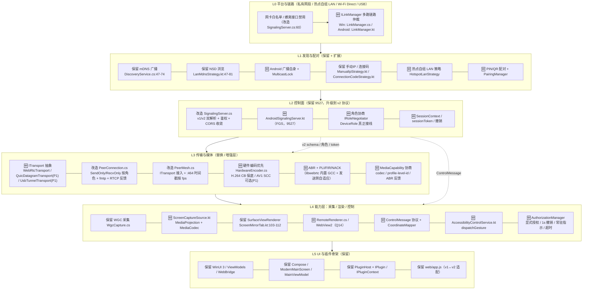
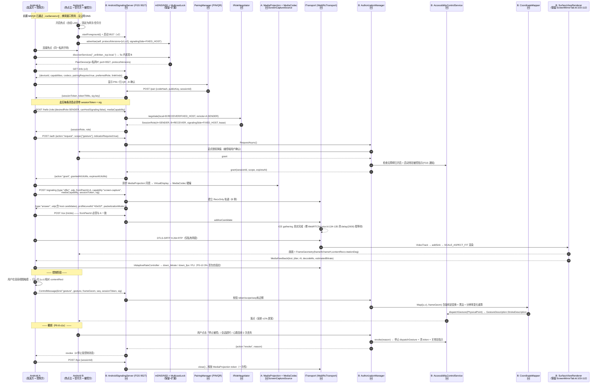
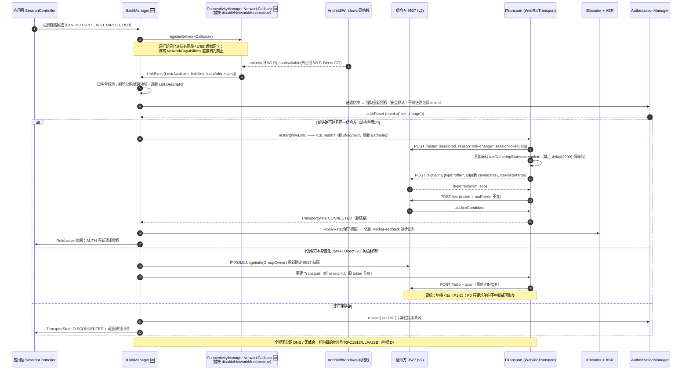
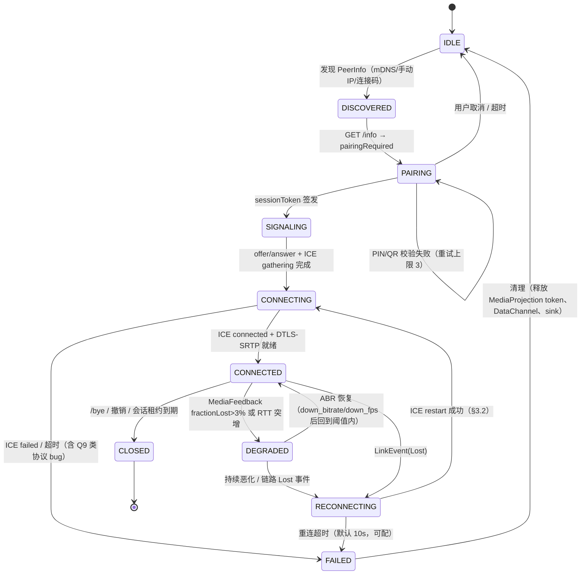
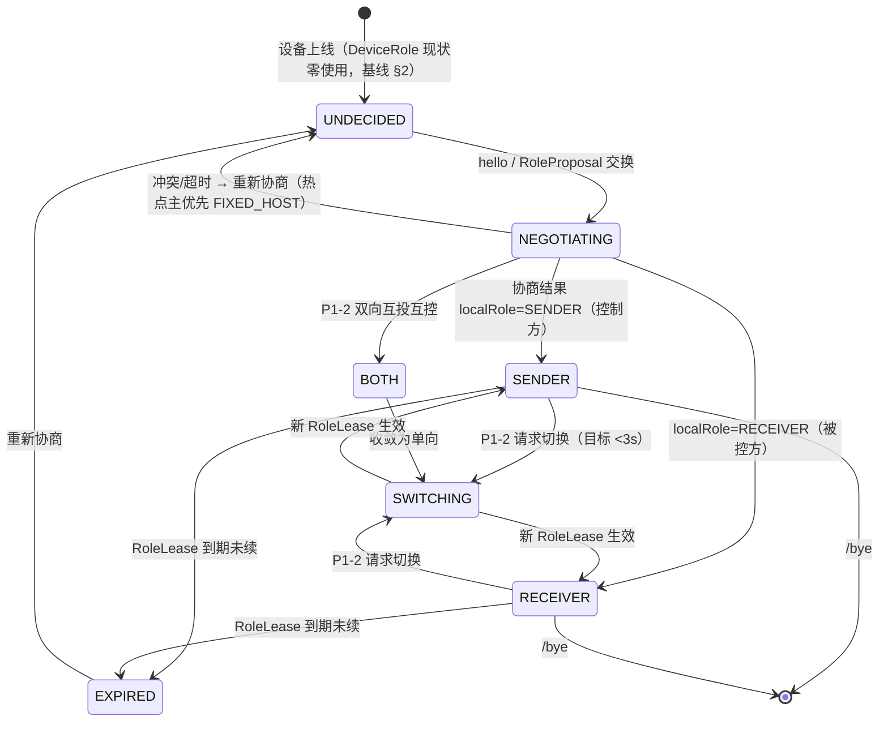
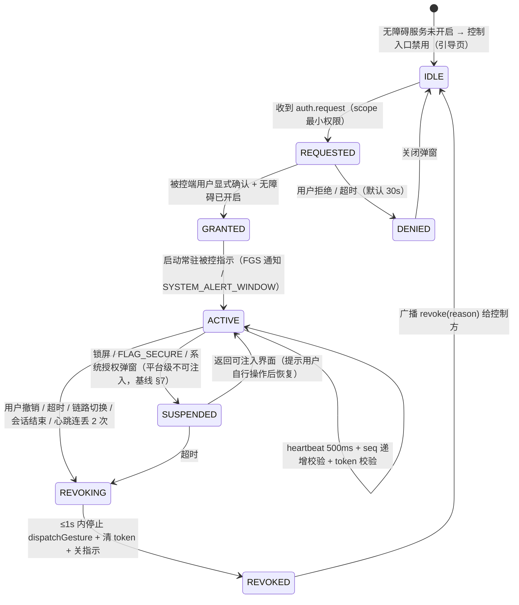
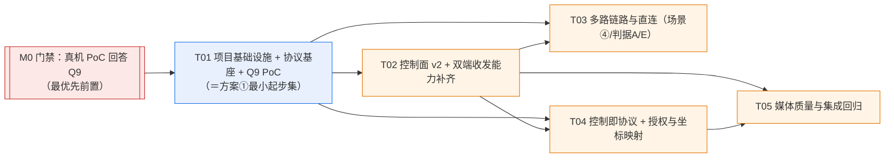

# 03 · 推荐方案架构设计与实施计划

> 本文件**只针对** `02-options-and-research.md` 推荐的 **方案 ②「传输与架构升级 · 换芯不换壳」**，并采用其 §6.4 的两阶段落地：**① 起步 → ② 演进**（方案 ① 的最小起步集即本文件 T01）。
> 若 `02-options-and-research.md` §6.6 的条件分支触发（采用 PM 正式 D1~D9 矩阵：**「成本+复用」权重 D6≥30** 才翻转为方案 ①；Q13 判「目标档非硬性」在 PM 矩阵下**不翻转**），则本文件 T02~T05 中「替换/增强层」的部分可整体降级，T01/T02/T03/T04 仍适用——差异见 §9.1 条件分支说明。
> 本轮只产出**架构与计划文档**，不改 `src/`、`android/` 源码，不写实现代码，不做 git 操作。所有现状判断附 `文件路径:行号`；静态推断显式标注。
> 基线：`docs/redesign/00-feasibility-baseline.md`；方案与调研：`docs/redesign/02-options-and-research.md`。
> 作者：架构师高见远（Architect）｜日期：2026-11-12

---

## 0. 设计前提与硬约束速查

| 项 | 内容 | 证据 |
|---|---|---|
| 现状四大缺口 | ① Android 采集/编码/发送 ② Android 本地信令服务端 ③ Windows 接收渲染 ④ 设备控制全栈 | 基线 §3 |
| 现状可运行资产 | Windows 发送链路、mDNS、9527 信令（仅应答 offer）、文件传输、Android `SurfaceViewRenderer` 渲染、浏览器观看页、SM05 全链路 E2E | 基线 §2 |
| 最大未知 | **Q9：Android 现有接收链路是否真机可用**（三重协议 bug 静态推断） | 基线 §8；`WebRTCService.kt:134-150,160-169` vs `web/app.js:179-184,239-253` vs `SignalingServer.cs:217,241-244,330-341` |
| 平台级不可行 | 无 ROOT 下锁屏/`FLAG_SECURE`/系统授权弹窗不可注入；Windows UAC 安全桌面不可注入；MediaProjection 与无障碍是两套独立授权 | 基线 §7 |
| 零流量 | 去两处 STUN（`WebRTCService.kt:76`、`web/app.js:112`）；`SignalingServer.cs:60` IPv6Any DualMode 收敛；判据 E（仅 USB）当前不可达 | 基线 §4 |
| 硬瓶颈 | `PeerMesh.cs:464` 时间戳写死 `90000/30`；OpenH264 软编 `OpenH264Encoder.cs:148`；`CLAUDE.md:66` 禁止复活 MF SinkWriter | 基线 §6 |

---

## 1. 分层架构图与模块划分

### 1.1 总分层（Mermaid）



### 1.2 三端「保留 / 改造 / 新增」模块清单

| 端 | 🟢 保留（不动或极小改） | 🟡 改造 | 🔵 新增 |
|---|---|---|---|
| **Windows** | `src/UniLinker.WinUI/**`（UI / ViewModels / Converters / TrayIcon / Services 的 UI 部分）；`src/UniLinker.Core/PluginHost.cs`；`src/UniLinker.Plugin.Sdk/IPlugin.cs`、`IPluginContext.cs`、`ICapture.cs`、`IChannel.cs`；`src/UniLinker.Core/DiscoveryService.cs`；`src/UniLinker.Plugins.FileTransfer/**`；`tests/UniLinker.E2E.Tests/**` | `src/UniLinker.Core/SignalingServer.cs`（v1/v2 双协议、鉴权、角色、CORS、网卡白名单）；`src/UniLinker.Core/PeerConnection.cs`（RecvOnly 轨道、fmtp `42e01f`、RTCP 反馈）；`src/UniLinker.Core/PeerMesh.cs`（`ITransport` 接入、`:464` 时间戳）；`src/UniLinker.Core/Platform.cs`（注入 `ILinkManager`/`IRoleNegotiator`）；`src/UniLinker.Plugins.ScreenMirror/ScreenMirrorPlugin.cs`（`:139-140` OnPeerRequest、`:154-160` 动态配置）；`WgcCapture.cs`（`:465-468` CreateForWindow 接线 + 多显示器枚举）；`src/UniLinker.WinUI/Services/WebBridge.cs`（v2 状态/配置桥接） | `src/UniLinker.Core/Protocol/**`（v2 schema / ControlMessage / CapabilityNegotiator / PairingManager）；`src/UniLinker.Core/Transport/ITransport.cs`、`WebRtcTransport.cs`、`QuicDatagramTransport.cs`(P1)、`UsbTunnelTransport.cs`(P1)；`src/UniLinker.Core/LinkManager.cs`；`src/UniLinker.Core/RoleNegotiator.cs`；`src/UniLinker.Core/AuthorizationManager.cs`；`src/UniLinker.Core/CoordinateMapper.cs`；`src/UniLinker.Plugins.ScreenMirror/HardwareEncoder.cs`（**重新设计，不复活 MF SinkWriter**）；`RemoteRenderer.cs`；`src/UniLinker.Plugins.Control/**`（ControlChannel / Windows SendInput(P1)） |
| **Android** | `android/.../ui/**`（ModernMainScreen / MainViewModel / theme / components）；`android/.../plugins/screenmirror/ScreenMirrorTab.kt`（渲染 `:103-112`）；`android/.../sdk/models/Models.kt`（`PeerDevice`/`StreamStats`，`DeviceRole` 需接线）；`android/app/src/main/res/**` | `android/.../core/WebRTCService.kt`（重构为 `ITransport` 的 WebRTC 实现：`:74-80` 去 STUN、`:62` 开 NetworkMonitor、`:134-135` 修 ICE 等待、`:145-169` 补 `fromPeerId`/`capability`/peerId 关联、`:102` 实装 onDataChannel、`:125` offer 方向由角色驱动、`:50` 关闭 HighProfile field trial）；`android/.../core/Platform.kt`（`:64-77` 注入真实 `IPeerMesh`、`:19-21` 去 localhost、`:16-28` 实例化发现）；`android/.../core/strategies/LanMdnsStrategy.kt`（`:39-41` 补广播自身 + MulticastLock）；`ConnectionCodeStrategy.kt`（`:64` 广播端口改为真实信令端口）；`WifiP2pStrategy.kt`（`:146/153-204` 整体重写）；`MainViewModel.kt`（接 v2 状态）；`AndroidManifest.xml`（权限 + `<service>`） | `android/.../core/protocol/**`（与 C# 对齐的 v2 schema / ControlMessage / Capability）；`AndroidSignalingServer.kt`（FGS，9527）；`ScreenCaptureSource.kt`（MediaProjection + MediaCodec）；`AccessibilityControlService.kt`；`CoordinateMapper.kt`；`AuthorizationManager.kt`；`HotspotLanStrategy.kt`；`LinkManager.kt`；`ITransport.kt` / `WebRtcTransport.kt`；`PairingActivity.kt`（PIN/QR） |
| **浏览器** | `web/index.html`、`web/styles.css`、`web/webcodecs-decoder.js` | `web/app.js`（`:111-113` 去 STUN；增 v1↔v2 适配层；保持 SM01~SM05 断言不变） | 无（Viewer 保持轻量；QUIC/WebTransport Viewer 仅 ③ 远期，`02-options-and-research.md` §5.6 明确不作 P0） |

> **废弃/降级**：`OpenH264Encoder.cs` 降级为「无硬编设备时的 fallback」（不删除）；`android/.../core/DiscoveryService.kt`（基线 §2 死代码，`Platform.kt:16-28` 未实例化）合并进 `LanMdnsStrategy.kt` 后删除；`WifiP2pStrategy.kt:153-204` 骨架实现整体替换。

---

## 2. 关键数据结构与接口定义

> 本节为**接口契约**（签名/字段名/类型），不是实现代码。协议采用 **JSON over HTTP 9527（控制面）+ DataChannel/QUIC stream（控制消息）**；所有 v2 消息统一 envelope。
> 兼容约束：v2 必须保留 v1 全部字段 `type/sdp/fromPeerId/capability`（`SignalingServer.cs:582-588`），旧客户端不传新字段时走 `SignalingServer.cs:286-296` 的 capabilities 遍历 fallback。

### 2.1 设备发现与 `PeerInfo` / `PeerDevice`

**C#（保留并扩展 `src/UniLinker.Plugin.Sdk/PeerInfo.cs` 的等价类型）**

```csharp
public enum PeerRoleHint { Unknown = 0, Sender, Receiver, Both }

public sealed record PeerInfo
{
    public required string Id { get; init; }              // 稳定 ID；禁止用 MAC 冒充
    public required string Name { get; init; }
    public required string IpAddress { get; init; }       // 必须私有网段或 USB 虚拟网卡
    public int Port { get; init; } = 9527;
    public string Version { get; init; } = "3.1.0";
    public string[] Capabilities { get; init; } = [];
    public string[] ProtocolVersions { get; init; } = ["v1", "v2"];  // 🆕 /info 通告
    public PeerRoleHint PreferredRole { get; init; } = PeerRoleHint.Unknown; // 🆕
    public PeerState State { get; init; } = PeerState.Discovered;
    public DateTime LastSeen { get; init; }
}
```

**Kotlin（对齐 `android/.../sdk/models/Models.kt:3-10`）**

```kotlin
data class PeerDevice(
    val id: String,
    val name: String,
    val ipAddress: String,       // 必须为真实 IPv4/IPv6 私网地址，禁止 MAC
    val port: Int = 9527,
    val version: String = "",
    val capabilities: List<String> = emptyList(),
    val protocolVersions: List<String> = listOf("v1", "v2"),
    val preferredRole: RoleHint = RoleHint.UNKNOWN,
    val isGroupOwner: Boolean = false,   // 🆕 Wi-Fi Direct 场景由 WifiP2pInfo 填充
)
```

**发现接口**

```csharp
public interface IDeviceDiscovery : IDisposable
{
    event Action<PeerInfo>? DeviceFound;
    event Action<PeerInfo>? DeviceLost;
    IReadOnlyList<PeerInfo> KnownDevices { get; }
    Task StartAsync(CancellationToken ct = default);
    Task StopAsync();
    Task AdvertiseAsync(DeviceAdvertisement ad, CancellationToken ct = default); // 🆕 Android 广播自身
}

public sealed record DeviceAdvertisement(
    string DeviceId, string Name, int Port, string[] Capabilities,
    string[] ProtocolVersions, PeerRoleHint PreferredRole, LinkKind ActiveLink);
```

```kotlin
interface IDeviceDiscovery {
    val devices: StateFlow<List<PeerDevice>>
    suspend fun start()
    suspend fun stop()
    suspend fun advertise(self: DeviceAdvertisement)   // 🆕 修 LanMdnsStrategy.kt:39-41
}
```

> **实证约束**：`WifiP2pStrategy.kt:146` 目前把 `device.deviceAddress`(MAC) 赋给 `ipAddress`，而 `ScreenMirrorPlugin.kt:55` 用它拼 `http://${ip}:${port}` → 必然失败。v2 规定 `ipAddress` 必须是**可路由的私网地址**，Wi-Fi Direct 场景由 `WifiP2pInfo.groupOwnerAddress.hostAddress`（`WifiP2pStrategy.kt:190-194` 已取但未用）填入。

### 2.2 角色协商 —— `DeviceRole` 真正接线

现状：`src/UniLinker.Plugin.Sdk/DeviceRole.cs:4-10` 与 `android/.../sdk/models/Models.kt:24` **全项目零使用**（基线 §2）。v2 把它提升为会话级契约。

**C#**

```csharp
[Flags]
public enum DeviceRole { None = 0, Sender = 1, Receiver = 2, Both = Sender | Receiver }

public enum SignalingSide { Undecided, FixedHost, GroupOwner, Negotiated }

public sealed record SessionRole(
    string SessionId,
    DeviceRole LocalRole,
    DeviceRole RemoteRole,
    SignalingSide SignalingSide,      // 热点主=FixedHost；Wi-Fi Direct GO=GroupOwner
    string SignalingEndpoint,         // "http://<私网IP>:9527"
    DateTime EstablishedAtUtc,
    TimeSpan Lease,                   // 租约到期自动降级/断开
);

public interface IRoleNegotiator
{
    /// 热点主固定为信令方；Wi-Fi Direct 在 isGroupOwner 确定后动态指定 GO。
    Task<SessionRole> NegotiateAsync(
        RoleProposal local, RoleProposal remote, LinkDescriptor link, CancellationToken ct);
    Task<SessionRole> SwitchAsync(string sessionId, DeviceRole newLocalRole, CancellationToken ct); // P1-2 <3s
    event Action<SessionRole>? RoleChanged;
}

public sealed record RoleProposal(
    string DeviceId, string[] Capabilities, DeviceRole DesiredRole,
    bool CanHostSignaling, bool IsGroupOwner, int ProtocolMajor);
```

**Kotlin**

```kotlin
enum class DeviceRole { NONE, SENDER, RECEIVER, BOTH }
enum class SignalingSide { UNDECIDED, FIXED_HOST, GROUP_OWNER, NEGOTIATED }

data class SessionRole(
    val sessionId: String,
    val localRole: DeviceRole,
    val remoteRole: DeviceRole,
    val signalingSide: SignalingSide,
    val signalingEndpoint: String,
    val establishedAtUtcMs: Long,
    val leaseMs: Long,
)

interface IRoleNegotiator {
    suspend fun negotiate(local: RoleProposal, remote: RoleProposal, link: LinkDescriptor): SessionRole
    suspend fun switch(sessionId: String, newLocalRole: DeviceRole): SessionRole
    val roleChanges: SharedFlow<SessionRole>
}
```

> **默认假设**（Q1/Q18）：P0 单向，`Sender` = 控制方、`Receiver` = 被控方；`Both` 与 `SwitchAsync` 列 P1-2。若 Q18 改为「接收方控制发送方」，需翻转 `ControlMessage` 的方向校验，属阻塞选型（§8）。

### 2.3 信令消息扩展（v2 envelope）

现状 `SignalingServer.cs:582-588` 的 `SignalingMessage` 仅 `{Type, Sdp, FromPeerId, Capability}`，`IceCandidateMessage` 仅 `{PeerId, Candidate, SdpMid, SdpMLineIndex}`。v2 统一 envelope：

| 字段 | 类型 | 必填 | 说明 |
|---|---|---|---|
| `v` | int | ✅ | 协议版本，`2`（`1` 走旧解析器） |
| `msgId` | string(uuid) | ✅ | 幂等键，防重放 |
| `ts` | int64 | ✅ | Unix ms，接收端校验 ±30s 窗口 |
| `sessionId` | string(uuid) | ✅ | 会话唯一标识 |
| `fromPeerId` | string | ✅ | **必须与所有 `/ice` 的 `peerId` 一致**（修基线 §8 第 3 条） |
| `toPeerId` | string | ❌ | 单播目标 |
| `type` | enum string | ✅ | `hello` / `offer` / `answer` / `ice` / `pair` / `role` / `capability` / `bye` / `restart` |
| `sdp` | string | ❌ | `offer`/`answer` 时必填 |
| `capability` | string | ❌ | 保留 v1 兼容（如 `screen-capture`） |
| `capabilities` | string[] | ❌ | v2 能力列表 |
| `role` | object `RoleProposal` | ❌ | `hello`/`role` 时必填 |
| `candidate` / `sdpMid` / `sdpMLineIndex` | string / string / int | ❌ | `ice` 时必填；`peerId` 字段保留为 `fromPeerId` 别名 |
| `pairing` | object `PairingProof` | ❌ | PIN/QR 校验；**按 Q15 默认列 P1（R1-10），P0 不携带此字段**（`PairingProof.method="none"`） |
| `sessionToken` | string | ✅（**会话建立后**） | **P0 由服务端在 `hello` / 首连时签发**（不依赖 PIN/QR 配对），每条消息必须携带；服务端校验 |
| `mediaCapability` | object `MediaCapability` | ❌ | 见 §2.5 |
| `sig` | string(base64) | ✅（**会话建立后**） | **基于会话密钥**（由会话密钥派生，非配对密钥）的 HMAC，防局域网内伪造 |

**`GET /info` v2 响应扩展**（保留 `SignalingServer.cs:136-144` 全部旧字段）

| 字段 | 类型 | 说明 |
|---|---|---|
| `name` / `version` / `capabilities` / `status` | string / string / string[] / string | 保留 |
| `protocolVersions` | string[] | `["v1","v2"]` |
| `deviceId` | string | 稳定 ID |
| `preferredRole` | string enum | `sender`/`receiver`/`both`/`unknown` |
| `signalingSide` | string enum | 见 §2.2 |
| `linkKinds` | string[] | `lan` / `hotspot` / `wifi-direct` / `usb` |
| `pairingRequired` | bool | 是否强制 PIN/QR；**P0 默认 `false`**（Q15 默认把 PIN/QR 完整配对列 P1），P1 配对启用时才置 `true` |
| `codecs` | string[] | 见 §2.5 |

**C# 接口**

```csharp
public interface ISignalingServer : IDisposable
{
    Task StartAsync(CancellationToken ct = default);
    void Stop();
    bool IsRunning { get; }
    int Port { get; }
    event Func<SignalingEnvelope, CancellationToken, Task<SignalingEnvelope?>>? OnMessage;
}

public interface ISignalingClient
{
    Task<SignalingEnvelope> PostAsync(string endpoint, SignalingEnvelope msg, CancellationToken ct);
    Task<IReadOnlyList<IceCandidateDto>> PollIceAsync(string endpoint, string sessionId, CancellationToken ct);
}
```

```kotlin
interface ISignalingServer {
    val isRunning: StateFlow<Boolean>
    suspend fun start(port: Int = 9527)     // Android 侧 FGS 内
    suspend fun stop()
    val incoming: SharedFlow<SignalingEnvelope>
}
interface ISignalingClient {
    suspend fun post(endpoint: String, msg: SignalingEnvelope): SignalingEnvelope
    suspend fun pollIce(endpoint: String, sessionId: String): List<IceCandidateDto>
}
```

> **实证约束**：Android 现有接收链路静态推断不通（基线 §8）——`WebRTCService.kt:134` 的 `scope.launch{delay(2000)}` 是 fire-and-forget 不阻塞 `:135`，`:145-150` 缺 `fromPeerId`/`capability`，`:160-169` 的 `peerId="android-<ts>"` 与 `SignalingServer.cs:241-244` 的 `key="unknown"` 不匹配导致 `:330-341` 静默丢弃候选，且 Android 从不 GET `/ice-pending`（`SignalingServer.cs:166-168`）。**T01 的 M0 门禁必须先用真机回答 Q9**。

### 2.4 控制消息（归一化坐标、手势、授权/撤销、会话 token）

**设计原则**：控制端**只发归一化坐标 `[0,1]`**，由被控端 `CoordinateMapper` 结合当前帧几何换算为物理像素，避免宽高比/黑边/旋转在两端各算一遍。依据：`ScreenMirrorTab.kt:108` 使用 `SCALE_ASPECT_FIT` 会产生信箱黑边，正是 PM P0-7 的映射难点。

| 字段 | 类型 | 必填 | 说明 |
|---|---|---|---|
| `v` / `msgId` / `ts` / `sessionId` / `sessionToken` / `sig` | 同 §2.3 | ✅ | 统一 envelope |
| `kind` | enum string | ✅ | `gesture` / `auth` / `key` / `clipboard` / `file` / `feedback` |
| `seq` | int64 | ✅ | 严格递增，被控端丢弃乱序旧包 |
| `frameGeom` | object `FrameGeometry` | ✅（gesture） | 控制端所见几何快照 |
| `gesture` | object `Gesture` | ✅（gesture） | 见下 |
| `auth` | object `AuthAction` | ✅（auth） | 见下 |
| `key` | object `SystemKey` | ✅（key, P1） | `BACK`/`HOME`/`RECENTS`/`VOL_UP`/`VOL_DOWN`/`POWER` |

**`FrameGeometry`**

| 字段 | 类型 | 说明 |
|---|---|---|
| `frameW` / `frameH` | int | 编码帧宽高（物理像素） |
| `viewW` / `viewH` | int | 控制端渲染视图宽高 |
| `contentLeft` / `contentTop` / `contentW` / `contentH` | int | `SCALE_ASPECT_FIT` 后的内容矩形（信箱黑边之外） |
| `rotationDeg` | int enum | `0`/`90`/`180`/`270`，被控端当前旋转 |
| `scaleType` | string enum | `aspect-fit` / `aspect-fill` / `fill` |

**`Gesture`**

| 字段 | 类型 | 说明 |
|---|---|---|
| `type` | enum string | `tap` / `long_press` / `swipe` / `pinch_zoom` / `scroll` / `multi_touch`（P2） |
| `u` / `v` | double `[0,1]` | **相对内容矩形**的归一化坐标；`u=(touchX-contentLeft)/contentW` |
| `u2` / `v2` | double `[0,1]` | `swipe` 终点 / `pinch` 第二指 |
| `durationMs` | int | `long_press`/`swipe` 时长 |
| `pressure` / `scaleFactor` | double | 可选 |
| `pointerCount` | int | 多指 |

**归一化 → 物理坐标换算（被控端 `CoordinateMapper`）**：先按 `contentRect` 反归一化得到 `(u,v)`，再按 `rotationDeg` 逆旋转（下表公式照表保留）：

> ⚠️ **待标定参数（Q22，主理人裁决 C-8）**：**旋转方向约定（顺/逆时针）与 `contentRect`／`contentLeft/Top` 的基准**是 **T04 真机四点标定后才锁定的待标定参数**，本表给出的是公式结构与候选方向，**不得在标定前视为最终契约**；标定结论须写入阶段 2 开发文档后才生效，`CoordinateMapper`（C#/Kotlin）两端必须使用同一标定结果，不允许两端各算一遍。

| `rotationDeg` | 物理 `(px, py)` |
|---|---|
| 0 | `(u·frameW, v·frameH)` |
| 90 | `(v·frameW, (1−u)·frameH)` |
| 180 | `((1−u)·frameW, (1−v)·frameH)` |
| 270 | `((1−v)·frameW, u·frameH)` |

> 分辨率变化（`MediaProjection.Callback.onCapturedContentResize`）时，发送端**必须重发 `FrameGeometry`**，被控端按新 `frameW/frameH` 重算，满足 P0-7「分辨率变化自动重算」。验收：4 种宽高比 × 0/90/180/270 各 20 次点击，落点误差 ≤1% 屏宽。

**`AuthAction`**

| 字段 | 类型 | 说明 |
|---|---|---|
| `action` | enum string | `request` / `grant` / `deny` / `revoke` / `heartbeat` / `expire` |
| `scope` | string[] | `["gesture"]` / `["gesture","key","clipboard"]`（最小权限） |
| `grantedAtUtcMs` / `expiresAtUtcMs` | int64 | 租约 |
| `reason` | string | 撤销原因（用户/超时/链路切换/会话结束） |
| `indicatorRequired` | bool | 常驻被控指示（FGS 通知 / `SYSTEM_ALERT_WINDOW`） |

> **撤销 ≤1s**（P0-8）：`revoke` 到达后被控端立即停 `dispatchGesture`、清 token、关常驻指示；心跳 500ms，连续 2 次丢失即本地 `expire`。

**`PairingProof` / `sessionToken`**

| 字段 | 类型 | 说明 |
|---|---|---|
| `method` | enum string | `pin` / `qr` / `none`；**P0 默认 `none`**（无配对流程，Q15 默认把 PIN/QR 完整配对列 P1/R1-10）；`pin`/`qr` 仅在 P1 配对启用时使用 |
| `codeHash` | string | PIN/QR 的哈希，不传明文；**`method="none"` 时为空/省略** |
| `publicKey` | string(base64) | 每会话临时密钥对（X25519）；**会话密钥即由此派生，`sig` 使用它而非「配对密钥」** |
| `sessionToken` | string | **服务端在 `hello` / 首连时签发**（P0 无需配对），绑定 `sessionId`+`fromPeerId`+`IpAddress` |
| `tokenTtlMs` | int | 默认 ≤ 会话租约 |

> **P0 安全模型收敛（对应 Q15 默认 / 主理人裁决 C-2）**：P0 **没有** PIN/QR 配对流程 → `PairingProof.method="none"`、`pairingRequired=false`、`pairing` 字段省略；服务端在 `hello`/首连签发 `sessionToken`，密钥来自 `publicKey` 派生的**会话密钥**，`sig` 为基于该会话密钥的 HMAC。PIN/QR 完整配对（含 UI、`codeHash` 校验）按 Q15 降为 **P1（R1-10，M7）**。**M1 与 M4 退出条件均不含 PIN/QR**（见 §6 里程碑表）；`04-implementation-guide.md` 的 P0 落地方案与此一致。

**C# / Kotlin 接口**

```csharp
public enum ControlChannelKind { DataChannel, QuicStream, UsbTunnel }

public interface IControlChannel : IDisposable
{
    ControlChannelKind Kind { get; }
    Task SendAsync(ControlMessage msg, CancellationToken ct);
    IAsyncEnumerable<ControlMessage> ReadAsync(CancellationToken ct);
    event Action<ControlChannelState>? StateChanged;
}

public interface ICoordinateMapper
{
    PhysicalPoint Map(NormalizedPoint p, FrameGeometry geom);     // 含旋转/黑边/分辨率变化
    FrameGeometry Recompute(FrameGeometry old, int newFrameW, int newFrameH, int newRotationDeg);
}

public interface IInputInjector
{
    bool IsAuthorized { get; }
    Task<InjectResult> InjectAsync(Gesture g, PhysicalPoint pt, CancellationToken ct);
    Task RevokeAsync(string reason, CancellationToken ct);         // ≤1s 生效
}

public interface IAuthorizationManager
{
    Task<AuthDecision> RequestAsync(AuthRequest req, CancellationToken ct);
    Task GrantAsync(string sessionId, string[] scope, CancellationToken ct);
    Task RevokeAsync(string sessionId, string reason, CancellationToken ct);
    event Action<AuthState>? StateChanged;
}
```

```kotlin
interface IInputInjector {
    val isAuthorized: StateFlow<Boolean>
    suspend fun inject(gesture: Gesture, point: PhysicalPoint): InjectResult
    suspend fun revoke(reason: String)     // AccessibilityService.dispatchGesture 停止
}
interface IAuthorizationManager {
    val state: StateFlow<AuthState>
    suspend fun request(req: AuthRequest): AuthDecision
    suspend fun grant(sessionId: String, scope: Set<String>)
    suspend fun revoke(sessionId: String, reason: String)
}
```

> **平台约束**：`IInputInjector` 的 Android 实现必须是 `AccessibilityService.dispatchGesture`（官方 `https://developer.android.com/guide/topics/ui/accessibility/service`，需 `canPerformGestures="true"` + 用户手动开启）；`AndroidManifest.xml:4-35` 当前**零 `<service>`**，须补 `BIND_ACCESSIBILITY_SERVICE`。Windows 侧 `SendInput` 为 P1，且 UAC 安全桌面不可注入（基线 §7）。

### 2.5 媒体能力协商（codec / profile-level-id / ABR 反馈）

**`MediaCapability`（`GET /info` 与 `hello`/`capability` 消息共用）**

| 字段 | 类型 | 说明 |
|---|---|---|
| `codecs` | object[] | 每项见下，按优先级排序 |
| `codec` | string enum | `H264` / `AV1`（P1）/ `HEVC`（P1） |
| `profileLevelId` | string | H.264 固定 `42e01f`（Constrained Baseline L3.1，RFC 7742） |
| `packetizationMode` | int | 固定 `1`（RFC 7742 必须支持） |
| `levelAsymmetryAllowed` | int | `1` |
| `spropParameterSets` | — | **禁止出现在 SDP**（RFC 7742 要求 in-band；`OpenH264Encoder.cs:138-145` 已符合：SPS/PPS 随 IDR） |
| `maxW` / `maxH` / `maxFps` | int | 能力上限 |
| `maxBitrateKbps` / `minBitrateKbps` | int | ABR 区间 |
| `hwEncoder` / `hwDecoder` | bool | 是否硬编/硬解 |
| `rtcpFeedback` | string[] | `nack` / `nack pli` / `ccm fir` / `goog-remb` / `transport-cc` |
| `abrSupported` | bool | 是否支持动态码率/降帧 |
| `frameRotationSignaled` | bool | 是否随帧发 `rotationDeg` |

**`MediaFeedback`（接收端 → 发送端，RTCP 或 DataChannel）**

| 字段 | 类型 | 说明 |
|---|---|---|
| `sessionId` / `ts` | string / int64 | 关联 |
| `lostPackets` / `fractionLost` | int / double | 丢包率（P0-10 3%、P1-11 5%） |
| `jitterMs` / `rttMs` | double | 抖动/往返 |
| `estimatedBitrateKbps` | int | REMB / transport-cc 估计 |
| `framesDecoded` / `framesDropped` | int | 解码统计（现 `WebRTCService.kt:191-211` 已有 inbound-rtp） |
| `decodeMs` | double | 现 `ScreenMirrorTab.kt:135-140` 已有显示 |
| `request` | enum string | `pli` / `fir` / `none` |
| `suggestedAction` | enum string | `hold` / `down_bitrate` / `down_fps` / `force_keyframe` |
| `frameTimestampUs` | int64 | **optional（新增，向后兼容）**；透传采集帧时间戳 `WgcCapture.cs:184-192 TimestampUs`。**来源 `frame.SystemRelativeTime`（`WgcCapture.cs:184` 的 `TotalMilliseconds * 1000`），是单调相对时基（µs）、不是 UTC 墙钟**；作为端到端延迟打点起点 |
| `renderCompleteAtUs` | int64 | **optional（新增，向后兼容）**；接收端渲染完成时刻，**必须与 `frameTimestampUs` 同一单调时基域（µs）**；跨设备时由接收端用**单向 RTT/2 折算 + offset 校准**（或本地 NTP 对同一参考时钟）把渲染完成时刻映射到发送端单调域，**禁止墙钟直接相减**；作为延迟打点终点 |

> **`RenderComplete` 契约收敛（决策 14 / Q19 / §10.1 L9；QA D-8 裁决）**：`WgcCapture.cs:184-192` 的 `TimestampUs` 来自 `frame.SystemRelativeTime.TotalMilliseconds * 1000`（`WgcCapture.cs:184`），是**单调相对时基（µs）而非 UTC 墙钟**；若 `renderCompleteAtUs` 直接取墙钟，两者相减得到的 P50/P95 **全部无效**。故 **`frameTimestampUs` 与 `renderCompleteAtUs` 必须与 `frameTimestampUs` 同一单调时基域（µs）**；跨设备时由接收端用**单向 RTT/2 折算 + offset 校准**（或本地 NTP 对同一参考时钟）把渲染完成时刻映射到发送端单调域，**报告须注明所用方法与校准误差上界**；**禁止墙钟直接相减**。**延迟 = `renderCompleteAtUs − frameTimestampUs`，两值须已折算到同一单调域，否则报告无效**（口径：采集帧时间戳 → 接收端渲染完成，PM §3）。两字段为**对 `MediaFeedback` 的向后兼容可选扩展**，**不新增独立消息名、不改任何既有字段**；老端不发送时 ABR 与 PLI/FIR 行为不受影响。QA 的延迟 P50/P95 用例（`05-test-strategy.md` §11.3）依赖这两个字段。P0 不强制采集，列 R1-14/P1 可观测（Q19）。`04-implementation-guide.md` §11.3 / §14.4 按此契约落地（由主理人转达工程师与 QA 同步）。

**C# / Kotlin 接口**

```csharp
public interface ICapabilityNegotiator
{
    MediaCapability Intersect(MediaCapability local, MediaCapability remote); // 取交集，H.264 CB 保底
    string BuildFmtp(MediaCapability c);   // 修 PeerConnection.cs:54 缺 fmtp
}

public interface IAdaptiveRateController
{
    void OnFeedback(MediaFeedback fb);
    RateDecision Decide();                 // { bitrateKbps, fps, forceKeyframe }
    event Action<RateDecision>? DecisionChanged;
}

public interface IEncoder : IDisposable                 // 扩展现有 IEncoder
{
    event Action<EncodedPacket>? PacketEncoded;
    bool Initialize(int w, int h, int fps, int bitrateKbps);
    void Encode(CaptureFrame frame);
    void ForceKeyFrame();                              // 现有 OpenH264Encoder.cs:65-68 已有
    void ApplyRate(RateDecision d);                    // 🆕 ABR
    bool IsHardware { get; }                           // 现有 OpenH264Encoder.cs:148 恒 false
    void Configure(MediaCapability cap);               // 🆕 profile/packetization
    EncoderInfo GetInfo();
}
```

```kotlin
interface IMediaCapabilityProvider {
    fun local(): MediaCapability
    fun negotiate(remote: MediaCapability): MediaCapability
}
interface IAdaptiveRateController {
    fun onFeedback(fb: MediaFeedback)
    val decisions: SharedFlow<RateDecision>
}
```

> **实证约束**：`PeerConnection.cs:54` 仅 `new VideoFormat(H264, 96, 90000)` **未设 fmtp**；`WebRTCService.kt:50` 开了 `WebRTC-H264HighProfile/Enabled/` field trial（发送侧，与 OpenH264 的 CB 输出可能不匹配）→ T01 关闭并按 `42e01f`/`packetization-mode=1` 对齐（依据 RFC 7742 与 `02-options-and-research.md` R10/R22）。**二者互通为静态推断，需 M0/M1 真机抓 SDP 比对**（仓库无 SIPSorcery↔libwebrtc 测试，基线 §6）。

### 2.6 传输与链路契约 —— `ITransport` / `ILinkManager`（**正式补充契约**）

> **架构师结论（主理人裁决 C-5）**：**纳入契约，非实现层自由**。理由：§1.1 分层图、§3.2 链路切换时序、§5 T03 任务表、`04` §5.6、`05` §M8 判据 E 用例都依赖这两个接口；若声明「实现层自由」，Windows(C#)、Android(Kotlin)、浏览器三端会各写一套，链路切换与 ICE restart 无法互验。故把 `04-implementation-guide.md` §5.6 给出的**最小建议签名原样升格为 §2 正式契约**，与 §2.1~§2.5 同级，**三端字段名与方法语义必须一致、不得自行发明其它 API/字段**。`04` §5.6 与 §14.4 C-5 的「待架构师确认、非 §2 契约强制」标注由主理人转达工程师**更新为「已确认，`03` §2.6 为契约」**。
> 依据：`03` §1.1 L0/L3、§3.2 时序（`restart(newLink)`、`registerNetworkCallback()`、`LinkEvent(Lost/Available, linkKind, localAddresses[])`）、§4.1 `TransportState` 状态机、`02` §3.2/§3.5（`ITransport` 可插拔、判据 E 在 P1 达成）。

**共享数据类型（三端一致）**

| 类型 | 字段 / 取值 | 说明 |
|---|---|---|
| `LinkKind` | enum `Lan` / `Hotspot` / `WifiDirect` / `Usb` | 对应 §2.1 `PeerInfo`/`GET /info` 的 `linkKinds` |
| `LinkDescriptor` | `kind: LinkKind`、`localAddress: string`、`signalingEndpoint: string`、`isGroupOwner: bool` | 由 §2.2 `IRoleNegotiator` 与 §3.2 `SelectPrivateLink()` 产出；`localAddress` 必须为私网或 USB 虚拟网卡地址 |
| `LinkEvent` | `type: Lost / Available`、`linkKind: LinkKind`、`localAddresses: string[]` | §3.2 时序 step 2；`ILinkManager` 据此触发 ICE restart |
| `TransportState` | enum `Idle` / `Discovered` / `Pairing` / `Signaling` / `Connecting` / `Connected` / `Degraded` / `Reconnecting` / `Failed` / `Closed` | **与 §4.1 连接状态机同一枚举**（C# PascalCase / Kotlin 同名） |
| `SignalingEnvelope` | 见 §2.3 v2 envelope | 复用，不另定义 |
| `IceCandidateDto` | `candidate: string`、`sdpMid: string`、`sdpMLineIndex: int`、`peerId: string` | 见 §2.3；`peerId` 必须与 `fromPeerId` 一致 |

**C# 契约**

```csharp
public interface ITransport : IDisposable
{
    LinkKind Kind { get; }
    Task StartAsync(LinkDescriptor link, CancellationToken ct);
    Task RestartAsync(LinkDescriptor newLink, CancellationToken ct);   // §3.2 restart(newLink)：ICE restart
    Task<SignalingEnvelope> ExchangeSdpAsync(SignalingEnvelope offer, CancellationToken ct);
    Task AddIceCandidateAsync(IceCandidateDto candidate, CancellationToken ct);
    event Action<TransportState>? StateChanged;
}

public interface ILinkManager : IDisposable
{
    void RegisterCandidates(IReadOnlyList<LinkDescriptor> candidates);  // §3.2 step 1
    LinkDescriptor SelectPrivateLink();                                  // 白名单校验：剔除公网/蜂窝
    Task OnLinkEventAsync(LinkEvent ev, CancellationToken ct);            // Lost/Available → ICE restart
    event Action<LinkEvent>? LinkChanged;
}
```

**Kotlin 契约**

```kotlin
interface ITransport {
    val kind: LinkKind
    val state: StateFlow<TransportState>
    suspend fun start(link: LinkDescriptor)
    suspend fun restart(newLink: LinkDescriptor)
    suspend fun exchangeSdp(offer: SignalingEnvelope): SignalingEnvelope
}
interface ILinkManager {
    fun registerCandidates(candidates: List<LinkDescriptor>)
    fun selectPrivateLink(): LinkDescriptor
    suspend fun onLinkEvent(ev: LinkEvent)
    val linkChanged: SharedFlow<LinkEvent>
}
```

> **契约边界**：本小节只固定「可插拔传输 + 链路仲裁」的**最小公共面**；`WebRtcTransport` / `QuicDatagramTransport`(P1) / `UsbTunnelTransport`(P1) 各自的内部实现、平台 API 调用（NVENC/MediaCodec、`ConnectivityManager.NetworkCallback`）属实现层自由，不纳入本契约。媒体与控制消息仍分别走 §2.5 `MediaFeedback` 与 §2.4 `ControlMessage`，不通过 `ITransport` 另起协议。

---

## 3. 程序调用流程时序图

### 3.1 热点自组 LAN：双 Android 发现 → 配对 → 授权 → 投屏 → 控制 → 撤销

> 场景对应 PM `01` §3 的 **R0-04 / R0-06 / R0-07 / R0-08 / R0-11 / R0-12 / R0-13**（场景 ④）。默认假设按 PM §6：**Q1 单向 P0 + Q18 不坚持硬编码单向（角色可协商，但 P0 业务流仍只交付单向）**；本图按「发送方=控制方、接收方=被控方」的一次具体会话展开。
> ⚠️ **Q15 / D-6 校准（PIN/QR 为 P1 可选分支）**：图中 `PairingManager (PIN/QR)` 与 `POST /pair` 为 **P1（R1-10，M7）可选分支，非 P0 主流程**；**P0 由服务端在 `hello` / 首连签发 `sessionToken`，`sig` 基于会话密钥**（见 §2.3「P0 安全模型收敛」），配合 CORS 收敛（`SignalingServer.cs:515-519`）构成 P0 安全底线；P0 首次配对可走「连接码 / 手动 IP + 服务端签发 token」，无需 PIN/QR UI。**PIN/QR 完整配对不作 M1 / M4 退出条件**（§6 已同步）。



### 3.2 链路切换时的 ICE restart / 重连流程

> 修 `WebRTCService.kt:62 disableNetworkMonitor=true`（不刷新 host candidate、不 ICE restart）与 `:79 tcpCandidatePolicy=DISABLED`；覆盖判据 A（飞行模式+手动开热点）与 P1-4（Wi-Fi↔USB）。



---

## 4. 状态机

### 4.1 连接状态（`TransportState` / `PeerConnectionState`）

> 现状：`src/UniLinker.Core/PeerConnection.cs:297-305` 有 `{New, Connecting, Connected, Disconnected, Failed, Closed}`，`android/.../sdk/IPeerMesh.kt:7-9` 有 `{IDLE, CONNECTING, CONNECTED, DISCONNECTED, ERROR}`。v2 统一并补 `DEGRADED`/`RECONNECTING`。



### 4.2 会话角色状态（`SessionRole`）



> 信令方确定：热点自组 LAN → `FIXED_HOST`（热点主）；Wi-Fi Direct → 待 `WifiP2pInfo.isGroupOwner`（`WifiP2pStrategy.kt:184`）确定后 `GROUP_OWNER`；依据 `02-options-and-research.md` R16 与基线 §5。

### 4.3 被控授权状态（`AuthState`）



> **硬约束**：MediaProjection（发送方，每次会话弹窗、token 一次性）与 AccessibilityService（被控方，需手动开启）是**两套独立授权**，互不替代（基线 §7）；`AndroidManifest.xml:4-35` 当前零 `<service>`，T01 必须补齐。

---

## 5. 有序任务分解（T01~T05）

> **任务数上限说明**：遵循架构角色「不超过 5 个任务、每任务 ≥3 个相关文件、按层分组、首个任务为项目基础设施」的硬性约束，本轮压缩为 **5 个主任务**。阶段 2 工程师编写「详细开发文档」（任务 #5）时可再拆子任务，但不得改变此处依赖顺序与完成判据。
> **编号口径**：「对应需求编号」列采用 PM `01` §3 的重编号（R0-xx / R1-xx / R2-xx），旧编号映射见 `01` §3 表头；产品红线 K1~K8 / PR-1~PR-6 / 门禁 G1 见 `01` §1.2 / §7 / §3.1。

| 任务 | 名称 | 依赖 | **对应需求编号（PM `01` §3）** | 涉及文件（相对路径） | 新增 / 修改点 | 完成判据 |
|---|---|---|---|---|---|---|
| **T01** | **项目基础设施 + 协议基座 + Q9 真机 PoC**（＝方案 ① 最小起步集） | — | **R0-02**（零流量）、**R0-11**（角色接线）、**R0-12**（信令字段对齐/PEER ID）、**R0-14**（权限与 FGS）、**R0-15**（K1~K8 回归门禁）、**R0-01**（发现）；**R-01~R-10**（10 项非条件性重构）；**D-01/D-03/D-06**（强制废弃）；**门禁 G1**（Q9 PoC）；K1/K3/K7/K8、PR-1/PR-2/PR-5 | `android/app/src/main/AndroidManifest.xml`；`android/app/build.gradle.kts`；`src/UniLinker.Core/UniLinker.Core.csproj`；`src/UniLinker.Plugins.ScreenMirror/UniLinker.Plugins.ScreenMirror.csproj`；`android/.../core/WebRTCService.kt`；`web/app.js`；`src/UniLinker.Core/SignalingServer.cs`；`src/UniLinker.Core/PeerConnection.cs`；`src/UniLinker.Plugin.Sdk/DeviceRole.cs`；`src/UniLinker.Plugin.Sdk/IConnectionStrategy.cs`；`android/.../sdk/models/Models.kt`；`tests/UniLinker.E2E.Tests/Tests/DebugConnectionTest.cs` | ① **M0 门禁：真机 PoC 回答 Q9**（Android→Windows 现有接收是否可用；抓 SDP 比对 `fromPeerId`/`capability`/ICE/peerId）；② 去两处 STUN（`WebRTCService.kt:76`、`web/app.js:112`）；③ `:134-135` 假 ICE 等待改为真实 `iceGatheringState` 等待；④ `:145-169` 补 `fromPeerId`/`capability`、统一 peerId 关联、Android 补 GET `/ice-pending`；⑤ `:62` 开 NetworkMonitor、`:79` 放开 tcpCandidatePolicy、`:50` 关 HighProfile field trial；⑥ `SignalingServer.cs:60` 网卡白名单、`:515-519` CORS 收敛、`:582-588` 扩 v2 envelope 且保留 v1；⑦ `PeerConnection.cs:54` 补 fmtp `42e01f;packetization-mode=1`；⑧ `DeviceRole`/`IConnectionStrategy` 接线（新增空实现注册，不启用）；⑨ 补 Manifest 权限与 `<service>` 声明、TFM/WindowsSdkPackageVersion 钉死校验 | **M0 通过**（Q9 有明确真机结论并归档）；`ScreenMirrorTests.cs` SM01~SM05 全绿；抓包无公网 DNS/UDP（判据 D）；`GET /info` 返回 `protocolVersions`；新增项目 TFM 均为 `net9.0-windows10.0.22621.0` + `WindowsSdkPackageVersion 10.0.22621.38` |
| **T02** | **控制面 v2 + 双端收发能力补齐** | T01 | **R0-01/03/05/06/11/12/15**（发现·LAN·Win→Android·Android↔Android·对称角色·双端信令对等·兼容回归）；**R1-01**（Android→Windows，M6）、**R1-10**（PIN/扫码，P1）、**R1-13**（能力/版本协商）、**R1-15**（接收端可替换，Q14）；**R-06/07/08/09**；**D-01/02/03/06**；K1/K2/K3/K4/K5/K7/K8、PR-1/PR-2/PR-3/PR-4 | `src/UniLinker.Core/Protocol/**`（新）；`src/UniLinker.Core/SignalingServer.cs`；`src/UniLinker.Core/RoleNegotiator.cs`（新）；`src/UniLinker.Core/PeerConnection.cs`；`src/UniLinker.Core/PeerMesh.cs`；`src/UniLinker.Core/Platform.cs`；`src/UniLinker.WinUI/Services/WebBridge.cs`；`src/UniLinker.Plugins.ScreenMirror/ScreenMirrorPlugin.cs`；`src/UniLinker.Plugins.ScreenMirror/RemoteRenderer.cs`（新，Q14）；`android/.../core/protocol/**`（新）；`android/.../core/AndroidSignalingServer.kt`（新，FGS 9527）；`android/.../core/ScreenCaptureSource.kt`（新）；`android/.../core/Platform.kt`；`android/.../core/WebRTCService.kt`；`android/.../plugins/screenmirror/ScreenMirrorPlugin.kt`；`web/app.js` | ① v2 envelope 双解析器 + `sessionToken`/`sig` 鉴权 + PIN/QR `PairingManager`；② `IRoleNegotiator` 实现（热点 FIXED_HOST / Wi-Fi Direct GROUP_OWNER）；③ **Android 本地信令服务端**（FGS，端点对齐 `SignalingServer.cs:134-176`）；④ 修 `Platform.kt:19-21` localhost、`:64-77` 注入真实 `IPeerMesh`；⑤ Android MediaProjection + MediaCodec 采集发送（补缺口①）；⑥ Windows RecvOnly 轨道 + 渲染（补缺口③，Q14 选 WebView2 则复用 `web/app.js`）；⑦ `ScreenMirrorPlugin.cs:139-140` 实现 `OnPeerRequest`；⑧ `web/app.js` v1↔v2 适配 | **M1 通过**：双 Android 同 LAN 单向投屏真机出帧，连续 10min 不中断；v1 浏览器观看仍通过 SM05；`fromPeerId` 与 `/ice` peerId 一致；抓包目的地址全私网 |
| **T03** | **多路链路与直连（场景④ / 判据 A/E）** | T01, T02 | **R0-01/02/04/09/13**（发现·零流量·无路由器直连·无 SIM/飞行·链路切换自愈）、**R0-15**；**R1-04**（USB 判据 E，M8）、**R2-06**（QUIC/AV1 实验位，P2）；**R-04/05/12**（条件性）、**D-04**（Wi-Fi Direct 依赖 mDNS 强制废弃）；K1/K2/K6/K8、PR-1/PR-6 | `src/UniLinker.Core/LinkManager.cs`（新）；`src/UniLinker.Core/Transport/ITransport.cs`、`WebRtcTransport.cs`、`QuicDatagramTransport.cs`(P1)、`UsbTunnelTransport.cs`(P1)（新）；`src/UniLinker.Core/DiscoveryService.cs`；`src/UniLinker.Core/SignalingServer.cs`；`android/.../core/LinkManager.kt`（新）；`android/.../core/ITransport.kt` / `WebRtcTransport.kt`（新）；`android/.../core/strategies/HotspotLanStrategy.kt`（新）；`android/.../core/strategies/WifiP2pStrategy.kt`（重写）；`android/.../core/strategies/LanMdnsStrategy.kt`；`android/.../core/strategies/ConnectionCodeStrategy.kt`；`android/.../core/Platform.kt`；`android/.../ui/MainViewModel.kt` | ① `ILinkManager` + `ConnectivityManager.NetworkCallback`（替换 `disableNetworkMonitor=true`），§3.2 ICE restart；② 热点自组 LAN 策略（固定信令方）+ `MulticastLock.acquire()`；③ Android 侧 mDNS 广播自身（修 `LanMdnsStrategy.kt:39-41`）；④ `WifiP2pStrategy.kt:146` MAC→真实 IP、`:153-179` connect 成功路径 resume、`:181-197` 实建连、`:201-204` accept 返回真实 mesh、`:48` emit `incomingConnections`；⑤ `ConnectionCodeStrategy.kt:64` 广播真实信令端口；⑥ `ITransport` 预留 USB/QUIC 后端（判据 E 的架构入口，P1 实现）；⑦ 链路白名单自检（内置抓包替代） | **M2 通过**：无路由器（热点自组 LAN）下双 Android 发现→连接→投屏→控制全通；飞行模式+无 SIM；抓包无公网目的地址（判据 A/C/D）；链路切换触发 ICE restart 并可恢复；Wi-Fi Direct 至少真机跑通一条（Q11 分支） |
| **T04** | **控制即协议 + 授权与坐标映射（R0-07/08）** | T01, T02 | **R0-07**（触控注入+坐标映射含旋转/黑边/分辨率变化）、**R0-08**（授权+≤1s 撤销+常驻指示+超时）、**R0-15**；**R1-05**（系统键/键鼠，M7）、**R1-06**（剪贴板，M7）、**R1-10**（配对信任，P1）；**R-08**；K1/K7、PR-2/PR-4（两套授权一次性引导）、00 §7 平台级不可注入边界 | `src/UniLinker.Core/Protocol/ControlMessage.cs`（新）；`src/UniLinker.Core/CoordinateMapper.cs`（新）；`src/UniLinker.Core/AuthorizationManager.cs`（新）；`src/UniLinker.Core/PeerMesh.cs`（DataChannel 接线）；`src/UniLinker.Plugins.Control/**`（新）；`src/UniLinker.Plugin.Sdk/IIncomingChannelHandler.cs`；`src/UniLinker.Core/Platform.cs`；`android/.../core/protocol/ControlMessage.kt`（新）；`android/.../core/CoordinateMapper.kt`（新）；`android/.../core/AuthorizationManager.kt`（新）；`android/.../core/AccessibilityControlService.kt`（新）；`android/.../core/WebRTCService.kt`（`:102` onDataChannel 实装）；`android/.../plugins/screenmirror/ScreenMirrorTab.kt`（触摸捕获 + `removeSink`）；`android/app/src/main/AndroidManifest.xml` | ① `ControlMessage` schema（§2.4）+ `seq`/token/sig 校验；② `CoordinateMapper` 归一化坐标 + `SCALE_ASPECT_FIT` 黑边 + 0/90/180/270 旋转 + 分辨率变化重算（§2.4 换算表）；③ `AccessibilityService.dispatchGesture` + `canPerformGestures` + 常驻被控指示；④ `AuthorizationManager` 显式授权 / **≤1s 撤销** / 超时 / 心跳 / `SUSPENDED` 状态；⑤ `ScreenMirrorTab.kt:111` 补 `removeSink`（10min 稳定性）；⑥ Windows `SendInput`（P1）与 UAC 边界说明；⑦ 复用 `Platform.cs:33-34,92-106` 的 `IIncomingChannelHandler` 分发 | **M3 通过**：4 种宽高比 × 横竖屏 4 种旋转各 20 次点击，落点误差 ≤1% 屏宽；**M4 通过**：显式授权 + 1s 内撤销生效 + 常驻指示 + 超时断开；局域网内未授权设备无法注入 |
| **T05** | **媒体质量与集成回归（R0-10 / R1-03 / R1-11 + 增强项）** | T02, T04 | **R0-05/06**（10min 最低档画质）、**R0-10**（3% 丢包不花屏可恢复）、**R0-15**（K1~K8 全量回归）、**R0-02/03**（判据 A~F 复核）；**R1-03**（目标档，Q13 决定）、**R1-08/09/11/12/14**（音频·多显示器/窗口·ABR/PLI/FIR·编码可插拔·延迟打点）、**R2-01/05**（4K·多接收端，P2）；**R-11**（条件性时间戳）、**D-07**（条件性废弃软编唯一路径，Q13 未硬性则保留 fallback）；K-02/K3/K4/K5、PR-2/PR-6 | `src/UniLinker.Core/PeerMesh.cs`（`:464` 时间戳）；`src/UniLinker.Core/PeerConnection.cs`（RTCP 反馈）；`src/UniLinker.Plugins.ScreenMirror/ScreenMirrorPlugin.cs`（`:154-160` 动态配置）；`src/UniLinker.Plugins.ScreenMirror/OpenH264Encoder.cs`（降级 fallback）；`src/UniLinker.Plugins.ScreenMirror/HardwareEncoder.cs`（新，重新设计）；`src/UniLinker.Plugins.ScreenMirror/WgcCapture.cs`（`:465-468` 窗口 + 多显示器）；`src/UniLinker.Core/Protocol/MediaCapability.cs`（新）；`src/UniLinker.Core/AdaptiveRateController.cs`（新）；`web/app.js`；`tests/UniLinker.E2E.Tests/Tests/ScreenMirrorTests.cs`；`android/.../core/WebRTCService.kt`（inbound-rtp 反馈 `:191-211`） | ① 修 `90000/30` → 按 fps 计算；② `ICapabilityNegotiator` + `MediaCapability`/`MediaFeedback`（§2.5）；③ ABR（丢包/REMB/transport-cc）+ PLI/FIR/NACK 注册（现状 `PeerConnection.cs:58-90` 未注册反馈回调）；④ 硬件编码层**重新设计**（NVENC/QSV/AMF/MediaCodec；**不复活 MF SinkWriter，`CLAUDE.md:66`**）；⑤ 延迟打点用 `WgcCapture.cs:184-192 TimestampUs`（Q19）；⑥ 多显示器/窗口采集、音频开关(P1)、剪贴板/文件/系统键消息(P1)、AV1 SCC 可选(P1)；⑦ E2E 扩展到 Android 互操作 + 质量断言；⑧ v1/v2 双协议回归与 deprecation 标记 | **M5 通过**：最低档端到端 ≤150ms（打点验证）、3% 丢包自适应不花屏可恢复；目标档 1080p60/≤80ms 给出**明确达标/不达标结论**（Q13 决定投入）；全部判据 A~F 复核；`ScreenMirrorTests.cs` SM01~SM05 不回归 |

### 5.1 依赖图（Mermaid）



> 依赖设计要点：**T01 是唯一根节点**（项目基础设施，配置/Manifest/依赖声明/协议基座全部收拢）；T03 与 T04 只依赖 T01+T02，可并行；T05 收尾。避免过长线性链。

---

## 6. 里程碑 M0~M8（M6~M8 为 P1）

> **M0 是最优先前置，且就是 PM `01` §3.1 的「P0 排期门禁 G1」**（PR-5：Q9 真机 PoC 未回答前不得排期）。对应基线 §8「任何方案在排期前都应以真机 PoC 回答 Q9」与 PM §6 A3（默认按静态推断**假定「不可用」**，以重做信令对接估算工期）。**M0/G1 未通过不得进入 T02 的结构性重构、不得输出任何里程碑工期估算**；G1 结论若推翻 00 §8 静态推断，须按 PM §4.4「复算」条款同步修订 `00` §1.1 保留清单、`01` §5 预判表，并重打分矩阵的 D1/D6/D7/D9。

| 里程碑 | 可验证验收内容 | 对应任务 | 退出条件 |
|---|---|---|---|
| **M0 = 门禁 G1（最优先前置）** | **真机 PoC 回答 Q9**：Android（现有 v3.1 代码）→ Windows 现有 9527 是否能真实出帧；同时抓 SDP 比对 `fromPeerId`/`capability`/ICE candidate/`peerId` 关联、`profile-level-id`/`packetization-mode`；记录「可用 / 不可用 + 具体失败点」 | T01（前置门禁） | 结论归档到 `00-feasibility-baseline.md` 修订记录（含 PoC 报告号，供 `02` §6.4 证据列引用）；若「不可用」（PM 默认）则 T01 排期含协议对齐修复并重新验证；若「可用」则 T01 只做合规项。**未出结论不得进入 T02、不得给出 M1~M8 工期**（PR-5 / G1） |
| **M1** | 双 Android **同一 Wi-Fi LAN** 单向投屏打通：v2 发现→**`sessionToken`/`sig` 鉴权**（P0 安全底线）→角色协商→授权→MediaProjection 采集→真机出帧，连续 10min 不中断、分辨率/帧率达最低档。**PIN/扫码完整配对按 PM §6 B8 / Q15 默认列 P1（R1-10，M7），不作 M1 退出条件** | T01+T02 | 真机出帧截图/录屏 + 10min 日志无断流；`ScreenMirrorTests.cs` SM01~SM05 不回归；抓包目的地址全私网；v1 浏览器观看仍可用 |
| **M2** | **无路由器直连**：**热点自组 LAN**（PM §6 A4 / Q11 默认）下双 Android 发现→连接→投屏→控制全通；飞行模式 + 无 SIM；链路切换触发 ICE restart 并恢复 | T01+T03 | 判据 A/C/D 全过（移动数据用量不增、拔 SIM 可用、抓包无公网 DNS/IP）；首次配对 ≤30s（R0-04）；`LinkManager` 自检输出仅私有/USB 网卡；**Wi-Fi Direct 按 Q11 默认降为 P1（R1-04 关联），不作 M2 退出条件**（若用户改判「必须 Wi-Fi Direct」则补回并触发 `02` §6.5 S5 复算） |
| **M3** | 触控注入 + 坐标映射：4 种宽高比 × 横竖屏 0/90/180/270 各 20 次点击，落点误差 ≤1% 屏宽；`tap/long_press/swipe/pinch_zoom/scroll` 五类手势可用 | T04 | 自动化坐标落点报告（**80 组 = 16 组合 × 5 手势；320 次落点 = 16 × 20，要求 320/320 全 ≤1% 屏宽，不取平均、不剔离群点**，采用最严格口径，与 PM `01` R0-07 一致）；`FrameGeometry` 分辨率变化后自动重算验证通过；锁屏/`FLAG_SECURE` 明确降级为「提示用户自行操作」并写入文档 |
| **M4** | 被控端显式授权（两套独立授权一次性引导，PR-4）+ **≤1s 撤销生效** + 常驻被控指示 + 超时断开；**P0 安全底线**：`sessionToken`/`sig` 鉴权与 9527 CORS 收敛；局域网内未授权设备无法注入 | T04（+T05 鉴权回归） | 撤销端到端计时报告 ≤1000ms；未授权注入尝试全部被拒；`sig`/`sessionToken` 重放与伪造测试通过；CORS 不再为 `*`（`SignalingServer.cs:515-519`）；**PIN/扫码完整配对按 PM §6 B8 / Q15 默认列 P1（R1-10，M7），不作 M4 退出条件**；DTLS-SRTP 保留（`WebRTCService.kt:61` 已开） |
| **M5** | 质量达标：最低档端到端延迟 ≤150ms（采集帧时间戳→渲染完成打点）；3% 丢包自适应不花屏可恢复；目标档 1080p60/≤80ms 给出**明确结论**；全部判据 A~F 复核 | T05 | 延迟打点报告（用 `WgcCapture.cs:184-192 TimestampUs`）；ABR/PLI/FIR 日志；Q13 若判「硬性」则硬编层达标，否则书面记录「目标档不达标及原因」；E2E 扩展到 Android 互操作 |
| **M6（P1）** | ② Android→Windows 反向流（PC 作接收端）、③ Windows→Android 控制链路完善 | T02 延伸 | 场景 ② 真机出帧 |
| **M7（P1）** | 双向/反向互投互控切换 <3s；系统键 + 鼠标键盘注入；剪贴板双向；文件互传校验；音频开关；多显示器/指定窗口 | T04+T05 延伸 | P1-2/P1-5/6/7/8/9 逐项验收 |
| **M8（P1）** | 判据 E：USB 有线链路（`UsbTunnelTransport` / ADB reverse / RNDIS）；判据 A 在仅 USB 下复验 | T03 延伸（依赖 Q12） | 关 Wi-Fi 与蜂窝后仅 USB 可发现-连接-投屏-控制；若 Q12 不接受 ADB 依赖，则书面记录替代方案与代价 |

---

## 7. 风险登记册（按严重度）

| # | 严重度 | 风险 | 证据 / 来源 | 缓解措施 |
|---|---|---|---|---|
| 1 | 🔴 致命 | **Q9 未验证**：Android 现有接收链路静态推断不通，若真机确认不通，T01 需追加协议对齐工作量，全部排期后移 | 基线 §8；`WebRTCService.kt:134-150,160-169`；`SignalingServer.cs:217,241-244,330-341`；`web/app.js:179-184,239-253` | **M0 设为最优先前置门禁**，未出结论不进 T02；PoC 同时抓 SDP 比对，一次性定位全部协议差异 |
| 2 | 🔴 致命 | **Android 无本地信令服务端**，双 Android 场景③④无法建连 | 基线 §2/§3；`Platform.kt:19-21` 把 mesh 指向 `localhost:9527` | T02 新增 FGS 信令服务；M1/M2 强制验证；P0 优先热点主固定信令方 |
| 3 | 🔴 致命 | **Android 采集/编码/发送全缺**（MediaProjection + VideoSource + addTrack） | 基线 §2：Grep `MediaProjection/VideoSource/addTrack` 零命中；`WebRTCService.kt:125` 仅 `OfferToReceiveVideo=true` | T02 `ScreenCaptureSource.kt`；先做 Win↔Android 单向 PoC；`AndroidManifest.xml` 补 FGS/MEDIA_PROJECTION |
| 4 | 🔴 致命 | **Windows 无接收渲染** | `PeerConnection.cs:38,55` 恒 SendOnly；`PeerMesh.cs:420-425` 明示不解码 | T02 `RemoteRenderer.cs`；Q14 选 WebView2 可显著降本（**阻塞选型**，§8） |
| 5 | 🔴 致命 | **设备控制全栈缺失** | `WebRTCService.kt:102` onDataChannel 空；`ScreenMirrorTab.kt:103-112` 无触摸监听；Grep 注入零命中 | T04 整栈新建；复用 `Platform.cs:33-34,92-106` 分发基座 |
| 6 | 🟠 高 | **平台级覆盖盲区**：无 ROOT 下锁屏 / `FLAG_SECURE` / BiometricPrompt / 系统授权弹窗不可注入；Windows UAC 安全桌面不可注入 | 基线 §7；官方无障碍文档 R17 | 写入需求边界（Q8 默认不依赖 ROOT）；`AuthState.SUSPENDED` 降级为「提示用户自行操作」；ADB/`input` 仅作 P1 辅助且仍受锁屏限制 |
| 7 | 🟠 高 | **两套独立授权**：MediaProjection 每次会话弹窗 + token 一次性 + targetSdk 35 强制 `foregroundServiceType="mediaProjection"`；无障碍需用户手动开启 | 基线 §7；`build.gradle.kts:14 targetSdk 35`；`AndroidManifest.xml:4-35` 零 `<service>`；官方 R18 | T01 补权限与 `<service>`；每次投屏显式授权流程；FGS 常驻通知；`MediaProjection.Callback.onCapturedContentResize` 处理旋转/黑边；引导页状态自检 |
| 8 | 🟠 高 | **编解码 SDP 互通**：`profile-level-id`/`packetization-mode` 未设 + HighProfile field trial；仓库无 SIPSorcery↔libwebrtc 互操作测试 | `PeerConnection.cs:54`；`WebRTCService.kt:50`；RFC 7742（R10/R22） | T01 统一 `42e01f`+`packetization-mode=1`、关闭 field trial；**M0/M1 真机抓 SDP 比对**；必要时按 R22 做 SDP munging |
| 9 | 🟠 高 | **Wi-Fi Direct GO 角色不确定 + 组播不可靠 + connect 永久挂起** | `WifiP2pStrategy.kt:146,153-197,201-204`；R16 | P0 保底走热点自组 LAN（固定信令方）；T03 用 `groupOwnerAddress` + 连接码绕开 mDNS；重写策略时补 `onSuccess` resume |
| 10 | 🟠 高 | **硬件编码层复杂度**：四套硬编 API + 设备能力探测 + `CLAUDE.md:66` 禁止复活 MF SinkWriter | `OpenH264Encoder.cs:148 IsHardware:false`；`CLAUDE.md:66` | T05 **重新设计** `HardwareEncoder.cs`，H.264 CB 软编作 fallback；Q13 决定投入档位（**阻塞选型**） |
| 11 | 🟡 中 | **目标档 1080p60/≤80ms 大概率不达标**：软编 + 全帧 BGRA readback + 默认 jitter buffer + 时间戳硬编码 | 基线 §6；`WgcCapture.cs:173-181`（1080p ≈8.3MB/帧）；`PeerMesh.cs:464` | T05 修时间戳 + ABR + 硬编 + 减少 GPU→CPU 拷贝；延迟打点（Q19）后给出书面达标/不达标结论，不虚报 |
| 12 | 🟡 中 | **Android 后台/省电策略**：无 FGS、无 `MulticastLock.acquire()`，后台发现与投屏易被冻结 | `AndroidManifest.xml:18-35`；`LanMdnsStrategy.kt:39-41` | T01/T03 补 FGS + MulticastLock + 电池优化白名单引导；M1 10min 稳定性验证 |
| 13 | 🟡 中 | **Windows 防火墙 / 绑所有网卡**（含蜂窝） | `SignalingServer.cs:60-63`；`README.md:43` | T01 网卡白名单绑定 + 防火墙规则限定私有网段源（Q17） |
| 14 | 🟡 中 | **TFM / WinRT 钉死 + 必须 MSBuild** | `README.md:104-106`；`CLAUDE.md:9-14,56-57` | 所有新增项目固定 `net9.0-windows10.0.22621.0` + `WindowsSdkPackageVersion 10.0.22621.38`；插件与宿主同 `WinRT.Runtime`；一律 MSBuild；详见 §9 |
| 15 | 🟡 中 | **隐私与安全**：9527 无鉴权、`Access-Control-Allow-Origin: *`、局域网内未授权控制 | `SignalingServer.cs:515-519`；`AndroidManifest.xml:23 usesCleartextTraffic=true` | T01 CORS 收敛 + T02 `sessionToken`/`sig` + PIN/QR（Q15）+ T04 授权状态机；保留 DTLS-SRTP（`WebRTCService.kt:61` 已开） |
| 16 | 🟡 中 | **v1/v2 双协议并存期回归面扩大**；`web/app.js` 改动牵动 E2E | `SignalingServer.cs:582-588`；`web/app.js:111-113`；`ScreenMirrorTests.cs:116-157` | 绞杀者迁移：`/info` 通告 `protocolVersions`，v1 端点保留至少一大版本；Q16 决策后同步更新 E2E；每步可回滚 |
| 17 | 🟡 中 | **扩展接口与宿主 `WinRT.Runtime` 版本不一致**：新增内置插件加载失败；**外部 `plugins/` DLL 因原签名不变无需重编译**（决策 11，与 `02` §3.6/§3.7/§9.3 一致） | `src/UniLinker.Plugin.Sdk/IChannel.cs`；`CLAUDE.md:57` | 新增能力走 `IChannelV2`/`IPeerMeshV2` 之类扩展接口或默认接口方法，**不修改原接口签名**；发布 SDK 版本说明；新增内置插件强制与宿主同 `WinRT.Runtime`；v1/v2 并存期按 `protocolVersions` 做回归 |
| 18 | 🟡 中 | **双端同时采集性能/发热**；AV1 在 `minSdk 26` 硬解覆盖不足 | `OpenH264Encoder.cs:45-50`；`build.gradle.kts:13`；R11（Pixel 8 功耗 +14%） | 目标档限制分辨率/帧率；AV1 仅 P1 可选；加 CPU/温度自适应 |
| 19 | 🟢 低 | `addSink` 无 `removeSink`，长时可能泄漏/重复绑定 | `ScreenMirrorTab.kt:111` | T04 用 `DisposableEffect` 反注册；M1 10min 验证 |
| 20 | 🟢 低 | 前沿技术误引入（RoQ / L4S / 神经编码 / 5G ProSe）导致返工 | `02-options-and-research.md` §5.6 | 明确列入「看着好但不该上」，阶段 2 开发文档必须锁定「只用成熟可落地项」 |

---

## 8. 待决策清单（含阻塞选型标注）

> **分组以 PM `01` §6 为准**：组 A「阻塞方案选型」7 条 = **Q13 / Q18 / Q9 / Q11 / Q10 / Q14 / Q16**；组 B「阻塞排期」10 条 = Q1/Q2/Q3/Q4/Q7/Q8/Q12/Q15/Q17/Q19；组 C「可延后」2 条 = Q5/Q6。本轮任务点名 **Q9 / Q11 / Q13 / Q14 必须标为阻塞选型**，下表已用 🔴 标出（另 Q18 属 PM 组 A 且关系 D-01 强制废弃，一并标 🔴；Q10/Q16 属 PM 组 A，标 🟠 高并注明组号）。**Q1~Q19 未拍板一律按 PM 建议默认答案推进，并在结论标注「基于默认假设」**（PR-5）。
> Q20~Q22 为架构师本轮新增的技术决策项，不占 PM 的 19 条编号。

| 编号 | 问题 | 阻塞级别 | 影响 | 默认建议（未回复时按此推进，须在结论标注「基于默认假设」） |
|---|---|---|---|---|
| **Q9** | Android 现有接收链路是否已真机验证可用？ | 🔴 **阻塞选型 + 阻塞全部排期（＝门禁 G1）** | 决定 T01 工作量与 M0 结论；若不可用需追加协议对齐；决定 `01` §1.1 保留清单是否成立 | **以 PM `01` §6 A3 为准**：按 00 §8 静态推断**假定「不可用」**，以重做信令对接估算工期；**排期前必须真机 PoC 回答**（M0=G1）；结论须归档并含 PoC 报告号供 `02` §6.4 证据列引用 |
| **Q11** | 双 Android 无路由器场景：接受「一台开热点」为默认，还是**必须** Wi-Fi Direct？ | 🔴 **阻塞选型** | 决定 T03 是「热点优先 + Wi-Fi Direct 备选」还是需完整重写 Wi-Fi Direct（GO 角色协商成本差异大） | **以 PM `01` §6 A4 为准**：热点自组 LAN 为默认，**Wi-Fi Direct 列 P1**（基线 §5、PM Q7 默认）。→ M2 退出条件不再要求 Wi-Fi Direct 真机跑通；T03 的 Wi-Fi Direct 重写降为 P1 可选 |
| **Q13** | 目标档 1080p60/≤80ms 是否硬性？ | 🔴 **阻塞选型**（PM 组 A1） | 决定是否必须在 T05 换硬件编码层（且 `CLAUDE.md:66` 禁止复活 MF 旧路）；改变 D4/D6/D8 | **以 PM `01` §6 A1 为准：不硬性**，最低档为 P0 验收线，目标档列 P1；与 Q4 成对回答。若判硬性则 ② 复算升至 3.90、优势扩大（`02` §6.5 S2） |
| **Q14** | Windows 接收端用 WebView2 复用 `web/app.js`，还是原生 SIPSorcery 解码 + WinUI 控件？ | 🔴 **阻塞选型**（PM 组 A6） | 直接决定 T02 工期与 K3/D7 | **以 PM §6 A6 为准：优先 WebView2 复用**（保护 K3 与既有 E2E），原生解码列 R1-15 备选；由架构师按性能最终定 |
| Q10 | 是否接受「MediaProjection 每次弹窗 + 首次手动开启无障碍」两次独立授权？ | 🟠 高（PM 组 A5） | R0-08 授权 UX 与 R0-05「连续 10min」体验 | **以 PM §6 A5 为准：接受，但用一次性引导流程降低摩擦**（PR-4），被控授权必须可撤销且状态常驻 |
| Q12 | 有线链路（R1-04 / 判据 E）是否允许依赖 ADB / 开发者选项 / PC 辅助？ | 🟠 高（PM 组 B7） | 决定 `UsbTunnelTransport` 实现路径 | **以 PM §6 B7 为准：允许，但不作普通用户默认路径**；双 Android 需 PC 中转或 RNDIS |
| Q15 | 是否保留 DTLS-SRTP 并追加应用层 PIN/扫码配对？ | 🟠 高（PM 组 B8） | 决定 `sessionToken`/`sig`/`PairingManager` 范围与 M4 退出条件 | **以 PM §6 B8 为准：保留 DTLS-SRTP；PIN/扫码配对列 P1（R1-10，M7）**。P0 安全底线仍是修 9527 无鉴权（`sessionToken`/`sig` + CORS 收敛，`SignalingServer.cs:515-519`） |
| Q16 | 是否允许一并修改 `web/app.js`（去 STUN、v1↔v2 适配）？ | 🟠 高（PM 组 A7） | 浏览器观看页是唯一被 E2E 验证的链路，改动有回归风险 | **以 PM §6 A7 为准：允许修改**，但必须保持 K3 免安装观看与 E2E 出帧；同步更新 `ScreenMirrorTests.cs` 并保持 SM01~SM05 全绿 |
| Q17 | 判据 A/C 下 Windows 侧是否需禁用/解绑蜂窝网卡？ | 🟡 中（PM 组 B9） | 决定 T01 是「网卡白名单绑定」还是仅「防火墙规则」 | **以 PM §6 B9 为准：不做系统级禁用**，改为应用绑定私有网卡白名单（`SignalingServer.cs:60` 收敛） |
| Q18 | 是否坚持「发送方=控制方、被控方=接收方」单向角色？ | 🔴 **阻塞选型**（PM 组 A2） | 决定是否必须对称角色协商（**D-01 强制废弃**核心差异）、`IRoleNegotiator` 与 `ControlMessage` 方向校验 | **以 PM §6 A2 为准：不坚持单向**，改为角色可协商的对称架构，但 **P0 业务流仍只交付单向**；双向互投互控列 P1-2。若用户改判「坚持」会与 D-01 冲突，须显式确认并重打矩阵（§9.1） |
| Q19 | 是否接受用 `WgcCapture.cs:184-192 TimestampUs` 做端到端延迟打点？ | 🟡 中（PM 组 B10） | 决定 M5 延迟验收口径（R1-14） | **以 PM §6 B10 为准：接受**，列 P1 可观测；需接收端渲染完成时刻回传（新增 `RenderComplete` 反馈消息） |
| Q20（新增） | v1 协议保留几个大版本？外部 `plugins/` DLL 是否允许断裂？ | 🟡 中 | 决定绞杀者迁移窗口与 SDK 版本策略 | 保留至少 1 个大版本；外部插件不断裂（走扩展接口） |
| Q21（新增） | `ControlMessage` 用 JSON 还是二进制？ | 🟡 中 | 控制消息频率与解析开销、三端 binding 一致性 | P0 用 JSON（与 9527 控制面一致、易调试）；P1 评估二进制 |
| Q22（新增） | 旋转方向约定（顺/逆时针）与 `contentRect` 基准由谁标定？ | 🟡 中 | P0-7 落点误差 ≤1% 能否达标 | **待标定参数**：须在 **T04 真机四点标定后**才锁定（见 §2.4 换算表上方警示），标定结论写入阶段 2 开发文档后生效；`03` §2.4 的换算公式照表保留但不得视为最终契约；`CoordinateMapper` 两端共用同一标定结果，不允许两端各算一遍 |

---

## 9. 与项目硬约束的对齐说明

| 硬约束 | 出处 | 本方案如何对齐 |
|---|---|---|
| **TFM 固定 `net9.0-windows10.0.22621.0` + `WindowsSdkPackageVersion 10.0.22621.38`，不可升 26100** | `README.md:104-106`；`CLAUDE.md:56-57`；`UniLinker.WinUI.csproj:4,13`；`UniLinker.Plugins.ScreenMirror.csproj:3,9` | T01 把「TFM 钉死校验」列为完成判据：**所有新增 C# 项目**（`Protocol/**`、`Transport/**`、`LinkManager.cs`、`Plugins.Control/**`、`HardwareEncoder.cs`）一律使用同一 TFM 与 `WindowsSdkPackageVersion`；不引入任何要求 26100+ 的包；`HardwareEncoder.cs` 走厂商 SDK / D3D11 原生互操作而非新 Windows SDK 投影 |
| **插件与宿主必须同 `WinRT.Runtime` 版本，否则插件程序集加载失败** | `CLAUDE.md:57` | T05 改变 `IChannel`/`IPeerMesh` 时**优先新增扩展接口**而非修改原签名；确需修改时同步 bump SDK 并在开发文档写明「外部 `plugins/` DLL 必须重编译且 WinRT.Runtime 与宿主一致」；T02 新增内置插件由 `App.xaml.cs:61-62` 的 `RegisterPlugin` 静态注册，不走 DLL 加载 |
| **必须 MSBuild 构建，`dotnet build` 因缺 AppxPackage/PRI 任务会失败** | `README.md:34-35`；`CLAUDE.md:9-14` | 全部构建/验收脚本沿用 `"C:/Program Files/Microsoft Visual Studio/2022/Community/MSBuild/Current/Bin/amd64/MSBuild.exe" UniLinker.sln -p:Configuration=Debug`；E2E 仍用 `dotnet test tests/UniLinker.E2E.Tests --filter "Category=ScreenMirror"`（`CLAUDE.md:19`）；新增项目须加入 `UniLinker.sln` 且不改变 MSBuild 路径 |
| **`CLAUDE.md:66` 明确 MediaFoundation SinkWriter 硬编旧路 `MFCreateMemoryByteStream` 不存在、不可复活** | `CLAUDE.md:65-66` | T05 的 `HardwareEncoder.cs` **从零重新设计**（NVENC / QSV / AMF / MediaCodec 抽象 + 能力探测 + 软编 fallback），**明确禁止**复制/恢复旧 SinkWriter 代码；`OpenH264Encoder.cs` 保留为 fallback（不删除） |
| **WGC 实现细节不可回退**：`CreateForMonitor` + `WinRT.CastExtensions.As<T>()` + `CreateFreeThreaded` + `_isCapturing` 先于 `StartCapture` | `CLAUDE.md:59-63`；`WgcCapture.cs:69-85,123,316-338` | T05 扩展多显示器/窗口采集时**只增不改**：保留现有 `CreateForMonitor` 主路径，新增 `CreateForWindow`（`WgcCapture.cs:465-468` 已声明）与显示器枚举分支；不动 staging readback 与帧池逻辑 |
| **编码器约束**：OpenH264 经 H264Sharp，`RgbImage(Bgra,w,h,stride,data)` 原生处理 stride | `CLAUDE.md:65-67`；`OpenH264Encoder.cs:134` | 保留；硬件编码层另起，不改动 `OpenH264Encoder.cs:119-135` 的初始化/编码主干（仅增 `ApplyRate`/`Configure` 扩展点） |
| **信令端口 9527 可配置，改端口会重启信令服务器；首次运行触发 Windows 防火墙弹窗** | `CLAUDE.md:69`；`App.xaml.cs:117-138`；`README.md:43` | v2 信令仍用 9527；`AndroidSignalingServer.kt` 端口从配置读取；`ApplyRuntimeSettingsAsync`（`App.xaml.cs:117-138`）重启时同时重建 v2 解析器；T01 网卡白名单绑定不破坏端口可配置性 |
| **日志/诊断**：`%APPDATA%\uniLinker\unilinker.log` + `crash.log`，unpackaged WinUI 控制台不可见 | `CLAUDE.md:71` | M0/M1 的 SDP 抓包、ICE 状态、Q9 结论统一写入文件日志，便于真机排障；新增 `LinkManager` 自检结果也落盘 |
| **git 规范**：`dev/<feature>` 或 `fix/<bug>` 分支、绝不直提 main；英文 Conventional Commits（feat/fix/chore/docs）；**不加 `Co-Authored-By: Claude`** | `CLAUDE.md:73-77` | 阶段 2 每个任务一条 `dev/<feature>` 分支；提交信息英文 Conventional Commits；本轮及后续均不添加 Co-Authored-By。本文件与 02 文件属 `docs` 类提交 |
| **E2E 浏览器需 H264**：Playwright 自带 Chromium 无 H264，fixture 优先已装 Edge/Chrome | `CLAUDE.md:23-24`；`README.md:91-97` | T02/T05 扩展 E2E 到 Android 互操作时，浏览器用例仍复用 `PlaywrightFixture` 的 Edge/Chrome channel；SM05 作为不可回归护栏 |
| **零流量 C1~C5 / 判据 A~F** | 基线 §1/§4 | T01 去 STUN + 网卡白名单；T03 `LinkManager` 显式剔除蜂窝接口并提供自检；QUIC/WebTransport **不作 P0**（W3C 需 HTTPS 安全上下文，与明文 9527 冲突，`02-options-and-research.md` R8/§5.6）；判据 E 通过 `UsbTunnelTransport`(P1) 达成 |

### 9.1 条件分支说明（推荐随条件变化时）

> **口径校正**：本文件 v0.1 曾以架构师自拟矩阵（含「起步速度 D1=20 权重」）给出「Q13 非硬性且 D1≥24 → 翻转 ①」的分支。该自拟矩阵**已被 PM `01` §4 的正式 D1~D9 矩阵取代**；正式矩阵**没有起步速度维度**，且 `02` §6.5 S2/S4 已证明 Q13 两种取值下推荐均不翻转。以下按正式矩阵重写。

| 触发条件 | 本文件如何调整（以 `02` §6.6 为准） |
|---|---|
| **默认（PM §6）**：Q13 不硬性、Q18 不坚持单向、Q11 热点默认、Q14 WebView2、Q9 假定不可用、Q15 PIN 列 P1、Q16 允许改 `web/app.js`、Q17 不做系统级禁用 | **维持方案 ②**（正式矩阵 3.80）；两阶段「① 起步 → ② 演进」不变；T05 的硬件编码层与 AV1 降为 P1 可选，`OpenH264Encoder.cs` 保留 fallback（PR-6 / D-07 条件性废弃） |
| Q13 判「目标档硬性」 | **维持 ②**（复算 3.90）；T05 必须完成 `HardwareEncoder.cs`（新设计，不复活 MF SinkWriter），M5 需给出 1080p60/≤80ms 达标结论；`PeerMesh.cs:464` 时间戳必改（R-11 由条件性转强制） |
| Q11 判「必须 Wi-Fi Direct」 | **维持 ②**（复算 3.62）；T03 中 Wi-Fi Direct 重写提前到 M1 之后第一优先级（R-12 转强制），GO 角色协商与 `isGroupOwner` 动态信令方成为 M2 退出条件 |
| Q14 选 WebView2（PM 默认） | **维持 ②**；T02 的 `RemoteRenderer.cs` 改为 WebView2 承载 `web/app.js`，保护 K3 与既有 E2E；Windows 原生解码列 R1-15 备选 |
| Q18 坚持单向角色（与 PM 默认相反） | 会与 **D-01 强制废弃** 冲突 → 需用户显式确认；② 的 `IRoleNegotiator` 仍保留但 P0 业务流锁定单向，D3 分数下降，须重打矩阵 |
| 用户把「成本+复用」权重抬到 D6≥30 | **翻转 ①**（`02` §6.5 S6）：T02/T03/T05 的结构性重构降级为后续演进，仅保留 T01/T04 的最小集 |
| 用户要求「完全重写/换栈」 | 才切方案 ③；本文件作废，需另出架构（且必须先补 `02` R21 Rust/UniFFI 的一手可核查来源验证；③ 的 D1 待验证可能命中 V4 不得推荐） |

### 9.2 与产品红线 PR-1~PR-6 / 兼容红线 K1~K8 的对齐

> 来源：PM `01` §1.2（K1~K8）、§7（PR-1~PR-6）。工程实现时须逐条可验证。

| 红线 | 本方案（②）落点 | 可验证判据（写入阶段 2 开发文档） |
|---|---|---|
| **PR-1** 运行期零蜂窝 / 零互联网 / 仅本地链路 / 断 WAN·飞行·无 SIM 全功能 | T01 去 STUN（`WebRTCService.kt:76`、`web/app.js:112`）+ `SignalingServer.cs:60` 网卡白名单；T03 `LinkManager` 显式剔除蜂窝 `NetworkCapabilities`；§3.2 链路切换时序全程标注「无公网 DNS / 无蜂窝」 | 判据 A/B/C/D/F；M2 抓包报告；`LinkManager` 自检仅输出私有/USB 网卡；违反即 V1/V2 出局 |
| **PR-2** K1~K8 不回退（浏览器免安装观看 K3、文件互传 K4、GUI 双语主题 K5、一键发现 K2、插件可扩展 K7、免账号直连 K8）；插件接口须迁移层 | §1.2 保留 WinUI/Compose UI 与 `PluginHost`；`web/app.js` v1↔v2 适配保 K3；`IChannel`/`IPeerMesh` **新增扩展接口**而非改签名，保 K7；连接码 `ConnectionCodeStrategy.kt` 保 K8 | R0-15 回归门禁：K1~K8 逐条走查；M1/M5 均要求 `ScreenMirrorTests.cs` SM01~SM05 全绿；挂载 1 个示例外部插件成功 |
| **PR-3** 四大缺口全部闭合；D1<3 不得推荐 | §3.4 四缺口逐项解法；`02` §6.3 正式矩阵 D1=5，**未命中 V4** | M1（缺口①②③）+ M3/M4（缺口④）；`02` §6.1 V1~V5 检查表 |
| **PR-4** 不以 ROOT/系统签名为 P0 控制唯一路径；两套独立授权一次性引导、可撤销、常驻可见 | §3.1 时序：`PairingManager` 一次性引导编排 MediaProjection + 无障碍；§4.3 `AuthState` 常驻指示 + `revoke` ≤1s + `SUSPENDED` 显式标注 00 §7 边界；P0 注入只用 `AccessibilityService.dispatchGesture`（R17） | M4 撤销计时 ≤1000ms、未授权注入全拒；**未命中 V5**；`AndroidManifest.xml` 补 `BIND_ACCESSIBILITY_SERVICE` |
| **PR-5** Q9 PoC 未答不得排期；Q1~Q19 按默认答案并标注「基于默认假设」 | **M0 = 门禁 G1**（§6）；§8 全表按 PM `01` §6 默认答案，结论统一标注「基于默认假设」 | G1 PoC 报告号归档；`02` §6 全表标注「设计态打分，G1 结论若推翻则重打 D1/D6/D7/D9」 |
| **PR-6** 前沿技术可插拔、可一键回退；Q13 未判硬性前软编保底不可废弃 | §1.1 `ITransport` + `MediaCapability` 抽象；`OpenH264Encoder.cs` **保留为 fallback 不删除**（D-07 条件性废弃）；AV1/QUIC 仅 P1 可选 | `02` §5.6「看着好但不该上」清单写入开发文档「明确不做」章节；软编保底路径一键回退演练 |

---

## 10. 交给阶段 2（工程师编写详细开发文档）的交接锚点

1. **必须先拿到 M0 / G1（Q9）结论**再写详细设计；Q9 结论决定 `WebRTCService.kt` 是「小修」还是「按 v2 重写协议层」，并决定 `00` §1.1 保留清单与 `01` §5 预判表是否需修订、矩阵 D1/D6/D7/D9 是否重打。
2. **协议 schema 以 §2 为唯一契约**：v2 envelope、ControlMessage、MediaCapability/MediaFeedback、`FrameGeometry` 换算表、AuthAction 状态，三端字段名与类型不得各写一套；编号统一用 PM `01` §3 的 R0/R1/R2（§5 任务表已列「对应需求编号」）。
3. **接口签名以 §2 为准**，扩展用新增接口、不改原签名（保护外部插件 ABI 与 WinRT.Runtime 一致性，PR-2 / K7）。
4. **迁移必须绞杀者**：v1/v2 并存、`/info` 通告 `protocolVersions`、SM01~SM05 全程可回归（PR-2 / K3）。
5. **硬约束清单见 §9**，逐条在开发文档「构建与约束」章节复述，尤其 `CLAUDE.md:66`（MF SinkWriter 不可复活）与 TFM 钉死 `net9.0-windows10.0.22621.0` + `WindowsSdkPackageVersion 10.0.22621.38`、必须 MSBuild、`dev/<feature>` 分支 + 英文 Conventional Commits + 不加 Co-Authored-By。
6. **前沿技术白名单**：统一采用**决策 12 的 9 项** `R1 / R6 / R10 / R11 / R16 / R17 / R18 / R19 / R22`（与 `02` §6.6、§9、`04` §12.2 一致）；§5.6 的「看着好但不该上」清单原样写入开发文档的「明确不做」章节（PR-6）。**白名单语义＝可进入方案的技术候选，分级仍以 `02` §5 为准不升级**：R22 保留「需验证（二手社区实践）」、R11 保留「成熟可落地但仅 P1」、R19 保留「参考架构、不作默认路径」。
7. **待决策 Q9 / Q11 / Q13 / Q14（及 Q18）为阻塞选型**，工程师不得自行假设；其余按 §8 默认建议推进并在文档标注「基于默认假设」（PR-5）。
8. **产品红线 PR-1~PR-6 / K1~K8 逐条落到验收用例**（§9.2），尤其 R0-15「K1~K8 回归门禁」必须作为 M1/M5 的退出条件而非可选项。

### 10.1 阶段 2 工程师写「详细开发文档」时必须锁定的技术决策（供主理人转交）

| # | 必须锁定的决策 | 锁定依据 / 不锁定的后果 |
|---|---|---|
| L1 | **G1/Q9 PoC 结论**（现有 Android 接收是否可用） | 决定 `WebRTCService.kt` 改造幅度与全部工期；未答不得排期（PR-5） |
| L2 | **v2 协议 envelope 与字段类型**（§2.3）+ v1/v2 双解析器与 `protocolVersions` 通告 | 三端 schema 不一致会直接重现 00 §8 的 `fromPeerId`/`peerId` 不匹配 bug |
| L3 | **`fromPeerId` 与 `/ice` 的 `peerId` 同一化**、ICE gathering 真实等待（禁 `delay(2000)` 假等待） | `WebRTCService.kt:134-135,145-169` vs `SignalingServer.cs:241-244,330-341` |
| L4 | **H.264 SDP fmtp 定值** `profile-level-id=42e01f`、`packetization-mode=1`、`level-asymmetry-allowed=1`；关闭 `WebRTC-H264HighProfile` field trial | RFC 7742（R10/R22）；`PeerConnection.cs:54`、`WebRTCService.kt:50`；不锁则协商失败/花屏 |
| L5 | **角色与信令方确定机制**：热点主 = `FIXED_HOST`；Wi-Fi Direct = `isGroupOwner` 确定后 `GROUP_OWNER`（`WifiP2pInfo.groupOwnerAddress`） | `02` §5 / 基线 §5 / R16；D-01、D-03、D-04 强制废弃项 |
| L6 | **归一化坐标基准与旋转方向约定**（§2.4 `contentRect` + 0/90/180/270 换算表），T04 真机四点标定 | R0-07 落点误差 ≤1%；两端各算一遍必然超标 |
| L7 | **Windows 接收端形态**（Q14 默认 WebView2 复用 `web/app.js`）与 `RemoteRenderer` 接口 | 决定 T02 工期与 K3 兼容；原生解码列 R1-15 备选 |
| L8 | **编码层形态**：Q13 默认不硬性 → `OpenH264Encoder.cs` 保留 fallback；硬编层仅在 Q13 判硬性时从零设计，**禁止复活 MF SinkWriter** | `CLAUDE.md:66`、PR-6、D-07 条件性废弃 |
| L9 | **ABR/PLI/FIR/NACK 的 RTCP 回调注册与阈值**，以及 `WgcCapture.cs:184-192 TimestampUs` 延迟打点口径 + `RenderComplete` 回传消息（Q19） | `PeerConnection.cs:58-90` 现无反馈注册；R0-10 / R1-11 / R1-14 |
| L10 | **插件 ABI 策略（决策 11）**：新增能力走扩展接口而非改原签名 → **外部 `plugins/` DLL 无需重编译、ABI 不断裂**；新增内置插件须与宿主同 `WinRT.Runtime`；v1/v2 并存期按 `protocolVersions` 回归（与 `02` §3.6/§3.7/§9.3、`03` §7 风险 17 一致） | `CLAUDE.md:57`、PR-2 / K7 |
| L11 | **鉴权边界**：P0 = `sessionToken`/`sig` + CORS 收敛（修 `SignalingServer.cs:515-519`）+ DTLS-SRTP；**PIN/QR 完整配对列 P1**（Q15 默认） | 与 PM §6 B8 一致，避免把 P1 工作误排进 M4 退出条件 |
| L12 | **前沿技术白名单与回退开关**：统一为**决策 12 的 9 项** `R1 / R6 / R10 / R11 / R16 / R17 / R18 / R19 / R22`（补 R16，与 `02` §6.6 / §10 锚点 6 / `04` §12.2 对齐）；分级仍以 `02` §5 为准（R22 需验证、R11 仅 P1、R19 不作默认路径）；AV1/QUIC 为 P1 可插拔且一键回退 | PR-6；`02` §5.6「不该上」清单 |
| L13 | **USB/判据 E 路径**（Q12 默认：允许 ADB/PC 辅助但不作普通用户默认路径）与 `UsbTunnelTransport` 接口 | M8 / R1-04；避免 P0 引入开发者选项门槛 |
| L14 | **测试与构建口径**：MSBuild 命令、E2E 走 Playwright 已装 Edge/Chrome channel、`dotnet test --filter "Category=ScreenMirror"`、SM05 不可回归 | `CLAUDE.md:9-24`、`README.md:34-38,91-97` |

---

（本文件仅做架构设计与计划，未修改任何源码、未写实现代码、未做 git 操作。）
