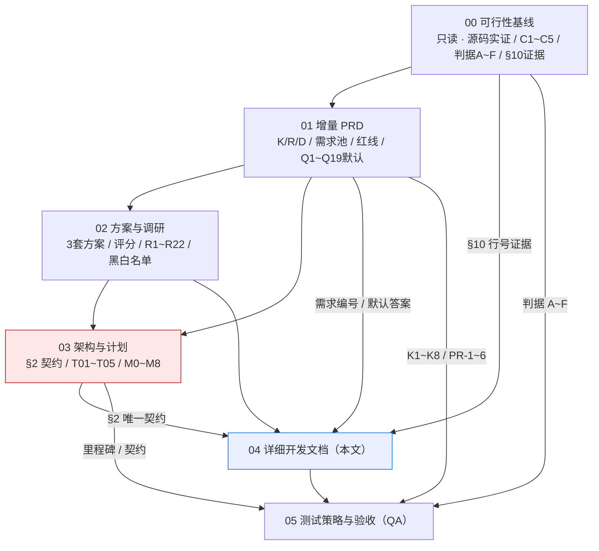
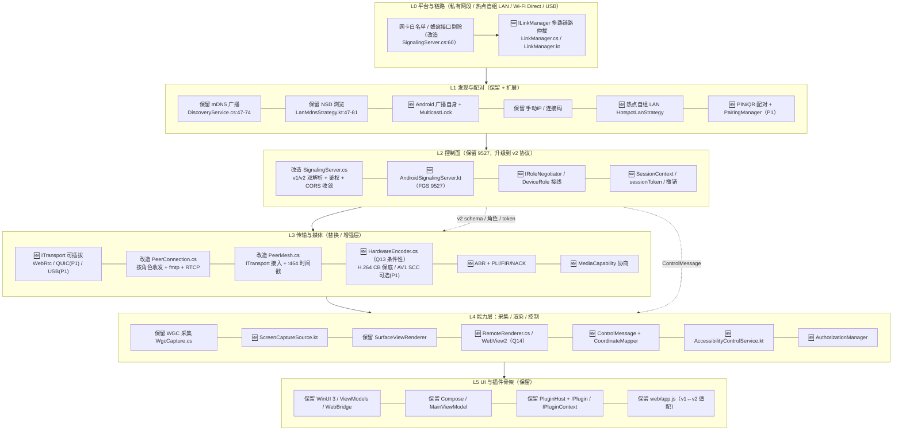

# 04 · 详细开发文档（实现指南 / Implementation Guide）

> 本文件是阶段 2 工程师交付的**唯一产物**：面向"开发者拿着就能开工"的详细实现指南。
> **本轮只写文档**：未修改 `src/`、`android/`、`web/` 任何源码，未写实现代码文件，未做任何 git 操作。
> 契约来源：`docs/redesign/00-feasibility-baseline.md`（源码实证基线）、`01-product-requirements.md`（增量 PRD）、`02-options-and-research.md`（方案与调研）、`03-architecture-and-plan.md`（**§2 为唯一协议契约**）；另参照根目录 `CLAUDE.md`、`README.md` 的构建/实现注意事项。
> **所有对现状的描述均附 `文件路径:行号` 证据**，取自 `00` §10「关键证据索引」、`CLAUDE.md`、`README.md` 与 `03` 各章；未标注证据的均为本轮新增设计，不作为现状断言。

| 项 | 值 |
|---|---|
| 文档编号 | **04** |
| 版本 | **v0.1（草案）** |
| 日期 | **2026-11-12** |
| 作者 | **寇豆码（Kou）· 工程师（software-engineer）** |
| 状态 | **草案** — 待主理人齐活林汇编；待用户/主理人对 §14 待决策项拍板 |
| 上游契约 | `00`（只读基线）、`01`（需求/红线/默认答案）、`02`（选型/前沿白名单/黑名单）、`03`（**§2 唯一协议契约**） |
| 下游 | `05-test-strategy.md`（QA：测试策略与验收自动化用例） |
| 语言 | 中文 |
| 当前分支 | `dev/v3.1-revival`；实施期一律新建 `dev/<feature>` 分支（`CLAUDE.md:73-77`） |

**变更记录**

| 版本 | 日期 | 作者 | 变更 |
|---|---|---|---|
| v0.1 | 2026-11-12 | 寇豆码 | 初始草案。基于 00/01/02/03 四份已落盘契约，锁定 14 条技术决策；展开 14 章：开发环境与构建、完整文件清单（新增/修改/废弃 + 行号证据）、分层职责、接口与契约（复现 03 §2）、协议规范、T01~T05 实现步骤、踩坑清单、编码规范、迁移回滚、调试诊断、明确不做、验收清单、待决策与假设登记。未改动任何源码。 |

---

## 1. 阅读指引、契约优先级与本轮锁定结论

### 1.1 本系列 00~05 各文档职责

> ⚠️ **编号口径说明（已裁决，见 §14.4 C-6）**：`01` §1「文档依赖」图里规划的是「03 = 详细开发文档 / 04 = 测试策略与验收 / 05 = 方案评估总览」，且 `01` 自注「02/03/04/05 的编号与文件名为本轮规划，最终以主理人确认为准」（`01:47`）。**实际落盘编号**由主理人阶段 2 派发确定为下表（03 由架构师产出为「架构与计划」，开发文档顺延为 04，测试策略顺延为 05）。**本文一律按下表实际编号书写**。

> ✅ **编号映射（主理人齐活林 2026-11-12 裁决，见 §14.4 C-6）**：本文系列**以 `docs/redesign/README.md` 的文档索引为权威编号**（00 基线 / 01 PRD / 02 方案与调研 / 03 架构与计划 / 04 开发文档 / 05 测试策略 / README 总览）；**`01` §1 的早期规划编号（03 = 开发文档 / 04 = 测试策略 / 05 = 方案评估）已作废**。

| 文档 | 文件名 | 职责 | 对本文的作用 |
|---|---|---|---|
| **00** | `00-feasibility-baseline.md` | 上一轮源码实证基线：硬约束 C1~C5、判据 A~F、四大缺口、零流量结论、平台级不可行项、Q9 静态推断、**§10 关键证据索引** | 所有「现状」断言的行号证据来源；只读，不得冲突 |
| **01** | `01-product-requirements.md` | 增量 PRD：K-01~K-11 保留清单、R-01~R-12 重构项、D-01~D-07 废弃项、需求池 R0-01~15 / R1-01~15 / R2-01~07、K1~K8 兼容红线、PR-1~PR-6 产品红线、门禁 G1、**§6 Q1~Q19 默认答案** | 需求编号口径、兼容红线、默认假设来源 |
| **02** | `02-options-and-research.md` | 3 套方案对比（正式 D1~D9 矩阵）、22 条论文来源 R1~R22、**§5「成熟可落地」白名单**、**§5.6「看着好但不该上」黑名单** | 选型结论、前沿白名单/黑名单、SDP fmtp 依据 |
| **03** | `03-architecture-and-plan.md` | 推荐方案 ② 的分层架构、**§2 关键数据结构与接口定义（唯一协议契约）**、时序图、状态机、§5 任务分解 T01~T05、§6 里程碑 M0~M8、§7 风险、§9 硬约束、§10 交接锚点 | **本文的接口/schema 唯一来源**；任务与里程碑编号来源 |
| **04** | `04-implementation-guide.md`（**本文**） | 详细开发文档：环境/构建、文件清单、接口契约复现、协议规范、逐任务实现步骤、踩坑、编码规范、迁移回滚、调试、不做清单、验收、待决策 | — |
| **05** | `05-test-strategy.md`（QA 产出） | 测试策略与验收：把本文 §13 验收清单中标注「QA 定义」的条目落成自动化用例 | 本文 §13 标注哪些条目由 QA 覆盖 |

### 1.2 依赖关系（Mermaid）



### 1.3 契约优先级（冲突裁决规则）

1. **`03` §2「关键数据结构与接口定义」是本协议/接口的唯一契约**。本文 §5 的接口签名、字段名、类型、必填性、`FrameGeometry` 换算表、`AuthAction`、`PairingProof` 均**原样复现** `03` §2，不做改名、不改类型、不增删必填项。
2. **冲突时一律以 `03` §2 为准**：若本文、`05`、或任何实现代码与 `03` §2 冲突，以 `03` §2 为准并回报主理人修订本文，不得在实现里"各写一套"。
3. 需求编号、红线、默认答案以 `01` 为准；现状事实与行号证据以 `00` §10 为准；选型结论与前沿黑白名单以 `02` 为准。
4. **三端字段名与类型不得各写一套**：C#（`src/UniLinker.Core/Protocol/**`）、Kotlin（`android/.../core/protocol/**`）、浏览器（`web/app.js` 的 v1↔v2 适配层）必须共用 `03` §2 的同一份 schema 定义；建议以 `03` §2 的表为唯一真值，三端各自生成/手写绑定时逐字段核对（详见 §5.0 与 §9.4）。
5. `ITransport` / `ILinkManager` 的字段级签名由 **`03` §2.6「传输与链路契约（正式补充契约）」** 定义，与 §2.1~§2.5 同级；本文 §5.6 原样复现该签名，**已确认：`03` §2.6 为正式补充契约（三端一致）**，三端字段名与方法语义必须一致，不得自行发明其它 API/字段。

### 1.4 本轮设计结论（已锁定，不得自行改写）

| 项 | 锁定结论 | 来源 |
|---|---|---|
| 推荐方案 | **② 传输与架构升级**，加权 **3.80/5.00**，排名 1 | `02` §6.3 / §6.6 |
| 次选 | ① 保守渐进 **3.24/5.00**（排名 2，作为起步子集）；③ 全新设计 **2.90/5.00**（排名 3，**不推荐**） | `02` §6.3 |
| 红线检查 | 三套方案均通过 **V1~V5** 否决检查；③ 在严格「无证据取 2」口径下命中 V4 不得推荐 | `02` §6.1 |
| 实施策略 | **「① 起步 → ② 演进」两阶段**：`T01` 作为 ② 的 **Phase-0** 先做（＝ ① 的最小起步集）；「最小起步」是**实施顺序**，不是矩阵选型 | `02` §6.6 / `03` §0 |
| 任务链 | **M0/G1（Q9 真机 PoC 门禁）→ T01（唯一根节点）→ {T02→T03, T02→T04, T02→T05, T04→T05}**；**T03 / T04 可并行**；T05 收尾 | `03` §5.1 / §5 表 |
| 里程碑 | **M0/G1 → M1** 双 Android 同 LAN 单向出帧 10min → **M2** 热点直连 + 判据 A/C/D → **M3** 触控坐标映射 → **M4** 授权 + ≤1s 撤销 → **M5** ≤150ms + 3% 丢包 → **M6/M7/M8（P1）** | `03` §6 |

### 1.5 必须锁定的 14 条技术决策（逐条落点索引）

> 本表是主理人阶段 2 派发的硬性锁定项。左列为锁定内容，右列为在本文的落点章节；**逐条在正文中体现**，不是仅在此登记。

| # | 锁定决策 | 本文落点 |
|---|---|---|
| **1** | **M0/G1（Q9：Android 现有 v3.1 接收链路是否真机出帧）结论未拿到前不得写死实现方案**；默认按「不可用」估算，需重做信令对接 | §2.6、§6.7、§7 T01、§13 M0、§14.1；T01 给出「小修 / 重写」双分支，不写死 |
| **2** | 阻塞四问 **Q9/Q11/Q13/Q14 一律按 `01` §6 默认答案推进并标注「基于默认假设」**：Q13 目标档不硬性、Q11 热点自组 LAN 默认且 Wi-Fi Direct 列 P1、Q14 Windows 接收优先 WebView2 复用 `web/app.js`、Q9 假定不可用 | §1.5、§6.5、§6.9、§7 T02/T03/T05、§14.2 全表；全文相关处均带「基于默认假设」标记 |
| **3** | **协议 schema 以 `03` §2 为唯一契约**：v2 envelope、ControlMessage、MediaCapability/MediaFeedback、FrameGeometry 归一化坐标换算表、AuthAction、PairingProof/sessionToken；三端字段名与类型不得各写一套 | §1.3、§5（整章）、§6.8/§6.9、§9.4 |
| **4** | **D-01 强制废弃**「Windows 恒 Sender / Android 恒 Receiver」硬编码单向角色 → `IRoleNegotiator` + `DeviceRole` 接线；Q18 默认不坚持单向，但 **P0 业务流只交付单向**，双向列 R1-02/P1 | §5.2、§6.2、§7 T01/T02、§12（D-01）、§14.2 |
| **5** | 信令方确定机制：热点主 = **FIXED_HOST**；Wi-Fi Direct 待 `WifiP2pInfo.isGroupOwner`（`WifiP2pStrategy.kt:184`）确定后动态指定 **GO**；`ipAddress` 必须是可路由私网地址，**禁止用 MAC 冒充**（`WifiP2pStrategy.kt:146`） | §5.2、§6.2、§6.5、§7 T03、§8.6 |
| **6** | 编码器：H.264 **Constrained Baseline `profile-level-id=42e01f;packetization-mode=1`**（RFC 7742 / R10 / R22）互通保底；**关闭** `WebRTC-H264HighProfile` field trial（`WebRTCService.kt:50`）；硬件编码层仅 Q13 条件性投入且**必须重新设计**，**禁止复活 MediaFoundation SinkWriter**（`CLAUDE.md:66`）；`OpenH264Encoder.cs` **保留为 fallback 不删除** | §6.8、§7 T01/T05、§8.2、§12、§14.2 |
| **7** | Windows 接收渲染：Q14 默认 **WebView2 复用 `web/app.js`**（保护 K3 与 SM01~SM05），原生解码列 **R1-15** 备选 | §4.2、§7 T02、§10.3、§14.2 |
| **8** | 控制消息：**归一化坐标 + 0/90/180/270 旋转逆变换 + SCALE_ASPECT_FIT 黑边 + 分辨率变化重算**；旋转方向约定与 `contentRect` 基准须**真机四点标定锁定（新 Q22）**，不允许两端各算一遍；**P0 用 JSON，P1 评估二进制（Q21）** | §5.4、§6.9、§7 T04、§13 M3、§14.3 |
| **9** | 授权 UX：MediaProjection 与 AccessibilityService 是**两套独立授权**，须编排为**一次性引导**；撤销 ≤1s、常驻指示、超时断开；锁屏 / `FLAG_SECURE` / BiometricPrompt / Windows UAC 安全桌面明确降级为「提示用户自行操作」并写入需求边界 | §5.4、§6.10、§7 T04、§8.5/§8.6、§12、§13 M4 |
| **10** | 安全分层：**P0 底线 = `sessionToken`/`sig` + CORS 收敛（`SignalingServer.cs:515-519`）+ DTLS-SRTP（`WebRTCService.kt:61` 已开）**；PIN/扫码完整配对按 Q15 **降 R1-10/P1** | §6.10、§7 T01/T02、§13 M4、§14.4 |
| **11** | 迁移策略：**v1/v2 并存 + 绞杀者**，`/info` 通告 `protocolVersions`，v1 端点保留至少一大版本（Q20）；`IChannel`/`IPeerMesh` 用**扩展接口而非改签名**，外部 `plugins/` DLL 不断裂（K7/PR-2）；`web/app.js` 改动必须同步 `ScreenMirrorTests.cs` 且 SM01~SM05 全绿（Q16） | §6.1、§10（整章）、§7 T01/T02/T05、§13、§14.4 C-1（已裁决） |
| **12** | 前沿白名单：只用 `02` §5 标「成熟可落地」的 **R1/R6/R10/R11/R16/R17/R18/R19/R22**；`02` §5.6 黑名单**原样写入**「明确不做」章节；所有前沿项必须**可插拔、可一键回退**（PR-6） | §12.1（黑名单原样）、§12.2（白名单）、§7 T05、§14.4（C-1~C-9 已裁决） |
| **13** | 构建硬约束：`net9.0-windows10.0.22621.0` + `WindowsSdkPackageVersion 10.0.22621.38` **钉死**（升 26100 → XamlTypeInfo 启动崩溃）；插件与宿主**必须同 WinRT.Runtime 版本**；**必须 MSBuild**（`dotnet build` 缺 AppxPackage PRI 任务会失败）；WGC 实现细节不可回退（`CreateFreeThreaded`、`WinRT.CastExtensions.As<T>()`、`_isCapturing` 必须先于 `StartCapture`）；git 用 `dev/<feature>` + **英文 Conventional Commits** + **不加 Co-Authored-By** | §2.5、§8.1、§9.5、§10.2、§14.4（C-1~C-9 已裁决） |
| **14** | 延迟验收口径：用 `WgcCapture.cs:184-192 TimestampUs` 打点 + 接收端 **`RenderComplete` 回传**，输出 **P50/P95**；Q13 未判硬性前按最低档 **720p30 / ≤150ms** 评估 | §7 T05、§11.3、§13 M5、§14.4 C-3（已裁决：03 §2.5 补 optional 字段） |

---

## 2. 开发环境与构建

### 2.1 Windows（宿主 / WinUI 3 / C# 插件）

| 项 | 要求 | 证据 |
|---|---|---|
| IDE | **Visual Studio 2022 + "Windows App SDK" workload** | `README.md:102`、`CLAUDE.md:9` |
| SDK | **.NET 9 SDK** | `README.md:103` |
| OS | Windows 10 1903+ / Windows 11 | `README.md:104` |
| TFM | **固定 `net9.0-windows10.0.22621.0`**（匹配 Windows App SDK 1.6 投影） | `README.md:104-106`、`CLAUDE.md:56-57` |
| SDK 包版本 | **`WindowsSdkPackageVersion 10.0.22621.38`** | `CLAUDE.md:57`、`UniLinker.WinUI.csproj:4,13`、`UniLinker.Plugins.ScreenMirror.csproj:3,9`（见 `03` §9） |
| 构建工具 | **必须 MSBuild**，`dotnet build` 不可用 | `README.md:34-35`、`CLAUDE.md:9-10` |

### 2.2 MSBuild 完整命令与运行产物路径

```bash
# === Windows 构建（必须 MSBuild；dotnet build 缺 AppxPackage/PRI 任务会失败）===
"C:/Program Files/Microsoft Visual Studio/2022/Community/MSBuild/Current/Bin/amd64/MSBuild.exe" UniLinker.sln -p:Configuration=Debug

# === 运行产物 ===
./src/UniLinker.WinUI/bin/Debug/net9.0-windows10.0.22621.0/win-x64/UniLinker.WinUI.exe
```

> 命令与产物路径逐字取自 `CLAUDE.md:11-14`、`README.md:35-38`、`03` §9。**新增项目必须加入 `UniLinker.sln` 且不改变 MSBuild 路径**（`03` §9）。
> **首次运行**：Windows 防火墙会弹窗询问，须点"允许"，否则局域网内其他设备无法连接（本机浏览器观看不受影响）——`README.md:43`、`CLAUDE.md:69`。观看页：`http://<本机IP>:9527` → Connect（`README.md:44`）。端口默认 9527 可在设置修改，保存后自动重启信令服务器（`README.md:45`、`CLAUDE.md:69`、`App.xaml.cs:117-138`）。

### 2.3 Android（Android Studio / Gradle / Kotlin）

| 项 | 要求 / 现状证据 |
|---|---|
| IDE | Android Studio 打开 `android/` 目录 → Sync → Run（`README.md:47`） |
| `minSdk` | **26**（`build.gradle.kts:13`，`00` §10；`02` §3.7 风险 2 指出 AV1 在 minSdk 26 硬解覆盖不足） |
| `targetSdk` | **35**（`build.gradle.kts:14`，`00` §10 / `03` §7 风险 7）→ **强制 `foregroundServiceType="mediaProjection"`**（`00` §7、`03` §4.3 注） |
| WebRTC 依赖 | **`io.getstream:stream-webrtc-android:1.1.1`**（`android/app/build.gradle.kts:56`，`02` §2.2） |
| HTTP 客户端 | **OkHttp**（现状 Android 侧全项目信令均为 OkHttp 客户端、无服务端，`00` §2） |
| UI | **Jetpack Compose（Compose BOM）**（`README.md:13`；依赖块见 `build.gradle.kts:40-69`，`00` §10） |
| 现状清单 | `AndroidManifest.xml:4-35` **仅 7 个权限 + 1 个 Activity、零 `<service>`**（`00` §2 / §10） |

> 路径缩写约定：下文与 `03` 一样使用 `android/.../` 简写，其完整前缀为 **`android/app/src/main/java/com/unilinker/android/`**（证据：`02` §0 B-2 引用 `android/app/src/main/java/com/unilinker/android/core/strategies/ConnectionCodeStrategy.kt:64`）；Manifest 全路径为 `android/app/src/main/AndroidManifest.xml`。

### 2.4 E2E 测试命令（**必须用系统 Edge/Chrome channel**）

```bash
# 主用例（fixture 自动启动真实 App）：
dotnet test tests/UniLinker.E2E.Tests --filter "Category=ScreenMirror"

# Debug 诊断用例（SDP dump、截图）：
dotnet test tests/UniLinker.E2E.Tests --filter "Category=Debug"
```

> 命令取自 `CLAUDE.md:19-21`、`README.md:91-95`、`03` §9。
> 🔴 **硬约束**：**Playwright 自带的 Chromium 是开源构建，不含 H264 编解码器**，用它跑投屏用例必然失败；fixture 必须**优先使用已安装的 Edge/Chrome channel**（`CLAUDE.md:23-24`、`README.md:92-93`、`03` §9 末行）。`SM05_Browser_ReceivesActualVideoData` 是最强断言：验证"采集→编码→RTP→解码"全链路真实出帧（`README.md:97`、`ScreenMirrorTests.cs:116-157`、`00` §10）。
> ⚠️ **`02` §0 B-1 降级说明**：`DebugConnectionTest.cs:44-68` 虽用 `iceServers: []`，但只做 SDP 交换并 dump answer、**未断言 `connectionState === 'connected'`**；`ScreenMirrorTests.cs:116-157` 是通过仍配置 `stun:stun.l.google.com:19302` 的 `web/app.js:111-113` 页面在 localhost 跑通的。因此 **E2E 证明的是「localhost 全链路出帧（浏览器端带 STUN 配置）」，不是「零 STUN 的 LAN/热点可建连」**——后者必须由 **M0 真机 PoC** 回答（§6.7、§13 M0、§14.1）。

### 2.5 构建硬约束与踩坑（逐条复述，不得违反）

| # | 硬约束 | 违反后果 | 证据 |
|---|---|---|---|
| B-1 | **TFM 钉死 `net9.0-windows10.0.22621.0` + `WindowsSdkPackageVersion 10.0.22621.38`，不可升 26100** | XamlTypeInfo 生成代码引用不存在的 `Microsoft.Windows.UI.Xaml` 版本 → **启动即崩溃** | `README.md:104-106`、`CLAUDE.md:56-57`、`03` §9 |
| B-2 | **插件与宿主必须同 `WinRT.Runtime` 版本** | 插件程序集加载失败 | `CLAUDE.md:57`、`03` §9 |
| B-3 | **必须 MSBuild**（`UniLinker.sln`），`dotnet build` 缺 AppxPackage/PRI 任务 | 构建失败 | `CLAUDE.md:9-10`、`README.md:34-35` |
| B-4 | **所有新增 C# 项目**沿用同一 TFM 与 SDK 包版本，且加入 `UniLinker.sln` | 见 B-1/B-3 | `03` §9、§5 T01 完成判据 |
| B-5 | **WGC 实现细节不可回退**（详见 §8.1） | 采集无帧 / COM 抛异常 / 静态桌面丢唯一帧 | `CLAUDE.md:59-63`、`WgcCapture.cs:69-85,123,316-338` |
| B-6 | **禁止复活 MediaFoundation SinkWriter 硬编旧路** | `MFCreateMemoryByteStream` 导出不存在，编码器永远无法初始化 | `CLAUDE.md:65-66`、`03` §9 |
| B-7 | **H264Sharp `RgbImage(Bgra, w, h, stride, data)` 原生处理 stride-padded WGC 帧**，不要自行裁剪 stride | 花屏 / 斜纹 | `CLAUDE.md:67`、`OpenH264Encoder.cs:134` |
| B-8 | **日志在文件**：`%APPDATA%\uniLinker\unilinker.log`（插件+服务端）、`crash.log`（未处理异常）；**unpackaged WinUI 控制台不可见**，不要靠 `Console.WriteLine` 调试 | 排障无输出 | `CLAUDE.md:71`、`03` §9 |
| B-9 | **git**：`dev/<feature>` 或 `fix/<bug>` 分支，绝不直提 `main`；**英文 Conventional Commits**（`feat/fix/chore/docs`）；**不加 `Co-Authored-By: Claude`** | 违反仓库规范 | `CLAUDE.md:73-77`、`03` §9 |
| B-10 | **信令端口 9527 可配置**；改端口会重启信令服务器；v2 解析器须随之重建 | LAN 访问失败 | `CLAUDE.md:69`、`App.xaml.cs:117-138`、`03` §9 |
| B-11 | **内置插件静态注册**（`App.xaml.cs:61-62` `RegisterPlugin`），外部 DLL 从 `<output>/plugins/` 加载 | 插件不生效 | `CLAUDE.md:40`、`03` §9 |

---

## 3. 目标目录结构与完整文件清单

> 清单按「**新增 / 修改 / 废弃降级**」三类，逐文件给出**相对路径 + 一句话职责 + 任务编号 T01~T05**。修改类附**现有文件行号**（取自 `00` §10 证据索引、`CLAUDE.md`、`03` §5/§9）。规划依据：`03` §1.2「三端保留/改造/新增模块清单」、`03` §5 任务表、`02` §2.3/§3.3。

### 3.1 目标目录树（新增部分标 🆕）

```
uniLinker/
├── src/
│   ├── UniLinker.Plugin.Sdk/            # 保留：IPlugin / IPluginContext / IChannel / ICapture / IIncomingChannelHandler
│   │   ├── DeviceRole.cs                # 修改：接线（现状 4-10 零使用）
│   │   └── IConnectionStrategy.cs       # 修改：接线（现状 13-32 零实现类）
│   ├── UniLinker.Core/
│   │   ├── Protocol/                    # 🆕 v2 schema / 双解析器 / 配对
│   │   │   ├── SignalingEnvelope.cs    #   🆕 v2 envelope + v1/v2 双解析器
│   │   │   ├── ControlMessage.cs       #   🆕 控制消息 schema
│   │   │   ├── FrameGeometry.cs        #   🆕 帧几何
│   │   │   ├── MediaCapability.cs      #   🆕 能力描述
│   │   │   ├── MediaFeedback.cs        #   🆕 反馈（含 RenderComplete 扩展，见 §14.4）
│   │   │   ├── PairingProof.cs         #   🆕 配对凭据 / sessionToken
│   │   │   ├── CapabilityNegotiator.cs #   🆕 能力交集 + BuildFmtp
│   │   │   └── PairingManager.cs       #   🆕 PIN/QR（P1）
│   │   ├── Transport/                   # 🆕 可插拔传输
│   │   │   ├── ITransport.cs           #   🆕 传输抽象（契约签名见 `03` §2.6 / 本文 §5.6）
│   │   │   ├── WebRtcTransport.cs      #   🆕 P0 实现
│   │   │   ├── QuicDatagramTransport.cs#   🆕 P1 可选（R6）
│   │   │   └── UsbTunnelTransport.cs   #   🆕 P1 可选（判据 E / Q12）
│   │   ├── LinkManager.cs               # 🆕 多路链路仲裁（契约签名见 `03` §2.6 / 本文 §5.6）
│   │   ├── RoleNegotiator.cs            # 🆕 IRoleNegotiator 实现
│   │   ├── CoordinateMapper.cs          # 🆕 ICoordinateMapper 实现
│   │   ├── AuthorizationManager.cs      # 🆕 IAuthorizationManager 实现
│   │   ├── AdaptiveRateController.cs    # 🆕 ABR 决策
│   │   ├── SignalingServer.cs           # 修改：v2/鉴权/CORS/网卡白名单
│   │   ├── PeerConnection.cs            # 修改：RecvOnly/fmtp/RTCP
│   │   ├── PeerMesh.cs                  # 修改：ITransport 接入 / :464 时间戳
│   │   ├── Platform.cs                  # 修改：注入 ILinkManager / IRoleNegotiator
│   │   ├── DiscoveryService.cs          # 修改：mDNS 与 LinkManager 联动
│   │   ├── PluginHost.cs                # 保留（不动）
│   │   └── UniLinker.Core.csproj        # 修改：TFM 钉死校验
│   ├── UniLinker.Plugins.ScreenMirror/
│   │   ├── WgcCapture.cs                # 修改（只增不改主路径）：多显示器/窗口
│   │   ├── OpenH264Encoder.cs           # 降级 fallback（不删除）
│   │   ├── HardwareEncoder.cs           # 🆕 重新设计（禁止复活 MF SinkWriter）
│   │   ├── RemoteRenderer.cs            # 🆕 WebView2 承载（Q14）
│   │   ├── ScreenMirrorPlugin.cs        # 修改：OnPeerRequest / 动态配置
│   │   └── UniLinker.Plugins.ScreenMirror.csproj  # 修改：TFM 钉死校验
│   ├── UniLinker.Plugins.Control/        # 🆕 ControlChannel / Windows SendInput(P1)
│   ├── UniLinker.Plugins.FileTransfer/  # 保留（K4）
│   └── UniLinker.WinUI/
│       ├── App.xaml.cs                  # 修改：RegisterPlugin / 运行时重启 v2 解析器
│       ├── Services/WebBridge.cs        # 修改：v2 状态/配置桥接
│       ├── Services/RemoteViewService.cs# 🆕（可选）WebView2 承载服务
│       └── UniLinker.WinUI.csproj       # 修改：TFM 钉死校验
├── android/app/src/main/
│   ├── AndroidManifest.xml              # 修改：权限 + <service>
│   └── java/com/unilinker/android/
│       ├── core/
│       │   ├── protocol/                # 🆕 与 C# 对齐的 v2 schema
│       │   ├── AndroidSignalingServer.kt# 🆕 FGS 9527
│       │   ├── ScreenCaptureSource.kt   # 🆕 MediaProjection + MediaCodec
│       │   ├── AccessibilityControlService.kt # 🆕 dispatchGesture
│       │   ├── CoordinateMapper.kt      # 🆕
│       │   ├── AuthorizationManager.kt  # 🆕
│       │   ├── LinkManager.kt           # 🆕
│       │   ├── ITransport.kt / WebRtcTransport.kt # 🆕
│       │   ├── WebRTCService.kt         # 修改：重构为 ITransport 的 WebRTC 实现
│       │   ├── Platform.kt              # 修改：注入真实 IPeerMesh / 去 localhost
│       │   ├── DiscoveryService.kt      # 废弃（死代码，合并进 LanMdnsStrategy.kt）
│       │   └── strategies/
│       │       ├── HotspotLanStrategy.kt      # 🆕
│       │       ├── LanMdnsStrategy.kt        # 修改：广播自身 + MulticastLock
│       │       ├── ConnectionCodeStrategy.kt # 修改：广播真实信令端口
│       │       └── WifiP2pStrategy.kt       # 重写（P1）
│       ├── ui/
│       │   ├── MainViewModel.kt         # 修改：接 v2 状态
│       │   └── PairingActivity.kt       # 🆕 PIN/QR（P1）
│       └── sdk/
│           ├── models/Models.kt         # 修改：DeviceRole 接线
│           └── IPeerMesh.kt             # 修改：补 DEGRADED/RECONNECTING
├── web/
│   ├── app.js                           # 修改：去 STUN + v1↔v2 适配（同步 E2E）
│   ├── index.html / styles.css / webcodecs-decoder.js  # 保留
├── tests/UniLinker.E2E.Tests/
│   └── Tests/
│       ├── ScreenMirrorTests.cs         # 修改：SM01~SM05 保持全绿 + Android 互操作扩展
│       └── DebugConnectionTest.cs       # 修改：M0/Q9 PoC 的 SDP dump 用例
└── UniLinker.sln                        # 修改：加入所有新增项目
```

### 3.2 新增文件清单

| 相对路径 | 一句话职责 | 任务 |
|---|---|---|
| `src/UniLinker.Core/Protocol/SignalingEnvelope.cs` | v2 统一 envelope（§2.3）+ v1/v2 双解析器 + `sessionToken`/`sig` 校验 | T01/T02 |
| `src/UniLinker.Core/Protocol/ControlMessage.cs` | 控制消息 schema（`kind`/`seq`/`frameGeom`/`gesture`/`auth`/`key`） | T04 |
| `src/UniLinker.Core/Protocol/FrameGeometry.cs` | 帧几何（frameW/H、viewW/H、contentRect、rotationDeg、scaleType） | T04 |
| `src/UniLinker.Core/Protocol/MediaCapability.cs` | 编解码能力描述（codecs/profileLevelId/packetizationMode/ABR 区间/RTCP 反馈） | T05 |
| `src/UniLinker.Core/Protocol/MediaFeedback.cs` | 接收端反馈（丢包/jitter/RTT/REMB/解码统计/PLI/FIR 请求） | T05 |
| `src/UniLinker.Core/Protocol/PairingProof.cs` | `PairingProof`/`sessionToken`/`tokenTtlMs` 与 X25519 临时公钥 | T02（P1 完整配对） |
| `src/UniLinker.Core/Protocol/CapabilityNegotiator.cs` | `ICapabilityNegotiator` 实现：能力交集 + `BuildFmtp` | T05 |
| `src/UniLinker.Core/Protocol/PairingManager.cs` | PIN/QR 配对编排（Q15 默认列 P1 / R1-10） | T02（P1） |
| `src/UniLinker.Core/RoleNegotiator.cs` | `IRoleNegotiator` 实现：FIXED_HOST / GROUP_OWNER 信令方仲裁 | T02 |
| `src/UniLinker.Core/LinkManager.cs` | `ILinkManager` 实现：链路候选仲裁 + NetworkCallback 对接 + ICE restart 触发 | T03 |
| `src/UniLinker.Core/CoordinateMapper.cs` | `ICoordinateMapper` 实现：归一化→物理坐标（旋转/黑边/分辨率变化） | T04 |
| `src/UniLinker.Core/AuthorizationManager.cs` | `IAuthorizationManager` 实现：显式授权 / ≤1s 撤销 / 常驻指示 / 超时 / 心跳 | T04 |
| `src/UniLinker.Core/AdaptiveRateController.cs` | `IAdaptiveRateController` 实现：ABR 决策（down_bitrate/down_fps/force_keyframe） | T05 |
| `src/UniLinker.Core/Transport/ITransport.cs` | 可插拔传输抽象（契约签名见 `03` §2.6 / 本文 §5.6） | T03 |
| `src/UniLinker.Core/Transport/WebRtcTransport.cs` | P0 WebRTC 传输实现（仅 host candidate） | T03 |
| `src/UniLinker.Core/Transport/QuicDatagramTransport.cs` | P1 可选 QUIC DATAGRAM 后端（R6，可一键回退） | T03（P1） |
| `src/UniLinker.Core/Transport/UsbTunnelTransport.cs` | P1 USB 隧道（ADB reverse / RNDIS，判据 E 架构入口） | T03（P1） |
| `src/UniLinker.Plugins.ScreenMirror/HardwareEncoder.cs` | **从零重新设计**的硬编层（NVENC/QSV/AMF/MediaCodec 抽象 + 能力探测 + 软编 fallback）；禁止复制旧 SinkWriter 代码 | T05（Q13 条件性） |
| `src/UniLinker.Plugins.ScreenMirror/RemoteRenderer.cs` | Windows 接收渲染（Q14 默认 WebView2 承载 `web/app.js`；原生解码为 R1-15 备选） | T02 |
| `src/UniLinker.Plugins.Control/ControlChannel.cs` | `IControlChannel` 的 DataChannel 实现 + `IIncomingChannelHandler` 分发接线 | T04 |
| `src/UniLinker.Plugins.Control/WindowsInputInjector.cs` | Windows `SendInput` 注入（P1；UAC 安全桌面不可注入须显式提示） | T04（P1） |
| `src/UniLinker.WinUI/Services/RemoteViewService.cs` | （可选）WebView2 宿主服务，承载观看页与 v2 状态桥接 | T02 |
| `android/.../core/protocol/**`（`SignalingEnvelope.kt` / `ControlMessage.kt` / `MediaCapability.kt` / `MediaFeedback.kt` / `FrameGeometry.kt` / `PairingProof.kt` / `Capability.kt`） | 与 C# **逐字段对齐**的 Kotlin v2 schema | T01/T02/T04/T05 |
| `android/.../core/AndroidSignalingServer.kt` | Android 本地信令服务端（FGS，9527；端点对齐 `SignalingServer.cs:134-176`），补四大缺口② | T02 |
| `android/.../core/ScreenCaptureSource.kt` | MediaProjection → VirtualDisplay → MediaCodec → `createVideoTrack`+`addTrack`，补四大缺口① | T02 |
| `android/.../core/AccessibilityControlService.kt` | `AccessibilityService.dispatchGesture` 注入实现（免 ROOT 唯一主路径，R17） | T04 |
| `android/.../core/CoordinateMapper.kt` | 被控端 `ICoordinateMapper` 实现（换算表 §5.4） | T04 |
| `android/.../core/AuthorizationManager.kt` | 被控端授权状态机（`AuthState`）实现 | T04 |
| `android/.../core/LinkManager.kt` | Android `ILinkManager`：`ConnectivityManager.NetworkCallback` + 蜂窝剔除 | T03 |
| `android/.../core/ITransport.kt` / `WebRtcTransport.kt` | Android 可插拔传输抽象与 WebRTC 实现 | T03 |
| `android/.../core/strategies/HotspotLanStrategy.kt` | 热点自组 LAN 策略（固定信令方 FIXED_HOST）+ `MulticastLock.acquire()` | T03 |
| `android/.../ui/PairingActivity.kt` | PIN/QR 配对界面（Q15 默认 P1） | T02（P1） |

> ⚠️ `03` §1.2 以 `Protocol/**`、`core/protocol/**` 概括 schema 目录，仅明确点名 `ControlMessage.cs`（`03` §5 T04）与 `MediaCapability.cs`（`03` §5 T05）；上表更细的子文件拆分是**工程实现建议**，不改变 `03` §2 的任何字段名与类型。

### 3.3 修改文件清单（附现有行号证据）

| 相对路径 | 现有行号证据 | 一句话改动职责 | 任务 |
|---|---|---|---|
| `src/UniLinker.Core/SignalingServer.cs` | `:60-66`（`TcpListener(IPv6Any,9527)` DualMode）、`:134-176`（端点）、`:199-208`（answer 分支直接返回 ok）、`:215-311`、`:241-244`（`_pendingIceConnections` key=`"unknown"`）、`:330-341`（候选静默丢弃）、`:515-519`（CORS `*` + 无鉴权）、`:582-588`（`SignalingMessage` 仅 4 字段） | v1/v2 双解析器、`sessionToken`/`sig` 鉴权、CORS 收敛、私有网卡白名单绑定、envelope 扩展且保留 v1 全字段、`/ice-pending` 可用 | T01/T02/T03 |
| `src/UniLinker.Core/PeerConnection.cs` | `:38,48,53-56`（恒 `SendOnly`、`iceServers=[]`、H264/96/90000）、`:54`（**未设 fmtp**）、`:58-90`（无 RTCP 反馈注册）、`:224-236`（SIPSorcery FU-A）、`:297-305`（状态枚举） | 按角色建 SendOnly/RecvOnly 轨道、补 fmtp `42e01f;packetization-mode=1`、注册 RTCP 反馈回调 | T01/T02/T05 |
| `src/UniLinker.Core/PeerMesh.cs` | `:246-309`、`:394-477`（`:464` `const uint frameDurationRtp = 90000/30`）、`:420-425`（明示 Windows 不解码） | `ITransport` 接入、`:464` 时间戳按 fps 计算、DataChannel 控制消息接线 | T02/T04/T05 |
| `src/UniLinker.Core/Platform.cs` | `:33-34,92-106`（`IIncomingChannelHandler` 分发基座） | 注入 `ILinkManager` / `IRoleNegotiator`；接线控制消息分发 | T02/T04 |
| `src/UniLinker.Core/DiscoveryService.cs` | `:47-138`（mDNS 广播 + Zeroconf 浏览） | 与 `LinkManager` 联动，只通告私有网卡地址 | T03 |
| `src/UniLinker.Core/UniLinker.Core.csproj` | `03` §5 T01「TFM 钉死校验」 | 固定 TFM / SDK 包版本 | T01 |
| `src/UniLinker.Plugin.Sdk/DeviceRole.cs` | `:4-10`（**全项目零使用**，`00` §2） | 接线为会话级 `DeviceRole` 契约（D-01） | T01 |
| `src/UniLinker.Plugin.Sdk/IConnectionStrategy.cs` | `:13-32`（**零实现类**，`00` §2） | 新增空实现注册（T01 先接线不启用），T03 补策略实现 | T01/T03 |
| `src/UniLinker.Plugin.Sdk/IChannel.cs` / `IPluginContext.cs` / `IIncomingChannelHandler.cs` | `CLAUDE.md:44`；`Platform.kt:64-77`（`IPluginContext.peers` 抛 `UnsupportedOperationException`） | **扩展接口而非改签名**；补真实 peer 注册表（D-06） | T02/T04 |
| `src/UniLinker.Plugins.ScreenMirror/ScreenMirrorPlugin.cs` | `:18,36-67,139-140`（`OnPeerRequest` 未实现）、`:154-160`（动态配置） | 实现 `OnPeerRequest`、按 `MediaCapability` 动态配置编码 | T02/T05 |
| `src/UniLinker.Plugins.ScreenMirror/WgcCapture.cs` | `:35-41,69-85,123,173-181,184-192,316-346,465-468`（`CreateForWindow` 已声明未调用） | **只增不改**：接线 `CreateForWindow` + 多显示器枚举；保留全部 WGC 细节（§8.1） | T05 |
| `src/UniLinker.Plugins.ScreenMirror/OpenH264Encoder.cs` | `:35-52,65-68,119-135,138-145,148`（`IsHardware:false`） | **降级为 fallback，不删除**；仅增 `ApplyRate`/`Configure` 扩展点 | T05 |
| `src/UniLinker.Plugins.ScreenMirror/UniLinker.Plugins.ScreenMirror.csproj` | `:3,9`（TFM/SDK 包，`03` §9） | TFM 钉死校验 | T01 |
| `src/UniLinker.WinUI/Services/WebBridge.cs` | `03` §1.2 | v2 状态/配置桥接 | T02 |
| `src/UniLinker.WinUI/App.xaml.cs` | `:61-62`（`RegisterPlugin`）、`:117-138`（`ApplyRuntimeSettingsAsync`） | 静态注册新增内置插件；端口变更重启时重建 v2 解析器 | T02 |
| `src/UniLinker.WinUI/UniLinker.WinUI.csproj` | `:4,13`（`03` §9） | TFM 钉死校验 | T01 |
| `android/app/build.gradle.kts` | `:13-16`（minSdk 26 / targetSdk 35）、`:40-69`（依赖块）、`:56`（stream-webrtc 1.1.1） | 核对依赖与 TFM 等价约束；不升级破坏性依赖 | T01 |
| `android/app/src/main/AndroidManifest.xml` | `:4-35`（仅 7 权限 + 1 Activity、**零 `<service>`**）、`:23`（`usesCleartextTraffic=true`）、`:18-35` | 补 6 类权限 + 2~3 个 `<service>`（§8.5） | T01/T04 |
| `android/.../core/WebRTCService.kt` | `:50`（HighProfile field trial）、`:54-62`（`:61` DTLS-SRTP 已开、`:62` `disableNetworkMonitor=true`）、`:74-80`（`:76` 公网 STUN、`:79` `tcpCandidatePolicy=DISABLED`）、`:102`（`onDataChannel` 空）、`:105-112`、`:122-169`（`:125` `OfferToReceiveVideo=true`、`:134` `delay(2000)`、`:145-150` 缺 `fromPeerId`/`capability`、`:160-169` `peerId="android-<ts>"`）、`:191-211`（inbound-rtp 统计） | 去 STUN / 关 field trial / 开 NetworkMonitor / 修 ICE 等待 / 补字段 / 统一 peerId / 实装 onDataChannel / offer 方向由角色驱动 / 重构为 `ITransport` 实现 | T01/T02/T04/T05 |
| `android/.../core/Platform.kt` | `:16-28`（发现服务未实例化、死代码）、`:19-21`（mesh 指向 `http://localhost:9527`）、`:64-77`（`IPluginContext.peers` 抛异常） | 去 localhost 假信令、注入真实 `IPeerMesh`、实例化发现 | T02/T03 |
| `android/.../core/strategies/LanMdnsStrategy.kt` | `:36,39-41`（NSD **只被动浏览、不广播自身**）、`:47-96` | 补 `advertise(self)` + `MulticastLock.acquire()` | T03 |
| `android/.../core/strategies/ConnectionCodeStrategy.kt` | `:38,59-117`（`:64` 广播 `"$CODE_BROADCAST_PREFIX$code|$localIp:9527"`） | 广播端口改为**真实信令端口**（双 Android 场景须有监听者，`02` §0 B-2） | T03 |
| `android/.../core/strategies/WifiP2pStrategy.kt` | `:48`（`incomingConnections` 从不 emit）、`:146`（**把 MAC 当 IP**）、`:153-179`（connect 成功路径永不 resume）、`:181-197`（`handleConnectionChange` 只有注释）、`:184`（`isGroupOwner`）、`:190-194`（`groupOwnerAddress` 已取未用）、`:201-204`（accept 返回空壳） | 整体重写：MAC→`groupOwnerAddress.hostAddress`、GO 动态信令方、resume 成功路径、真实建连 | T03（Q11 默认 P1） |
| `android/.../sdk/models/Models.kt` | `:3-10`（`PeerDevice`）、`:24`（`DeviceRole` 零使用） | 补 `protocolVersions`/`preferredRole`/`isGroupOwner`（§5.1） | T01 |
| `android/.../sdk/IPeerMesh.kt` | `:7-9`（`{IDLE,CONNECTING,CONNECTED,DISCONNECTED,ERROR}`） | 补 `DEGRADED`/`RECONNECTING`（`03` §4.1） | T02 |
| `android/.../plugins/screenmirror/ScreenMirrorPlugin.kt` | `:17,51-94`（`:55` 用 `ip` 拼 `http://${ip}:${port}`） | 用可路由私网 `ipAddress`；按角色决定收发 | T02 |
| `android/.../plugins/screenmirror/ScreenMirrorTab.kt` | `:26,35-38,103-112`（`:108` `SCALE_ASPECT_FIT` 产生黑边、`:111` `addSink` **无 `removeSink`**）、`:135-140`（decode 显示） | 触摸捕获 + `removeSink`（`DisposableEffect` 反注册，10min 稳定性） | T04 |
| `android/.../ui/MainViewModel.kt` | `03` §1.2/§5 T03 | 接 v2 角色/链路状态 | T03 |
| `web/app.js` | `:111-113`（`:112` `stun:stun.l.google.com:19302`）、`:115-124`（渲染）、`:165-196`（信令）、`:179-184`（**正确的 `fromPeerId`/`capability` 格式**）、`:239-253`（**真实 ICE 等待**） | 去 STUN、增 v1↔v2 适配层、保持 SM01~SM05 断言不变 | T01/T02/T05 |
| `tests/UniLinker.E2E.Tests/Tests/ScreenMirrorTests.cs` | `:116-157`（SM05 全链路出帧断言） | 与 `web/app.js` 改动**同步**；扩展 Android 互操作 + 质量/坐标/撤销用例 | T01/T02/T05 |
| `tests/UniLinker.E2E.Tests/Tests/DebugConnectionTest.cs` | `:44-68`（`:45` `iceServers: []`，仅 dump answer 未断言 connected，`02` §0 B-1） | M0/Q9 PoC：抓 SDP 比对 `fromPeerId`/`capability`/ICE/`peerId`/fmtp | T01（M0） |
| `UniLinker.sln` | `03` §9 | 加入所有新增项目，不改变 MSBuild 路径 | T01 |

### 3.4 废弃 / 降级文件清单

| 相对路径 | 处置 | 理由与证据 | 任务 |
|---|---|---|---|
| `src/UniLinker.Plugins.ScreenMirror/OpenH264Encoder.cs` | **降级为「无硬编设备时的 fallback」（不删除）** | Q13 默认不硬性，软编保底不可废弃（PR-6 / D-07 条件性废弃）；`OpenH264Encoder.cs:148` `IsHardware:false`；`02` §3.3、`03` §1.2 | T05 |
| `android/.../core/DiscoveryService.kt` | **死代码合并进 `LanMdnsStrategy.kt` 后删除** | `00` §2：`Platform.kt:16-28` 未实例化，完整实现但从不生效 | T03 |
| `android/.../core/strategies/WifiP2pStrategy.kt:153-204` | **骨架实现整体替换**（文件保留、实现重写） | `00` §2「骨架/不可用」；`02` §3.3；Q11 默认降 P1 | T03（P1） |
| `Platform.kt:19-21` 的 `localhost:9527` 假信令 | **强制废弃（D-03）** | `00` §3 缺口 2：双 Android 无一方能当信令方 | T02 |
| 「Windows 恒 Sender / Android 恒 Receiver」硬编码单向角色 | **强制废弃（D-01）** | `PeerConnection.cs:38,55`、`PeerMesh.cs:420-425` | T01/T02 |
| `IPluginContext.peers` 直接抛异常的空接口 | **强制废弃（D-06）** | `Platform.kt:64-77` | T02 |
| 「浏览器为唯一观看端」假设 / Wi-Fi Direct 依赖 mDNS 旧思路 | **强制废弃（D-02 / D-04）** | `01` §1.1-C | T02/T03 |
| MediaFoundation SinkWriter 硬编旧路 | **强制废弃、禁止复活（D-05）** | `CLAUDE.md:65-66` | T05 |

---

## 4. 分层与模块职责（对应 `03` §1 架构图）

### 4.1 分层总览（Mermaid，复现 `03` §1.1 六层）



### 4.2 三端新增 / 保留模块（对应 `03` §1.2）

| 端 | 🟢 保留（不动或极小改） | 🔵 新增 | 说明 |
|---|---|---|---|
| **Windows** | `src/UniLinker.WinUI/**`（UI / ViewModels / TrayIcon）、`PluginHost.cs`、`IPlugin.cs`/`IPluginContext.cs`/`IChannel.cs`/`ICapture.cs`、`DiscoveryService.cs`、`UniLinker.Plugins.FileTransfer/**`、`tests/UniLinker.E2E.Tests/**` | `Protocol/**`、`Transport/**`、`LinkManager.cs`、`RoleNegotiator.cs`、`CoordinateMapper.cs`、`AuthorizationManager.cs`、`AdaptiveRateController.cs`、`HardwareEncoder.cs`（Q13 条件）、`RemoteRenderer.cs`、`Plugins.Control/**` | **接收端形态（决策 7）**：Q14 默认 `RemoteRenderer.cs` 用 **WebView2 承载 `web/app.js`**，保护 K3 与 SM01~SM05；原生 SIPSorcery 解码 + WinUI 控件列 **R1-15 备选**，二者以 `RemoteRenderer` 接口隔离、用户可见观看体验不变 |
| **Android** | `android/.../ui/**`、`ScreenMirrorTab.kt:103-112`（渲染）、`Models.kt:3-10`、`res/**` | `core/protocol/**`、`AndroidSignalingServer.kt`（FGS 9527）、`ScreenCaptureSource.kt`、`AccessibilityControlService.kt`、`CoordinateMapper.kt`、`AuthorizationManager.kt`、`HotspotLanStrategy.kt`、`LinkManager.kt`、`ITransport.kt`/`WebRtcTransport.kt`、`PairingActivity.kt`（P1） | 四大缺口中 Android 侧占 ①②④，是新增量最大的一端 |
| **浏览器** | `web/index.html`、`web/styles.css`、`web/webcodecs-decoder.js` | **无新增**（Viewer 保持轻量） | 仅 `web/app.js` 做去 STUN + v1↔v2 适配；QUIC/WebTransport Viewer 属 ③ 远期，`02` §5.6 明确不作 P0 |

### 4.3 插件 SDK 扩展点（K7 / PR-2 / 决策 11）

1. **扩展接口而非改签名**：`IChannel` / `IPeerMesh` 新增 `ITransport` 相关能力时，**新建 `IChannelV2` / `IPeerMeshV2` 之类的扩展接口**（或默认接口方法），**不修改原接口签名**，保证外部 `plugins/` DLL 二进制不破裂（`03` §7 风险 17 / §9 / §10.1 L10）。
2. **内置插件静态注册**：T02 新增的内置插件走 `App.xaml.cs:61-62` 的 `RegisterPlugin` 静态注册，**不走 DLL 加载**（`03` §9）。
3. **同 WinRT.Runtime**：任何确需重编译的外部插件，必须与宿主 `WinRT.Runtime` 版本一致（`CLAUDE.md:57`）。
4. **分发基座复用**：控制消息分发复用 `Platform.cs:33-34,92-106` 的 `IIncomingChannelHandler`，不另起一套。
5. **不引入新长期模块破坏 K7**：新增 `src/UniLinker.Plugins.Control/**` 是内置插件，不改变 `plugins/` 目录加载契约。

### 4.4 控制面 v2 与媒体面分离

| 面 | 承载 | 协议 | 端口/通道 | 关键约束 |
|---|---|---|---|---|
| **控制面（v2）** | `SignalingServer.cs` / `AndroidSignalingServer.kt` | **JSON over HTTP**，统一 `SignalingEnvelope`（§5.3） | **TCP 9527**（可配置） | 明文 HTTP 仅私有网段；`sessionToken`/`sig` + CORS 收敛；`/info` 通告 `protocolVersions` |
| **媒体面** | `ITransport`（WebRtcTransport / QUIC / USB） | **DTLS-SRTP + H.264 RTP**（RFC 7742，`42e01f`） | WebRTC host candidate | `iceServers=[]`；无公网 DNS/UDP；目的地址均私网 |
| **控制消息面** | `IControlChannel` | **JSON（P0）**，Q21 的二进制为 P1 | WebRTC **DataChannel** / QUIC stream / USB | 归一化坐标、`seq` 严格递增、`sessionToken`/`sig` 校验 |

> 三者分离的意义：v2 控制面可独立演进（绞杀者迁移），媒体面可插拔替换，控制消息面可随 P1 换二进制编码而不动另两层（`03` §1.1 注「控制即协议」）。

---

## 5. 接口与契约（核心章节 · 原样复现 `03` §2）

### 5.0 契约使用约定（**三端不得各写一套**）

1. 本节所有签名与字段**逐字取自 `03` §2**，是 C# / Kotlin / 浏览器三端共用的唯一真值。冲突时以 `03` §2 为准（§1.3）。
2. **字段命名统一**：JSON 用 `lowerCamelCase`（`sessionId`、`fromPeerId`、`profileLevelId`…）；C# 用 `PascalCase` 属性 + `[JsonPropertyName]` 显式映射；Kotlin 用 `lowerCamelCase` val + `kotlinx.serialization` 的 `@SerialName` 显式映射。**禁止三端各自按语言习惯改名**。
3. **枚举取值统一为 `03` §2 的字符串字面量**（`sender`/`receiver`/`both`/`unknown`、`gesture`/`auth`/`key`/…、`tap`/`swipe`/…）；C#/Kotlin 内部枚举名可不同，但序列化到线上必须一致。
4. **必填性统一**：`03` §2 表中标 ✅ 的字段三端都必须校验存在；标 ❌ 的可缺省；「配对后 ✅」按 §6.10 的 P0 安全模型执行。
5. **建议做法**：把 `03` §2 的表固化为仓库内一份 schema 清单（本文 §5.9 的 JSON 示例即可作为 golden sample），CI 中加「三端字段名 diff」检查；任何一端新增字段必须先改 `03` §2 再改本文，再改三端。
6. **`ITransport` / `ILinkManager` 的字段级签名由 `03` §2.6 正式补充契约定义**——§5.6 原样复现该签名；**已确认：`03` §2.6 为正式补充契约（三端一致）**，实现时三端字段名与方法语义必须一致，不得自行发明其它 API/字段。

### 5.1 设备发现：`PeerInfo` / `PeerDevice` / `IDeviceDiscovery`（`03` §2.1）

**C#（保留并扩展 `PeerInfo` 等价类型）**

```csharp
public enum PeerRoleHint { Unknown = 0, Sender, Receiver, Both }

public sealed record PeerInfo
{
    public required string Id { get; init; }              // 稳定 ID；禁止用 MAC 冒充
    public required string Name { get; init; }
    public required string IpAddress { get; init; }       // 必须私有网段或 USB 虚拟网卡
    public int Port { get; init; } = 9527;
    public string Version { get; init; } = "3.1.0";
    public string[] Capabilities { get; init; } = [];
    public string[] ProtocolVersions { get; init; } = ["v1", "v2"];  // 🆕 /info 通告
    public PeerRoleHint PreferredRole { get; init; } = PeerRoleHint.Unknown; // 🆕
    public PeerState State { get; init; } = PeerState.Discovered;
    public DateTime LastSeen { get; init; }
}
```

| 字段 | 类型 | 必填 | 语义 | 合法值域 |
|---|---|---|---|---|
| `Id` | string | ✅ | 稳定设备 ID | 非空；**禁止 MAC 字符串冒充**（`WifiP2pStrategy.kt:146`） |
| `Name` | string | ✅ | 展示名 | 非空 |
| `IpAddress` | string | ✅ | 可路由地址 | **RFC1918 私网 / ULA / USB 虚拟网卡**；`WifiP2pInfo.groupOwnerAddress.hostAddress`（`WifiP2pStrategy.kt:190-194`） |
| `Port` | int | 默认 9527 | 信令端口 | 1~65535，默认 `9527` |
| `Version` | string | 默认 `"3.1.0"` | 应用版本 | semver 字符串 |
| `Capabilities` | string[] | 默认空 | v1 兼容能力 | 如 `"screen-capture"` |
| `ProtocolVersions` | string[] | 默认 `["v1","v2"]` | 支持的协议版本 | `v1`/`v2` 子集，至少含 `v1` |
| `PreferredRole` | `PeerRoleHint` | 默认 `Unknown` | 期望角色 | `unknown`/`sender`/`receiver`/`both` |
| `State` | `PeerState` | 默认 `Discovered` | 发现状态 | 见 `03` §4.1 |
| `LastSeen` | DateTime | ✅ | 最后可见时刻 | UTC |

**Kotlin（对齐 `Models.kt:3-10`）**

```kotlin
data class PeerDevice(
    val id: String,
    val name: String,
    val ipAddress: String,       // 必须为真实 IPv4/IPv6 私网地址，禁止 MAC
    val port: Int = 9527,
    val version: String = "",
    val capabilities: List<String> = emptyList(),
    val protocolVersions: List<String> = listOf("v1", "v2"),
    val preferredRole: RoleHint = RoleHint.UNKNOWN,
    val isGroupOwner: Boolean = false,   // 🆕 Wi-Fi Direct 场景由 WifiP2pInfo 填充
)
```

> 🔴 **实证约束（决策 5）**：`WifiP2pStrategy.kt:146` 现把 `device.deviceAddress`（MAC）赋给 `ipAddress`，而 `ScreenMirrorPlugin.kt:55` 用它拼 `http://${ip}:${port}` → **必然失败**。v2 规定 `ipAddress` 必须是可路由私网地址；Wi-Fi Direct 场景由 `WifiP2pInfo.groupOwnerAddress.hostAddress` 填入（`WifiP2pStrategy.kt:190-194` 已取未用）。

**发现接口**

```csharp
public interface IDeviceDiscovery : IDisposable
{
    event Action<PeerInfo>? DeviceFound;
    event Action<PeerInfo>? DeviceLost;
    IReadOnlyList<PeerInfo> KnownDevices { get; }
    Task StartAsync(CancellationToken ct = default);
    Task StopAsync();
    Task AdvertiseAsync(DeviceAdvertisement ad, CancellationToken ct = default); // 🆕 Android 广播自身
}

public sealed record DeviceAdvertisement(
    string DeviceId, string Name, int Port, string[] Capabilities,
    string[] ProtocolVersions, PeerRoleHint PreferredRole, LinkKind ActiveLink);
```

```kotlin
interface IDeviceDiscovery {
    val devices: StateFlow<List<PeerDevice>>
    suspend fun start()
    suspend fun stop()
    suspend fun advertise(self: DeviceAdvertisement)   // 🆕 修 LanMdnsStrategy.kt:39-41
}
```

### 5.2 角色协商：`IRoleNegotiator` / `DeviceRole` / `SessionRole`（`03` §2.2）

> **D-01 强制废弃硬编码单向角色**（决策 4）。现状 `DeviceRole.cs:4-10` 与 `Models.kt:24` **全项目零使用**（`00` §2）。Q18 默认**不坚持单向**，但 **P0 业务流只交付单向**；`Both` 与 `SwitchAsync` 列 **R1-02 / P1**。

**C#**

```csharp
[Flags]
public enum DeviceRole { None = 0, Sender = 1, Receiver = 2, Both = Sender | Receiver }

public enum SignalingSide { Undecided, FixedHost, GroupOwner, Negotiated }

public sealed record SessionRole(
    string SessionId,
    DeviceRole LocalRole,
    DeviceRole RemoteRole,
    SignalingSide SignalingSide,      // 热点主=FixedHost；Wi-Fi Direct GO=GroupOwner
    string SignalingEndpoint,         // "http://<私网IP>:9527"
    DateTime EstablishedAtUtc,
    TimeSpan Lease,                   // 租约到期自动降级/断开
);

public interface IRoleNegotiator
{
    /// 热点主固定为信令方；Wi-Fi Direct 在 isGroupOwner 确定后动态指定 GO。
    Task<SessionRole> NegotiateAsync(
        RoleProposal local, RoleProposal remote, LinkDescriptor link, CancellationToken ct);
    Task<SessionRole> SwitchAsync(string sessionId, DeviceRole newLocalRole, CancellationToken ct); // P1-2 <3s
    event Action<SessionRole>? RoleChanged;
}

public sealed record RoleProposal(
    string DeviceId, string[] Capabilities, DeviceRole DesiredRole,
    bool CanHostSignaling, bool IsGroupOwner, int ProtocolMajor);
```

**Kotlin**

```kotlin
enum class DeviceRole { NONE, SENDER, RECEIVER, BOTH }
enum class SignalingSide { UNDECIDED, FIXED_HOST, GROUP_OWNER, NEGOTIATED }

data class SessionRole(
    val sessionId: String,
    val localRole: DeviceRole,
    val remoteRole: DeviceRole,
    val signalingSide: SignalingSide,
    val signalingEndpoint: String,
    val establishedAtUtcMs: Long,
    val leaseMs: Long,
)

interface IRoleNegotiator {
    suspend fun negotiate(local: RoleProposal, remote: RoleProposal, link: LinkDescriptor): SessionRole
    suspend fun switch(sessionId: String, newLocalRole: DeviceRole): SessionRole
    val roleChanges: SharedFlow<SessionRole>
}
```

| 字段/枚举 | 取值域 | 语义 |
|---|---|---|
| `DeviceRole` | `None=0` / `Sender=1` / `Receiver=2` / `Both=3`（`[Flags]`） | 会话级角色；线上序列化为 `sender`/`receiver`/`both`/`none` |
| `SignalingSide` | `Undecided` / `FixedHost` / `GroupOwner` / `Negotiated` | **决策 5**：热点主 = `FIXED_HOST`；Wi-Fi Direct `WifiP2pInfo.isGroupOwner`（`WifiP2pStrategy.kt:184`）确定后 = `GROUP_OWNER`；依据 `02` R16、`00` §5 |
| `SignalingEndpoint` | `http://<私网IP>:9527` | 必须可路由私网地址；**禁止 `localhost:9527`**（D-03，`Platform.kt:19-21`） |
| `Lease` / `leaseMs` | >0 ms | 租约到期自动降级/断开（`03` §4.2 `EXPIRED`） |
| `RoleProposal.CanHostSignaling` | bool | 本端能否起信令服务端（热点主/GO 为 true） |
| `RoleProposal.IsGroupOwner` | bool | 来自 `WifiP2pInfo.isGroupOwner` |
| `RoleProposal.ProtocolMajor` | int（`1`/`2`） | 协议主版本 |

> ⚠️ **默认假设（Q1/Q18）**：P0 单向，`Sender` = 控制方、`Receiver` = 被控方（`03` §2.2 注）。若 Q18 改为「接收方控制发送方」，需翻转 `ControlMessage` 的方向校验，属**阻塞选型**（§14.2）。

### 5.3 信令 v2 envelope 与信令服务端/客户端接口（`03` §2.3）

> 现状 `SignalingServer.cs:582-588` 的 `SignalingMessage` 仅 `{Type, Sdp, FromPeerId, Capability}`，`IceCandidateMessage` 仅 `{PeerId, Candidate, SdpMid, SdpMLineIndex}`。**v2 必须保留 v1 全部字段** `type/sdp/fromPeerId/capability`（`SignalingServer.cs:582-588`），旧客户端不传新字段时走 `SignalingServer.cs:286-296` 的 capabilities 遍历 fallback。

**v2 统一 envelope 字段表（原样复现 `03` §2.3）**

| 字段 | 类型 | 必填 | 语义说明 | 合法值域 |
|---|---|---|---|---|
| `v` | int | ✅ | 协议版本；`2` 走 v2 解析器，`1` 走旧解析器 | `1` \| `2` |
| `msgId` | string(uuid) | ✅ | 幂等键，防重放 | UUID 字符串；同一 `msgId` 只处理一次 |
| `ts` | int64 | ✅ | Unix ms；接收端校验 **±30s 窗口** | 毫秒时间戳；超出 ±30s 拒绝 |
| `sessionId` | string(uuid) | ✅ | 会话唯一标识 | UUID |
| `fromPeerId` | string | ✅ | 发送方 ID；**必须与所有 `/ice` 的 `peerId` 一致**（修 `00` §8 第 3 条） | 非空稳定 ID |
| `toPeerId` | string | ❌ | 单播目标 | 非空稳定 ID 或缺省（广播） |
| `type` | enum string | ✅ | 消息类型 | `hello` / `offer` / `answer` / `ice` / `pair` / `role` / `capability` / `bye` / `restart` |
| `sdp` | string | ❌ | SDP；`offer`/`answer` 时**必填** | 合法 SDP 文本 |
| `capability` | string | ❌ | **保留 v1 兼容** | 如 `screen-capture` |
| `capabilities` | string[] | ❌ | v2 能力列表 | 能力字符串数组 |
| `role` | object `RoleProposal` | ❌ | `hello`/`role` 时**必填**（§5.2） | 见 `RoleProposal` |
| `candidate` / `sdpMid` / `sdpMLineIndex` | string / string / int | ❌ | `ice` 时**必填**；`peerId` 字段保留为 `fromPeerId` 别名 | ICE candidate 三元组 |
| `pairing` | object `PairingProof` | ❌ | PIN/QR 校验（Q15 默认 P1） | 见 §5.4 |
| `sessionToken` | string | ✅（配对后） | 每条消息必须携带；服务端校验 | 服务端签发，绑定 `sessionId`+`fromPeerId`+`IpAddress` |
| `mediaCapability` | object `MediaCapability` | ❌ | 见 §5.5 | 见 §5.5 |
| `sig` | string(base64) | ✅（配对后） | 基于会话密钥的 HMAC，防局域网内伪造 | base64(HMAC) |

**`GET /info` v2 响应扩展（保留 `SignalingServer.cs:136-144` 全部旧字段）**

| 字段 | 类型 | 语义 | 合法值域 |
|---|---|---|---|
| `name` / `version` / `capabilities` / `status` | string / string / string[] / string | **保留旧字段** | 沿用 v1 |
| `protocolVersions` | string[] | 通告支持的协议版本 | `["v1","v2"]` |
| `deviceId` | string | 稳定 ID | 非空 |
| `preferredRole` | string enum | 期望角色 | `sender`/`receiver`/`both`/`unknown` |
| `signalingSide` | string enum | 见 §5.2 | `undecided`/`fixed_host`/`group_owner`/`negotiated` |
| `linkKinds` | string[] | 支持的链路类型 | `lan`/`hotspot`/`wifi-direct`/`usb` |
| `pairingRequired` | bool | 是否强制 PIN/QR | P0 默认 `false`（Q15 列 P1，见 §6.10） |
| `codecs` | string[] | 见 §5.5 | 如 `["H264"]`（AV1/HEVC 为 P1） |

**C# 接口**

```csharp
public interface ISignalingServer : IDisposable
{
    Task StartAsync(CancellationToken ct = default);
    void Stop();
    bool IsRunning { get; }
    int Port { get; }
    event Func<SignalingEnvelope, CancellationToken, Task<SignalingEnvelope?>>? OnMessage;
}

public interface ISignalingClient
{
    Task<SignalingEnvelope> PostAsync(string endpoint, SignalingEnvelope msg, CancellationToken ct);
    Task<IReadOnlyList<IceCandidateDto>> PollIceAsync(string endpoint, string sessionId, CancellationToken ct);
}
```

**Kotlin 接口**

```kotlin
interface ISignalingServer {
    val isRunning: StateFlow<Boolean>
    suspend fun start(port: Int = 9527)     // Android 侧 FGS 内
    suspend fun stop()
    val incoming: SharedFlow<SignalingEnvelope>
}
interface ISignalingClient {
    suspend fun post(endpoint: String, msg: SignalingEnvelope): SignalingEnvelope
    suspend fun pollIce(endpoint: String, sessionId: String): List<IceCandidateDto>
}
```

> 🔴 **实证约束（决策 1 / 2 / Q9）**：Android 现有接收链路静态推断不通（`00` §8）——`WebRTCService.kt:134` 的 `scope.launch{delay(2000)}` 是 fire-and-forget 不阻塞 `:135`；`:145-150` 缺 `fromPeerId`/`capability`；`:160-169` 的 `peerId="android-<ts>"` 与 `SignalingServer.cs:241-244` 的 key=`"unknown"` 不匹配导致 `:330-341` 静默丢弃候选；Android 从不 GET `/ice-pending`（`SignalingServer.cs:166-168`）。**T01 的 M0 门禁必须先用真机回答 Q9**（§6.7、§7 T01）。

### 5.4 控制消息：`ControlMessage` / `FrameGeometry` / `Gesture` / `AuthAction` / `PairingProof`（`03` §2.4）

> **设计原则（决策 8）**：控制端**只发归一化坐标 `[0,1]`**，由被控端 `CoordinateMapper` 结合当前帧几何换算为物理像素，**避免宽高比/黑边/旋转在两端各算一遍**。依据：`ScreenMirrorTab.kt:108` 使用 `SCALE_ASPECT_FIT` 会产生信箱黑边，正是 R0-07 的映射难点。

**`ControlMessage` 字段表（原样复现 `03` §2.4）**

| 字段 | 类型 | 必填 | 语义 | 合法值域 |
|---|---|---|---|---|
| `v` / `msgId` / `ts` / `sessionId` / `sessionToken` / `sig` | 同 §5.3 | ✅ | 统一 envelope | 同 §5.3 |
| `kind` | enum string | ✅ | 消息类别 | `gesture` / `auth` / `key` / `clipboard` / `file` / `feedback` |
| `seq` | int64 | ✅ | 严格递增；被控端**丢弃乱序旧包** | 单调递增正整数 |
| `frameGeom` | object `FrameGeometry` | ✅（gesture） | 控制端所见几何快照 | 见下 |
| `gesture` | object `Gesture` | ✅（gesture） | 见下 | 见下 |
| `auth` | object `AuthAction` | ✅（auth） | 见下 | 见下 |
| `key` | object `SystemKey` | ✅（key, P1） | 系统键 | `BACK`/`HOME`/`RECENTS`/`VOL_UP`/`VOL_DOWN`/`POWER` |

**`FrameGeometry`**

| 字段 | 类型 | 语义 | 合法值域 |
|---|---|---|---|
| `frameW` / `frameH` | int | 编码帧宽高（物理像素） | >0 |
| `viewW` / `viewH` | int | 控制端渲染视图宽高 | >0 |
| `contentLeft` / `contentTop` / `contentW` / `contentH` | int | `SCALE_ASPECT_FIT` 后的**内容矩形**（信箱黑边之外） | ≥0；`contentW≤viewW`、`contentH≤viewH` |
| `rotationDeg` | int enum | 被控端当前旋转 | `0`/`90`/`180`/`270` |
| `scaleType` | string enum | 缩放模式 | `aspect-fit` / `aspect-fill` / `fill` |

**`Gesture`**

| 字段 | 类型 | 语义 | 合法值域 |
|---|---|---|---|
| `type` | enum string | 手势类型 | `tap` / `long_press` / `swipe` / `pinch_zoom` / `scroll` / `multi_touch`（P2） |
| `u` / `v` | double `[0,1]` | **相对内容矩形**的归一化坐标；`u=(touchX-contentLeft)/contentW` | `[0,1]` |
| `u2` / `v2` | double `[0,1]` | `swipe` 终点 / `pinch` 第二指 | `[0,1]` |
| `durationMs` | int | `long_press`/`swipe` 时长 | ≥0 ms |
| `pressure` / `scaleFactor` | double | 可选 | ≥0 |
| `pointerCount` | int | 多指 | ≥1 |

**归一化 → 物理坐标换算表（被控端 `CoordinateMapper`，`03` §2.4 原表）**

| `rotationDeg` | 物理 `(px, py)` |
|---|---|
| 0 | `(u·frameW, v·frameH)` |
| 90 | `(v·frameW, (1−u)·frameH)` |
| 180 | `((1−u)·frameW, (1−v)·frameH)` |
| 270 | `((1−v)·frameW, u·frameH)` |

> **公式照表实现，但旋转方向（顺/逆时针）与 `contentRect` 原点基准须由 Q22 真机四点标定锁定**（`03` §2.4 注、§8 Q22、§10.1 L6），**不允许两端各算一遍**。详见 §6.9。
> **分辨率变化**（`MediaProjection.Callback.onCapturedContentResize`）时发送端**必须重发 `FrameGeometry`**，被控端按新 `frameW/frameH` 重算，满足 R0-07「分辨率变化自动重算」。验收：4 种宽高比 × 0/90/180/270 各 20 次点击，落点误差 ≤1% 屏宽。

**`AuthAction`**

| 字段 | 类型 | 语义 | 合法值域 |
|---|---|---|---|
| `action` | enum string | 授权动作 | `request` / `grant` / `deny` / `revoke` / `heartbeat` / `expire` |
| `scope` | string[] | 最小权限 | `["gesture"]` / `["gesture","key","clipboard"]` |
| `grantedAtUtcMs` / `expiresAtUtcMs` | int64 | 租约起止 | Unix ms |
| `reason` | string | 撤销原因 | `user`/`timeout`/`link-change`/`session-end`/`no-link` 等 |
| `indicatorRequired` | bool | 常驻被控指示 | true → FGS 通知 / `SYSTEM_ALERT_WINDOW` |

> **撤销 ≤1s（R0-08）**：`revoke` 到达后被控端立即停 `dispatchGesture`、清 token、关常驻指示；**心跳 500ms，连续 2 次丢失即本地 `expire`**（`03` §2.4 注）。

**`PairingProof` / `sessionToken`（`03` §2.4）**

| 字段 | 类型 | 语义 | 合法值域 |
|---|---|---|---|
| `method` | enum string | 配对方式 | `pin` / `qr` / `none`（仅 v1 兼容期） |
| `codeHash` | string | PIN/QR 的哈希，**不传明文** | 哈希字符串 |
| `publicKey` | string(base64) | 每会话临时密钥对（X25519） | base64 |
| `sessionToken` | string | 服务端签发，绑定 `sessionId`+`fromPeerId`+`IpAddress` | 非空 |
| `tokenTtlMs` | int | 默认 ≤ 会话租约 | >0 ms |

> ✅ **P0 安全模型澄清（决策 10 / 已裁决 2026-11-12，见 §14.4 C-2）**：`03` §2.3 把 `sessionToken`/`sig` 标为「配对后 ✅」、`sig` 说明为「基于**配对密钥**的 HMAC」；但 Q15 默认把 **PIN/QR 完整配对降为 R1-10/P1**（`03` §3.1 注、§6 M1/M4 已同步修正）。因此 **P0 的 `sessionToken`/`sig` 由信令服务端在首次连接（连接码 / 手动 IP / `hello`）时签发，密钥来自服务端会话密钥而非 PIN/QR 配对**；`PairingProof.method="none"` 在 v1 兼容期与 P0 首连使用。本文按此落地；`03` §2.3 的「配对后 / 配对密钥」措辞已由架构师收敛为「会话建立后 / 会话密钥」（已裁决 2026-11-12，见 `README.md` §7）。

**C# 控制侧接口（`03` §2.4）**

```csharp
public enum ControlChannelKind { DataChannel, QuicStream, UsbTunnel }

public interface IControlChannel : IDisposable
{
    ControlChannelKind Kind { get; }
    Task SendAsync(ControlMessage msg, CancellationToken ct);
    IAsyncEnumerable<ControlMessage> ReadAsync(CancellationToken ct);
    event Action<ControlChannelState>? StateChanged;
}

public interface ICoordinateMapper
{
    PhysicalPoint Map(NormalizedPoint p, FrameGeometry geom);     // 含旋转/黑边/分辨率变化
    FrameGeometry Recompute(FrameGeometry old, int newFrameW, int newFrameH, int newRotationDeg);
}

public interface IInputInjector
{
    bool IsAuthorized { get; }
    Task<InjectResult> InjectAsync(Gesture g, PhysicalPoint pt, CancellationToken ct);
    Task RevokeAsync(string reason, CancellationToken ct);         // ≤1s 生效
}

public interface IAuthorizationManager
{
    Task<AuthDecision> RequestAsync(AuthRequest req, CancellationToken ct);
    Task GrantAsync(string sessionId, string[] scope, CancellationToken ct);
    Task RevokeAsync(string sessionId, string reason, CancellationToken ct);
    event Action<AuthState>? StateChanged;
}
```

**Kotlin 控制侧接口（`03` §2.4）**

```kotlin
interface IInputInjector {
    val isAuthorized: StateFlow<Boolean>
    suspend fun inject(gesture: Gesture, point: PhysicalPoint): InjectResult
    suspend fun revoke(reason: String)     // AccessibilityService.dispatchGesture 停止
}
interface IAuthorizationManager {
    val state: StateFlow<AuthState>
    suspend fun request(req: AuthRequest): AuthDecision
    suspend fun grant(sessionId: String, scope: Set<String>)
    suspend fun revoke(sessionId: String, reason: String)
}
```

> 🔴 **平台约束（决策 9）**：`IInputInjector` 的 Android 实现**必须是 `AccessibilityService.dispatchGesture`**（官方 `https://developer.android.com/guide/topics/ui/accessibility/service`，需 `canPerformGestures="true"` + 用户手动开启）；`AndroidManifest.xml:4-35` 当前**零 `<service>`**，须补 `BIND_ACCESSIBILITY_SERVICE`。Windows 侧 `SendInput` 为 P1，且 **UAC 安全桌面不可注入**（`00` §7）。

### 5.5 媒体能力：`MediaCapability` / `MediaFeedback` 及相关接口（`03` §2.5）

**`MediaCapability`（`GET /info` 与 `hello`/`capability` 消息共用）**

| 字段 | 类型 | 语义 | 合法值域 |
|---|---|---|---|
| `codecs` | object[] | 每项见下，**按优先级排序** | 数组，至少 1 项 |
| `codec` | string enum | 编码 | `H264` / `AV1`（P1）/ `HEVC`（P1） |
| `profileLevelId` | string | H.264 固定值 | **`42e01f`**（Constrained Baseline L3.1，RFC 7742） |
| `packetizationMode` | int | 固定 | **`1`**（RFC 7742 必须支持） |
| `levelAsymmetryAllowed` | int | 固定 | `1` |
| `spropParameterSets` | — | **禁止出现在 SDP**（RFC 7742 要求 in-band；`OpenH264Encoder.cs:138-145` 已符合：SPS/PPS 随 IDR） | 不序列化 |
| `maxW` / `maxH` / `maxFps` | int | 能力上限 | >0；最低档 1280×720×30 |
| `maxBitrateKbps` / `minBitrateKbps` | int | ABR 区间 | 最低档 2000~4000 Kbps（`00` §1 Q4） |
| `hwEncoder` / `hwDecoder` | bool | 是否硬编/硬解 | true/false |
| `rtcpFeedback` | string[] | 反馈类型 | `nack` / `nack pli` / `ccm fir` / `goog-remb` / `transport-cc` |
| `abrSupported` | bool | 动态码率/降帧 | true/false |
| `frameRotationSignaled` | bool | 是否随帧发 `rotationDeg` | true/false |

**`MediaFeedback`（接收端 → 发送端，RTCP 或 DataChannel）**

| 字段 | 类型 | 语义 | 合法值域 |
|---|---|---|---|
| `sessionId` / `ts` | string / int64 | 关联 | UUID / Unix ms |
| `lostPackets` / `fractionLost` | int / double | 丢包率（R0-10 3%、R1-11 5%） | ≥0 / `[0,1]` |
| `jitterMs` / `rttMs` | double | 抖动/往返 | ≥0 ms |
| `estimatedBitrateKbps` | int | REMB / transport-cc 估计 | ≥0 |
| `framesDecoded` / `framesDropped` | int | 解码统计（现 `WebRTCService.kt:191-211` 已有 inbound-rtp） | ≥0 |
| `decodeMs` | double | 解码耗时（现 `ScreenMirrorTab.kt:135-140` 已有显示） | ≥0 ms |
| `request` | enum string | 关键帧请求 | `pli` / `fir` / `none` |
| `suggestedAction` | enum string | 建议动作 | `hold` / `down_bitrate` / `down_fps` / `force_keyframe` |

> ⚠️ **`RenderComplete` 回传（决策 14）契约缺口**：`03` §8 Q19 与 §10.1 L9 要求"接收端渲染完成时刻回传（新增 `RenderComplete` 反馈消息）"，但 **`03` §2.5 的 `MediaFeedback` 表未列出该字段**。本文按「**对 `MediaFeedback` 的向后兼容扩展**：新增可选字段 `frameTimestampUs`（透传 `WgcCapture.cs:184-192 TimestampUs`）与 `renderCompleteAtUs`，不改任何既有字段」落地；字段形态 **已裁决：架构师补入 `03` §2.5 `MediaFeedback` 表（optional、不改既有字段）**（主理人齐活林 2026-11-12，见 §14.4 C-3）。**不得**另起一套独立消息名与 `03` §2 冲突。

**C# 接口**

```csharp
public interface ICapabilityNegotiator
{
    MediaCapability Intersect(MediaCapability local, MediaCapability remote); // 取交集，H.264 CB 保底
    string BuildFmtp(MediaCapability c);   // 修 PeerConnection.cs:54 缺 fmtp
}

public interface IAdaptiveRateController
{
    void OnFeedback(MediaFeedback fb);
    RateDecision Decide();                 // { bitrateKbps, fps, forceKeyframe }
    event Action<RateDecision>? DecisionChanged;
}

public interface IEncoder : IDisposable                 // 扩展现有 IEncoder
{
    event Action<EncodedPacket>? PacketEncoded;
    bool Initialize(int w, int h, int fps, int bitrateKbps);
    void Encode(CaptureFrame frame);
    void ForceKeyFrame();                              // 现有 OpenH264Encoder.cs:65-68 已有
    void ApplyRate(RateDecision d);                    // 🆕 ABR
    bool IsHardware { get; }                           // 现有 OpenH264Encoder.cs:148 恒 false
    void Configure(MediaCapability cap);               // 🆕 profile/packetization
    EncoderInfo GetInfo();
}
```

**Kotlin 接口**

```kotlin
interface IMediaCapabilityProvider {
    fun local(): MediaCapability
    fun negotiate(remote: MediaCapability): MediaCapability
}
interface IAdaptiveRateController {
    fun onFeedback(fb: MediaFeedback)
    val decisions: SharedFlow<RateDecision>
}
```

> 🔴 **实证约束（决策 6）**：`PeerConnection.cs:54` 仅 `new VideoFormat(H264, 96, 90000)` **未设 fmtp**；`WebRTCService.kt:50` 开了 `WebRTC-H264HighProfile/Enabled/` field trial（发送侧，与 OpenH264 的 CB 输出可能不匹配）→ T01 关闭并按 `42e01f`/`packetization-mode=1` 对齐（RFC 7742 与 `02` R10/R22）。**二者互通为静态推断，需 M0/M1 真机抓 SDP 比对**（仓库无 SIPSorcery↔libwebrtc 测试，`00` §6）。

### 5.6 传输与链路：`ITransport` / `ILinkManager`（**`03` §2.6 正式补充契约 · 三端一致**）

> ✅ **已确认：`03` §2.6 为正式补充契约（三端一致）**：架构师已新增 `03` §2.6「传输与链路契约（正式补充契约）」，把本文 §5.6 的签名**原样升格**，注明与 §2.1~§2.5 同级；三端字段名与方法语义必须一致，不得自行发明其它 API/字段。**契约边界**：只固定「可插拔传输 + 链路仲裁」最小公共面；`WebRtcTransport` / `QuicDatagramTransport`(P1) / `UsbTunnelTransport`(P1) 的内部实现与平台 API 属实现层自由；媒体/控制消息仍分别走 §2.5 `MediaFeedback` / §2.4 `ControlMessage`，不通过 `ITransport` 另起协议。下方代码块签名与 `03` §2.6 **逐字一致**。

```csharp
// 已确认：03 §2.6 为正式补充契约（三端一致）
public enum LinkKind { Lan, Hotspot, WifiDirect, Usb }
public enum TransportState { Idle, Discovered, Pairing, Signaling, Connecting,
                             Connected, Degraded, Reconnecting, Failed, Closed }

public interface ITransport : IDisposable
{
    LinkKind Kind { get; }
    Task StartAsync(LinkDescriptor link, CancellationToken ct);
    Task RestartAsync(LinkDescriptor newLink, CancellationToken ct);   // 03 §3.2 restart(newLink)
    Task<SignalingEnvelope> ExchangeSdpAsync(SignalingEnvelope offer, CancellationToken ct);
    Task AddIceCandidateAsync(IceCandidateDto candidate, CancellationToken ct);
    event Action<TransportState>? StateChanged;
}

public interface ILinkManager : IDisposable
{
    void RegisterCandidates(IReadOnlyList<LinkDescriptor> candidates);  // 03 §3.2 step 1
    LinkDescriptor SelectPrivateLink();                                  // 白名单校验：剔除公网/蜂窝
    Task OnLinkEventAsync(LinkEvent ev, CancellationToken ct);            // Lost/Available → ICE restart
    event Action<LinkEvent>? LinkChanged;
}
```

```kotlin
// 已确认：03 §2.6 为正式补充契约（三端一致）
interface ITransport {
    val kind: LinkKind
    val state: StateFlow<TransportState>
    suspend fun start(link: LinkDescriptor)
    suspend fun restart(newLink: LinkDescriptor)
    suspend fun exchangeSdp(offer: SignalingEnvelope): SignalingEnvelope
}
interface ILinkManager {
    fun registerCandidates(candidates: List<LinkDescriptor>)
    fun selectPrivateLink(): LinkDescriptor
    suspend fun onLinkEvent(ev: LinkEvent)
    val linkChanged: SharedFlow<LinkEvent>
}
```

> 依据：`03` §1.1 L0/L3、§3.2 时序、`02` §3.2「`ITransport` 可插拔：WebRTC / QUIC DATAGRAM(P1) / USB 隧道(P1)」、§3.5「判据 E 通过 `ITransport` 预留接口在 P1 达成」、`ConnectivityManager.NetworkCallback` 修 `WebRTCService.kt:62 disableNetworkMonitor=true`。

### 5.7 接口与 schema 清单速查（供 QA / Code Review 核对）

| 类别 | 名称 | 定义位置 |
|---|---|---|
| **C# 接口** | `IDeviceDiscovery`、`IRoleNegotiator`、`ISignalingServer`、`ISignalingClient`、`IControlChannel`、`ICoordinateMapper`、`IInputInjector`、`IAuthorizationManager`、`ICapabilityNegotiator`、`IAdaptiveRateController`、`IEncoder` | `03` §2.1/§2.2/§2.3/§2.4/§2.5 |
| **Kotlin 接口** | `IDeviceDiscovery`、`IRoleNegotiator`、`ISignalingServer`、`ISignalingClient`、`IInputInjector`、`IAuthorizationManager`、`IMediaCapabilityProvider`、`IAdaptiveRateController` | `03` §2.1/§2.2/§2.3/§2.4/§2.5 |
| **`03` §2.6 正式契约** | `ITransport`、`ILinkManager`（C#）、`ITransport`、`ILinkManager`（Kotlin） | `03` §2.6；本文 §5.6（逐字一致） |
| **C#/Kotlin 数据类型** | `PeerInfo`/`PeerDevice`、`PeerRoleHint`/`RoleHint`、`DeviceAdvertisement`、`DeviceRole`、`SignalingSide`、`SessionRole`、`RoleProposal`、`LinkDescriptor`、`LinkKind`、`LinkEvent`、`TransportState`、`PhysicalPoint`、`NormalizedPoint`、`InjectResult`、`AuthState`、`AuthDecision`、`AuthRequest`、`ControlChannelState`、`ControlChannelKind`、`RateDecision`、`EncoderInfo`、`EncodedPacket`、`CaptureFrame`、`IceCandidateDto`、`PeerState`、`SystemKey` | `03` §2 / §4.1 |
| **JSON schema（协议消息）** | **`SignalingEnvelope`（v2 envelope）**、**`GET /info` v2 响应**、**`ControlMessage`**、**`FrameGeometry`**、**`Gesture`**、**`AuthAction`**、**`PairingProof` / `sessionToken`**、**`MediaCapability`**、**`MediaFeedback`**、`RoleProposal`、`SystemKey` | `03` §2.2/§2.3/§2.4/§2.5 |

### 5.8 协议 JSON golden samples（字段严格取自 `03` §2，值用占位符）

> 用途：三端联调时以此为准做字段名 diff；**不得新增 `03` §2 未定义的字段**。

```json
// 1) POST /signaling  —— type:"offer"（v2 envelope，03 §2.3）
{
  "v": 2,
  "msgId": "<uuid>",
  "ts": 1770000000000,
  "sessionId": "<uuid>",
  "fromPeerId": "android-A",
  "toPeerId": "android-B",
  "type": "offer",
  "sdp": "v=0\r\n...a=fmtp:96 profile-level-id=42e01f;level-asymmetry-allowed=1;packetization-mode=1\r\n",
  "capability": "screen-capture",
  "capabilities": ["screen-capture", "gesture"],
  "mediaCapability": { "codecs": [ { "codec": "H264", "profileLevelId": "42e01f", "packetizationMode": 1 } ] },
  "sessionToken": "<server-issued>",
  "sig": "<base64-hmac>"
}
```

```json
// 2) POST /ice —— fromPeerId 必须与 /signaling 一致（修 00 §8 第 3 条）
{
  "v": 2, "msgId": "<uuid>", "ts": 1770000000123,
  "sessionId": "<uuid>",
  "fromPeerId": "android-A",
  "type": "ice",
  "candidate": "candidate:... typ host",
  "sdpMid": "0", "sdpMLineIndex": 0,
  "sessionToken": "<server-issued>", "sig": "<base64-hmac>"
}
```

```json
// 3) GET /info v2 响应（保留旧字段 + 扩展，03 §2.3）
{
  "name": "UniLinker", "version": "3.1.0", "capabilities": ["screen-capture"], "status": "ok",
  "protocolVersions": ["v1", "v2"],
  "deviceId": "android-B",
  "preferredRole": "receiver",
  "signalingSide": "fixed_host",
  "linkKinds": ["lan", "hotspot"],
  "pairingRequired": false,
  "codecs": ["H264"]
}
```

```json
// 4) DataChannel ControlMessage —— kind:"gesture"（03 §2.4）
{
  "v": 2, "msgId": "<uuid>", "ts": 1770000000500,
  "sessionId": "<uuid>", "sessionToken": "<server-issued>", "sig": "<base64-hmac>",
  "kind": "gesture", "seq": 42,
  "frameGeom": {
    "frameW": 1280, "frameH": 720, "viewW": 1080, "viewH": 1920,
    "contentLeft": 0, "contentTop": 420, "contentW": 1080, "contentH": 608,
    "rotationDeg": 90, "scaleType": "aspect-fit"
  },
  "gesture": { "type": "tap", "u": 0.5, "v": 0.5, "durationMs": 0 }
}
```

```json
// 5) ControlMessage —— kind:"auth"（03 §2.4 AuthAction）
{
  "v": 2, "msgId": "<uuid>", "ts": 1770000000600,
  "sessionId": "<uuid>", "sessionToken": "<server-issued>", "sig": "<base64-hmac>",
  "kind": "auth", "seq": 43,
  "auth": {
    "action": "grant", "scope": ["gesture"],
    "grantedAtUtcMs": 1770000000600, "expiresAtUtcMs": 1770000060600,
    "reason": "", "indicatorRequired": true
  }
}
```

```json
// 6) MediaFeedback（03 §2.5；RenderComplete 字段形态已由 03 §2.5 定为 optional（frameTimestampUs / renderCompleteAtUs），见 §14.4 C-3）
{
  "sessionId": "<uuid>", "ts": 1770000000700,
  "lostPackets": 3, "fractionLost": 0.03,
  "jitterMs": 8.0, "rttMs": 4.0, "estimatedBitrateKbps": 2800,
  "framesDecoded": 300, "framesDropped": 1, "decodeMs": 12.0,
  "request": "pli", "suggestedAction": "down_bitrate"
}
```

---

## 6. 协议规范

### 6.1 v1/v2 并存与绞杀者迁移（决策 11）

| 步骤 | 动作 | 完成判据 |
|---|---|---|
| 1 | `GET /info` 增 `protocolVersions: ["v1","v2"]`，**保留 `SignalingServer.cs:136-144` 全部旧字段** | v1 旧客户端解析不受影响 |
| 2 | `SignalingMessage`（`SignalingServer.cs:582-588`）扩展为**可版本化 envelope**，实现 **v1/v2 双解析器**：`v=1` 走旧解析器，`v=2` 走新解析器 | v1 请求返回 v1 形状应答；`fromPeerId`/`capability` 旧字段继续可读 |
| 3 | v2 只**新增**可选字段（`role`/`sessionId`/`capabilities`/`mediaCapability`/`sessionToken`/`sig`），旧字段 `type/sdp/fromPeerId/capability` 全部保留 | 旧客户端不传新字段时走 `SignalingServer.cs:286-296` 的 capabilities 遍历 fallback |
| 4 | 新增 `ITransport` 时**先只包一层 WebRTC 实现**，保证 SM01~SM05 全绿 | `ScreenMirrorTests.cs:116-157` 不回归 |
| 5 | 逐个把编码层、链路层、控制层切到新实现，**每步可回滚**（§10） | 每步都有可运行版本，无「重写期间完全不可用」窗口 |
| 6 | v1 在 **M5 之后**标记 deprecated，**保留至少一个大版本**（Q20，`03` §8） | 退出条件见 §10.5 |

> 证据：`02` §2.6/§3.6、`03` §3.6/§9.2、`01` §1.1 K-11 / R-01。

### 6.2 `/info` 协商与信令方确定（决策 4 / 5）

1. 客户端连接后先 `GET /info`，读 `protocolVersions`、`preferredRole`、`signalingSide`、`linkKinds`、`codecs`、`pairingRequired`。
2. 双方 `hello` 携带 `RoleProposal`（§5.2）→ `IRoleNegotiator.NegotiateAsync` 产出 `SessionRole`。
3. **信令方确定机制（锁定）**：
   - **热点自组 LAN**（Q11 默认）→ `SignalingSide.FixedHost`，**热点主固定为信令方**，复用 mDNS + 9527（`00` §5）。
   - **Wi-Fi Direct**（P1）→ 待 `WifiP2pInfo.isGroupOwner`（`WifiP2pStrategy.kt:184`）确定后指定 `SignalingSide.GroupOwner`，用 `WifiP2pInfo.groupOwnerAddress.hostAddress`（`WifiP2pStrategy.kt:190-194`）作 `ipAddress`，**绕开 mDNS**（D-04）。
   - 双 Android 场景**任一端可起本地信令服务端**（R0-12 / D-03），修 `Platform.kt:19-21` 的 `localhost:9527` 假信令。
4. `ipAddress` **必须是可路由私网地址**，禁止 MAC 冒充（`WifiP2pStrategy.kt:146`），否则 `ScreenMirrorPlugin.kt:55` 拼 `http://${ip}:${port}` 必然失败。

### 6.3 信令端点扩展方式（`/info` `/api/status` `/signaling` `/ice` `/ice-pending`）

现状 `SignalingServer` 是 `TcpListener` 手写 HTTP，端点见 `CLAUDE.md:42`、`SignalingServer.cs:134-176`。**扩展原则：只增不改**，v1 语义完全保留。

| 端点 | v1 行为 | v2 扩展 | 证据 |
|---|---|---|---|
| `GET /info` | 返回 name/version/capabilities/status（`SignalingServer.cs:136-144`） | 增 §5.3 的 7 个字段 | `03` §2.3 |
| `GET /api/status` | 现状状态查询 | 增 `protocolVersions` / `sessionRole` / `linkKinds` 只读字段 | `CLAUDE.md:42` |
| `POST /signaling` | 只处理 offer，**answer 分支直接返回 ok**（`SignalingServer.cs:199-208`） | 支持 `offer`/`answer` **双向**；解析 v2 envelope；回落 v1 | `00` §2 / `01` R-01 |
| `POST /ice` | `_pendingIceConnections` key = `"unknown"`（`SignalingServer.cs:241-244`）导致候选静默丢弃（`:330-341`） | 以 `sessionId` + **`fromPeerId` 一致的 `peerId`** 关联；`peerId` 保留为 `fromPeerId` 别名 | `00` §8 第 3 条 / `03` §2.3 |
| `GET /ice-pending` | 已存在但 Android 从不 GET（`SignalingServer.cs:166-168`） | Android `ISignalingClient.PollIceAsync` **必须实装并轮询** | `00` §8 第 4 条 / `03` §2.3 |
| 静态文件 | `web/` 由信令服务器托管 | 不变（K3 浏览器免安装观看） | `CLAUDE.md:42` |

**Android 本地信令服务端**（`AndroidSignalingServer.kt`，FGS 9527）端点**逐一对齐** `SignalingServer.cs:134-176`，用 Java `ServerSocket`/等价 HTTP 实现（`02` §2.2/§2.4），补 `00` §3 缺口 2。

### 6.4 去公网 STUN（判据 D 的必要条件）

| 位置 | 现状 | 改动 | 证据 |
|---|---|---|---|
| `android/.../core/WebRTCService.kt:76` | `stun:stun.l.google.com:19302` | **`iceServers = []`** | `00` §4 / `01` R-02 |
| `web/app.js:112` | `stun:stun.l.google.com:19302` | **`iceServers = []`** | `00` §4 / `01` R-02 |
| `src/UniLinker.Core/PeerConnection.cs:48` | 本就 `iceServers=[]` | 保持不变 | `00` §4 |

> 改完判据 D 方可通过（触发公网 DNS + UDP 是 `00` §4 唯一的零流量违规），**零功能损失**（`00` §4、`02` §2.5）。⚠️ 但如 §2.4 所述，`02` §0 B-1 已把「零 STUN 的 LAN/热点可建连」降级为**高置信静态推断**，必须由 **M0 真机 PoC** 验证，不能当作既成事实。

### 6.5 私有网卡白名单替代 `IPv6Any`（决策 5 / R-03 / Q17）

现状 `SignalingServer.cs:60-66` 用 `TcpListener(IPv6Any, 9527)` **DualMode 绑定包括蜂窝在内的所有网卡**（`00` §4）。

| 步骤 | 做法 |
|---|---|
| 1 | 枚举本机网卡，只保留 **RFC1918（`10/8`、`172.16/12`、`192.168/16`）/ ULA（`fc00::/7`）/ USB 虚拟网卡** 的地址 |
| 2 | `TcpListener` 绑定到**白名单内的具体地址**，不再用 `IPv6Any` / `IPAddress.Any` |
| 3 | `LinkManager` 运行时用 `ConnectivityManager.NetworkCallback` 校验，**蜂窝 `NetworkCapabilities` 直接判为禁止**（Q17 默认「不做系统级禁用，改为应用绑定私有网卡白名单」，`01` §6 B9） |
| 4 | 防火墙规则限定**私有网段源**（`README.md:43` 首次弹窗仍保留，但规则收敛） |
| 5 | 内置「网络白名单自检」：启动与链路切换时落盘输出当前绑定网卡/候选地址清单，供判据 D 抓包自检（§11.2） |

> 依据：`00` §4、`01` R-03 / Q17、`02` §3.5、`03` §7 风险 13 / §9。

### 6.6 `disableNetworkMonitor=true` 改 false + `NetworkCallback` + ICE restart（决策 5 / R-04）

现状 `WebRTCService.kt:62` `disableNetworkMonitor=true`：链路切换（Wi-Fi Direct 组成立、热点开关、Wi-Fi↔USB）时**不刷新 host candidate、不 ICE restart**（`00` §4）。另 `:79` `tcpCandidatePolicy=DISABLED`（`03` §3.2 注）需放开。

**改造步骤（对齐 `03` §3.2 时序）**：

1. 置 `disableNetworkMonitor=false`，注册 `ConnectivityManager.NetworkCallback`。
2. `onLost(旧 Wi-Fi)` / `onAvailable(热点或 GO)` → `LinkEvent(Lost/Available, linkKind, localAddresses[])` → `ILinkManager` 白名单校验后选新 `LinkDescriptor`。
3. **链路切换 → 强制重新授权**（`AuthorizationManager.revoke("link-change")`，安全默认：不跨链路继承 token）。
4. 同一信令方（热点主固定）→ `ITransport.RestartAsync(newLink)`：**ICE restart**（新 ufrag/pwd，重新 gathering），`POST /restart {sessionId, reason:"link-change", sessionToken, sig}`。
5. **真实等待 `iceGatheringState == complete`**，禁止 `WebRTCService.kt:134` 的 `delay(2000)` 假等待。
6. 重发 `offer`（`iceRestart:true`）→ `answer` → `/ice` trickle（`fromPeerId` 不变）→ `TransportState.CONNECTED`。
7. `ApplyRate(保守初值)`，依据 `MediaFeedback` 逐步回升；`RoleLease` 续期 + 重新请求授权。
8. 若 **GO 角色翻转**（Wi-Fi Direct，`WifiP2pInfo.isGroupOwner`）→ `IRoleNegotiator` 重新确定 9527 归属，重建 Transport（新 `sessionId`，旧 token 作废），目标切换 <3s（R1-02/P1）。
9. 无可用链路 → `revoke("no-link")`、常驻指示关闭、`DISCONNECTED` + 可重试倒计时。

> 全程**无公网 DNS / 无蜂窝**；抓包目的地址均 RFC1918/ULA/USB（判据 D）。验收：切换后 ≤3s 恢复出帧（R0-13）。

### 6.7 Q9 四缺陷修复（决策 1 / 2 / 11；M0 门禁先行）

> 🔴 **M0/G1 结论未拿到前不得写死实现方案**（决策 1）。本文按 `01` §6 A3 默认「**基于默认假设：Q9 = 不可用**」估算 → 需重做信令对接；但 `WebRTCService.kt` 是「小修」还是「按 v2 重写协议层」**由 M0 真机 PoC 结论定稿**（`03` §10.1 L1 / §10 锚点 1）。下面给出**双分支**，不写死：

| # | 缺陷（`00` §8） | 证据 | 「小修」分支（Q9=可用） | 「重写」分支（Q9=不可用，默认） |
|---|---|---|---|---|
| 1 | `POST /signaling` 缺 `fromPeerId`/`capability` | `WebRTCService.kt:145-150`；正确格式见 `web/app.js:179-184` | 补两字段 | 按 §5.3 v2 envelope 重写发送侧，字段以 `03` §2 为准 |
| 2 | `scope.launch{delay(2000)}` fire-and-forget，不阻塞 `sendSdp` → offer 不含 ICE candidate | `WebRTCService.kt:134-135`；对比 `web/app.js:239-253` 真实等待 | 改为挂起等待 `iceGatheringState==complete` | 同左，且纳入 `ITransport.ExchangeSdpAsync` 统一实现 |
| 3 | `/ice` 携带 `peerId="android-<ts>"`，与 `SignalingServer.cs` key `"unknown"` 不一致 → 候选静默丢弃 | `WebRTCService.kt:160-169`；`SignalingServer.cs:241-244,330-341` | 统一 `peerId`=`fromPeerId` | 服务端以 `sessionId`+`fromPeerId` 关联，双端一并改 |
| 4 | Android 从不 GET `/ice-pending` | `SignalingServer.cs:166-168` | 实装 `PollIceAsync` 轮询 | 同左 |

**M0 PoC 归档要求**（`03` §6 M0 退出条件）：结论写入 `00-feasibility-baseline.md` 修订记录，**含 PoC 报告号**（供 `02` §6.4 证据列引用）；抓 SDP 比对 `fromPeerId`/`capability`/ICE candidate/`peerId` 关联、`profile-level-id`/`packetization-mode`；记录「可用 / 不可用 + 具体失败点」。

### 6.8 SDP fmtp 约定（决策 6）

```
a=fmtp:96 profile-level-id=42e01f;level-asymmetry-allowed=1;packetization-mode=1
```

| 项 | 定值 | 依据 |
|---|---|---|
| `profile-level-id` | **`42e01f`**（H.264 Constrained Baseline Level 3.1） | RFC 7742（`02` R10）、`02` R22（SharpRTSPtoWebRTC 实践值） |
| `packetization-mode` | **`1`** | RFC 7742 必须支持 |
| `level-asymmetry-allowed` | **`1`** | `02` R22 |
| `spropParameterSets` | **禁止出现在 SDP**（参数集 in-band） | RFC 7742；`OpenH264Encoder.cs:138-145` 已符合：SPS/PPS 随 IDR |
| `WebRTC-H264HighProfile/Enabled/` field trial | **关闭** | `WebRTCService.kt:50`；与 OpenH264 CB 输出可能不匹配 |
| `PeerConnection.cs:54` | 由 `ICapabilityNegotiator.BuildFmtp` 补齐 | `03` §2.5、§10.1 L4 |

> **互通为静态推断，需 M0/M1 真机抓 SDP 比对**（`00` §6：仓库无 SIPSorcery↔libwebrtc 互操作测试）。必要时按 `02` R22 做 SDP munging，但不得偏离 `42e01f` 定值。

### 6.9 控制消息坐标换算公式与真机四点标定（决策 8 / Q22）

**换算流程（只在被控端 `CoordinateMapper` 执行一遍）**：

1. 控制端触摸点 `(touchX, touchY)` → 相对 `contentRect` 归一化：
   `u = (touchX - contentLeft) / contentW`，`v = (touchY - contentTop) / contentH`；**只发 `(u,v) ∈ [0,1]`**。
2. 若落在黑边区（`touchX < contentLeft` 或 `> contentLeft+contentW` 等）→ **丢弃或钳制到 `[0,1]` 边界**，不得注入黑边外坐标。
3. 被控端按 `FrameGeometry.rotationDeg` 用 §5.4 换算表逆旋转，得物理像素 `(px, py)`：
   - `0` → `(u·frameW, v·frameH)`
   - `90` → `(v·frameW, (1−u)·frameH)`
   - `180` → `((1−u)·frameW, (1−v)·frameH)`
   - `270` → `((1−v)·frameW, u·frameH)`
4. `MediaProjection.Callback.onCapturedContentResize` / 旋转变化时，发送端**重发 `FrameGeometry`**，被控端 `ICoordinateMapper.Recompute(old, newFrameW, newFrameH, newRotationDeg)` 重算。
5. `scaleType=aspect-fill`/`fill` 时 `contentRect` 语义不同，需独立标定；**P0 只保 `aspect-fit`**（`ScreenMirrorTab.kt:108`）。

**Q22 真机四点标定流程（必须锁定方向约定与 `contentRect` 基准，不允许两端各算一遍）**：

| 步 | 操作 | 记录 |
|---|---|---|
| 1 | 被控端固定一帧几何（`frameW/H`、`viewW/H`、`contentRect`、`rotationDeg=0`），控制端显示同一帧 | 落盘一份 `FrameGeometry` 基准快照 |
| 2 | 在被控端屏幕上标记**四个可辨识靶点**：左上、右上、右下、左下（均在 `contentRect` 内，避开黑边）+ 中心点 | 记录物理像素 `(px,py)` 真值（用 `adb shell dumpsys input` / 开发者指针位置辅助） |
| 3 | 控制端在渲染视图点击对应四点，记录发出的 `(u,v)` 与被控端 `dispatchGesture` 实际落点 | 4 组 × 每旋转角度 |
| 4 | 对 `rotationDeg ∈ {0,90,180,270}` 各重复步骤 2~3（**4 角度 × ≥4 点**） | 至少 16 组样本 |
| 5 | 用样本反推**旋转是顺时针还是逆时针**、以及 `contentRect` 的**原点基准**（视图左上 vs 内容左上 vs 已含黑边偏移），确定 §5.4 换算表是否需要统一变换前的坐标预调整 | 写入本文修订记录 + `CoordinateMapper` 常量，三端共用 |
| 6 | 验收：4 种宽高比 × 4 种旋转各 20 次点击，落点误差 **≤1% 屏宽**（R0-07 / M3） | 自动化落点报告（§13 M3，由 QA 定义） |

> 标定前**不得**把「顺/逆时针」与 `contentRect` 基准硬编码进任一端；`03` §2.4 的公式是**形状契约**，方向/基准是**待标定参数**（`03` §8 Q22、`03` §10.1 L6）。

### 6.10 安全分层与授权 UX（决策 9 / 10）

| 层 | P0 必做 | P1（Q15 默认） | 证据 |
|---|---|---|---|
| 信令 | **`sessionToken`/`sig` 校验** + **CORS 收敛**（不再 `*`，`SignalingServer.cs:515-519`） | PIN/扫码 `PairingManager`（R1-10 / M7） | `03` §6 M4、`01` §6 B8 |
| 媒体 | **DTLS-SRTP**（`WebRTCService.kt:61` 已开，保留） | — | `02` §3.5、`03` §6 M4 |
| 控制消息 | `seq` 递增 + `sessionToken`/`sig` + `AuthAction.scope` 最小权限 | 二进制编码（Q21） | `03` §2.3/§2.4 |
| 授权状态 | 显式授权 → `ACTIVE` 常驻指示 → **≤1s 撤销** → 超时断开；心跳 500ms 连丢 2 次本地 `expire` | 系统键/键鼠/剪贴板 scope | `03` §4.3、§2.4 |

**两套独立授权一次性引导（PR-4 / 决策 9）**：

1. `MediaProjection`（**发送方**）：每次会话弹窗、token **一次性**、`targetSdk 35` 强制 `foregroundServiceType="mediaProjection"`（`00` §7、R18）。
2. `AccessibilityService`（**被控方**）：需用户**到系统设置手动开启**、`canPerformGestures="true"`（`00` §7、R17）。
3. 二者**互不替代**；产品上用**一次性引导流程**（`PairingManager` / 引导页状态自检）把两步串起来，但**平台限制决定无法降到 1 次以下**（`01` §5 预判）。

**平台级不可注入边界（明确降级为「提示用户自行操作」，写入需求边界）**：

| 场景 | 处置 | 证据 |
|---|---|---|
| Android 锁屏 / `FLAG_SECURE` 窗口 / BiometricPrompt / 系统授权弹窗 | `AuthState.SUSPENDED`，**提示用户自行操作**，返回可注入界面后恢复；超时 → `REVOKING` | `00` §7、`03` §4.3 / §7 风险 6 |
| Windows UAC 安全桌面 | `SendInput` 不可注入（P1），显式提示 | `00` §7 |
| ROOT / `INJECT_EVENTS` 系统签名 | **不作 P0 路径**（V5 否决，`01` §4.2） | `00` §7、`03` §7 风险 6 |

### 6.11 状态机索引（实现须与 `03` §4 一致）

| 状态机 | 状态集合 | 位置 |
|---|---|---|
| `TransportState` | `IDLE → DISCOVERED → PAIRING → SIGNALING → CONNECTING → CONNECTED → DEGRADED → RECONNECTING → FAILED → CLOSED` | `03` §4.1；C# 现状 `PeerConnection.cs:297-305`，Kotlin 现状 `IPeerMesh.kt:7-9`（补 `DEGRADED`/`RECONNECTING`） |
| `SessionRole` | `UNDECIDED → NEGOTIATING → SENDER/RECEIVER/BOTH → SWITCHING → EXPIRED` | `03` §4.2 |
| `AuthState` | `IDLE → REQUESTED → GRANTED → ACTIVE → REVOKING → REVOKED`；`ACTIVE ↔ SUSPENDED`；`DENIED` | `03` §4.3 |

---

## 7. 分任务实现步骤 T01~T05

> 依赖：**M0/G1 → T01（唯一根节点）→ {T02→T03, T02→T04, T02→T05, T04→T05}**；**T03 / T04 可并行**（`03` §5.1）。每任务按「涉及文件 → 具体改动点 → 完成判据 → 对应需求编号 → 依赖 → 回滚点」展开。需求编号口径：`01` §3（R0-xx/R1-xx/R2-xx）、§1.2（K1~K8）、§7（PR-1~PR-6）。

### 7.1 T01 · 项目基础设施 + 协议基座 + Q9 真机 PoC（＝方案 ① 最小起步集 / ② Phase-0）

**涉及文件（相对路径 + 现有行号）**

- `android/app/src/main/AndroidManifest.xml:4-35,23,18-35`
- `android/app/build.gradle.kts:13-16,40-69,56`
- `src/UniLinker.Core/UniLinker.Core.csproj`、`src/UniLinker.Plugins.ScreenMirror/UniLinker.Plugins.ScreenMirror.csproj:3,9`、`src/UniLinker.WinUI/UniLinker.WinUI.csproj:4,13`、`UniLinker.sln`
- `android/.../core/WebRTCService.kt:50,54-62,61,62,74-80,76,79,102,122-169,134-135,145-150,160-169`
- `web/app.js:111-113,112,179-184,239-253`
- `src/UniLinker.Core/SignalingServer.cs:60-66,134-176,199-208,241-244,330-341,515-519,582-588`
- `src/UniLinker.Core/PeerConnection.cs:48,54,53-56`
- `src/UniLinker.Plugin.Sdk/DeviceRole.cs:4-10`、`IConnectionStrategy.cs:13-32`
- `android/.../sdk/models/Models.kt:3-10,24`
- `tests/UniLinker.E2E.Tests/Tests/ScreenMirrorTests.cs:116-157`、`DebugConnectionTest.cs:44-68,45`
- 🆕 `src/UniLinker.Core/Protocol/SignalingEnvelope.cs`、`android/.../core/protocol/**`

**具体改动点（有序）**

1. **M0 门禁先行**：真机 PoC 回答 Q9（Android 现有 v3.1 → Windows 现有 9527 是否真实出帧）；抓 SDP 比对 `fromPeerId`/`capability`/ICE candidate/`peerId` 关联、`profile-level-id`/`packetization-mode`；结论归档 `00` 修订记录 + PoC 报告号。**未出结论不得进入 T02、不得给出 M1~M8 工期**（G1 / PR-5）。按 §6.7 双分支决定 `WebRTCService.kt` 改造幅度，**不写死**。
2. 去两处 STUN：`WebRTCService.kt:76`、`web/app.js:112` → `iceServers=[]`（保持 `PeerConnection.cs:48` 不变）。
3. `WebRTCService.kt:134-135` 的 `delay(2000)` 假等待 → **真实 `iceGatheringState==complete` 等待**。
4. `WebRTCService.kt:145-150` 补 `fromPeerId`/`capability`；`:160-169` 统一 `peerId` 与 `fromPeerId`；Android 补 `GET /ice-pending` 轮询（对齐 `SignalingServer.cs:166-168`）。
5. `WebRTCService.kt:62` 开 NetworkMonitor、`:79` 放开 `tcpCandidatePolicy`、`:50` **关闭 `WebRTC-H264HighProfile` field trial**。
6. `SignalingServer.cs:60` 网卡白名单绑定（§6.5）、`:515-519` **CORS 收敛**、`:582-588` 扩 v2 envelope **且保留 v1 全字段**、`/info` 增 `protocolVersions`。
7. `PeerConnection.cs:54` 补 fmtp `profile-level-id=42e01f;level-asymmetry-allowed=1;packetization-mode=1`（§6.8）。
8. `DeviceRole.cs:4-10` / `IConnectionStrategy.cs:13-32` / `Models.kt:24` **接线**（新增空实现注册，T01 先不启用），落实 D-01。
9. **Manifest 补权限与 `<service>` 声明**（§8.5）；核对 `build.gradle.kts` 的 minSdk 26 / targetSdk 35 / stream-webrtc 1.1.1。
10. **TFM / `WindowsSdkPackageVersion` 钉死校验**：所有新增 C# 项目 `net9.0-windows10.0.22621.0` + `10.0.22621.38`；加入 `UniLinker.sln` 且 MSBuild 路径不变。
11. `web/app.js` 去 STUN 后**同步 `ScreenMirrorTests.cs`**，保持 SM01~SM05 全绿（Q16）。

**完成判据**：M0 通过（Q9 有明确真机结论并归档）；`ScreenMirrorTests.cs` SM01~SM05 全绿；抓包**无公网 DNS/UDP**（判据 D）；`GET /info` 返回 `protocolVersions`；新增项目 TFM 全部钉死。

**对应需求编号**：R0-02、R0-11、R0-12、R0-14、R0-15、R0-01；R-01~R-10；D-01/D-03/D-06；门禁 G1；K1/K3/K7/K8；PR-1/PR-2/PR-5。

**依赖**：无（唯一根节点），**前置门禁 M0/G1**。

**回滚点**：① STUN 改动可单行回退；② v2 envelope 为「只增可选字段」，`v=1` 旧解析器保证随时回退；③ 网卡白名单以配置开关控制，可临时恢复 `IPv6Any`（仅限本地调试，不得进发布）；④ Manifest 权限为增量声明，不影响既有 Activity。

### 7.2 T02 · 控制面 v2 + 双端收发能力补齐

**涉及文件（相对路径 + 现有行号）**

- 🆕 `src/UniLinker.Core/Protocol/**`、`RoleNegotiator.cs`、`RemoteRenderer.cs`、`src/UniLinker.WinUI/Services/RemoteViewService.cs`
- `src/UniLinker.Core/SignalingServer.cs:582-588,199-208,286-296,136-144`
- `src/UniLinker.Core/PeerConnection.cs:38,53-56,297-305`、`PeerMesh.cs:420-425,394-477`、`Platform.cs:33-34,92-106`
- `src/UniLinker.WinUI/Services/WebBridge.cs`、`App.xaml.cs:61-62,117-138`
- `src/UniLinker.Plugins.ScreenMirror/ScreenMirrorPlugin.cs:139-140,154-160`
- 🆕 `android/.../core/protocol/**`、`AndroidSignalingServer.kt`、`ScreenCaptureSource.kt`、`ui/PairingActivity.kt`(P1)
- `android/.../core/Platform.kt:16-28,19-21,64-77`、`WebRTCService.kt:102,105-112,122-169,125`、`sdk/IPeerMesh.kt:7-9`
- `android/.../plugins/screenmirror/ScreenMirrorPlugin.kt:17,51-94,55`
- `web/app.js:165-196,115-124,239-253`、`tests/.../ScreenMirrorTests.cs:116-157`

**具体改动点**

1. v2 envelope **双解析器** + `sessionToken`/`sig` 鉴权（P0，§6.10）+ PIN/QR `PairingManager`（**P1，不作 M1/M4 退出条件**）。
2. `IRoleNegotiator` 实现：热点 `FIXED_HOST` / Wi-Fi Direct `GROUP_OWNER`（§6.2），`DeviceRole` 真正接线。
3. **Android 本地信令服务端** `AndroidSignalingServer.kt`（FGS 9527，端点对齐 `SignalingServer.cs:134-176`），补 `00` §3 缺口 2。
4. 修 `Platform.kt:19-21` 的 `localhost:9527`（D-03）、`:64-77` 注入真实 `IPeerMesh`（D-06）、`:16-28` 实例化发现。
5. **Android MediaProjection + MediaCodec 采集发送**：`MediaProjection` 同意 → `VirtualDisplay` → `ScreenCapturerAndroid`/MediaCodec → `createVideoTrack` + `addTrack`；`WebRTCService.kt:125` 的 `OfferToReceiveVideo=true` **改由 `DeviceRole` 驱动**（补缺口①）。
6. **Windows RecvOnly 轨道 + 渲染**（补缺口③）：**Q14 默认 `RemoteRenderer.cs` 用 WebView2 承载 `web/app.js`**（决策 7，保护 K3 / SM01~SM05）；原生解码列 R1-15 备选。`PeerConnection.cs:38,55` 恒 SendOnly / `PeerMesh.cs:420-425` 不解码的假设撤销（R-07）。
7. `ScreenMirrorPlugin.cs:139-140` 实现 `OnPeerRequest`；`:154-160` 动态配置。
8. `WebRTCService.kt:102` 实装 `onDataChannel`（为 T04 控制通道铺路）。
9. `web/app.js` v1↔v2 适配，**同步 `ScreenMirrorTests.cs`**，SM01~SM05 全绿。
10. `App.xaml.cs:117-138` 端口变更重启时**同时重建 v2 解析器**（B-10）。

**完成判据**：**M1 通过** —— 双 Android 同 LAN 单向投屏真机出帧、连续 10min 不中断；v1 浏览器观看仍通过 SM05；`fromPeerId` 与 `/ice` `peerId` 一致；抓包目的地址全私网。

**对应需求编号**：R0-01/03/05/06/11/12/15；R1-01（M6）、R1-10（P1）、R1-13、R1-15；R-06/07/08/09；D-01/02/03/06；K1/K2/K3/K4/K5/K7/K8；PR-1/PR-2/PR-3/PR-4。

**依赖**：T01（含 M0 结论）。

**回滚点**：v1 端点与 v1 解析器全程保留 → 任何 v2 异常可把客户端 `v` 降回 `1`；`RemoteRenderer` 以接口隔离，WebView2 与原生解码可切换；Android FGS 信令服务端可独立启停；`ScreenMirrorTests.cs` SM05 是每步的护栏。

### 7.3 T03 · 多路链路与直连（场景 ④ / 判据 A/E）— 可与 T04 并行

**涉及文件（相对路径 + 现有行号）**

- 🆕 `src/UniLinker.Core/LinkManager.cs`、`Transport/ITransport.cs`、`WebRtcTransport.cs`、`QuicDatagramTransport.cs`(P1)、`UsbTunnelTransport.cs`(P1)
- `src/UniLinker.Core/DiscoveryService.cs:47-138`、`SignalingServer.cs:60-66`
- 🆕 `android/.../core/LinkManager.kt`、`ITransport.kt` / `WebRtcTransport.kt`、`strategies/HotspotLanStrategy.kt`
- `android/.../core/strategies/WifiP2pStrategy.kt:48,146,153-179,181-197,184,190-194,201-204`
- `android/.../core/strategies/LanMdnsStrategy.kt:36,39-41,47-96`、`ConnectionCodeStrategy.kt:38,59-117,64`
- `android/.../core/Platform.kt:16-28`、`ui/MainViewModel.kt`
- `android/.../core/DiscoveryService.kt`（废弃合并）

**具体改动点**

1. `ILinkManager` + `ConnectivityManager.NetworkCallback`（替换 `WebRTCService.kt:62 disableNetworkMonitor=true`），按 §6.6 完成 **ICE restart** 时序。
2. **热点自组 LAN 策略**（Q11 默认，固定信令方 `FIXED_HOST`）+ **`WifiManager.MulticastLock.acquire()`**（Manifest 有 `CHANGE_WIFI_MULTICAST_STATE` 但代码未 acquire，国产 ROM 常默认过滤组播，`00` §5）。
3. Android 侧 **mDNS 广播自身**（修 `LanMdnsStrategy.kt:39-41` 只被动浏览）+ `IDeviceDiscovery.advertise(self)`。
4. `WifiP2pStrategy.kt` 重写（**Q11 默认降 P1**）：`:146` **MAC → `groupOwnerAddress.hostAddress` 真实 IP**、`:153-179` connect 成功路径 `resume`、`:181-197` 实建连、`:201-204` accept 返回真实 mesh、`:48` emit `incomingConnections`；GO 由 `isGroupOwner`（`:184`）动态确定（决策 5）。
5. `ConnectionCodeStrategy.kt:64` 广播**真实信令端口**（`02` §0 B-2：现状广播 `IP:9527` 但双 Android 无监听者）。
6. `ITransport` 预留 USB / QUIC 后端（判据 E 的架构入口，**P1 实现**，Q12 默认允许 ADB/PC 辅助但不作普通用户默认路径）。
7. **链路白名单自检**（内置抓包替代，§11.2）：启动/切换时落盘输出仅私有/USB 网卡。
8. `DiscoveryService.kt` 死代码合并进 `LanMdnsStrategy.kt` 后删除。

**完成判据**：**M2 通过** —— 无路由器（热点自组 LAN）下双 Android 发现→连接→投屏→控制全通；飞行模式 + 无 SIM；抓包无公网目的地址（判据 A/C/D）；链路切换触发 ICE restart 并可恢复（≤3s）；首次配对 ≤30s（R0-04）。**Wi-Fi Direct 按 Q11 默认降 P1，不作 M2 退出条件**（`03` §6 M2）。

**对应需求编号**：R0-01/02/04/09/13/15；R1-04（M8）、R2-06（P2）；R-04/05/12（条件性）；D-04；K1/K2/K6/K8；PR-1/PR-6。

**依赖**：T01、T02。**可与 T04 并行**。

**回滚点**：热点策略与 LAN 策略以 `LinkKind` 独立注册，可单独禁用热点回退到同 LAN；`ITransport` 默认只启用 `WebRtcTransport`；`WifiP2pStrategy` 重写可整文件回退（P1，不影响 P0）；`MulticastLock` 与广播自身为独立开关。

### 7.4 T04 · 控制即协议 + 授权与坐标映射 — 可与 T03 并行

**涉及文件（相对路径 + 现有行号）**

- 🆕 `src/UniLinker.Core/Protocol/ControlMessage.cs`、`Protocol/FrameGeometry.cs`、`CoordinateMapper.cs`、`AuthorizationManager.cs`、`src/UniLinker.Plugins.Control/**`
- `src/UniLinker.Core/PeerMesh.cs`（DataChannel 接线）、`Platform.cs:33-34,92-106`
- `src/UniLinker.Plugin.Sdk/IIncomingChannelHandler.cs`
- 🆕 `android/.../core/protocol/ControlMessage.kt`、`CoordinateMapper.kt`、`AuthorizationManager.kt`、`AccessibilityControlService.kt`
- `android/.../core/WebRTCService.kt:102`（`onDataChannel` 空）
- `android/.../plugins/screenmirror/ScreenMirrorTab.kt:103-112,108,111,135-140`
- `android/app/src/main/AndroidManifest.xml:4-35`

**具体改动点**

1. `ControlMessage` schema（§5.4）+ `seq` 严格递增 / `sessionToken` / `sig` 校验；`kind=gesture|auth|key|clipboard|file|feedback`。
2. `CoordinateMapper`：归一化坐标 + `SCALE_ASPECT_FIT` 黑边 + 0/90/180/270 旋转 + **分辨率变化重算**（§5.4 换算表 / §6.9）；**Q22 真机四点标定**锁定方向与 `contentRect` 基准，不允许两端各算一遍。
3. `AccessibilityService.dispatchGesture` + `canPerformGestures="true"` + **常驻被控指示**（FGS 通知 / `SYSTEM_ALERT_WINDOW`）；两套授权一次性引导（§6.10）。
4. `AuthorizationManager`：显式授权 / **≤1s 撤销** / 超时 / 心跳 500ms / `SUSPENDED` 状态；`AuthState` 状态机对齐 `03` §4.3。
5. `ScreenMirrorTab.kt:111` 补 `removeSink`（用 `DisposableEffect` 反注册，修 10min 稳定性 / `03` §7 风险 19）。
6. Windows `SendInput`（**P1**）与 **UAC 安全桌面不可注入**的显式提示；锁屏/`FLAG_SECURE`/BiometricPrompt 降级为「提示用户自行操作」。
7. 复用 `Platform.cs:33-34,92-106` 的 `IIncomingChannelHandler` 分发基座，不另起一套。
8. **P0 用 JSON，P1 评估二进制**（Q21，`03` §8）。

**完成判据**：**M3 通过** —— 4 种宽高比 × 横竖屏 4 种旋转各 20 次点击，落点误差 ≤1% 屏宽；五类手势 `tap/long_press/swipe/pinch_zoom/scroll` 可用；`FrameGeometry` 分辨率变化后自动重算；**M4 通过** —— 显式授权 + ≤1s 撤销生效 + 常驻指示 + 超时断开；局域网内未授权设备无法注入；`sig`/`sessionToken` 重放与伪造测试通过；CORS 不再 `*`。

**对应需求编号**：R0-07、R0-08、R0-15；R1-05（M7）、R1-06（M7）、R1-10（P1）；R-08；K1/K7；PR-2/PR-4；`00` §7 平台级边界。

**依赖**：T01、T02。**可与 T03 并行**。

**回滚点**：控制通道以 `IControlChannel` 接口隔离，可整体禁用（回到「只投屏不控制」）；`CoordinateMapper` 标定常量集中一处，可重标定；`AuthorizationManager` 默认 `DENIED`，任何异常都 fail-closed（不放行注入）；`removeSink` 为独立小改。

### 7.5 T05 · 媒体质量与集成回归

**涉及文件（相对路径 + 现有行号）**

- `src/UniLinker.Core/PeerMesh.cs:394-477(464)`、`PeerConnection.cs:58-90`
- `src/UniLinker.Plugins.ScreenMirror/ScreenMirrorPlugin.cs:154-160`、`OpenH264Encoder.cs:35-52,65-68,119-135,138-145,148`、`WgcCapture.cs:184-192,465-468,316-346,173-181`
- 🆕 `Protocol/MediaCapability.cs`、`Protocol/MediaFeedback.cs`、`Protocol/CapabilityNegotiator.cs`、`AdaptiveRateController.cs`、`HardwareEncoder.cs`
- `web/app.js`、`tests/.../ScreenMirrorTests.cs:116-157`
- `android/.../core/WebRTCService.kt:191-211`

**具体改动点**

1. 修 `PeerMesh.cs:464` `const uint frameDurationRtp = 90000/30` → **按 fps 计算**（Q13 判硬性时 R-11 由条件性转强制；默认不硬性也可修以保正确）。
2. `ICapabilityNegotiator` + `MediaCapability`/`MediaFeedback`（§5.5）；`PeerConnection.cs:54` fmtp 由 `BuildFmtp` 生成。
3. **ABR + PLI/FIR/NACK**：注册 RTCP 反馈回调（现状 `PeerConnection.cs:58-90` 未注册）；`IAdaptiveRateController` 依据 `MediaFeedback` 出 `RateDecision`；沿用 libwebrtc 内置 **GCC**（`02` R1），**不自研 CC**（§12.1 黑名单）。
4. **硬件编码层重新设计**（Q13 条件性）：NVENC/QSV/AMF/MediaCodec 抽象 + 能力探测 + 软编 fallback；**禁止复活 MF SinkWriter**（`CLAUDE.md:66`）；`OpenH264Encoder.cs` **保留 fallback 不删除**（决策 6 / PR-6）。
5. **延迟打点**：`WgcCapture.cs:184-192 TimestampUs` + 接收端 **`RenderComplete` 回传**（03 §2.5 已定 optional 字段）+ 输出 **P50/P95**（Q19 / 决策 14 / §11.3）。
6. P1 增强：多显示器/窗口采集（`WgcCapture.cs:465-468` `CreateForWindow` 接线，**只增不改主路径** §8.1）、音频开关、剪贴板/文件/系统键消息、AV1 SCC 可选（R11，P1）。
7. E2E 扩展到 **Android 互操作 + 质量断言**（浏览器用例仍用 Edge/Chrome channel，§2.4）。
8. v1/v2 双协议回归 + deprecation 标记（M5 之后，§10.5）。

**完成判据**：**M5 通过** —— 最低档端到端 ≤150ms（打点验证）、3% 丢包自适应不花屏可恢复；目标档 1080p60/≤80ms 给出**明确达标/不达标结论**（Q13 决定投入，默认按最低档评估）；全部判据 A~F 复核；SM01~SM05 不回归。

**对应需求编号**：R0-05/06、R0-10、R0-15、R0-02/03；R1-03、R1-08/09/11/12/14；R2-01/05（P2）；R-11（条件性）；D-07（条件性）；K-02/K3/K4/K5；PR-2/PR-6。

**依赖**：T02、T04（T03 结果并入回归）。

**回滚点**：软编 fallback 一键回退演练（PR-6）；每个前沿项（AV1/QUIC/硬编）都是 `ITransport`/`IEncoder` 下的可插拔实现，**一键开关**；`MediaCapability.Intersect` 交集保底 H.264 CB，任何新编码协商失败自动回落 `42e01f`；ABR 可退化为固定码率。

---

## 8. 关键实现要点与踩坑清单

### 8.1 WGC（`WgcCapture.cs`）—— 逐条引用 `CLAUDE.md` Critical Implementation Notes，不可回退

| # | 要点 | 证据 | 违反后果 |
|---|---|---|---|
| W-1 | `IGraphicsCaptureItemInterop.CreateForMonitor` 是 **HRESULT + 3 参数**；**DisplayId API 在被钉死的投影里不存在** | `CLAUDE.md:60`、`WgcCapture.cs:69-85` | 编译失败 / 拿不到 capture item |
| W-2 | Surface 访问**必须**用 `WinRT.CastExtensions.As<T>()`；裸 COM cast 在 CsWinRT 2.x 抛异常 | `CLAUDE.md:61`、`WgcCapture.cs:123` | 运行时崩溃 |
| W-3 | 帧池用 `Direct3D11CaptureFramePool.CreateFreeThreaded`（插件线程**无 DispatcherQueue**） | `CLAUDE.md:62` | 采集线程死锁 / 无帧 |
| W-4 | **`_isCapturing` 必须先于 `StartCapture` 置位**；静态桌面只投递一帧，否则与标志竞态 | `CLAUDE.md:63` | 静态桌面首帧丢失、黑屏 |
| W-5 | T05 扩展多显示器/窗口时**只增不改**：保留 `CreateForMonitor` 主路径（`:316-338,342-346`），新增 `CreateForWindow`（`:465-468` 已声明未调用）与显示器枚举；**不动 staging readback（`:173-181`）与帧池逻辑** | `03` §9、`WgcCapture.cs` | 破坏已验证的 K-01 |
| W-6 | 全帧 BGRA readback：1080p ≈ **8.3MB/帧**，是目标档硬瓶颈之一 | `00` §6、`WgcCapture.cs:173-181` | 盲目上 1080p60 会超预算 |

### 8.2 编码器

| # | 要点 | 证据 |
|---|---|---|
| E-1 | **`MFCreateMemoryByteStream` 导出不存在** —— 旧 MediaFoundation SinkWriter 硬编永远无法初始化，**do not resurrect it** | `CLAUDE.md:65-66`、`03` §9 |
| E-2 | `HardwareEncoder.cs` **从零重新设计**（NVENC/QSV/AMF/MediaCodec 抽象 + 能力探测 + fallback），**明确禁止复制/恢复旧 SinkWriter 代码**；走厂商 SDK / D3D11 原生互操作而非新 Windows SDK 投影（避免 26100 依赖） | `03` §9、`02` §3.3 |
| E-3 | H264Sharp 的 **`RgbImage(Bgra, w, h, stride, data)` 原生处理 stride-padded WGC 帧**，不要自行裁剪 stride | `CLAUDE.md:67`、`OpenH264Encoder.cs:134` |
| E-4 | `OpenH264Encoder.cs:138-145` 已符合 RFC 7742 in-band 参数集（SPS/PPS 随 IDR），**SDP 中禁止 `spropParameterSets`** | `03` §2.5 |
| E-5 | `OpenH264Encoder.cs:148` `IsHardware` 恒 `false`；新增 `ApplyRate`/`Configure` 扩展点**不改 `:119-135` 初始化/编码主干** | `03` §9 |
| E-6 | **软编保底不可废弃**：Q13 未判硬性前 `OpenH264Encoder.cs` 保留为 fallback 不删除（PR-6 / D-07） | `02` §5.6、`03` §9.1 |

### 8.3 日志与诊断

| # | 要点 | 证据 |
|---|---|---|
| L-1 | 文件日志：**`%APPDATA%\uniLinker\unilinker.log`**（插件 + 服务端）、**`crash.log`**（未处理异常） | `CLAUDE.md:71` |
| L-2 | **unpackaged WinUI 看不到 console 输出**，不要靠 `Console.WriteLine` 排障 | `CLAUDE.md:71` |
| L-3 | M0/M1 的 SDP 抓包、ICE 状态、Q9 结论、`LinkManager` 自检结果**统一落盘到文件日志** | `03` §9 |
| L-4 | 端口 9527 可配置，保存后重启信令服务器；v2 解析器须随之重建 | `CLAUDE.md:69`、`App.xaml.cs:117-138` |

### 8.4 Android Manifest 权限与 `<service>`（T01 必补）

现状 `AndroidManifest.xml:4-35` **仅 7 个权限 + 1 个 Activity、零 `<service>`**（`00` §2 / §10）。

**须补权限清单**：

| 权限 | 用途 |
|---|---|
| `FOREGROUND_SERVICE` | 前台服务基座 |
| `FOREGROUND_SERVICE_MEDIA_PROJECTION` | `targetSdk 35` 强制 `foregroundServiceType="mediaProjection"`（`00` §7 / R18） |
| `POST_NOTIFICATIONS` | FGS 常驻被控指示 / 通知 |
| `SYSTEM_ALERT_WINDOW` | 常驻被控状态条 |
| `BIND_ACCESSIBILITY_SERVICE` | `AccessibilityControlService` 声明（`03` §2.4 注） |
| 存储权限 | 文件互传落盘（K4，`src/UniLinker.Plugins.FileTransfer/` 的 Android 对端） |
| `CHANGE_WIFI_MULTICAST_STATE` | **已在 Manifest，但代码未 `MulticastLock.acquire()`**（`00` §5）——保留并补调用 |

**须补 `<service>`（2~3 个）**：

| service | `foregroundServiceType` / 属性 | 用途 |
|---|---|---|
| `AndroidSignalingServer`（FGS） | `foregroundServiceType` 依实际类型声明 | 本地 9527 信令服务端（T02） |
| `ScreenCaptureService`（FGS） | **`android:foregroundServiceType="mediaProjection"`** | MediaProjection 采集（T02） |
| `AccessibilityControlService` | `android:permission="android.permission.BIND_ACCESSIBILITY_SERVICE"` + `<intent-filter>` `android.accessibilityservice.AccessibilityService`；`canPerformGestures="true"` | `dispatchGesture` 注入（T04） |

> `usesCleartextTraffic=true`（`AndroidManifest.xml:23`）为明文 HTTP 9527 所需，保留；但**这是 `02` §5.6 判定 WebTransport 不能作 P0 的理由之一**（W3C 需 HTTPS 安全上下文，与明文 9527 冲突）——见 §12.1。

### 8.5 MediaProjection / 无障碍 / 组播 / 省电 / 防火墙（逐条）

| # | 要点 | 证据 |
|---|---|---|
| A-1 | **MediaProjection 每次会话弹窗、token 一次性**；用完必须释放，`/bye` 时释放 token（`03` §3.1 末） | `00` §7、R18（`02` §5.3） |
| A-2 | `targetSdk≥34` 强制 `foregroundServiceType="mediaProjection"`；`build.gradle.kts:14 targetSdk 35` | `00` §7、`03` §7 风险 7 |
| A-3 | **无障碍服务需用户到系统设置手动开启**，App 内无法静默开启 → 引导页状态自检，未开启则控制入口禁用（`AuthState.IDLE`） | `00` §7、`03` §4.3 |
| A-4 | `AccessibilityService.dispatchGesture` 需 `canPerformGestures="true"` + `GestureDescription.StrokeDescription`（R17 官方） | `03` §2.4 注、`02` R17 |
| A-5 | **`WifiManager.MulticastLock.acquire()`** 必须调用（国产 ROM 默认过滤组播）；退出时 `release()` | `00` §5、`03` §7 风险 12 |
| A-6 | 前台服务 + **电池优化白名单引导**：无 FGS、无 MulticastLock 时后台发现与投屏易被冻结（M1 10min 稳定性） | `03` §7 风险 12、`AndroidManifest.xml:18-35` |
| A-7 | **Windows 防火墙首次运行弹窗须放行**（`README.md:43`）；v2 收敛为「私有网段源」规则，不做系统级禁用蜂窝网卡（Q17 默认） | `CLAUDE.md:69`、`01` §6 B9 |
| A-8 | `MediaProjection.Callback.onCapturedContentResize` 处理旋转/黑边 → 重发 `FrameGeometry`（§6.9） | `03` §2.4、§7 风险 7 |
| A-9 | `ScreenMirrorTab.kt:111` `addSink` 无 `removeSink` → 用 `DisposableEffect` 反注册，避免长时泄漏/重复绑定 | `03` §7 风险 19 |

### 8.6 其它易漏点

| # | 要点 | 证据 |
|---|---|---|
| O-1 | **信令服务端 `answer` 分支现状直接返回 ok**（`SignalingServer.cs:199-208`），v2 必须支持 offer/answer 双向 | `00` §2 / `01` R-01 |
| O-2 | `WifiP2pStrategy.kt:146` 把 MAC 当 IP → `ScreenMirrorPlugin.kt:55` 拼 URL 必失败（决策 5） | `00` §2、`03` §2.1 |
| O-3 | `ConnectionCodeStrategy.kt:64` 广播 `IP:9527` 但双 Android 无 9527 监听者（先补服务端再计入发现手段） | `02` §0 B-2 |
| O-4 | `Platform.kt:64-77` `IPluginContext.peers` 直接抛 `UnsupportedOperationException`（D-06） | `00` §2 |
| O-5 | `ScreenMirrorTests.cs` 与 `web/app.js` **必须同步改**，SM01~SM05 是唯一回归护栏 | `01` §6 A7 / `03` §9 |
| O-6 | 插件与宿主 **WinRT.Runtime 版本必须一致**；内置新插件走静态注册不走 DLL | `CLAUDE.md:40,57`、`03` §9 |

---

## 9. 编码规范

### 9.1 C# / Kotlin 命名与分层

| 项 | C# | Kotlin |
|---|---|---|
| 类型/接口 | `PascalCase`；接口 `I` 前缀（`IRoleNegotiator`） | `PascalCase`；接口 `I` 前缀（对齐 `03` §2 的 `IRoleNegotiator`） |
| 方法 | `PascalCase` + `Async` 后缀（返回 `Task`） | `lowerCamelCase`，`suspend` 用于挂起函数 |
| 属性/字段 | `PascalCase` 属性；DTO 用 `record` / `sealed record` | `lowerCamelCase` `val`，`data class` |
| 枚举 | `PascalCase` 成员 | `UPPER_SNAKE`（`03` §2 原样：`NONE/SENDER/...`） |
| 分层 | `Protocol`（schema）→ `Transport`/`LinkManager`（传输）→ `Core`（编排）→ `Plugins.*`（能力）→ `WinUI`（UI）；**依赖单向向下** | `core/protocol` → `core/strategies` → `core` → `plugins/*` → `ui`；**禁止 ui 反向依赖 strategies 实现细节** |
| 注 | 遵循 Google-style：public 成员加 XML doc；复杂逻辑加行内注释 | 遵循 Kotlin 官方约定 + ktlint；`suspend` 函数不阻塞主线程 |

### 9.2 协议字段命名（强制）

1. 线上 JSON 一律 `lowerCamelCase`，**逐字对齐 `03` §2**（`sessionId`、`fromPeerId`、`profileLevelId`、`frameGeom`、`contentLeft`、`rotationDeg`…）。
2. C# 用 `[JsonPropertyName("...")]`、Kotlin 用 `@SerialName("...")` **显式映射**，不依赖自动命名策略。
3. 枚举线上值一律 `03` §2 的字符串字面量（见 §5.0 第 3 条）；**禁止**一端用数字一端用字符串。
4. **新增字段流程**：先修订 `03` §2 → 再修订本文 §5 → 再三端同步。**不允许**任何一端先加字段。

### 9.3 错误处理与日志

1. 所有外部输入（信令消息、控制消息、SDP、ICE candidate）**先校验后处理**：`v`、`msgId` 幂等、`ts` ±30s 窗口、`sessionToken`/`sig`、`seq` 递增、`scope` 最小权限。
2. **fail-closed**：授权/注入链路任何异常都回到 `DENIED`/`SUSPENDED`，不得放行未授权注入。
3. 日志写 `%APPDATA%\uniLinker\unilinker.log`（`CLAUDE.md:71`），格式建议 `[ISO8601][Level][Module][sessionId] message`；**不记录 `sessionToken`/`sig`/PIN 明文**（`PairingProof.codeHash` 本就只传哈希，`03` §2.4）。
4. 崩溃写 `crash.log`；unpackaged WinUI **不要**依赖 console（`CLAUDE.md:71`）。
5. 能力不匹配给**可读提示**而非静默失败（R1-13）。

### 9.4 异步与取消

1. 所有 I/O / 协商 / 注入接口带 `CancellationToken ct`（对齐 `03` §2 的 C# 签名）；Kotlin 用 `suspend` + 结构化并发（`viewModelScope`/`serviceScope`）。
2. **禁止 `scope.launch{delay(2000)}` 假等待**（`WebRTCService.kt:134` 的 Q9 缺陷）：ICE gathering 必须等 `iceGatheringState == complete` 的真实信号。
3. 链路切换 / `/bye` / 撤销时统一 `ct` 取消在途任务；FGS `onDestroy` 释放 `MediaProjection` token、`removeSink`、关 DataChannel。
4. `seq` 校验在 `ReadAsync` 流内完成，乱序旧包直接丢弃（不抛异常打断流）。

### 9.5 git 分支与提交（逐条复述 `CLAUDE.md:73-77`）

| 项 | 规则 |
|---|---|
| 分支 | **`dev/<feature>` 或 `fix/<bug>`**；**绝不直提 `main`**；本轮在 `dev/v3.1-revival` 基础上按任务新建分支 |
| 提交信息 | **英文 Conventional Commits**：`feat(...)` / `fix(...)` / `chore(...)` / `docs(...)`，例：`feat(protocol): add v2 signaling envelope with v1 fallback` |
| Co-Authored | **不加 `Co-Authored-By: Claude`**（也不加任何 AI 署名） |
| 提交粒度 | **一个主题一个 commit**：例如「去 STUN」「补 fmtp」「v2 envelope」「Manifest 权限」各自独立提交，便于 §10 回滚点定位 |
| 文档 | 本文与 00~03 属 `docs(...)` 类提交 |

> 每任务一条 `dev/<feature>` 分支（`03` §9）：建议 `dev/t01-protocol-base`、`dev/t02-control-plane-v2`、`dev/t03-link-manager`、`dev/t04-control-message`、`dev/t05-media-quality`。

---

## 10. 迁移与回滚

### 10.1 v1/v2 并存期行为

| 场景 | 行为 |
|---|---|
| v1 浏览器 / 旧 Android 连 v2 服务端 | `GET /info` 仍返回旧字段（只是多了新字段，旧客户端忽略）；`v=1` 走旧解析器；`sessionToken`/`sig` 对 v1 **不强制** |
| v2 客户端连 v1 服务端 | 读 `protocolVersions` 不含 `v2` → 自动降 `v=1`，能力不匹配给可读提示（R1-13） |
| v2 ↔ v2 | 走 §6.1 全部新流程；`MediaCapability.Intersect` 取交集，**H.264 CB `42e01f` 保底** |
| `web/app.js` | 增 v1↔v2 适配层；**浏览器免安装观看体验不变（K3）**；去 STUN 后仍可观看（判据 D） |
| 端口变更（`App.xaml.cs:117-138`） | 重启信令服务器时**同时重建 v2 解析器**，避免半新半旧状态 |

### 10.2 扩展接口而非改签名（K7 / PR-2 / 决策 11）

1. `IChannel` / `IPeerMesh` 的 `ITransport` 相关能力**走新增扩展接口/默认接口方法**，**不改原接口签名** → 外部 `plugins/` DLL **不断裂**（`03` §7 风险 17 / §9 / §10.1 L10）。
2. 内置新插件由 `App.xaml.cs:61-62` 静态注册，不经过 DLL 加载（`03` §9）。
3. 确需重编译的外部插件：发布 SDK 版本说明，强制 **`WinRT.Runtime` 与宿主一致**（`CLAUDE.md:57`）。
4. 每次接口变更都必须附「迁移层」并在本文 §5.7 清单登记。

> ✅ **已裁决（2026-11-12，见 §14.4 C-1）**：扩展接口而非改签名，外部 `plugins/` DLL 不断裂，D7=4 的代价来自协议迁移期与回归成本。

### 10.3 浏览器观看页改动同步 E2E（Q16 / K3）

1. `web/app.js` 任何改动（去 STUN `:112`、v1↔v2 适配）**必须同步 `ScreenMirrorTests.cs`**（`01` §6 A7、`03` §9）。
2. **SM01~SM05 全程全绿**是 T01/T02/T05 的硬性完成判据；`SM05_Browser_ReceivesActualVideoData`（`ScreenMirrorTests.cs:116-157`）是**不可回归护栏**（`README.md:97`）。
3. 浏览器用例**必须用系统 Edge/Chrome channel**（§2.4），Playwright 自带 Chromium 无 H264。
4. **Windows 接收端（Q14 默认）复用 `web/app.js`** 而非另写解码器，正是为了不产生第二条需要维护的观看链路（决策 7）。

### 10.4 K1~K8 兼容回归门禁（R0-15）

| 红线 | 回归动作 | 所在里程碑 |
|---|---|---|
| K1 零流量 / 无账号 | 判据 A/B/D/F 抓包 | M1/M2/M5 |
| K2 一键发现 ≤5s | mDNS/手动 IP/连接码走查 | M1/M2 |
| K3 浏览器免安装观看 | SM01~SM05 + 免安装走查 | M1/M5 |
| K4 文件互传 | 100MB SHA256 校验 + 与投屏并发 | M5 |
| K5 GUI 主题/双语 | 主题 + 双语切换走查 | M5 |
| K6 断 WAN/飞行/无 SIM | 判据 A/B/C | M2 |
| K7 插件可扩展 | 挂载 1 个示例外部插件 + 迁移层验证 | M1/M5 |
| K8 免账号直连 | 连接码配对无云步骤 | M1/M2 |

> **R0-15 是门禁而非可选项**：任一失败视为方案不合格（`01` §3.1 / PR-2 / `03` §9.2 / §10 锚点 8）。

### 10.5 逐步绞杀 v1 的时间点与退出条件

| 时间点 | 动作 | 退出条件 |
|---|---|---|
| T01~T05 全程 | v1 端点与 v1 解析器**保留**，v2 只增可选字段 | SM01~SM05 全绿 |
| **M5 之后** | v1 标记 `deprecated`（`/info` 仍通告 `["v1","v2"]`，但文档/日志标注弃用） | M5 全部判据通过；v2 连续稳定运行 |
| **至少保留一个大版本**（Q20，`03` §8） | 不删除 v1 代码路径 | 至少一个大版本发布周期内 v1 客户端仍能连接 |
| 最终移除 v1 | **不在本轮范围**；须另行评审 + 用户确认 | 满足 Q20 且无存量 v1 客户端 |

---

## 11. 调试与诊断

### 11.1 日志与 SDP/ICE 抓包方法

1. **日志路径**：`%APPDATA%\uniLinker\unilinker.log`（插件 + 服务端）、`crash.log`（`CLAUDE.md:71`）。unpackaged WinUI **看不到 console**（`CLAUDE.md:71`）。
2. **SDP 抓包**：M0/M1 用 `DebugConnectionTest.cs` 的 `Category=Debug` 用例 dump offer/answer（`DebugConnectionTest.cs:44-68`），逐项比对：
   - `a=fmtp:96 profile-level-id=42e01f;level-asymmetry-allowed=1;packetization-mode=1`（§6.8）
   - **无** `spropParameterSets`
   - ICE candidate **仅 host / 私网地址**，无 srflx/relay
   - `fromPeerId` 与 `/ice` `peerId` 一致、`capability` 存在
3. **ICE 状态**：记录 `iceGatheringState` 是否真的到 `complete`（验证已移除 `WebRTCService.kt:134` 的 `delay(2000)`）。
4. **Android 侧**：`adb logcat` + `adb shell dumpsys` 辅助；FGS/无障碍开启状态由引导页自检落盘。
5. `LinkManager` 白名单自检结果落盘（`03` §9）。

### 11.2 判据 D 抓包自检（目的地址均私有网段、无公网 DNS）

| 步 | 操作 | 通过标准 |
|---|---|---|
| 1 | Windows 用 Wireshark（或 `pktmon`）、Android 用 `tcpdump` 抓运行期全流量 | 抓包覆盖发现→信令→媒体→控制全周期 ≥10min |
| 2 | 过滤 `dns`（UDP/TCP 53） | **无任何目的地址为公网的 DNS 查询**；尤其确认 `stun.l.google.com` 解析为 0 次（去 `WebRTCService.kt:76` / `web/app.js:112` 两处 STUN） |
| 3 | 过滤所有出站 IP 目的 | 目的地址全部落在 `10/8`、`172.16/12`、`192.168/16`、`fc00::/7` 或 USB 虚拟网卡；**无公网 IP** |
| 4 | 核对 `LinkManager` 自检输出 | 绑定网卡/候选地址清单**仅私有/USB**，蜂窝接口被剔除（Q17） |
| 5 | 断 WAN / 飞行模式 / 拔 SIM 复验（判据 A/B/C） | 全功能可用，移动数据用量不增 |
| 6 | 归档 | 抓包报告 + PoC 报告号写入 `00` 修订记录 / `03` §6 证据 |

> 内置「链路白名单自检」（`03` §3.5 / T03）是**替代手段不是替代证据**：自动化回归可读，但 M2/M5 仍需真机抓包报告。

### 11.3 延迟打点（`TimestampUs` + `RenderComplete`，P50/P95）

1. 发送侧：`WgcCapture.cs:184-192` 的 `TimestampUs` 随帧透传到编码/RTP（Q19，`03` §8 / §10.1 L9）。
2. 接收侧：渲染完成时刻回传 **`RenderComplete`**（`03` §8 Q19「新增反馈消息」）。**字段形态已裁决：架构师补入 `03` §2.5 `MediaFeedback` 表（optional、不改既有字段）**（主理人齐活林 2026-11-12，§5.5 / §14.4 C-3）：本文按 `MediaFeedback` 的**向后兼容可选扩展** `frameTimestampUs` + `renderCompleteAtUs` 落地，不改 `03` §2.5 既有字段。
3. 计算：`latencyUs = renderCompleteAtUs − frameTimestampUs`（两端时钟需 NTP-less 对齐或用相对偏移；**同机/同 LAN 用单调时钟差 + 偏移标定**）。
4. 输出 **P50 / P95** 报告（≥10min、≥数千帧样本），落 `unilinker.log` 或独立报告文件。
5. 验收口径：Q13 未判硬性前按**最低档 720p30 / ≤150ms** 评估（决策 14 / `01` §6 A1）；目标档 1080p60/≤80ms 给出明确达标/不达标结论，不虚报。

**D-8 时基换算方法（QA 实测发现 · 主理人齐活林 2026-11-12 裁决）**

> 🔴 `WgcCapture.cs:184-192` 的 `TimestampUs` 取自 `frame.SystemRelativeTime`，是**单调相对时基（µs）**，**不是 UTC 墙钟**；`renderCompleteAtUs` 若直接取墙钟值，两者相减得到的 P50/P95 **全部无效**。架构师已把 `03` §2.5 的「建议 UTC µs」改为「与 `frameTimestampUs` 同一单调时基域（µs）」。字段命名一律以 `03` §2.5 为准：`frameTimestampUs` / `renderCompleteAtUs`。**契约源** `03` §2.5；**测试侧** `05` §11.3 / §8.1 / §14 RK-9；**权威裁决** `README.md` §7.2 D-8。

1. **采集端**：随帧记录 `frameTimestampUs`（取自 `WgcCapture.cs:184-192` 的 `frame.SystemRelativeTime`，**单调相对时基**，单位 µs），透传到编码/RTP 与接收端；**不转换为墙钟**。
2. **接收端**：先用**单向 RTT/2 折算 + offset 校准**（或以本地 NTP 对齐到同一参考时钟）把渲染完成时刻**映射到同一单调时基域**，之后才写入 `renderCompleteAtUs`；**不得写入墙钟原值**。
3. **计算与报告**：**禁止墙钟直接相减**；`latency = renderCompleteAtUs − frameTimestampUs`；P50/P95 报告必须**注明所用折算方法与校准误差上界**，**未折算或未注明者的延迟报告判为无效**（对应 §13 M5 / R1-14、`05` §8.1）。
4. **兼容与降级**：`frameTimestampUs` / `renderCompleteAtUs` 是 `03` §2.5 的 **optional** 扩展；老端不上报这两个字段时，**ABR / PLI / FIR / NACK 与画面播放不受影响**；该会话延迟报告标记「无样本」，不阻断媒体面（§5.5、§7 T05）。

### 11.4 常见故障排查表

| 现象 | 优先排查 | 关联证据 / 修复 |
|---|---|---|
| **连不上（发现不到 / 建连失败）** | ① 防火墙是否放行（`README.md:43`）；② `iceServers` 是否真为 `[]` 且 `iceGatheringState` 到 complete；③ `fromPeerId`/`capability` 是否补齐、`peerId` 是否一致；④ `ipAddress` 是不是 MAC 冒充 | `WebRTCService.kt:145-150,160-169`、`SignalingServer.cs:241-244,330-341`、`WifiP2pStrategy.kt:146`、§6.7 |
| **花屏 / 彩条 / 斜纹** | ① fmtp 是否 `42e01f;packetization-mode=1`；② HighProfile field trial 是否关闭；③ stride 是否被错误裁剪；④ SDP 是否混入 `spropParameterSets` | `PeerConnection.cs:54`、`WebRTCService.kt:50`、`CLAUDE.md:67`、§6.8 |
| **无画面（黑屏）** | ① `_isCapturing` 是否先于 `StartCapture`；② 静态桌面唯一帧竞态；③ `addSink` 是否绑定 / 是否需要 `removeSink`；④ Windows 是否仍恒 `SendOnly` | `CLAUDE.md:63`、`ScreenMirrorTab.kt:111`、`PeerConnection.cs:38,55`、`PeerMesh.cs:420-425` |
| **控制错位点不动** | ① `contentRect` 黑边是否算对；② 旋转方向/`contentRect` 基准是否做过 Q22 四点标定；③ 分辨率变化后是否重发 `FrameGeometry`；④ `u/v` 是否落在 `[0,1]`；⑤ 无障碍服务是否手动开启、`canPerformGestures` 是否为 true | `ScreenMirrorTab.kt:108`、`03` §2.4、`00` §7、§6.9 |
| **10min 后断开** | ① 无 FGS / 电池优化未加白名单被冻结；② `MulticastLock` 未 `acquire()`；③ `addSink` 泄漏；④ 心跳/租约到期；⑤ 链路切换 `disableNetworkMonitor` 未修 | `AndroidManifest.xml:18-35`、`LanMdnsStrategy.kt:39-41`、`ScreenMirrorTab.kt:111`、`WebRTCService.kt:62`、`03` §7 风险 12 |
| **撤销不生效 / 未授权可注入** | ① `AuthState` 是否 fail-closed；② `revoke` 是否 ≤1s 内停 `dispatchGesture` + 清 token + 关指示；③ `seq`/`sig`/`sessionToken` 是否校验；④ 心跳 500ms 连丢 2 次是否 `expire` | `03` §2.4 / §4.3、§6.10 |
| **升级后插件加载失败** | `WinRT.Runtime` 版本是否与宿主一致；是否误改了 `IChannel`/`IPeerMesh` 原签名 | `CLAUDE.md:57`、§10.2 |

---

## 12. 「明确不做」章节

### 12.1 `02` §5.6「看着好但不该上」黑名单（**原样收录**）

| 技术 | 为什么看着好 | 为什么本项目不该上 | 对应方案取舍 |
|---|---|---|---|
| **RTP over QUIC / WebTransport 作为 P0 主传输** | 单端口多路复用、always-on 加密、无队头阻塞 | RoQ 仍是过期 Internet-Draft（R7）；WebTransport 需 HTTPS 安全上下文（R8），与本仓库明文 HTTP 9527（`AndroidManifest.xml:23 usesCleartextTraffic=true`）冲突；且会推翻已验证的 SM05 链路 | ② 仅把 QUIC DATAGRAM 列为 **P1 可选 `ITransport` 后端**；③ 远期 |
| **PCC Vivace / Copa / NADA / SCReAM 自研拥塞控制** | 论文指标漂亮（Copa 排队时延低 2–10×） | 面向广域多流竞争；本项目是双设备私有 LAN、单流、瓶颈在编码与 readback 而非排队；SCReAM V2 需 L4S AQM（R2/R9），热点/家用路由器不具备。libwebrtc 已内置 GCC（R1） | ② 只**沿用 GCC + 补 RTCP 反馈/ABR**，不自研 CC |
| **L4S（RFC 9330）** | 运营商级超低时延 | 需网络侧 Dual-Queue Coupled AQM + ECN，与「零互联网/纯本地链路」C2/C3 场景错位（R9） | 全部方案排除 |
| **神经视频压缩 DCVC / DCVC-RT** | 26% 码率节省、100+ FPS 1080p | 需 GPU 推理与模型权重、无标准 RTP 封装、浏览器/Android `minSdk 26` 无互操作路径（R14） | 全部方案排除 |
| **Wi-Fi Aware / NAN 作为 P0 发现** | 无 AP 即可持续发现 + 测距 + 安全配对 | Android API/OEM 覆盖未核实、Windows 侧无对应实现，Win↔Android 不成立（R15 + `00` §5）；热点自组 LAN 更可靠且复用 9527 | ③ 远期 Android 侧增强；P0 用热点 |
| **5G ProSe / 蜂窝 D2D** | 标准定义的设备直连 | 与 C1（零蜂窝计费）、C4（无 SIM 全功能）**直接冲突**；且本轮 **未找到可核查的一手 3GPP 规范来源** | 全部方案排除（明确写「未找到可核查来源」） |
| **Rust/UniFFI 或 KMP 共享内核** | 协议只写一遍、三端一致 | 本轮未找到 Rust/UniFFI 一手来源（R21）；KMP 与 C#/.NET/WinUI 3 宿主非一等互操作（R20）；且 `CLAUDE.md:56-57` 的 TFM/WinRT 钉死不因换栈解除 | ③ 保留为概念，不作推荐依据 |
| **AV1 作为 P0 编码** | 屏幕内容最高 80% BD-BR（R12） | Pixel 8 软编功耗 +14%（R11）；`minSdk 26`（`build.gradle.kts:13`）设备 AV1 硬解覆盖率不足；SIPSorcery 8.0.12 的 AV1 RTP 封装支持**未验证** | ② 列为 **P1 可选**，P0 保 H.264 CB `42e01f` |
| **复活 MediaFoundation SinkWriter 硬编** | 看似能快速拿到 Windows 硬编 | `CLAUDE.md:66` 明确 `MFCreateMemoryByteStream` 不存在、"do not resurrect it" | ② 硬编层**重新设计**，不复活旧路 |

> **前沿白名单（决策 12）**：只用 `02` §5 标「成熟可落地」的 **R1 / R6 / R10 / R11 / R16 / R17 / R18 / R19 / R22**；所有前沿项必须**可插拔、可一键回退**（PR-6），且**不得压过红线与当期交付**；Q13 未判硬性前**软编保底路径不可废弃**（`02` §9.1 / `03` §9.2）。
> ⚠️ 白名单 R 编号在三处文档略有出入（`03` §10.1 少 R11、`02` §6.6 少 R16；R22 在 `02` §5.5 标「需验证」而非「成熟可落地」）——本文以主理人决策 12 的 **9 项**为准，详见 §14.4 C-4（已裁决）。

### 12.2 平台级不可行项（`00` §7，写入需求边界）

| 项 | 为什么不做 | 降级处置 |
|---|---|---|
| 无 ROOT 下安全锁屏 / `FLAG_SECURE` 窗口 / BiometricPrompt / 系统授权弹窗注入 | `INJECT_EVENTS` 需系统签名（V5 否决） | `AuthState.SUSPENDED` → **提示用户自行操作** |
| Windows UAC 安全桌面 `SendInput` 注入 | 平台隔离 | 显式提示（P1 控制链路也不覆盖） |
| ROOT 静默注入 / 免授权模式 | 不作 P0 依赖（`01` R2-02 列 P2） | 仅 P2 实验位 |
| 判据 E「仅 USB」作为 P0 | 全项目零 USB/ADB/RNDIS 代码（`00` §4）；Q12 默认不作普通用户默认路径 | `UsbTunnelTransport` 列 **P1 / M8** |
| 目标档 1080p60/≤80ms 作为 P0 硬性 | Q13 默认**不硬性**；软编 + 全帧 readback + 时间戳硬编码硬瓶颈（`00` §6） | 按最低档 720p30/≤150ms 评估，P1 给书面结论 |

### 12.3 D-01~D-07 废弃项（`01` §1.1-C）

| # | 废弃项 | 类型 | 为什么不做 / 替代 |
|---|---|---|---|
| **D-01** | 「Windows 恒 Sender / Android 恒 Receiver」硬编码单向角色 | **强制废弃** | 与场景②③、Android↔Android 冲突；替代：`IRoleNegotiator` + `DeviceRole` 接线 + 能力通告（R0-11）。`PeerConnection.cs:38,55`、`PeerMesh.cs:420-425` |
| **D-02** | 「浏览器为唯一观看端」假设 | **强制废弃** | 限制三端对等；替代：统一渲染接口，Windows/Android/浏览器对等 |
| **D-03** | 双 Android 下 `Platform.kt:19-21` 把 mesh 指向 `localhost:9527` 的假信令 | **强制废弃** | `00` §3 缺口 2：无一方能当信令方必失败；替代：任一端可起本地信令服务端（R0-12） |
| **D-04** | Wi-Fi Direct 依赖 mDNS 的旧思路 | **强制废弃** | `00` §5：GO 角色连接建立后才知道；替代：热点优先 / `groupOwnerAddress` + 连接码确认 |
| **D-05** | 旧 MediaFoundation SinkWriter 硬编复活路线 | **强制废弃** | `CLAUDE.md:66` `MFCreateMemoryByteStream` 不存在；替代：重新设计编码层（Q13 决定投入） |
| **D-06** | `IPluginContext.peers` 直接抛异常的空接口 | **强制废弃** | 死接口（`Platform.kt:64-77`）；替代：真实 peer 注册表（R-06） |
| **D-07** | 「软编为唯一编码路径」 | **条件性废弃** | `00` §6：软编基本不产 High/CABAC；**仅当 Q13 判 1080p60/≤80ms 硬性时废弃**，否则保留为保底（K-02 / PR-6） |

---

## 13. 验收清单（M0/G1 → M1~M8 开发者自验收）

> 「QA 定义」= 该条目的**自动化测试**由 `05-test-strategy.md`（QA）落地；开发者仍须完成手工/真机自验收。所有条目均需可核查产物（日志/抓包/报告/截图）。

### M0 = 门禁 G1（最优先前置）

- [ ] 真机 PoC 回答 **Q9**：Android 现有 v3.1 → Windows 现有 9527 是否真实出帧；**结论「可用 / 不可用 + 具体失败点」归档 `00` 修订记录 + PoC 报告号**（PR-5 / 决策 1）
- [ ] 抓 SDP 比对 `fromPeerId`/`capability`/ICE candidate/`peerId` 关联、`profile-level-id`/`packetization-mode`
- [ ] **未出结论不得进入 T02、不得给出 M1~M8 工期**
- [ ] 若结论推翻 `00` §8 静态推断 → 按 `01` §4.4 复算条款修订保留清单/预判表并重打 D1/D6/D7/D9
- [ ] **QA 定义**：M0 PoC 报告模板与 SDP 断言自动化（`Category=Debug`）

### M1（双 Android 同 LAN 单向投屏出帧 10min）

- [ ] v2 发现 → **`sessionToken`/`sig` 鉴权（P0 安全底线）** → 角色协商 → 授权 → MediaProjection 采集 → **真机出帧**
- [ ] 连续 **10min 不中断**（日志无断流）；分辨率/帧率达最低档
- [ ] `ScreenMirrorTests.cs` **SM01~SM05 不回归**；v1 浏览器观看仍可用（K3）
- [ ] 抓包目的地址**全私网**；`fromPeerId` 与 `/ice` `peerId` 一致
- [ ] **PIN/扫码完整配对按 Q15 列 P1，不作 M1 退出条件**
- [ ] **QA 定义**：SM01~SM05 回归、10min 稳定性、抓包私网断言

### M2（热点直连 + 判据 A/C/D）

- [ ] 热点自组 LAN 下双 Android 发现→连接→投屏→控制全通；**飞行模式 + 无 SIM**
- [ ] 判据 **A/C/D** 全过（流量不增、拔 SIM 可用、抓包无公网 DNS/IP）；首次配对 ≤30s（R0-04）
- [ ] 链路切换触发 **ICE restart** 并 ≤3s 恢复出帧（R0-13）
- [ ] `LinkManager` 自检输出**仅私有/USB 网卡**
- [ ] **Wi-Fi Direct 按 Q11 默认降 P1，不作 M2 退出条件**
- [ ] **QA 定义**：判据 A~F 自动化、链路切换自愈、白名单自检

### M3（触控坐标映射）

- [ ] 4 种宽高比 × 0/90/180/270 各 **20 次点击**，落点误差 **≤1% 屏宽**
- [ ] `tap/long_press/swipe/pinch_zoom/scroll` 五类手势可用
- [ ] `FrameGeometry` **分辨率变化后自动重算**验证通过
- [ ] **Q22 四点标定**已完成并写入文档（方向与 `contentRect` 基准锁定）
- [ ] 锁屏/`FLAG_SECURE` 明确降级为「提示用户自行操作」并写入需求边界
- [ ] **QA 定义**：80 组×手势类型的落点自动化报告（最容易漏：**黑边外坐标钳制**、**旋转方向**、**分辨率变化重算**）

### M4（授权 + ≤1s 撤销）

- [ ] 显式授权（两套独立授权**一次性引导**，PR-4）+ **≤1s 撤销生效** + 常驻指示 + 超时断开
- [ ] **P0 安全底线**：`sessionToken`/`sig` 鉴权 + 9527 **CORS 不再 `*`**（`SignalingServer.cs:515-519`）；DTLS-SRTP 保留（`WebRTCService.kt:61`）
- [ ] 局域网内**未授权设备无法注入**；`sig`/`sessionToken` 重放与伪造测试通过
- [ ] **PIN/扫码完整配对列 P1，不作 M4 退出条件**
- [ ] **QA 定义**：撤销端到端计时 ≤1000ms、重放/伪造、心跳连丢 2 次 `expire`、fail-closed

### M5（≤150ms + 3% 丢包 + 全量回归）

- [ ] 最低档端到端 **≤150ms**（`WgcCapture.cs:184-192 TimestampUs` + `RenderComplete` 打点，输出 **P50/P95**）
- [ ] **3% 丢包**自适应不花屏可恢复；ABR/PLI/FIR 日志齐备
- [ ] 目标档 1080p60/≤80ms 给出**明确达标/不达标结论**（Q13 决定投入；默认按最低档）
- [ ] 全部判据 **A~F** 复核；**K1~K8 逐条回归**（R0-15 门禁）
- [ ] `ScreenMirrorTests.cs` SM01~SM05 不回归；E2E 扩展到 Android 互操作
- [ ] **QA 定义**：延迟 P50/P95、丢包注入、K1~K8 回归矩阵、v1/v2 双协议矩阵

### M6（P1）Android→Windows 反向流

- [ ] 场景②真机出帧（PC 作接收端）；Windows 控制链路完善
- [ ] **QA 定义**：反向流 E2E

### M7（P1）双向/系统键/剪贴板/文件/音频/多显示器

- [ ] 双向互投互控切换 <3s（R1-02）；系统键 + 键鼠注入；剪贴板双向；文件互传校验；音频开关；多显示器/指定窗口
- [ ] **QA 定义**：P1 逐项走查

### M8（P1）判据 E 仅 USB

- [ ] 关 Wi-Fi 与蜂窝后**仅 USB** 可发现-连接-投屏-控制；判据 A 在仅 USB 下复验
- [ ] 若 Q12 不接受 ADB 依赖 → 书面记录替代方案与代价
- [ ] **QA 定义**：仅 USB 端到端

> **跨里程碑护栏**：M1/M5 均要求 **SM01~SM05 全绿**（`03` §9.2）；R0-15「K1~K8 回归门禁」是退出条件而非可选项（`03` §10 锚点 8）。

---

## 14. 待决策项与假设登记

> 规则：**Q1~Q19 未拍板一律按 `01` §6 默认答案推进并标注「基于默认假设」**（PR-5）；**Q9/Q11/Q13/Q14 为阻塞选型四问**，工程师不得自行假设（但须按默认答案推进、标注假设），Q18 亦为阻塞项；Q20/Q21/Q22 为架构师新增项（§8）。每条写明「当前按什么假设写、若用户改判会影响本文哪些章节」。

### 14.1 Q9（阻塞选型 + 阻塞全部排期 = 门禁 G1）

| 项 | 内容 |
|---|---|
| 当前假设 | **基于默认假设：按 `00` §8 静态推断假定「不可用」**，以重做信令对接估算工期；**排期前必须真机 PoC 回答**（M0/G1） |
| 不写死 | §7 T01 给出「小修 / 重写」双分支（§6.7）；`WebRTCService.kt` 改造幅度由 M0 结论定稿（决策 1） |
| 若改判「可用」 | 影响 §6.7（只做合规项）、§7 T01（去掉协议对齐修复）、§13 M0/M1；须按 `01` §4.4 修订 `00` §1.1 保留清单、`01` §5 预判表，重打 D1/D6/D7/D9（`02` §6.5 S3） |
| 若改判「不可用」（默认） | 维持本文全部内容；T01 排期含协议对齐修复并重新验证（`03` §6 M0） |

### 14.2 Q1~Q19 默认答案登记表（含四个阻塞选型）

| # | 分组 | 当前按什么假设写（=`01` §6 默认答案） | 若用户改判会影响本文哪些章节 |
|---|---|---|---|
| **Q9** | 🔴 阻塞选型 | 假定不可用；G1 真机 PoC 前置 | §14.1、§6.7、§7 T01、§13 M0（见上） |
| **Q11** | 🔴 阻塞选型 | **热点自组 LAN 默认，Wi-Fi Direct 列 P1** | 若判「必须 Wi-Fi Direct」→ §6.2/§6.5、§7 T03（`WifiP2pStrategy.kt` 重写提前为 M2 退出条件）、§13 M2、`02` §6.5 S5 复算（推荐不变 3.62） |
| **Q13** | 🔴 阻塞选型 | **目标档不硬性**，最低档 720p30/≤150ms 为 P0 验收线，目标档 P1 | 若判「硬性」→ §6.8、§7 T05（`HardwareEncoder.cs` 必做、`PeerMesh.cs:464` 强制修）、§8.2、§11.3、§13 M5；`02` §6.5 S2（② 升 3.90，推荐不变） |
| **Q14** | 🔴 阻塞选型 | **Windows 接收优先 WebView2 复用 `web/app.js`**，原生解码列 R1-15 | 若选原生解码 → §4.2、§7 T02（`RemoteRenderer.cs` 实现形态）、§10.3、§13 M1；K3 保护方式改变 |
| **Q18** | 🔴 阻塞选型 | **不坚持单向**，对称角色协商；**P0 业务流仍只交付单向**，双向列 R1-02/P1 | 若判「坚持单向」→ 与 **D-01 强制废弃冲突**，须显式确认并重打矩阵；影响 §5.2、§6.2、§12.3 |
| Q10 | A5 高 | 接受两次独立授权，但**一次性引导**降低摩擦，可撤销且常驻 | §6.10、§7 T04、§13 M4 |
| Q16 | A7 高 | **允许改 `web/app.js`**，但保持 K3 免安装观看与 E2E 出帧，同步 `ScreenMirrorTests.cs` | §2.4、§7 T01/T02、§10.3 |
| Q1 | B1 | P0 只保单向屏幕共享 | §7 T02/T03、§13 M1/M2 |
| Q2 | B2 | P0 = 控制 Android 被控端；控 Windows 列 P1 | §7 T04、§8.4 |
| Q3 | B3 | Android→Windows 列 P1，不阻塞 P0 | §7 T02（M6）、§13 M6 |
| Q4 | B4 | 最低档为 P0 验收线（与 Q13 成对） | §2.4、§11.3、§13 M5 |
| Q7 | B5 | P0 保无线（含无路由器直连），有线三型列 P1 | §7 T03、§13 M8 |
| Q8 | B6 | 无障碍为主 + ADB 为辅，不依赖 ROOT | §6.10、§8.4、§12.2 |
| Q12 | B7 | 允许 ADB/开发者选项/PC 辅助，但**不作普通用户默认路径** | §7 T03、§13 M8 |
| Q15 | B8 | **保留 DTLS-SRTP；PIN/扫码配对列 P1（R1-10/M7）**；P0 底线 = `sessionToken`/`sig` + CORS | §5.4 注、§6.10、§7 T01/T02、§13 M1/M4；**见 §14.4 措辞收敛** |
| Q17 | B9 | 不做系统级禁用蜂窝网卡，改为应用绑定私有网卡白名单 | §6.5、§8.5 |
| Q19 | B10 | 接受 `WgcCapture.cs:184-192 TimestampUs` 做延迟打点 | §5.5 注、§7 T05、§11.3、§13 M5；**见 §14.4 C-3（已裁决）** |
| Q5 | C1 可延后 | 音频列 P1 可开关 | §7 T05 |
| Q6 | C2 可延后 | 允许安装/首次授权阶段联网；**运行期零互联网零移动数据** | §6.4、§11.2 |

> **统一标记**：本文所有基于上述默认答案的表述均应视为「**基于默认假设**」；若用户对任一条改判，须按对应行修订并重跑 `02` §6 打分。

### 14.3 Q20 / Q21 / Q22（架构师新增）

| # | 当前按什么假设写 | 若改判影响 |
|---|---|---|
| **Q20**（v1 保留几个大版本 / 外部 DLL 是否允许断裂） | 按 `03` §8 默认：**保留至少 1 个大版本；外部插件不断裂（走扩展接口）** | 若允许断裂 → §10.2、§10.5、§3.3（`IChannel`/`IPeerMesh`）、§9.5 SDK 版本说明；K7 回归口径改变 |
| **Q21**（ControlMessage JSON 还是二进制） | 按 `03` §8 默认：**P0 用 JSON**（与 9527 控制面一致、易调试），**P1 评估二进制** | 若 P0 改二进制 → §4.4、§5.4、§6.10、§7 T04；三端 binding 生成方式改变（但 `03` §2 字段名不变） |
| **Q22**（旋转方向约定 / `contentRect` 基准由谁标定） | 按 `03` §8 默认：**T04 用真机四点标定锁定，写入开发文档，不允许两端各算一遍**（本文 §6.9 / §13 M3） | 若改由单端硬编码 → §5.4 换算表落地方式、§6.9、§7 T04、§13 M3；**落点误差 ≤1% 风险上升** |

### 14.4 文档间矛盾 / 契约缺口的裁决状态（**重点**）

> 以下为我在通读 00~03 后发现的问题，**C-1~C-9 全部已裁决（2026-11-12），见 `README.md` §7**（主理人齐活林裁决；C-5 由架构师新增 `03` §2.6 后于同日定稿）；本文按裁决结论与 `03` §2 的优先级给出「当前采用的写法」。

| # | 问题 | 涉及文档 | 本文当前采用 | 裁决状态与结论（主理人齐活林，2026-11-12） |
|---|---|---|---|---|
| **C-1** ✅ | **插件 ABI 是否断裂**：`02` §3.6/§3.7 风险 4/§9.3 说「`IChannel`/`IPeerMesh` 增加 `ITransport` 成员 → 外部 `plugins/` DLL **需按新 SDK 重编译**」，并把这列为 ② 的兼容代价（D7=4 的原因）；而 `03` §7 风险 17/§9/§10.1 L10 与**主理人决策 11** 说「**扩展接口而非改签名、外部 DLL 不断裂**」 | `02` vs `03` + 决策 11 | **按决策 11：扩展接口、不断裂**（§10.2） | **已裁决**：以决策 11 为准 —— 扩展接口而非改签名、外部 `plugins/` DLL 不断裂；已要求架构师修订 `02` §3.6/§3.7/§9.3 措辞并补明 D7=4 的理由（协议迁移期成本，非 ABI 断裂），分数与排名不变；本文 §10.2 处理正确，保持不动 |
| **C-2** ✅ | **P0 安全模型措辞**：`03` §2.3 把 `sessionToken`/`sig` 标为「配对后 ✅」、`sig` 说明为「基于**配对密钥**的 HMAC」；但 Q15 默认把 **PIN/QR 完整配对降 P1**（`03` §3.1 注 / §6 M1、M4 已同步修正），P0 首连走「连接码/手动 IP + 服务端签发 token」 | `03` §2.3 vs `03` §3.1/§6 + 决策 10 | **P0 的 token 由信令服务端在 `hello`/首连时签发，密钥来自服务端会话密钥；`PairingProof.method="none"` 用于 v1 兼容期与 P0 首连**（§5.4 注、§6.10） | **已裁决**：采纳本文方案 —— P0 由服务端 `hello`/首连签发 `sessionToken`、密钥来自会话密钥、`PairingProof.method="none"`；已要求架构师把 `03` §2.3 收敛为「会话建立后 / 会话密钥」 |
| **C-3** ✅ | **`RenderComplete` 契约缺口**：决策 14 / `03` §8 Q19 / §10.1 L9 要求「接收端渲染完成时刻回传（新增 `RenderComplete` 反馈消息）」，但 **`03` §2.5 的 `MediaFeedback` 表没有该字段** | `03` §2.5 vs `03` §8/§10.1 + 决策 14 | **按「`MediaFeedback` 的向后兼容可选扩展」处理**：新增 `frameTimestampUs` + `renderCompleteAtUs`，**不改 §2.5 任何既有字段**（§5.5 注、§11.3） | **已裁决**：采纳向后兼容可选扩展 —— 已要求架构师把 `frameTimestampUs` / `renderCompleteAtUs` 补进 `03` §2.5 `MediaFeedback` 表（optional、不改既有字段）；本文 §5.5 / §11.3 标注已改为「已裁决」 |
| **C-4** ✅ | **前沿白名单 R 编号三处不一致**：主理人决策 12 = `R1/R6/R10/R11/R16/R17/R18/R19/R22`（9 项）；`03` §10.1 锚点 6 = `R1/R6/R10/R16/R17/R18/R19/R22`（**缺 R11**）；`02` §6.6 理由 5 = `R1/R6/R10/R11/R17/R18/R19/R22`（**缺 R16**）。另 `02` §5.5 把 **R22 标为「需验证」**而非「成熟可落地」，R11 标「成熟可落地但仅 P1」、R19 标「成熟可落地（作为参考架构，不作默认路径）」 | 决策 12 / `03` §10.1 / `02` §6.6 / `02` §5 | **以主理人决策 12 的 9 项为准**（§12.1 注） | **已裁决**：白名单以决策 12 的 9 项（R1/R6/R10/R11/R16/R17/R18/R19/R22）为准；各条分级仍以 `02` §5 为准（R22 保留「需验证」、R11 保留「仅 P1」、R19 保留「不作默认路径」）；已要求架构师统一 `02` §6.6 与 `03` §10.1 编号；本文 §12.1 处理正确，保持不动 |
| **C-5** ✅ | **`ITransport` / `ILinkManager` 无字段级契约**：原 `03` §2 未定义这两个接口，但 §5 任务表、§1.1 分层图、§3.2 时序都依赖它们 | `03` §2 vs §1.1/§3.2/§5 | 本文 §5.6 原样复现 `03` §2.6 签名；**已确认：`03` §2.6 为正式补充契约（三端一致）** | **已裁决（2026-11-12）**：架构师已新增 `03` §2.6 把 `ITransport`/`ILinkManager` 升格为正式补充契约；`04` §5.6 签名逐字一致，无需改实现；三端字段名与方法语义必须一致 |
| **C-6** ✅ | **文档编号口径**：`01` §1 规划「03 = 详细开发文档 / 04 = 测试策略 / 05 = 方案评估总览」；实际落盘为「03 = 架构与计划 / **04 = 本文（详细开发文档）** / **05 = QA 测试策略**」。`01:47` 自注「最终以主理人确认为准」 | `01` §1 vs 实际派发 | **按实际落盘编号**（§1.1 表 + 注） | **已裁决**：以实际落盘编号为准，权威索引是 `docs/redesign/README.md` 的文档索引（00 基线 / 01 PRD / 02 方案与调研 / 03 架构与计划 / 04 开发文档 / 05 测试策略 / README 总览）；`01` §1 早期规划编号作废；本文 §1.1 已加编号映射注记 |
| **C-7** ✅ | **`03` §5.1 依赖图 vs §5 任务表**：图上有 `T01→T03`、`T01→T04` 直连边，而任务表 T03/T04 的「依赖」列写 `T01, T02` | `03` §5.1 vs §5 | 二者表达同一事实（T01 是唯一根；T03/T04 均依赖 T01+T02、可并行），**无实质冲突**（§1.4 按主理人任务链） | **已裁决**：判定无实质冲突，记录即可 |
| **C-8** ✅ | **`03` §2.4 换算表已给 0/90/180/270 公式，但 Q22 又说「旋转方向约定待真机标定」** | `03` §2.4 vs §8 Q22 | **公式照表实现；顺/逆时针与 `contentRect` 原点基准视为待标定参数**（§6.9） | **已裁决**：公式照 `03` §2.4；旋转方向约定与 `contentRect` 基准为 Q22 待 T04 真机四点标定的参数；本文 §6.9 处理正确，保持不动 |
| **C-9** ✅ | **`02` §0 B-1 已把 `00` §4 的「E2E 证明纯 host candidate 在 LAN 可建连」降级为「高置信静态推断」**（E2E 实为 localhost 带 STUN 浏览器观看全链路） | `00` §4 vs `02` §0 | 本文 §2.4 / §6.4 / §13 M0 均按降级口径书写，**M0 真机 PoC 必须验证零 STUN 的 LAN/热点建连** | **已裁决**：`00` §12 修订记录 B-1 已由主理人回写；本文按降级口径书写正确；QA 勿把 SM05 当作判据 D 的充分证据 |

---

## 附录 A · 14 条技术决策与本文落点速查

| # | 决策关键词 | 主要落点 |
|---|---|---|
| 1 | G1/Q9 未拿到不写死、默认不可用 | §1.5、§2.6*、§6.7、§7 T01、§13 M0、§14.1 |
| 2 | Q9/Q11/Q13/Q14 按默认答案 + 标注假设 | §1.5、§14.2 全表 |
| 3 | `03` §2 唯一契约、三端不各写一套 | §1.3、§5 整章、§9.2 |
| 4 | D-01 废弃单向角色 / Q18 | §5.2、§6.2、§12.3 |
| 5 | FIXED_HOST / GO / 禁 MAC 冒充 | §5.1/§5.2、§6.2/§6.5、§8.6 |
| 6 | `42e01f` / 关 field trial / 禁 MF / 保留软编 | §6.8、§8.2、§12.1 |
| 7 | Q14 WebView2 / R1-15 | §4.2、§7 T02、§10.3 |
| 8 | 归一化坐标 / 旋转 / 黑边 / Q22 四点标定 / JSON(P0) | §5.4、§6.9、§13 M3 |
| 9 | 两套授权一次性引导 / ≤1s 撤销 / 平台边界 | §6.10、§8.4、§12.2 |
| 10 | P0 = token/sig + CORS + DTLS-SRTP；PIN 列 P1 | §6.10、§13 M4 |
| 11 | 绞杀者 / `/info` / 扩展接口 / SM01~SM05 | §6.1、§10 整章 |
| 12 | 前沿白名单 9 项 / 黑名单原样 / 一键回退 | §12.1 |
| 13 | TFM 钉死 / WinRT / MSBuild / WGC / git | §2.5、§8.1、§9.5 |
| 14 | `TimestampUs` + `RenderComplete` / P50/P95 / 最低档 | §5.5 注、§11.3、§13 M5 |

> *§2.6 未单列，Q9 的构建侧影响见 §2.4 E2E 降级说明。

## 附录 B · 接口 / JSON schema 名速查（供 QA 与 Code Review）

- **接口**：`IDeviceDiscovery`、`IRoleNegotiator`、`ISignalingServer`、`ISignalingClient`、`IControlChannel`、`ICoordinateMapper`、`IInputInjector`、`IAuthorizationManager`、`ICapabilityNegotiator`、`IAdaptiveRateController`、`IEncoder`、`IMediaCapabilityProvider`（C#/Kotlin 见 §5.7）；**`03` §2.6 正式契约**：`ITransport`、`ILinkManager`（§5.6）。
- **JSON schema**：`SignalingEnvelope`（v2 envelope）、`GET /info` v2 响应、`ControlMessage`、`FrameGeometry`、`Gesture`、`AuthAction`、`PairingProof` / `sessionToken`、`MediaCapability`、`MediaFeedback`、`RoleProposal`、`SystemKey`（§5.1~§5.5、golden samples 见 §5.8）。
- **端点**：`/info`、`/api/status`、`/signaling`、`/ice`、`/ice-pending`（§6.3）。

---

> 状态：**草案 v0.1（2026-11-12）**。本文件未修改任何源码、未写实现代码、未做 git 操作。待主理人齐活林汇编、待 §14 待决策项（尤其 §14.4 的 C-1~C-5）裁决后升版。
