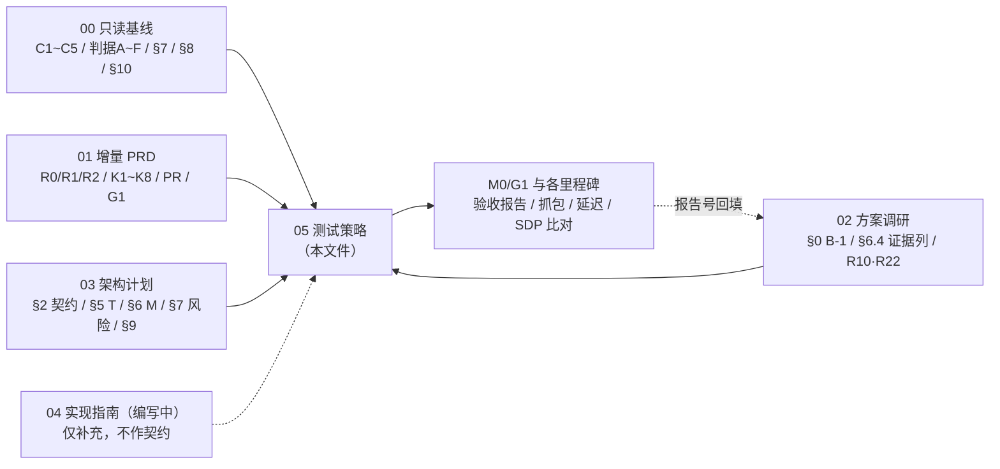
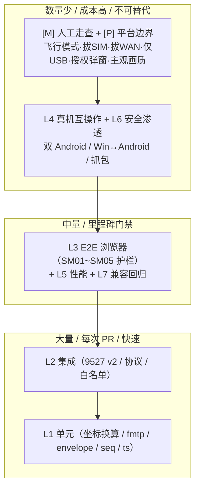

# 05 · 测试策略与验收方案（Test Strategy & Acceptance Plan）

> 本文件是「详细开发文档」交付物中的**测试与验收部分**，对应任务 #6（software-qa-engineer）。
> 本轮范围：**只产出测试策略与验收文档**。不修改 `src/`、`android/`、`web/`、`tests/` 任何源码，不新建测试代码文件，不做 git 操作，不与其他成员直连。
> 本文所有「现状描述」均附 `文件路径:行号` 证据；凡引用既有测试断言，均以已落盘代码为准，**不编造现有测试中不存在的断言**。
> 接口契约以 `03-architecture-and-plan.md` §2 为唯一准绳；`04-implementation-guide.md` 由工程师并行编写，本文启动时未落盘，故不依赖、不阻塞。
> 作者：严过关（Yan）· QA 工程师（software-qa-engineer）｜日期：**2026-11-12**｜状态：**草案 v0.1**（待主理人齐活林汇编；**M0/G1 未出结论前，本文的里程碑出口条件不得用于排期估工**）。

---

## 1. 文档元信息、依赖关系与编号对照

### 1.1 元信息与变更记录

| 项 | 值 |
|---|---|
| 文档编号 | **05** |
| 文件名 | `docs/redesign/05-test-strategy.md` |
| 版本 | **v0.1（草案）** |
| 日期 | **2026-11-12** |
| 作者 | **严过关（Yan）· QA 工程师（software-qa-engineer）** |
| 状态 | **草案** — 待主理人齐活林汇编；待用户对 Q1~Q19 拍板；待 M0/G1（Q9 真机 PoC）回答后升版 |
| 上游基线 | `00-feasibility-baseline.md`（**只读**：C1~C5、判据 A~F、源码实证、四大缺口、§7 平台级不可行、§8 Q9 静态推断、§10 证据索引） |
| 语言 | 中文 |
| 本文定位 | 把「判据 A~F / 需求池 R0·R1·R2 / 兼容红线 K1~K8 / 产品红线 PR-1~PR-6 / 门禁 G1 / 里程碑 M0~M8」翻译成**可执行、可取证、可签字**的测试用例与退出条件 |

**变更记录**

| 版本 | 日期 | 作者 | 变更 |
|---|---|---|---|
| v0.1 | 2026-11-12 | 严过关 | 初始草案。基于 00~03 已落盘文档 + `tests/UniLinker.E2E.Tests` 源码实证，建立：现有测试资产盘点、七层测试策略、判据 A~F 自动化方案、用例矩阵 TC-xxx、八个专项方案、M0/G1 与 M1~M8 出口条件、环境设备矩阵、报告模板与编号规则、风险与盲区清单 |

### 1.2 与 00~04 的依赖关系

| 文档 | 角色 | 本文如何依赖 | 状态 |
|---|---|---|---|
| `00-feasibility-baseline.md` | 只读基线 | **最高约束**：C1~C5、判据 A~F 的定义与通过标准、§4 零流量结论、§6 硬瓶颈、§7 平台级不可行项、§8 Q9 三重协议 bug、§10 证据索引，全部以它为准；现状行号证据出自此 | 已归档（只读） |
| `01-product-requirements.md` | 增量 PRD | 需求池 R0-01~15 / R1-01~15 / R2-01~07、K1~K8 兼容红线、PR-1~PR-6 产品红线、门禁 G1、Q1~Q19 默认答案，是**用例可追溯性的唯一来源** | 已落盘（草案） |
| `02-options-and-research.md` | 方案与调研 | **§0 B-1 基线修正**（本文测试口径必须采用修正后表述）、§6.4 证据列（本文报告号需可被其引用）、§5 论文白名单 R10/R22（编解码用例依据）、§5.6「不该上」清单（明确不做项）、§6.3 推荐方案 ② 3.80/5.00 | 已落盘 |
| `03-architecture-and-plan.md` | 架构与计划 | **§2 接口契约（唯一准绳）**：v2 envelope、ControlMessage、`FrameGeometry` 换算表、AuthAction、MediaCapability；**§5 T01~T05**、**§6 M0~M8 里程碑**、**§7 风险登记册**、**§9 构建硬约束**、§10.1 L1~L14 锁定决策 | 已落盘 |
| `04-implementation-guide.md` | 详细开发文档（工程师并行编写） | **不作为契约来源**。仅在其落盘后作为「实现细节补充」查阅；本文所有接口字段名/类型/状态机均以 03 §2 为准。若 04 与 03 §2 出现字段差异，以 03 §2 为准并报主理人裁决 | 编写中（本文未依赖） |

> ⚠️ **文档编号口径说明（需主理人裁决，详见 §11.6 / 附录 A）**：`01` §"文档依赖" 规划图中把 `03` 标为「详细开发文档」、`04` 标为「测试策略与验收文档」、`05` 标为「方案评估总览」。而本轮主理人实际派发落盘的编号是：`03` = 架构与计划、`04` = 实现指南、`05` = **测试策略（本文件）**。`01` 自己在该图下注明「02/03/04/05 的编号与文件名为本轮规划，最终以主理人确认为准」。本文一律按**主理人派发的实际编号**书写，建议主理人在 `01` 规划图补注「本轮实际编号以派发为准」以免下游引用错乱。

**依赖链（本文件视角）**



### 1.3 术语、编号与标记体系对照表

**① 上游编号（本文不改写，仅引用）**

| 类别 | 编号 | 出处 | 本文用途 |
|---|---|---|---|
| 硬约束 | **C1~C5** | `00` §1 | 判据 A~F 与零流量用例的上位约束；违反即 V1/V2 出局 |
| 验收判据 | **A~F** | `00` §1 | §4 逐条自动化方案；判据 E 当前不可达 |
| 默认问题 | **Q1~Q19**（+ 架构新增 **Q20~Q22**） | `01` §6 / `03` §8 | 阻塞选型 Q9/Q11/Q13/Q14 按默认答案；Q22 旋转标定见 §6 |
| 需求池 | **R0-01~15 / R1-01~15 / R2-01~07** | `01` §3 | 每条 TC 的「对应需求」列 |
| 兼容红线 | **K1~K8**（保留资产 K-01~K-11） | `01` §1.2 / §1.1 | §10 兼容回归集、R0-15 门禁 |
| 产品红线 | **PR-1~PR-6** | `01` §7 | 放行签字时的红线核对表 |
| 门禁 | **G1 = M0** | `01` §3.1 / `03` §6 | §11 最优先前置门禁 |
| 评分 | **D1~D9 / V1~V5** | `01` §4 / `02` §6 | 本文不打分，仅引用 §6.4 证据列 |
| 基线修正 | **B-1 / B-2 / B-3** | `02` §0 | **B-1 直接决定 §2/§9 的测试口径** |
| 论文 | **R1~R22** | `02` §5 | R10（RFC 7742）、R22（fmtp）、R17/R18（平台授权） |
| 任务 | **T01~T05** | `03` §5 | 用例与里程碑的责任归属 |
| 里程碑 | **M0~M8** | `03` §6 | §11 出口条件 |
| 技术决策 | **L1~L14** | `03` §10.1 | L4（fmtp）、L6（坐标）、L9（延迟打点）、L14（测试口径） |
| 现有 E2E | **SM01~SM05 / FT01~FT03 / Debug_×2** | `tests/UniLinker.E2E.Tests` | §2 盘点对象 |
| 本文用例 | **TC-001~TC-0xx** | §5 | 用例矩阵编号 |
| 本文报告 | **POC- / CAP- / LAT- / MIL- / SDP- / GEO- / SEC-** | §13 | 供 `02` §6.4 证据列引用 |

**② 本文「测试方式」标记（全篇统一，避免"测试通过"这类空话）**

| 标记 | 含义 | 判定标准 | 允许的结论 |
|---|---|---|---|
| **[A] 可自动化** | 可由脚本 / CI / E2E / instrumentation 判定 Pass/Fail | 有布尔断言或量化阈值，输出机器可读结果 | 「通过 / 不通过」 |
| **[M] 需人工走查** | 必须真机人工操作或主观判定，附录屏 / 截图 / 走查清单签字 | 有可执行 checklist + 证据产物 | 「走查通过（附证据号）/ 不通过」 |
| **[P] 平台限制不可测通过** | 平台级不可能注入或不可能由自动化触发成功，**只能验证「降级提示用户自行操作」是否出现** | 只断言「提示 UI / `SUSPENDED` 状态 / 文案」出现 | 「降级提示已验证（非功能通过）」，**严禁写「功能通过」** |
| **[X] 当前不可达 / 阻塞** | 依赖尚未实现的能力（典型：判据 E 仅 USB） | 标记 NOT-TESTABLE 并给解除阻塞的里程碑 | 「待 M8 解除阻塞」 |

**③ 缺陷分级标记（§11.3 定义）**：`Blocker` / `Major` / `Minor`。

**④ 通过标准的书写规则**：本文每条判据与用例的「通过标准」必须包含**可观测对象 + 量化阈值 + 观测手段 + 证据产物**四要素之一以上；禁止出现「功能正常」「测试通过」「符合预期」等无阈值表述。

---

## 2. 现有测试资产盘点（源码实证）

### 2.1 目录结构与测试框架

`tests/UniLinker.E2E.Tests/` 实测结构（Glob 结果，未修改）：

```
tests/UniLinker.E2E.Tests/
├── README.md                      # 测试说明（注意：内容滞后，见 §2.6）
├── UniLinker.E2E.Tests.csproj     # net9.0 / xunit 2.9.2 / Playwright 1.48.0 / FluentAssertions 7.0.0
├── xunit.runner.json              # parallelizeTestCollections=false, maxParallelThreads=1（强制串行）
├── TestData/sample.txt
├── Fixtures/
│   ├── AppFixture.cs              # 启动真实 WinUI 应用；BaseUrl=http://localhost:9527
│   └── PlaywrightFixture.cs       # 优先 msedge/chrome channel，回退 bundled Chromium
└── Tests/
    ├── ScreenMirrorTests.cs       # SM01~SM05（Category=ScreenMirror）
    ├── DebugConnectionTest.cs     # Debug_ConnectAndDump / Debug_ConnectAndScreenshot（Category=Debug）
    └── FileTransferTests.cs       # FT01~FT03（Category=FileTransfer）
```

框架约束（`UniLinker.E2E.Tests.csproj:3-8` 为 `net9.0`、`PlaywrightPlatform=win-x64`；`xunit.runner.json:4-5` 串行单线程）：**所有 E2E 共用一个真实应用实例与 9527 端口，天然不可并行**。这是 §10 设计 Android 互操作 fixture 时的硬约束。

### 2.2 现有 Category 与用例清单

| Category | 用例 | 数量 | 运行命令 |
|---|---|---:|---|
| `ScreenMirror` | SM01 / SM02 / SM03 / SM04 / SM05 | **5** | `dotnet test tests/UniLinker.E2E.Tests --filter "Category=ScreenMirror"` |
| `Debug` | `Debug_ConnectAndDump` / `Debug_ConnectAndScreenshot` | **2** | `dotnet test tests/UniLinker.E2E.Tests --filter "Category=Debug"` |
| `FileTransfer` | FT01 / FT02 / FT03 | **3** | `dotnet test tests/UniLinker.E2E.Tests --filter "Category=FileTransfer"` |

完整回归命令（来自 `CLAUDE.md:19-21`、`tests/UniLinker.E2E.Tests/README.md:26-37`）：

```bash
# 全部 E2E
dotnet test tests/UniLinker.E2E.Tests
# 屏幕镜像（含 SM05 全链路护栏）
dotnet test tests/UniLinker.E2E.Tests --filter "Category=ScreenMirror"
# 诊断类（SDP dump / 截图，无断言）
dotnet test tests/UniLinker.E2E.Tests --filter "Category=Debug"
# 文件传输 API
dotnet test tests/UniLinker.E2E.Tests --filter "Category=FileTransfer"
```

> **构建前置硬约束**（`CLAUDE.md:9-14`、`README.md:34-35`、`03` §9）：E2E 依赖真实应用可执行文件，**必须先用 MSBuild 构建**，`dotnet build` 因缺 AppxPackage/PRI 任务会失败：
> `"C:/Program Files/Microsoft Visual Studio/2022/Community/MSBuild/Current/Bin/amd64/MSBuild.exe" UniLinker.sln -p:Configuration=Debug`
> `AppFixture.cs:24-33` 硬编码 exe 路径为 `src/UniLinker.WinUI/bin/Debug/net9.0-windows10.0.22621.0/win-x64/UniLinker.WinUI.exe`，未找到即抛 `FileNotFoundException`。

### 2.3 SM01~SM05 逐条断言（严格按已落盘代码，不增不减）

| 用例 | 位置 | 断言内容（实际代码） | 未断言的点（如实记录） |
|---|---|---|---|
| **SM01_Browser_CanAccessHomepage** | `ScreenMirrorTests.cs:36-54` | `GotoAsync("/index.html")` → `TitleAsync()` 包含 `"UniLinker"`；`.logo` `IsVisibleAsync()==true`；`#btnConnect` `IsVisibleAsync()==true` | 无网络/流量断言；无版本断言 |
| **SM02_Browser_CanConnectToHost** | `ScreenMirrorTests.cs:58-76` | `#hostInput` 填 `"localhost"` → 点 `#btnConnect` → 15s 内出现 `.status-dot.connected` → `#statusText` 文本 == `"已连接"` | **只查 UI 状态文本，未断言 WebRTC `connectionState === 'connected'`**（见 §2.4 B-1） |
| **SM03_Browser_ReceivesVideoStream** | `ScreenMirrorTests.cs:80-112` | 20s 内 `#remoteVideo` 满足 `style.display !== 'none' && srcObject !== null`；`IsVisibleAsync()==true`；`video.play()` 后 `readyState >= 2 && videoWidth > 0` 为 `true` | 未断言帧内容非空/非黑屏；未断言 `currentTime` 递增；未断言连续出帧 |
| **SM05_Browser_ReceivesActualVideoData** | `ScreenMirrorTests.cs:116-157` | **最强全链路断言**：连接后等待 `srcObject !== null`（20s）、`readyState>=2 && videoWidth>0`（30s）；`video.play()` 后延迟 1500ms，采集 `JSON.stringify({readyState, videoWidth, videoHeight, currentTime, trackState})` 打印 `[SM05] video stats`；最终断言 **`stats.Should().NotContain("\"videoWidth\":0")`** | 代码注释自称 `capture -> encode -> RTP -> decode` 全链路（`ScreenMirrorTests.cs:118-119`），但**实际断言仅排除 `videoWidth:0` 一种取值**：未断言 `currentTime` 递增、未断言 `trackState=="live"`、未断言解码帧数、未断言画面内容/色偏/花屏、未断言码率帧率延迟 |
| **SM04_Browser_CanDisconnect** | `ScreenMirrorTests.cs:161-188` | 连接后再次点 `#btnConnect` → 5s 内 `#statusText` 出现 `已断开` → 文本 == `"已断开"` → `#remoteVideo` `IsVisibleAsync()==false` | 未断言资源释放（sink / DataChannel / PeerConnection 关闭） |

> **SM05 的正确解读（QA 口径）**：它是当前仓库**唯一**验证「采集→编码→RTP→解码」真实出帧的护栏（`00` §2/§4、`02` §6.4、`03` §9.2 均以其为不可回归护栏，K3/R0-15 依赖它）。但它证明的是「**localhost 上、浏览器端、带 STUN 配置的观看页能出帧**」，**不等于**「零 STUN 的跨设备 LAN/热点可建连」——这正是 `02` §0 **B-1** 的修正对象（§2.4）。

### 2.4 B-1 基线修正：DebugConnectionTest.cs:44-68 只做 SDP 交换、未断言 connected

`00` §4 原文写「`DebugConnectionTest.cs:45` 与 `ScreenMirrorTests.cs:116-157` **证明**纯 host candidate 在 LAN 可建连」。`02` §0 **B-1** 已把该表述降级为「高置信静态推断」。实测代码支持 B-1：

| 事实 | 证据 |
|---|---|
| `Debug_ConnectAndDump` 用 `new RTCPeerConnection({ iceServers: [] })` 手工建连 | `tests/UniLinker.E2E.Tests/Tests/DebugConnectionTest.cs:45` |
| 只做 `addTransceiver('video',{direction:'recvonly'})` → `createOffer` → `setLocalDescription` → 等 `iceGatheringState==='complete'`（含 `setTimeout(r,3000)` 兜底）→ `POST /signaling`（body 含 `type/sdp/fromPeerId:'debugtest'/capability:'screen-capture'`） | `DebugConnectionTest.cs:44-68` |
| 返回值是 `JSON.stringify({status, body, offer})`，随后**仅** `Console.WriteLine("[answer raw] ...")` + 把 offer 写入 `%TEMP%/offer.sdp` | `DebugConnectionTest.cs:66-76` |
| **整个方法没有任何 FluentAssertions 断言**，且**从未读取 `pc.connectionState`，从未断言 `connected`** | `DebugConnectionTest.cs:39-77`（通篇无 `Should()`） |
| `Debug_ConnectAndScreenshot` 同样**无断言**，仅 `WaitForFunction(readyState>=2 && videoWidth>0)` 后 `ScreenshotAsync` 到 `%TEMP%/viewer-live.png` | `DebugConnectionTest.cs:81-102` |
| 真正跑通 SM05 的观看页 **仍配置公网 STUN** | `web/app.js:111-113`（实测 `web/app.js:112` = `iceServers: [{ urls: 'stun:stun.l.google.com:19302' }]`） |
| Windows 侧本身确为 `iceServers = []` | `src/UniLinker.Core/PeerConnection.cs:48`（实测注释 `// LAN only, no STUN needed initially`） |

**测试口径裁决（本文全篇采用）**：
1. 现有 E2E 证明的命题收敛为：**「localhost 全链路出帧（浏览器端带 STUN 配置）」+「Windows 侧 host candidate 必然产生（静态推断）」**；
2. **「移除 Android / 浏览器两处 STUN 后跨设备 LAN / 热点仍可建连」是未验证命题**，列为 **M0 门禁（T01）** 的必测项（见 §9.3 与 §11.1），在 M0 通过前，任何判据 A/C/D 的"纯 host candidate 建连"步骤都只能标 `[A]` 待验证，不得写「已证明」；
3. 建议主理人在 `00` §4 补注 B-1 修正（`00` 文件头已声明「若后续真机验证推翻静态推断条目，请修订本文件并在修订记录说明」），避免下游仍引用"已证明"表述。→ 列入 §11.6 裁决清单。

### 2.5 Playwright fixture 必须用系统 Edge/Chrome channel（自带 Chromium 无 H264）

| 事实 | 证据 |
|---|---|
| fixture 依次尝试 `channel = "msedge"`、`"chrome"`，成功即 break | `tests/UniLinker.E2E.Tests/Fixtures/PlaywrightFixture.cs:30-44` |
| 两者都失败才回退 `launchOptions.Channel = null`（bundled Chromium），并**明确打印** `H264 tests will fail` | `PlaywrightFixture.cs:45-50` |
| 原因注释：Playwright 自带 Chromium 为开源构建，**无 H264 编解码器**，屏幕镜像流程无法在其上测试 | `PlaywrightFixture.cs:22-24`；`CLAUDE.md:23-24`；`README.md:91-97` |
| 启动参数 `Headless=true` + `--disable-gpu --disable-software-rasterizer --autoplay-policy=no-user-gesture-required` | `PlaywrightFixture.cs:25-29` |
| `AppFixture` 固定 `SignalingPort=9527`、`BaseUrl="http://localhost:9527"`，轮询 `GET /info` 判就绪（30s 超时） | `AppFixture.cs:15-16,68-99` |

> **对 CI 的含义**：任何跑 `Category=ScreenMirror` 的 runner **必须预装 Microsoft Edge 或 Chrome**，否则 fixture 静默回退到无 H264 的 bundled Chromium，SM03/SM05 必然失败，且失败原因易被误判为「采集/编码回归」。CI 应增加一条前置检查：断言 fixture 日志出现 `[PlaywrightFixture] Browser launched (channel: msedge|chrome)`，出现 `bundled chromium` 即判定环境不合格（`[A]`）。

### 2.6 现有覆盖的最大缺口：只有浏览器端、没有任何 Android 互操作测试

**这是本轮测试策略要解决的第一问题。** 实证如下：

| 缺口 | 证据 |
|---|---|
| 全部 E2E 均为 **Playwright 驱动浏览器观看 Windows 发送的画面**，被测对象是 `web/app.js` + `SignalingServer` + `ScreenMirrorPlugin` 的 Windows 采集编码链 | `ScreenMirrorTests.cs:10-11`（注释 `Browser -> SignalingServer -> ScreenMirrorPlugin -> Video stream`）；`AppFixture.cs:15-16` |
| **全部用例连的都是 `localhost`**，无任何跨设备 LAN / 热点 / Wi-Fi Direct / USB 用例 | `AppFixture.cs:16`；`ScreenMirrorTests.cs:39,61,83,120,164`（均 `BaseUrl + /index.html`）；`SM02/SM03/SM05` 填 `"localhost"`（`:65,:87,:123`） |
| **零 Android 互操作测试**：无 instrumentation test、无 adb 驱动、无 Android 端断言、无双 Android 场景 | `Glob tests/UniLinker.E2E.Tests/**/*` 结果仅 3 个 `.cs` 测试文件，均为 C#/Playwright；`00` §8 亦明示「仓库 E2E 仅覆盖浏览器端」 |
| 零 K1~K8 回归、零判据 A~F 抓包、零移动数据用量统计、零延迟/画质客观指标、零控制/坐标/授权/撤销用例 | §2.3 断言逐条核对；`FT01~FT03` 仅断言 `/info`、`/api/status` 返回体含字段（`FileTransferTests.cs:42-83`），**未做 100 MB 文件 + SHA256 校验**（K4 未真正覆盖） |
| 零 10min 稳定性、零丢包注入、零 SDP 字段比对、零 v1/v2 双协议用例 | 全部测试文件通读 |

**由此推导的「现有测试能力边界」表（本文用例设计的起点）**

| 验收对象 | 现有是否覆盖 | 本文补充位置 |
|---|---|---|
| 浏览器免安装观看 H264（K3 最小面） | 部分（SM03/SM05 出帧，但仅 `videoWidth≠0`） | §10 兼容回归 + §8 画质客观指标 |
| 采集→编码→RTP→解码全链路真实出帧 | 部分（SM05，localhost，带 STUN） | §9 编解码互通、§5 场景用例 |
| 零流量 / 无公网 IP / 无外网 DNS（判据 A~F） | **无** | §4 全章 |
| 跨设备 LAN / 热点直连 / 无 SIM / 飞行模式 | **无** | §4、§5 |
| Android 作发送方 / 信令方 / 被控方 | **无** | §5、§9、§10 |
| 控制注入 / 坐标映射 / 旋转 / 黑边 | **无** | §6 |
| 授权 / 撤销 ≤1s / 常驻指示 / 渗透 | **无** | §7 |
| 延迟 P50/P95 / 3% 丢包 / 10min 稳定 | **无** | §8 |
| SDP 字段一致性 / fmtp / host candidate | **无**（`Debug_ConnectAndDump` 只 dump 不比） | §9 |
| 插件 ABI / 外部 DLL / v1·v2 并存（K7） | **无** | §7.8、§10.4 |

### 2.7 现有测试资产自身的两处不一致（记录，不修改）

| # | 不一致 | 证据 | 影响 |
|---|---|---|---|
| T-1 | `README.md` 的 Category 表写 `ScreenMirror \| SM01-SM04`（4 个），且「Test Details」章节标题为「ScreenMirror Tests (4 tests)」，只列 SM01~SM04；**代码实际有 SM01~SM05 共 5 个 `[Fact]`**，且 SM05 是最强全链路护栏 | `tests/UniLinker.E2E.Tests/README.md:43,48-55` vs `ScreenMirrorTests.cs:34,56,78,114,159` | 极易导致 CI 只按 README 勾验 4 条、**漏跑 SM05**；列入 §14「最易漏测」清单 |
| T-2 | `README.md` Troubleshooting 的 exe 路径写 `net9.0-windows10.0.19041.0`，而 fixture 代码与 `CLAUDE.md:57` / `03` §9 钉死的是 `net9.0-windows10.0.22621.0` | `tests/UniLinker.E2E.Tests/README.md:86` vs `AppFixture.cs:26` | 排障时按 README 找错目录；本文构建口径以 fixture 代码 / TFM 钉死为准 |

> 两处均**仅记录**（本轮不得修改测试代码/文档源码），建议主理人转交工程师在 T01 或独立 `docs` 提交中修订 README。

---

## 3. 测试分层与策略

### 3.1 七层测试定义

| 层 | 测什么（范围） | 由谁负责 | 何时跑 | 进入哪个里程碑出口 | 自动化程度 |
|---|---|---|---|---|---|
| **L1 单元** | `CoordinateMapper.Map/Recompute` 的 4 旋转换算表（03 §2.4）、`ICapabilityNegotiator.Intersect/BuildFmtp`、v2 envelope 双解析器、`ts ±30s` 窗口、`seq` 乱序丢弃、`sessionToken` 绑定校验、白名单网段判定（RFC1918/ULA/链路本地/USB） | 工程师写、QA 审 | 每次 PR / commit | 全里程碑（尤其 M3/M4/M9 无，M0~M5） | **[A]** 100% |
| **L2 集成** | 9527 v2 端点（`/info` 通告 `protocolVersions`、`/signaling` offer/answer 双向、`/ice` 与 `/ice-pending`、`/restart`）、`SignalingServer` ↔ `PeerMesh` ↔ `PeerConnection` 绑定、v1 旧客户端 fallback（`SignalingServer.cs:286-296`）、`LinkManager` 白名单自检输出 | 工程师 + QA | 每次 PR | M0/M1/M2/M4 | **[A]** 高 |
| **L3 E2E（浏览器）** | 现有 SM01~SM05 + FT01~FT03 全绿；新增「去 STUN 后浏览器仍出帧」回归（Q16）；`web/app.js` 每次改动同步 | QA | 每次 PR（CI） | **M0~M8 全程护栏**（不可回归） | **[A]** |
| **L4 真机 / 互操作** | 双 Android 同 LAN / 热点 / Wi-Fi Direct / USB；Win↔Android；Android↔Android；角色协商出帧；MediaProjection 授权弹窗；无障碍开启；4 旋转坐标落点；撤销计时 | QA（真机台）+ 工程师配合 | 里程碑门禁 + 夜间设备队列 | M0/M1/M2/M3/M4/M6/M7/M8 | **[A]+[M]** 混合 |
| **L5 性能** | `frameTimestampUs`→`renderCompleteAtUs` P50/P95（`MediaFeedback` optional 字段，C-3 / `03` §2.5）；720p30/2-4Mbps/≤150ms；1080p60/≤80ms（Q13 条件）；3%/5% 丢包；10min 连续；CPU/内存/温度/多接收端并发 | QA | 里程碑前 + 夜间长稳 | M1（10min）、M5（全量）、M7 | **[A]** 采集 + **[M]** 判读 |
| **L6 安全** | 未授权注入拒绝、≤1s 撤销、token 重放/伪造、CORS 收敛、DTLS-SRTP、局域网未授权连接渗透、`scope` 最小权限、`SUSPENDED` 平台边界 | QA + 架构师复核 | 里程碑门禁 + 每次鉴权代码改动 | M1/M4/M7 | **[A]** + **[M]** + **[P]** |
| **L7 兼容性回归** | K1~K8 逐条走查、R0-15 门禁、v1/v2 双协议并存集、外部 `plugins/` DLL 挂载（K7/WinRT.Runtime 一致性）、GUI 主题双语（K5）、文件 100MB+SHA256（K4） | QA | 每次 PR（子集）+ 每里程碑（全量） | **M1/M5 强制**，其余抽检 | **[A]** + **[M]** |

### 3.2 测试金字塔（本项目的形状）



**本项目金字塔是「宽底 + 厚顶」而非理想三角**：因为 `00` §7 平台级不可行项、判据 A/B/C/E 的飞行模式/拔 SIM/拔 WAN/仅 USB、以及国产 ROM 组播差异，**大量验收天然无法自动化**，只能靠真机 + 人工走查 + 抓包取证。测试策略必须诚实承认这一点，并把它转化为「证据产物 + 走查清单 + 签字规则」（§4.7、§11.5、§13），而不是伪装成全自动化 CI。

### 3.3 CI 触发策略建议（不修改任何 CI 文件，仅为建议）

| 触发 | 跑什么 | 环境要求 | 阻断规则 |
|---|---|---|---|
| **PR / push 到 `dev/<feature>`** | L1 单元 + L2 集成 + `dotnet test --filter "Category=ScreenMirror"` + `Category=FileTransfer`；MSBuild 构建校验；TFM/`WindowsSdkPackageVersion` 钉死校验（`03` §9） | Windows runner + 已装 **Edge 或 Chrome**；检查 fixture 日志 channel（§2.5） | SM01~SM05 任一红 = 阻断合并；bundled Chromium 回退 = 阻断（环境不合格） |
| **每次 `web/app.js` 变更** | 强制追加 SM01~SM05 全量 + 「去 STUN 后仍出帧」用例（Q16） | 同上 | 断言不变，`ScreenMirrorTests.cs` 同步更新（§10.3） |
| **每次鉴权 / 协议代码变更** | L2 集成 + L6 安全子集（token 重放/伪造、CORS、seq、ts） | 无需真机 | 未授权注入用例红 = 阻断 |
| **每日夜间（nightly）** | L5 长稳 10min + 3% 丢包 + 延迟打点采样；L4 真机队列（若设备常驻） | 真机台 + 时间同步 | 只报警不阻断，产出 LAT-/CAP- 报告草稿 |
| **里程碑门禁（M0~M8）** | 该里程碑全部出口条件 + 全量 K1~K8 回归 + 判据 A~F 复核 + 报告齐备 | 完整设备矩阵（§12） | **任一 Blocker/Major 未闭 + 报告未齐 = 不放行**（§11） |
| **明确不可进 CI（只能人工台账）** | 飞行模式 / 拔 SIM / 拔 WAN / 仅 USB / 省电策略冻结复现 / 锁屏·FLAG_SECURE·BiometricPrompt·UAC 降级提示 / 文字可读性与色偏主观判读 / MediaProjection 与无障碍系统设置授权 | 真机 + 人 + 录屏 | 以 `[M]`/`[P]` 走查清单 + 证据号 + 签字替代 |

> **端口与串行约束**：`xunit.runner.json:4-5` 已禁用并行；`AppFixture` 启动真实应用占用 9527；`AndroidSignalingServer.kt`（FGS，9527，`03` §5 T02）在真机侧也监听 9527。因此**浏览器 E2E 与 Android 互操作用例不得同进程并行**，须用独立 xUnit Collection / 独立 runner 队列串行执行，避免端口与 fixture 互杀（§10.2）。

---

## 4. 判据 A~F 自动化方案（核心章节）

> 判据定义以 `00` §1 为准，不得改写：
> **A** 飞行模式 + 直连可用且流量不增；**B** 拔 WAN 全功能；**C** 拔 SIM 可作发送/接收/被控；**D** 抓包目的地址均私有网段或 USB、无公网 IP 与外网 DNS；**E** 仅 USB 关 Wi-Fi 与蜂窝可用；**F** 无计费/无登录弹窗。

### 4.0 判据通用取证规范

**工具清单**

| 工具 | 用途 | 部署位置 |
|---|---|---|
| Wireshark / `tshark`（Windows）、`tcpdump`（Android，`adb shell tcpdump` 或 root/免 root VPN 抓包方案） | 抓目的 IP / DNS 查询 / STUN / mDNS / DTLS-SRTP | 发送端、接收端、热点主三处同时抓 |
| Android「设置 → 网络和互联网 → 数据使用」/ `adb shell dumpsys netstats` / `TrafficStats` API | 蜂窝移动数据用量前后差值 | 双 Android |
| 飞行模式开关、SIM 卡托、可拔 WAN 的路由器、USB 数据线 + `adb` | 构造判据物理条件 | 人工 |
| `LinkManager` 白名单自检输出（`03` §5 T03 / §3.2） | 枚举绑定网卡与 candidate 地址 | 应用内日志（`%APPDATA%\uniLinker\unilinker.log`，`CLAUDE.md:71`） |
| 系统移动数据用量截图 + 抓包 `.pcapng` + 应用日志 | 证据产物 | 归档 |

**抓包判读规则（写成可自动判定的规则，供 `[A]` 脚本使用）**

| 判定项 | 通过规则 | 失败特征 |
|---|---|---|
| 目的 IPv4 | 全部属于 `10/8`、`172.16/12`、`192.168/16`、`169.254/16`（链路本地）、`127/8`（本机）、热点典型 `192.168.43.x`/`192.168.137.x`，或 USB 虚拟网卡网段 | 任意非上述公网单播目的 IP |
| 目的 IPv6 | 全部为 ULA `fc00::/7`、链路本地 `fe80::/10`、loopback `::1` | 全局单播 `2000::/3` |
| DNS | **零** 出站 DNS 查询到公网解析器；允许 mDNS `224.0.0.251:5353` / `ff02::fb`（本地组播，不算外网）；允许无 DNS（纯 IP 直连，最优） | 出现 `stun.l.google.com` 等外网域名 A/AAAA 查询 |
| STUN / 公网特征 | 零 `3478`/`19302` 且目的为公网的 UDP；零 `stun:` 配置生效 | 命中即判据 D 失败 |
| 媒体/信令 | 信令为 `http://<私网IP>:9527`（`03` §2.2 `SignalingEndpoint`）；媒体为 DTLS-SRTP（`WebRTCService.kt:61`）且 candidate 仅 `host` 类型 | 出现 `srflx`/`relay` candidate、出现 TURN |
| 蜂窝归属 | 抓包网卡集合中不含蜂窝接口（`rmnet`/`ccmni`/`wwan` 等），`LinkManager` 自检输出不含蜂窝 `NetworkCapabilities` | 命中即 C1 / 判据 A 失败 |

> **两处必须去除的公网 STUN（判据 D 的前置改造，T01 完成判据）**：`android/.../core/WebRTCService.kt:76`（实测 `PeerConnection.IceServer.builder("stun:stun.l.google.com:19302")`）与 `web/app.js:112`（实测 `iceServers: [{ urls: 'stun:stun.l.google.com:19302' }]`）。去 STUN 后 `iceServers=[]`，仅产生 host candidate；**该建连在跨设备 LAN/热点下能否成功仍须 M0 真机验证（B-1）**，不得预先判定通过。

### 4.1 判据 A · 飞行模式 + 直连可用且流量不增

| 项 | 内容 |
|---|---|
| **对应** | C1/C4/C5、R0-02/04/09、US-04、M2、判据 A |
| **方式** | **[A]** 抓包 + 用量差值自动化判定；**[M]** 飞行模式开关与热点开启人工操作 |
| **前置条件** | T01/T02/T03 完成；两处 STUN 已去除；`SignalingServer.cs:60` 网卡白名单收敛；`WebRTCService.kt:62 disableNetworkMonitor=true` 已改为 `ConnectivityManager.NetworkCallback`（`03` §3.2）；热点主固定为 `FIXED_HOST`；`MulticastLock.acquire()` 已补（`00` §5） |
| **可执行步骤** | 1. 记录两端蜂窝数据用量基线 `U0`（`dumpsys netstats` + 设置页截图）；<br>2. 两台 Android **双双开启飞行模式**（关闭蜂窝与 Wi-Fi），随后**仅手动打开 Wi-Fi 并开热点**（A 为主机、B 接入）；确认无 SIM 亦可；<br>3. 三处同时启动抓包（A/B/热点主）；<br>4. 走完整链路：`mDNS/NSD 发现 ≤5s` → `GET /info` → 连接码/手动 IP 配对（≤30s）→ 角色协商 → 授权 → MediaProjection 采集 → **真机出帧** → 触控注入 → 撤销；<br>5. 连续 10 min；<br>6. 停止抓包，再取 `U1`；<br>7. 链路切换演练：关热点 / 切到另一路直连，验证 `ICE restart` 后 ≤3s 恢复出帧（R0-13） |
| **通过标准（量化）** | ① 全链路出帧成功（接收端 `videoWidth>0` 且画面可读）；② **`U1 − U0` 的蜂窝移动数据增量 == 0 字节**（容差：系统后台基线噪声需在报告中单列并证明与本应用无关）；③ 抓包集合按 §4.0 规则 **零公网目的 IP、零外网 DNS、零 srflx/relay candidate**；④ 飞行模式下蜂窝接口无本应用流量；⑤ 首次配对 ≤30s、发现 ≤5s；⑥ 10min 无断流；⑦ 链路切换 ≤3s 恢复 |
| **证据产物** | `CAP-A-M2-NNN`（`.pcapng` + 判读结果）、用量前后截图、`LAT-` 打点日志、走查清单签字；报告号回填 `02` §6.4 D2 证据列 |
| **无法自动化部分** | 飞行模式物理开关、热点开启、SIM 状态确认、画面「可读」主观判读 → **[M]** 走查（§4.7 W-01/W-02/W-06） |

### 4.2 判据 B · 拔 WAN 全功能

| 项 | 内容 |
|---|---|
| **对应** | C5、R0-02/03、判据 B、M2/M5 复核 |
| **方式** | **[A]** 功能回归脚本 + 抓包；**[M]** 物理拔 WAN |
| **前置条件** | 路由器 LAN 侧正常、WAN 口可物理断开；应用运行期零外网依赖（`00` §4） |
| **可执行步骤** | 1. 同 LAN 下先跑一遍全功能基线（发现/配对/投屏/控制/文件互传 100MB+SHA256/浏览器观看 SM05）；<br>2. **物理拔掉路由器 WAN 线**（LAN/Wi-Fi 保持）；<br>3. 重跑同一全功能回归集，逐项记录；<br>4. 抓包确认无「因 WAN 断开而产生的重试公网连接 / 超时等待」；<br>5. 观察应用是否出现登录/激活/云校验弹窗（判据 F 联动） |
| **通过标准** | ① 拔 WAN 前后**全部用例通过率一致**（无新增失败项）；② 无任何指向公网的 SYN/DNS/重传；③ 发现 ≤5s、出帧正常、控制注入有效、文件 100MB SHA256 一致、浏览器 SM01~SM05 全绿；④ 应用无「网络不可用」误报（LAN 仍可用）；⑤ 无 >3s 的因外网超时导致的界面卡顿 |
| **证据产物** | `CAP-B-M2-NNN`、回归集执行日志、`SEC-` 无外网依赖复核、走查签字 |
| **无法自动化部分** | 拔 WAN 物理动作、GUI 无异常弹窗目视 → **[M]**（§4.7 W-03） |

### 4.3 判据 C · 拔 SIM 可作发送/接收/被控

| 项 | 内容 |
|---|---|
| **对应** | C4、R0-09、US-03、判据 C、M2 |
| **方式** | **[A]** 三角色矩阵自动化 + 抓包；**[M]** 拔 SIM、Wi-Fi-only 平板确认 |
| **前置条件** | 至少 1 台**无 SIM / Wi-Fi-only** 设备（§12）；MediaProjection 与无障碍授权与 SIM 无关（`00` §7 / `03` §4.3 硬约束） |
| **可执行步骤** | 1. 取出 A 机 SIM（或改用 Wi-Fi-only 平板），确认「无 SIM / 无移动网络」；<br>2. 让该无 SIM 设备分别承担 **① Sender（采集并发送，需 MediaProjection 授权）② Receiver（渲染出帧）③ 被控端（无障碍注入落点）** 三种角色，各跑完整链路；<br>3. 每个角色跑 4 旋转 × 20 次点击抽样子集；<br>4. 抓包 + 用量统计；<br>5. 验证授权弹窗在无 SIM 下正常出现且可完成 |
| **通过标准** | ① 三种角色**全部**可完成，出帧/落点误差 ≤1% 屏宽；② 蜂窝数据用量增量 == 0；③ 抓包零公网 IP / 零外网 DNS；④ 授权流程不因无 SIM 降级或跳过；⑤ 无「需要移动网络」类误提示 |
| **证据产物** | `CAP-C-M2-NNN`、`GEO-` 落点报告、三角色录屏、走查签字 |
| **无法自动化部分** | 拔 SIM、无 SIM 状态确认、授权弹窗目视 → **[M]**（§4.7 W-04） |

### 4.4 判据 D · 抓包目的地址均私有网段或 USB、无公网 IP 与外网 DNS（**重点**）

| 项 | 内容 |
|---|---|
| **对应** | C1/C2/C3、R0-02、PR-1、V1 否决项、判据 D、M0（T01 完成判据）/M2/M5 复核 |
| **方式** | **[A]** 抓包自动判读（规则见 §4.0）；**[M]** 物理链路构造 |
| **前置改造（必须已完成，属 T01）** | ① 去 `WebRTCService.kt:76` 与 `web/app.js:112` 两处 STUN；② `SignalingServer.cs:60-66` 的 `TcpListener(IPv6Any)` DualMode 收敛到私有网卡白名单（Q17 默认「不做系统级禁用，改为应用绑定私有网卡白名单」）；③ `web/app.js:111-113` 改后 SM01~SM05 仍全绿（Q16）；④ `GET /info` 仍返回 `protocolVersions`；⑤ `LinkManager` 白名单自检输出 |
| **可执行步骤** | 1. 静态复核：Grep 全仓 `stun:` / `iceServers` / `19302` / `3478`，确认仅剩 `PeerConnection.cs:48` 的 `new List<RTCIceServer>()` 空集；<br>2. 分别在 **① 同一 Wi-Fi LAN ② 手机热点自组 LAN ③ 飞行模式+热点 ④ Wi-Fi Direct（P1，Q11 分支触发时）⑤ 仅 USB（P1/M8）** 五种链路下抓包；<br>3. 抓包覆盖完整生命周期：应用启动 → 发现（mDNS/NSD）→ `GET /info` → offer/answer → **ICE gathering** → trickle `/ice` → DTLS 握手 → RTP 媒体 → 链路切换 `/restart` → `/bye`；<br>4. 特别核对 **ICE gathering 阶段**：`sdp` 与 `/ice` 中 `candidate` 的 `typ` 必须全为 `host`，地址必须为私网；<br>5. 自动判读脚本按 §4.0 规则扫描所有 `.pcapng`，输出「目的地址分布表 + DNS 查询列表 + candidate 类型统计」；<br>6. 抓 **DNS 查询**：断言无 `stun.l.google.com` 等任何外网域名解析（去 STUN 后应完全消失）；<br>7. 抓 **信令端点**：断言为 `http://<私网IP>:9527`，非 `localhost:9527`（`Platform.kt:19-21` 假信令须已清除）、非公网域名 |
| **通过标准（量化）** | ① 五种链路抓包中**公网单播目的 IP 计数 == 0**；② **外网 DNS 查询计数 == 0**；③ `srflx`/`relay`/TURN candidate 计数 == 0，仅 `host`；④ STUN 相关 UDP（`3478`/`19302` 且目的公网）计数 == 0；⑤ 所有目的地址 ∈ RFC1918 / ULA / 链路本地 / 组播本地 / USB 虚拟网卡；⑥ `LinkManager` 自检输出不含蜂窝接口；⑦ 静态 Grep 无残留 `stun:` 配置；⑧ SM01~SM05 全绿（去 STUN 未破坏浏览器观看 K3） |
| **证据产物** | `CAP-D-M0-NNN`（M0 门禁抓 SDP/ICE 阶段）、`CAP-D-M2-NNN`、`CAP-D-M5-NNN`；附「目的地址分布表 / DNS 列表 / candidate 统计」三张机器可读表；报告号回填 `02` §6.4 D2 证据列 |
| **自动化边界** | 抓包判读可全自动 **[A]**；链路物理构造（热点/飞行模式/WAN/USB）**[M]**；**「去 STUN 后跨设备仍能建连」不是既成事实，须 M0 真机验证（B-1）**，M0 未过前本判据相关建连步骤标 `[A]` 待验证 |

### 4.5 判据 E · 仅 USB 关 Wi-Fi 与蜂窝可用（**当前完全不可达**）

| 项 | 内容 |
|---|---|
| **对应** | C1/C4、R1-04、US-07、判据 E、**M8（P1）**、Q12 |
| **方式** | **[X] 当前不可达 / 阻塞** |
| **现状实证（必须真写，不得粉饰）** | `00` §4 明示「**判据 E（仅 USB）当前完全不可达，全项目零 USB/ADB/RNDIS 代码**」；`00` §5「ADB reverse 仅适合 PC↔单设备；双 Android 需 PC 中转或 USB OTG + RNDIS，且需开发者选项授权，不能作普通用户默认路径」；`02` §2.5 判「① 不满足，仅列 P1」；`02` §3.5 判「② 通过 `ITransport` 预留 `UsbTunnelTransport` 在 **P1** 达成」；`03` §6 **M8** 才列为验收内容，`03` §5 T03 仅「预留接口，P1 实现」；`03` §8 Q12 默认「允许 ADB 但不作普通用户默认路径」 |
| **测试口径裁决** | **M0~M7 期间判据 E 一律标记 `NOT-TESTABLE`，不计入任何 P0 里程碑出口条件，也不得写入「判据 A~F 全通过」的结论**。`02` §6.3 打分表中「② 判据 A–F 全通过（含 E）」是**设计态目标**，本文按主理人锁定结论处理为「E 由 M8/P1 达成」；建议主理人统一 `00` §4 与 `02` §3.5 的表述为「**现状不可达，目标态 P1/M8 可达**」（列入 §11.6 裁决清单） |
| **解除阻塞后的验收（M8 预置，本文先定义）** | 前置：`UsbTunnelTransport` 已实现（`03` §5 T03）、`ITransport` 可插拔、ADB reverse 或 RNDIS 可用、Q12 已拍板。<br>步骤：① 关闭两端 Wi-Fi 与蜂窝（飞行模式）；② 仅用 USB 线连接；③ 走发现→配对→投屏→控制→撤销全链路；④ 抓包确认目的地址全为 USB 虚拟网卡网段；⑤ 复验判据 A（仅 USB 下移动数据增量 == 0）。<br>通过标准：仅 USB 全链路出帧、落点 ≤1% 屏宽、抓包零公网 IP/零外网 DNS/零蜂窝接口、无 SIM 可用、10min 不断流 |
| **证据产物（M8 时）** | `CAP-E-M8-NNN`、M8 验收报告 `MIL-M8-NNN` |
| **人工走查** | USB 线插拔、开发者选项/ADB 授权、RNDIS 开关 → **[M]**（§4.7 W-05） |

### 4.6 判据 F · 无计费 / 无登录弹窗

| 项 | 内容 |
|---|---|
| **对应** | C2、K1/K8、PR-1、判据 F、M0~M8 全程 |
| **方式** | **[A]** 断言 + **[M]** 目视走查 |
| **前置条件** | 代码无云 / 账号 / 中继 / 遥测（`00` §4）；连接码免账号直连（K8） |
| **可执行步骤** | 1. 全新安装（或清除数据）后从启动到首次成功出帧，全程录屏；<br>2. 枚举所有弹窗/页面文本，匹配关键词：登录、激活、账号、订阅、付费、试用、联网校验、云、遥测；<br>3. 静态复核：Grep 全仓 `login`/`auth`/`account`/`telemetry`/`http(s)://` 外链域名（`02` §6.4 已确认无云依赖，此处做自动化回归）；<br>4. 断 WAN + 拔 SIM + 飞行模式三态下各自重跑一遍；<br>5. 核对计费：蜂窝用量增量 == 0 且无运营商计费短信/通知 |
| **通过标准** | ① 全程**零**登录/激活/账号/付费/订阅弹窗；② 零公网外链请求（静态 + 抓包双证）；③ 三态下均可免账号直连成功（连接码/手动 IP/扫码，K8）；④ 蜂窝用量增量 == 0，无计费通知；⑤ 首次配对 ≤30s |
| **证据产物** | `CAP-F-*-NNN`、全程录屏、`SEC-` 无外网依赖复核、走查签字 |
| **无法自动化部分** | 弹窗文本目视、计费通知目视 → **[M]**（§4.7 W-07） |

### 4.7 判据 A~F 人工走查清单（汇总，替代"测试通过"）

> 以下每项必须产出「走查人 + 日期 + 录屏/截图证据号 + 结论（通过/不通过/降级提示已验证）」，缺一不得计入里程碑出口。

| 编号 | 走查项 | 关联判据 | 判定动作（可执行） | 结论类型 |
|---|---|---|---|---|
| W-01 | 两端飞行模式开启后手动开 Wi-Fi + 热点，确认状态栏无蜂窝/移动数据图标 | A/C | 肉眼核对状态栏 + `adb shell dumpsys connectivity` | [M] |
| W-02 | 首次配对 ≤30s、发现 ≤5s 的秒表计时与过程录屏 | A/R0-01/04 | 秒表 + 录屏时间戳 | [M] |
| W-03 | 物理拔路由器 WAN 线，LAN/Wi-Fi 保持，确认无外网 | B | 拔线 + 另一设备验证无法访问公网 | [M] |
| W-04 | 拔 SIM / 使用 Wi-Fi-only 平板，确认「无 SIM」状态 | C | SIM 卡托取出 + 设置页截图 | [M] |
| W-05 | 仅 USB：关 Wi-Fi 与蜂窝、插线、开发者选项/ADB 授权 | E（M8） | 目视状态栏 + `adb devices` | [M] |
| W-06 | 画面「文字可读 / 无色偏 / 不花屏」主观判读（含 3% 丢包下） | A/R0-05/10 | 标准测试图卡 + 双人目视签字 | [M] |
| W-07 | 全程无登录/激活/账号/付费/订阅/遥测弹窗，无计费通知 | F | 全程录屏 + 关键词清单逐项打勾 | [M] |
| W-08 | MediaProjection 授权弹窗每次会话出现、token 一次性（第二次需重新同意） | C/R0-14 | 连续两次投屏，目视弹窗 | [M] |
| W-09 | 无障碍服务需用户到系统设置**手动开启**，引导页状态自检正确 | C/R0-14/PR-4 | 目视系统设置页 + 引导页 | [M] |
| W-10 | 国产 ROM 组播过滤差异：`MulticastLock.acquire()` 后 mDNS 是否真能互发现 | A/R0-01 | 至少 2 个国产 ROM 品牌各跑一次发现 | [M] |
| W-11 | 常驻「正在被控制」指示全程可见（含锁屏/切后台/通知栏） | R0-08/M4 | 全程录屏 + 切后台检查 | [M] |
| W-12 | 平台级不可注入边界出现时，「请用户自行操作」降级提示是否出现 | §6.6 / `00` §7 | 触发锁屏/FLAG_SECURE/BiometricPrompt/UAC，只验提示 | **[P]** |
| W-13 | 外部 `plugins/` 示例 DLL 挂载成功（K7）、GUI 主题与中英双语切换（K5） | R0-15 | 手动挂载 + 切换 + 目视 | [M] |
| W-14 | 浏览器 Chrome/Edge/Firefox **免安装**直接观看（K3） | R0-15 | 三浏览器各打开网址观看 | [M] |

### 4.8 判据 ↔ 里程碑 ↔ 证据号 总表

| 判据 | 主要验收里程碑 | 自动化 | 人工 | 平台限制 | 当前可达性 | 证据报告号 |
|---|---|---|---|---|---|---|
| A 飞行模式+直连+流量不增 | M2（M5 复核） | 抓包/用量差值/10min | W-01/02/06/10 | — | ✅ 可测（T03 后） | `CAP-A-M2-*`, `LAT-*` |
| B 拔 WAN 全功能 | M2（M5 复核） | 功能回归 + 抓包 | W-03 | — | ✅ 可测 | `CAP-B-M2-*` |
| C 拔 SIM 三角色 | M2 | 三角色矩阵 + 抓包 | W-04/08/09 | — | ✅ 可测 | `CAP-C-M2-*`, `GEO-*` |
| D 抓包无公网/无外网 DNS | **M0（T01 前置）** / M2 / M5 | 抓包自动判读 | 链路构造 | — | ✅ 可测（去 STUN 后；建连须 M0 验证） | `CAP-D-M0-*`, `CAP-D-M2-*` |
| E 仅 USB | **M8（P1）** | M8 后抓包 | W-05 | — | ❌ **当前不可达 [X]** | `CAP-E-M8-*`（M8 时） |
| F 无计费/无登录弹窗 | M0~M8 全程 | 静态 Grep + 断言 + 用量 | W-07 | — | ✅ 可测 | `CAP-F-*`, `SEC-*` |

---

## 5. 用例矩阵（TC-xxx）

### 5.1 维度定义与全组合规模

| 维度 | 取值 | 取值数 | 依据 |
|---|---|---:|---|
| **D1 场景** | ① Windows→Android ② Android→Windows ③ Android↔Android ④ 双 Android 无路由器直连 | 4 | `00` §1 Q1/Q3；`01` §2 US-01~04；R0-05/06/R1-01 |
| **D2 角色** | Sender / Receiver / Both；控制方 / 被控方（`03` §2.2 `DeviceRole` + §2.2 默认假设「Sender=控制方、Receiver=被控方」） | 3 × 2 | `01` R0-11；`03` §2.2/§4.2 |
| **D3 链路** | 同一 Wi-Fi LAN / 手机热点自组 LAN（Q11 默认）/ Wi-Fi Direct（P1）/ USB-ADB（P1/M8） | 4 | `00` §5；`01` R0-03/04/R1-04；判据 A~E |
| **D4 质量档位** | 最低档 720p30 / 2-4Mbps / ≤150ms（P0 验收线，Q4/Q13 默认）；目标档 1080p60 / ≤80ms（Q13 判硬性才启用） | 2 | `00` §6；`01` Q4/Q13/A1；`03` §6 M5 |
| **D5 控制能力** | 点按 tap / 长按 long_press / 滑动 swipe / 双指缩放 pinch_zoom / 旋转（0/90/180/270 与横竖屏切换）/ 黑边 `SCALE_ASPECT_FIT` / 撤销 revoke | 7 | `03` §2.4 `Gesture`/`FrameGeometry`；`01` R0-07/08 |
| **D6 宽高比**（D5 子维） | 16:9 / 4:3 / 18:9 / 21:9（覆盖主屏、平板、折叠、超宽） | 4 | `01` R0-07「4 种宽高比」 |
| **D7 旋转**（D5 子维） | 0° / 90° / 180° / 270° | 4 | `03` §2.4 换算表 |

**全笛卡尔积规模**：`4(D1) × 3×2(D2) × 4(D3) × 2(D4) × 7(D5) × 4(D6) × 4(D7) = 10752` 组合。逐一穷举不现实，也无必要。

### 5.2 抽样规则（明确、可复算）

采用 **「Pairwise 两两覆盖 + 风险加权全遍历 + 里程碑最小集 + 边界值」** 四规则叠加，产出 **TC-001 ~ TC-084 共 84 条编号用例**（另 §6/§7/§8/§9 专项用例复用 TC 编号段，不重复计数）：

| 规则 | 内容 | 目的 |
|---|---|---|
| **R-1 Pairwise** | 保证 D1×D3、D1×D2、D2×D3、D3×D4、D4×D5、D5×D6、D5×D7 的**每一对取值至少出现 1 次** | 用最少用例覆盖绝大多数交互缺陷 |
| **R-2 风险加权全遍历** | 对「P0 判据链路」不做抽样，全遍历：D3 中的 `同一 Wi-Fi LAN` 与 `热点自组 LAN` × D1 中 P0 场景（①③④）× D7 全部 4 旋转 × D6 全部 4 宽高比 × 每组合 20 次点击（§6） | `00` §3 四大缺口、判据 A/C/D 属高风险，必须全测 |
| **R-3 里程碑最小集** | 每个 M0~M8 定义「出口必跑子集」（§11.2），任何情况下不得裁剪 | 保证出口条件可复核 |
| **R-4 边界值** | 旋转取 0/90/180/270 全值；丢包取 0%/3%/5%；延迟取 150ms/80ms 阈值点；撤销取 0ms/500ms/1000ms 时间点；宽高比取 4 极值；`ts` 窗口取 ±30s 边界 | 边界缺陷 |
| **R-5 不穷举声明** | **不测** Wi-Fi Direct × USB × 目标档 的 P1×P1×P1 组合（Q11/Q12/Q13 默认下不启用，标 `[X]` 或延后 M7/M8）；不测 ROOT 静默注入（R2-02，P2）；不测 AV1/QUIC 实验位（R2-06，P2） | 与「① 起步 → ② 演进」「P1 延后」的锁定结论一致 |

### 5.3 多维覆盖矩阵（哪些组合被抽样）

| D1 场景 \ D3 链路 | 同一 Wi-Fi LAN | 热点自组 LAN（默认） | Wi-Fi Direct（P1） | USB-ADB（P1/M8） |
|---|---|---|---|---|
| ① Windows→Android | **TC-010~013**（P0，全档位） | **TC-014~015**（判据 A） | TC-016（Q11 分支触发时） | TC-017（M8） |
| ② Android→Windows | TC-018（M6，R1-01） | TC-019（M6） | TC-020（P1 可选） | TC-021（M8） |
| ③ Android↔Android | **TC-022~026**（P0，M1 主场景） | **TC-027~029**（M2 判据 A/C/D） | TC-030（Q11 分支） | TC-031（M8） |
| ④ 双 Android 无路由器直连 | —（逻辑上即无 AP） | **TC-032~036**（P0，US-04 主场景） | TC-037（Q11 改判时） | TC-038（M8） |

| D2 角色 \ D5 控制能力 | tap | long_press | swipe | pinch_zoom | 旋转重算 | 黑边 | 撤销 |
|---|---|---|---|---|---|---|---|
| Sender（控制方） | TC-040 | TC-044 | TC-046 | TC-048 | TC-052 | TC-054 | TC-060 |
| Receiver（被控方） | TC-041 | TC-045 | TC-047 | TC-049 | TC-053 | TC-055 | TC-061 |
| Both（P1，M6/M7） | TC-042 | TC-043（并集） | TC-043 | TC-050 | TC-051（切换重算） | TC-056 | TC-062 |

### 5.4 关键组合枚举（编号用例，含前置/步骤/预期/需求/里程碑/方式）

> 表列说明：`前置` = 环境与状态；`关键步骤` = 可执行动作序列；`预期（通过标准）` = 可观测对象 + 量化阈值；`需求` = `01` §3 编号；`里程碑` = `03` §6；`方式` = §1.3 标记。
> 「通用前置 P0」= M0/G1 已通过、`iceServers=[]`、两处 STUN 已去除、SM01~SM05 全绿、设备在同一私网、`LinkManager` 自检仅私有/USB 网卡、时钟已同步（延迟用例）。

**A 组 · 发现与配对（TC-001~009）**

| 编号 | 标题 | 前置 | 关键步骤 | 预期（通过标准） | 需求 | 里程碑 | 方式 |
|---|---|---|---|---|---|---|---|
| TC-001 | 同 LAN mDNS 自动发现 | P0 + 同一 Wi-Fi LAN | 两端启动应用 → 秒表计时 → 观察对端列表 | ≤5s 列出对端；`PeerInfo` 的 `IpAddress` 为私网地址（非 MAC，验 `03` §2.1） | R0-01/R0-11 | M1 | [A] |
| TC-002 | Android 广播自身被对端发现 | P0 + 双 Android（`LanMdnsStrategy.kt:39-41` 已修 + MulticastLock） | A 开应用 → B 开应用 → 双向检查列表 | 两端互见；`GET /info` 返回 `protocolVersions:["v1","v2"]`、`deviceId`、`preferredRole` | R0-01/R0-12/R0-15 | M1/M2 | [A]+[M] |
| TC-003 | 手动 IP 兜底连接 | P0 + 关闭 mDNS | 输入 `http://<私网IP>:9527` → 连接 | 建连成功出帧；不依赖发现服务 | R0-01 | M1 | [A] |
| TC-004 | 连接码 UDP 9528 配对 | P0 + `ConnectionCodeStrategy.kt:64` 端口已改真实信令端口 | 扫码/输码 → 配对 | 配对成功出帧；广播出去的 `IP:9527` **有监听者**（修 `02` §0 B-2）；全程无账号步骤 | R0-01/K8 | M1/M2 | [A] |
| TC-005 | 首次配对耗时 | P0 + 场景④热点 | 从打开应用到首帧出图计时 | ≤30s（R0-04）；录屏时间戳为证 | R0-04 | M2 | [M] |
| TC-006 | v1 旧客户端 `/info` fallback | P0 + 模拟 v1 浏览器/旧 Android | 发不含新字段的 v1 消息 | 走 `SignalingServer.cs:286-296` capabilities 遍历 fallback，不静默失败；`type/sdp/fromPeerId/capability` 全保留 | R0-15/R1-13 | M1/M5 | [A] |
| TC-007 | 角色协商 `hello`/`role` | P0 + `IRoleNegotiator` 已实现 | 交换 `RoleProposal` → 检查 `SessionRole` | `localRole/remoteRole/signalingSide` 一致；热点主 = `FIXED_HOST`；Wi-Fi Direct = `isGroupOwner` 确定后 `GROUP_OWNER`；无硬编码单向 | R0-11/R0-12 | M1/M2 | [A] |
| TC-008 | 角色切换 <3s（P1） | P0 + Both 能力 + M6/M7 | `SwitchAsync` 切换收发 → 计时 | <3s；`RoleChanged` 事件回显；`ControlMessage` 方向校验随角色翻转 | R1-02/R1-01 | M6/M7 | [A] |
| TC-009 | `/info` 字段契约一致性 | P0 | 抓 `GET /info` v2 响应，比对 `03` §2.3 字段表 | `name/version/capabilities/status` 保留；新增 `protocolVersions/deviceId/preferredRole/signalingSide/linkKinds/pairingRequired/codecs` 齐全且类型正确 | R1-13/R0-15 | M1 | [A] |

**B 组 · 投屏出帧 × 场景/链路（TC-010~038）**

| 编号 | 标题 | 前置 | 关键步骤 | 预期（通过标准） | 需求 | 里程碑 | 方式 |
|---|---|---|---|---|---|---|---|
| TC-010 | ① Win→Android 同 LAN 单向出帧（P0 基线） | P0 + Windows WGC + Android 接收 | 发现→配对→协商→MediaProjection/采集→出帧 | 真机出帧截图；`videoWidth>0`；720p30；连续 10min 无断流 | R0-05 | M1 | [A]+[M] |
| TC-011 | ① 最低档画质/延迟 | TC-010 | 打点 P50/P95、码率、分辨率、帧率 | 720p / 30fps / 2-4Mbps / **P95 ≤150ms**；文字可读、无色偏（W-06） | R0-05 | M1/M5 | [A]+[M] |
| TC-012 | ① 3% 丢包弱网 | TC-010 + 丢包注入 3% | 注入 → 观察 60s | 连续播放、最长卡顿 <1s、无花屏、可自恢复；ABR 日志出现 `down_bitrate/down_fps` | R0-10 | M5 | [A]+[M] |
| TC-013 | ① 目标档（Q13 条件） | TC-010 + Q13 判硬性 + 硬编层完成 | 1080p60 出帧 + 打点 | **≤80ms**、8-12Mbps 自适应；若未判硬性则书面记录「目标档不达标及原因」，不虚报 | R1-03 | M5 | [A] |
| TC-014 | ① 热点自组 LAN 出帧 | P0 + 场景④热点（Q11 默认） | 飞行模式 + 手动热点 → 全链路 | 出帧成功；移动数据增量 **==0 字节**；抓包零公网 IP/DNS（判据 A/D） | R0-04/R0-02 | M2 | [A]+[M] |
| TC-015 | ① 链路切换 ICE restart 恢复 | TC-014 | 关热点 / 切链路 → 观察 `/restart` | ≤3s 恢复出帧；`iceGatheringState==complete` 真实等待（禁 `delay(2000)`）；无需手动重连 | R0-13 | M2 | [A] |
| TC-016 | ① Wi-Fi Direct（Q11 改判时） | P0 + `WifiP2pStrategy.kt` 重写完成 | GO 协商 → `groupOwnerAddress` → 连接码确认 | 出帧；`ipAddress` 为真实私网地址（非 MAC，`WifiP2pStrategy.kt:146`）；GO 动态指定信令方 | R0-04/R1-04 | M2（条件）/P1 | [A]+[M] |
| TC-017 | ① 仅 USB（M8） | M8 + `UsbTunnelTransport` | 关 Wi-Fi/蜂窝 → USB → 全链路 | 出帧；抓包仅 USB 虚拟网卡网段（判据 E） | R1-04 | M8 | [X]→[A] |
| TC-018 | ② Android→Windows 反向出帧（M6） | M6 + `RemoteRenderer.cs`/WebView2（Q14 默认） | Android MediaProjection → Windows 接收渲染 | PC 端真机出帧截图；达最低档；MediaProjection 授权弹窗可见 | R1-01 | M6 | [A]+[M] |
| TC-019 | ② 反向流 + PC 键鼠控制 | TC-018 | PC 键鼠操作手机画面 | 落点误差 ≤1% 屏宽；UAC 安全桌面不可注入须显式提示（`00` §7） | R1-01/R1-05 | M6/M7 | [A]+[P] |
| TC-020 | ② Wi-Fi Direct 反向（P1） | TC-016 前提 | 同 TC-016，反向流 | 出帧且零公网 | R1-01 | M7 | [A] |
| TC-021 | ② 仅 USB 反向（M8） | TC-017 前提 | 同 TC-017，反向流 | 判据 E 复验 | R1-04 | M8 | [X]→[A] |
| TC-022 | ③ 双 Android 同 LAN 单向出帧（M1 主用例） | P0 + 双 Android 同 LAN + **Android 本地信令服务端（FGS 9527）** | 发现→ `/info` → `sessionToken/sig` 鉴权 → 角色协商 → 授权 → MediaProjection → 出帧 | **双 Android 真机出帧**；连续 10min 不断流；`fromPeerId` 与 `/ice` 的 `peerId` 一致；抓包目的地址全私网；v1 浏览器观看仍 SM05 通过 | R0-06/R0-11/R0-12/R0-15 | **M1** | [A]+[M] |
| TC-023 | ③ 任一端可起信令服务端 | TC-022 | A 当信令方 / B 当信令方各跑一次 | 两种归属都建连成功；`Platform.kt:19-21` 的 `localhost:9527` 已清除；修 `02` §0 B-2（广播端口有监听者） | R0-12 | M1 | [A] |
| TC-024 | ③ 无 SIM 设备作 Sender | TC-022 + 拔 SIM（W-04） | 无 SIM 设备采集发送 | 出帧；授权与 SIM 无关；蜂窝增量 0（判据 C） | R0-09 | M2 | [A]+[M] |
| TC-025 | ③ v1 浏览器同时观看（K3 不回退） | TC-022 + 浏览器 | 双 Android 投屏同时开浏览器观看 | SM01~SM05 全绿；浏览器免安装 H264 出帧；去 STUN 后仍可看 | R0-15/K3 | M1/M5 | [A] |
| TC-026 | ③ 文件互传与投屏并发（K4） | TC-022 + 100MB 文件 | 投屏中传 100MB 文件 | SHA256 校验一致；与投屏并发不互斥；无云端步骤 | R0-15/K4/R1-07 | M1/M7 | [A] |
| TC-027 | ③ 热点 + 判据 A/C/D 联合 | P0 + 场景④ | 飞行模式 + 拔 SIM + 热点 → 全链路 + 三处抓包 | 判据 A/C/D 全通过（§4.1/4.3/4.4）；首次配对 ≤30s | R0-02/04/09 | **M2** | [A]+[M] |
| TC-028 | ③ 拔 WAN 全功能（判据 B） | TC-027 + 可拔 WAN 路由器 | 拔 WAN 前后跑同一回归集 | 通过率一致；无公网重试；无登录弹窗（判据 F 联动） | R0-02 | M2 | [A]+[M] |
| TC-029 | ③ 国产 ROM 组播过滤（W-10） | TC-027 + ≥2 国产 ROM | 各跑 mDNS 发现 | `MulticastLock.acquire()` 后均能互发现；未 acquire 的对照组记录失败以佐证 | R0-01 | M2 | [M] |
| TC-030 | ③ Wi-Fi Direct 双 Android（Q11 改判） | TC-016 前提 | GO 角色翻转 → 动态信令方 | 出帧；`isGroupOwner` 确定后 `GROUP_OWNER`；切换 <3s | R0-04 | M2（条件） | [A] |
| TC-031 | ③ 仅 USB 双 Android（M8） | M8 + PC 中转或 RNDIS（Q12） | 关无线 → USB → 全链路 | 判据 E；ADB/开发者选项不作普通用户默认路径 | R1-04 | M8 | [X]→[M] |
| TC-032 | ④ 无路由器热点直连端到端（US-04 主用例） | P0 + 双 Android 无 AP | 开热点 → 发现 → 配对 → 投屏 → 控制 → 撤销 | 全链路通；判据 A 通过；无公网 DNS；抓包目的地址全私有网段 | R0-04/R0-06 | **M2** | [A]+[M] |
| TC-033 | ④ 飞行模式 + 无 SIM 全功能 | TC-032 | 两端飞行模式 + 拔 SIM | 判据 A/C 通过；MediaProjection 与无障碍授权均可用 | R0-09/R0-14 | M2 | [A]+[M] |
| TC-034 | ④ 热点主固定为信令方 | TC-032 | 检查 `SessionRole.signalingSide` | == `FIXED_HOST`；`SignalingEndpoint` = `http://<私网IP>:9527`；非 localhost | R0-11/R0-12 | M2 | [A] |
| TC-035 | ④ 首次配对 ≤30s（无路由器） | TC-032 | 秒表 + 录屏 | ≤30s；全程无账号步骤（K8/F） | R0-04/K8 | M2 | [M] |
| TC-036 | ④ 链路切换自愈 | TC-032 | 热点开关 / Wi-Fi↔热点 / 组成立事件 | ≤3s 恢复出帧；`disableNetworkMonitor=true` 已修；`NetworkCallback` 触发 ICE restart | R0-13 | M2 | [A] |
| TC-037 | ④ Wi-Fi Direct GO 不确定（Q11 改判） | `WifiP2pStrategy.kt:153-204` 重写完成 | 反复组对 10 次 | 10/10 出帧；`connect` 成功路径 resume（修 `:153-179`）；`accept` 返回真实 mesh（修 `:201-204`）；`incomingConnections` emit（修 `:48`） | R0-04 | M2（条件） | [A] |
| TC-038 | ④ 仅 USB 无路由器（M8） | M8 | 关 Wi-Fi/蜂窝 → USB → 全链路 | 判据 E/A 仅 USB 复验 | R1-04 | M8 | [X]→[A] |

**C 组 · 控制与坐标（TC-040~056，判据类另见 §4 / §6）**

| 编号 | 标题 | 前置 | 关键步骤 | 预期（通过标准） | 需求 | 里程碑 | 方式 |
|---|---|---|---|---|---|---|---|
| TC-040 | tap 落点（Sender 侧） | P0 + 授权已 grant | 在渲染视图点击标定点 → 被控端回读落点 | 误差 **≤1% 屏宽**；`seq` 严格递增 | R0-07 | M3 | [A] |
| TC-041 | tap 落点（Receiver 被控侧） | TC-040 | 同上，反向校验 `PhysicalPoint` | ≤1% 屏宽；`CoordinateMapper` 只在被控端算一次（`03` §2.4 设计原则） | R0-07 | M3 | [A] |
| TC-042 | Both 角色 tap | M6/M7 + Both | 切换角色后点击 | 落点正确；方向校验随角色翻转 | R1-02 | M7 | [A] |
| TC-043 | long_press / swipe 组合 | TC-040 | 长按 800ms + 滑动 500ms | 被控端出现长按菜单 / 列表滚动；`durationMs` 正确传递 | R0-07 | M3 | [A] |
| TC-044 | long_press 单独 | TC-040 | 只长按 | 长按生效，不误判为 tap | R0-07 | M3 | [A] |
| TC-045 | long_press 被控侧回读 | TC-044 | 回读注入结果 | `InjectResult` 成功；`isAuthorized==true` | R0-07 | M3 | [A] |
| TC-046 | swipe 起点→终点 | TC-040 | 发 `swipe(u,v,u2,v2,durationMs)` | 起终点落点各 ≤1% 屏宽；轨迹连续 | R0-07 | M3 | [A] |
| TC-047 | swipe 被控侧回读 | TC-046 | 回读 | 同 TC-046 | R0-07 | M3 | [A] |
| TC-048 | pinch_zoom 双指 | TC-040 | 发 `pinch_zoom(u,v,u2,v2,scaleFactor)` | 缩放比例在 ±5% 内；`pointerCount==2`；`GestureDescription` 多指生效 | R0-07 | M3 | [A] |
| TC-049 | pinch_zoom 被控侧回读 | TC-048 | 回读 | 同 TC-048 | R0-07 | M3 | [A] |
| TC-050 | scroll 手势（P1 增强） | M7 | 发 `scroll` | 列表滚动生效 | R1-05 | M7 | [A] |
| TC-051 | 角色切换后坐标重算 | M7 + Both | 切换中发控制消息 | 不出现落点错乱；`frameGeom` 随角色更新 | R1-02 | M7 | [A] |
| TC-052 | 旋转 0/90/180/270 各 20 次点击（Sender） | TC-040 + 4 宽高比 + 四点标定（Q22） | 4 宽高比 × 4 旋转 × 20 次 = **320 次点击** | **每一次**落点误差 ≤1% 屏宽；生成 `GEO-` 落点报告（含 320 行原始坐标） | R0-07 | **M3** | [A] |
| TC-053 | 同上（Receiver 被控侧） | TC-052 | 被控端独立回读 320 次 | 一致；证明「归一化坐标只在被控端换算」 | R0-07 | M3 | [A] |
| TC-054 | `SCALE_ASPECT_FIT` 信箱黑边 | TC-040 + `ScreenMirrorTab.kt:108` | 点击黑边区、内容区边缘、四角 | 黑边区 `u/v` 被正确裁剪或拒绝（不落到内容区错误位置）；`contentLeft/Top/W/H` 反归一化正确；`u=(touchX-contentLeft)/contentW` | R0-07 | M3 | [A] |
| TC-055 | 黑边被控侧回读 | TC-054 | 回读 | 同 TC-054 | R0-07 | M3 | [A] |
| TC-056 | 分辨率/方向变化自动重算 | TC-040 + `MediaProjection.Callback.onCapturedContentResize` | 旋转设备 / 改分辨率 → 继续点击 | 发送端**重发 `FrameGeometry`**；被控端按新 `frameW/frameH` 重算；后续 20 次点击误差仍 ≤1% 屏宽 | R0-07 | M3 | [A] |

**D 组 · 授权/安全/撤销（TC-060~072，详见 §7）**

| 编号 | 标题 | 前置 | 关键步骤 | 预期（通过标准） | 需求 | 里程碑 | 方式 |
|---|---|---|---|---|---|---|---|
| TC-060 | 未授权前无法注入 | P0 + 授权未 grant | 发 100 条 `ControlMessage{gesture}` | **100% 被拒**（`InjectResult` 全部 deny）；`isAuthorized==false`；被控端无任何手势执行 | R0-08/PR-4 | **M4** | [A] |
| TC-061 | 撤销 ≤1s 注入失效 | TC-060 + 已授权 ACTIVE | 点「停止被控」→ 立即连发 50 条手势 → 高帧率计时 | 从 `revoke` 到**最后一条被接受**的手势 **≤1000ms**；之后全部拒绝；`dispatchGesture` 停止、token 清除、常驻指示关闭 | R0-08 | **M4** | [A] |
| TC-062 | 撤销（Both/双向会话） | M7 | 双向会话中撤销 | ≤1s；双向控制通道均失效 | R1-02/R0-08 | M7 | [A] |
| TC-063 | 超时自动断开 | TC-061 + `expiresAtUtcMs` | 不操作等待租约到期 | 到点自动 `expire` + 断开；无需用户干预 | R0-08 | M4 | [A] |
| TC-064 | 心跳连丢 2 次本地 expire | TC-061 + 心跳 500ms | 阻断心跳 2 个周期 | 被控端本地 `expire`；≤1s 内停止注入 | R0-08 | M4 | [A] |
| TC-065 | 常驻「正在被控制」指示全程可见 | TC-061 | 授权→投屏→切后台→锁屏→返回，全程录屏 | 指示**全程可见**（FGS 通知 / `SYSTEM_ALERT_WINDOW`）；`indicatorRequired==true`（W-11） | R0-08/PR-4 | M4 | [M] |
| TC-066 | 两套独立授权一次性引导 | P0 + 首次安装 | 走完整首次引导 | MediaProjection 弹窗 + 无障碍系统设置开启**均有引导**且合并为一次性流程（PR-4）；未完成任一项则控制入口禁用 | R0-08/R0-14 | M4 | [M] |
| TC-067 | MediaProjection token 一次性 | TC-066 | 连续两次投屏 | 第二次**必须重新弹窗授权**；`foregroundServiceType="mediaProjection"` 不崩溃（targetSdk 35） | R0-14 | M4 | [M] |
| TC-068 | `sessionToken`/`sig` 重放与伪造 | P0 + `SignalingServer.cs:515-519` CORS 已收敛 | 重放旧消息、改 `fromPeerId`、改 `ts` 超 ±30s、伪造 `sig` | 全部被拒；`msgId` 幂等键防重放；`sessionToken` 绑定 `sessionId+fromPeerId+IpAddress` | R0-08/R1-10 | M4 | [A] |
| TC-069 | CORS 收敛 | TC-068 | 跨域 `OPTIONS`/`POST` 请求 | 响应头 **不再** `Access-Control-Allow-Origin: *`；仅允许受控来源 | R0-08 | M4 | [A] |
| TC-070 | 局域网未授权连接渗透 | TC-068 + 第三台设备接入同一 LAN | 第三台伪装控制端发 offer/控制消息/注入 | 全部拒绝；无 PIN/配对（P0 用 token，Q15 默认）即无法注入；`Scope` 最小权限生效 | R0-08/R1-10 | M4 | [A] |
| TC-071 | DTLS-SRTP 加密 | P0 + `WebRTCService.kt:61` | 抓包媒体流 | 媒体为 DTLS-SRTP，非明文 RTP；LAN 抓包**无法还原明文画面** | R1-10/Q15 | M4 | [A] |
| TC-072 | 外部 `plugins/` DLL 不因扩展接口断裂（K7） | M5 + 外部示例 DLL | 挂载示例插件 | 挂载成功；`IChannel`/`IPeerMesh` 走**扩展接口**而非改签名；`WinRT.Runtime` 与宿主一致（`CLAUDE.md:57`） | R0-15/K7 | M5 | [A]+[M] |

**E 组 · 判据 A~F（TC-080~085，详见 §4）**

| 编号 | 标题 | 前置 | 关键步骤 | 预期（通过标准） | 需求 | 里程碑 | 方式 |
|---|---|---|---|---|---|---|---|
| TC-080 | 判据 A 飞行模式+直连+流量不增 | §4.1 | 按 §4.1 七步 | §4.1 七项量化标准全满足 | R0-02/04/09 | M2 | [A]+[M] |
| TC-081 | 判据 B 拔 WAN 全功能 | §4.2 | 按 §4.2 五步 | §4.2 五项全满足 | R0-02 | M2 | [A]+[M] |
| TC-082 | 判据 C 拔 SIM 三角色 | §4.3 | 按 §4.3 五步 | §4.3 五项全满足 | R0-09 | M2 | [A]+[M] |
| TC-083 | 判据 D 抓包无公网/无外网 DNS | §4.4 | 按 §4.4 七步 | §4.4 八项全满足 | R0-02/PR-1 | M0/M2/M5 | [A]+[M] |
| TC-084 | 判据 E 仅 USB | §4.5 | M8 前标记 NOT-TESTABLE | 当前 **[X]** 不可达；M8 后按 §4.5 五步验收 | R1-04 | **M8** | [X]→[A] |
| TC-085 | 判据 F 无计费/无登录弹窗 | §4.6 | 按 §4.6 五步 | §4.6 五项全满足 | K1/K8/PR-1 | 全程 | [A]+[M] |

### 5.5 用例规模与覆盖汇总（供回传）

| 组 | 编号段 | 条数 | 主覆盖维度 | 主里程碑 |
|---|---|---:|---|---|
| A 发现与配对 | TC-001~009 | 9 | D1×D2、`/info`、角色、v1 fallback | M1/M2 |
| B 投屏出帧 × 场景/链路 | TC-010~038 | 29 | D1×D3×D4、判据 A~E | M1/M2/M5/M6/M7/M8 |
| C 控制与坐标 | TC-040~056 | 17 | D2×D5×D6×D7（含 320 次点击） | M3 |
| D 授权/安全/撤销 | TC-060~072 | 13 | D2×撤销×安全 | M4/M5/M7 |
| E 判据 A~F | TC-080~085 | 6 | 判据全量 | M0/M2/M5/M8 |
| **合计** | **TC-001~085** | **74 条编号用例** | 7 大维度 + 抽样规则 R-1~R-5 | M0~M8 |

> 说明：§6/§7/§8/§9 的专项用例**复用上述 TC 编号并细化步骤**（不另起编号），例如 TC-052 在 §6.2 展开为 16 组合 × 20 次的执行细则；TC-061 在 §7.2 展开为端到端计时方法。这样既避免编号膨胀，又保证每条专项都有可追溯的 TC 编号。

---

## 6. 控制与坐标映射专项

### 6.1 契约基准（`03` §2.4，测试必须以它为准）

| 契约点 | 内容 | 证据 |
|---|---|---|
| 控制端只发归一化坐标 | `u/v ∈ [0,1]`，`u=(touchX-contentLeft)/contentW`，**相对内容矩形 `contentRect`** | `03` §2.4 `Gesture` / `FrameGeometry` |
| 换算只在被控端 | `CoordinateMapper` 结合当前帧几何换算物理像素，**避免两端各算一遍** | `03` §2.4 设计原则；Q22「不允许两端各算一遍」 |
| 黑边来源 | `ScreenMirrorTab.kt:108` 使用 `RendererCommon.ScalingType.SCALE_ASPECT_FIT` 产生信箱黑边 | 实测 `android/.../plugins/screenmirror/ScreenMirrorTab.kt:108` |
| 旋转换算表 | 0° `(u·W, v·H)`；90° `(v·W, (1−u)·H)`；180° `((1−u)·W, (1−v)·H)`；270° `((1−v)·W, u·H)` | `03` §2.4 换算表 |
| 分辨率变化 | `MediaProjection.Callback.onCapturedContentResize` 时发送端**必须重发 `FrameGeometry`** | `03` §2.4 末段 |
| 接口 | `ICoordinateMapper.Map(p, geom)` / `Recompute(old, newW, newH, newRot)`；`IInputInjector.InjectAsync(g, pt)` / `RevokeAsync` | `03` §2.4 C#/Kotlin 接口 |
| 方向约定未定 | Q22：旋转顺/逆时针与 `contentRect` 基准由 **T04 真机四点标定**锁定 | `03` §8 Q22 / §10.1 L6 |

### 6.2 TC-052 执行细则：4 宽高比 × 4 旋转 × 20 次点击

| 项 | 规定 |
|---|---|
| **组合数** | 4 种宽高比（16:9 / 4:3 / 18:9 / 21:9）× 4 种旋转（0/90/180/270）= **16 个几何组合** |
| **每组合采样** | 在内容矩形内取 **20 个标定点**：四角内缩 5%、四边中点、中心、以及 11 个伪随机点（固定种子，可复现） |
| **总点击数** | 16 × 20 = **320 次**（TC-052 Sender 侧）+ 320 次（TC-053 被控侧回读）= **640 个落点数据行** |
| **落点误差定义** | `err = ‖(px_actual − px_expected)‖₂`，归一化为 `err / screenWidthPx`；阈值 **≤1% 屏宽**（`01` R0-07 / `03` §6 M3） |
| **通过标准** | **320/320 全部 ≤1% 屏宽**（不允许取平均、不允许剔除离群点）；任何一次超标即 M3 不通过；输出 `GEO-M3-NNN` 报告（含每组合均值、P95、最大值、原始 320 行坐标） |
| **手势扩展** | 每个几何组合再叠加 `tap/long_press/swipe/pinch_zoom/scroll` 五类手势各 1 组（`03` §6 M3 退出条件「80 组×手势类型」= 16 组合 × 5 手势 = 80 组），逐组给通过标准 |
| **方式** | **[A]** 自动化（instrumentation / UIAutomator 驱动 + 被控端落点回读）；标定点布置与设备固定 **[M]** |

> ⚠️ **口径差异（需主理人裁决，列入 §11.6）**：`01` R0-07 原文「4 种宽高比 × 横竖屏旋转各测 20 次点击」、`03` §6 M3 退出条件「自动化坐标落点报告（**80 组**×手势类型）」、主理人派发「4 种宽高比 × 0/90/180/270 旋转各 20 次点击」三者表述不完全一致。本文按**最严格口径**统一为：**16 个几何组合（4 宽高比 × 4 旋转）× 每组合 20 次点击 = 320 次落点判定**，并额外叠加 16×5=80 组手势专项，同时满足三处表述。建议主理人在 `03` §6 M3 明确「80 组 = 16 几何组合 × 5 手势」以免验收时歧义。

### 6.3 手势专项（TC-043~050）

| 手势 | 输入字段 | 通过标准（可观测） | 常见缺陷（重点排查） |
|---|---|---|---|
| `long_press` | `durationMs` ≥ 500 | 被控端出现长按上下文菜单；不误判为 `tap`；`durationMs` 无损传递 | 时长被截断、落点漂移 |
| `swipe` | `u,v,u2,v2,durationMs` | 起点与终点各自落点 ≤1% 屏宽；轨迹连续（采样中间点）；列表/页面确实滚动 | 只发终点、方向被旋转变换两次 |
| `pinch_zoom` | `u,v,u2,v2,scaleFactor,pointerCount=2` | 缩放比例误差 ≤±5%；`GestureDescription.StrokeDescription` 双指路径同时下发 | 第二指坐标未做 `contentRect` 反归一化 |
| `scroll` | `Gesture.type=scroll` | 滚动方向与 finger 方向一致（0/90/180/270 各验一次） | 旋转后方向反了 |
| `seq` 乱序 | `seq` 严格递增 | 被控端丢弃乱序旧包；不执行过期手势 | 旧包重放导致「幽灵点击」 |

### 6.4 `SCALE_ASPECT_FIT` 信箱黑边专项（TC-054/055）

| 检查点 | 通过标准 |
|---|---|
| 点击落在黑边区（左/右/上/下） | 归一化后 `u` 或 `v` 越界 `[0,1]`，必须**裁剪到边界或拒绝**，不得映射到内容区错误位置 |
| 点击落在内容区四角（含内缩 1px） | 反归一化 `u=(touchX-contentLeft)/contentW` 正确；落点 ≤1% 屏宽 |
| `contentLeft/Top/W/H` 与渲染视图一致 | 抓 `FrameGeometry` 与 `SurfaceViewRenderer` 实际内容矩形比对，差值 ≤2px |
| `scaleType` 枚举 | 报文 `scaleType` = `aspect-fit`，与 `ScreenMirrorTab.kt:108` 实际一致 |
| 宽高比 21:9 / 4:3 极端黑边 | 黑边最宽组合下仍 ≤1% 屏宽 |

### 6.5 分辨率 / 方向变化自动重算（TC-056）

| 步骤 | 通过标准 |
|---|---|
| 投屏中旋转设备（0→90→180→270） | 发送端每次 `onCapturedContentResize` **重发 `FrameGeometry`**；抓包/日志可见新 `frameW/frameH/rotationDeg` |
| 被控端接收新几何 | `Recompute()` 被调用；后续 20 次点击落点仍 ≤1% 屏宽 |
| 不改分辨率只改旋转 | 同样重发几何并正确逆旋转 |
| 未重发几何的负面用例 | 人为抑制重发 → 后续点击**应显著超标**（证明重算确实生效，非"碰巧对"） |
| `frameRotationSignaled` | `MediaCapability.frameRotationSignaled==true` 时随帧发 `rotationDeg` |

### 6.6 真机四点标定（Q22）与旋转方向约定

| 项 | 规定 |
|---|---|
| **目的** | 锁定「0/90/180/270 的顺/逆时针约定」与「`contentRect` 基准（是否含状态栏/导航栏、以 `viewW/viewH` 还是 `frameW/frameH` 为基准）」——这两者不定，`≤1%` 无从判定 |
| **方法** | 在被测屏上取**四个已知物理标定点**（左上 / 右上 / 右下 / 左下 内缩 5%），控制端分别点击，被控端回读 `PhysicalPoint`；对 4 个旋转各做一次，得到 4×4 标定矩阵 |
| **通过标准** | ① 标定矩阵与 `03` §2.4 换算表逐格一致（允许 ±1% 屏宽）；② 顺/逆时针约定写入开发文档并**三端（C#/Kotlin/TS）共用同一常量**，不得各写一套；③ 标定结果作为 `GEO-CALIB-NNN` 报告归档，后续所有 TC-052 用例以该标定为基准 |
| **方式** | **[M]** 真机人工布置 + **[A]** 数据自动回读与比对 |
| **关联决策** | `03` §8 Q22 / §10.1 **L6**；未标定前 M3 不得签字 |

### 6.7 平台限制「不可测通过」项（**明确标注，严禁写成功能通过**）

> 依据 `00` §7、`03` §4.3 `AuthState.SUSPENDED`、`03` §7 风险 #6、PR-4、官方 R17/R18。**以下场景在任何无 ROOT / 无系统签名条件下都不可能被注入成功**，测试只能验证「降级提示用户自行操作」是否出现（`W-12`），结论必须写「**降级提示已验证（非功能通过）**」。

| 平台限制项 | 原因 | 只能验证的内容 | 通过标准（针对提示） | 标记 |
|---|---|---|---|---|
| Android 安全锁屏（PIN/图案/密码） | `INJECT_EVENTS` 需系统签名；无障碍服务在锁屏下不可用 | `AuthState` 进入 `SUSPENDED` + 出现「请在设备上自行解锁后继续」提示；返回可注入界面后自动恢复 `ACTIVE` | 提示出现率 100%；无「假成功」回执；恢复后落点仍 ≤1% 屏宽 | **[P]** |
| `FLAG_SECURE` 窗口（如银行/DRM 播放） | 系统禁止截屏与注入；MediaProjection 亦会黑屏 | 出现「该界面受系统保护，无法远程操作，请在本机操作」提示；投屏侧出现黑屏/占位提示而非花屏 | 提示文案出现；不崩溃；不误报注入成功 | **[P]** |
| BiometricPrompt / 系统授权弹窗 | 系统级窗口，无障碍无法派发手势 | 出现降级提示；`SUSPENDED` 状态 | 同上 | **[P]** |
| Windows UAC 安全桌面 | `SendInput` 无法跨安全桌面（`00` §7） | PC 被控（P1/M7）时出现「UAC 弹窗需本机确认」提示 | 提示出现；不误报控制成功 | **[P]** |
| 系统授权弹窗本身（MediaProjection 同意框） | 需用户本机点按 | 引导页正确指向系统弹窗，不尝试自动注入 | 引导文案出现 | **[P]** |

> **测试断言禁令**：上述 5 项**不得**出现「注入成功」「落点误差 ≤1%」「控制通过」等断言；若工程师实现了"绕过"路径，须立即上报主理人核验是否触碰 V5（ROOT/系统签名为唯一路径）红线。

---

## 7. 授权与安全专项

### 7.1 契约基准（`03` §2.3/§2.4/§4.3 + Q15 校准）

| 契约点 | 内容 | 证据 |
|---|---|---|
| P0 安全底线 | `sessionToken` / `sig` 鉴权 + `SignalingServer.cs:515-519` CORS 收敛 + DTLS-SRTP（`WebRTCService.kt:61` 已开）；**PIN/QR 完整配对为 P1（R1-10/M7）**，不作 M1/M4 退出条件 | `03` §3.1 Q15 校准、§6 M1/M4、§10.1 L11；`02` §9.2 Q15 |
| 现状漏洞 | 9527 无鉴权、`Access-Control-Allow-Origin: *`（实测 `SignalingServer.cs:517`）、`usesCleartextTraffic=true` | `00` §4 / `03` §7 风险 #15；实测 `SignalingServer.cs:515-519` |
| v2 envelope | `v/msgId/ts/sessionId/fromPeerId/sessionToken/sig`；`ts` 校验 ±30s；`msgId` 幂等防重放；`sig` = 基于配对密钥 HMAC | `03` §2.3 字段表 |
| `sessionToken` 绑定 | `sessionId + fromPeerId + IpAddress`，`tokenTtlMs ≤ 会话租约` | `03` §2.4 `PairingProof` |
| 授权状态机 | `IDLE→REQUESTED→GRANTED→ACTIVE→REVOKING→REVOKED`；`ACTIVE→SUSPENDED`（平台边界）；心跳 500ms、连丢 2 次 `expire` | `03` §4.3 |
| 两套独立授权 | MediaProjection（发送方，每次弹窗、token 一次性、`targetSdk 35` 强制 FGS `mediaProjection`）与 AccessibilityService（被控方，手动开启）**互不替代** | `00` §7；`03` §4.3 硬约束；`build.gradle.kts:14`（实测 `targetSdk = 35`） |
| `revoke` ≤1s | 到达后立刻停 `dispatchGesture`、清 token、关常驻指示 | `03` §2.4 `AuthAction` 末段 / `03` §6 M4 |
| 插件 ABI | 新增成员走**扩展接口**而非改原签名；外部 `plugins/` DLL 与宿主同 `WinRT.Runtime` | `03` §9 / §10.1 L10；`CLAUDE.md:57` |

### 7.2 未授权 / 撤销 / 常驻指示（TC-060~067）

| 专项 | 方法（可执行） | 通过标准 | 证据 |
|---|---|---|---|
| **未授权前无法注入** | 在 `AuthState=IDLE/REQUESTED` 下发 100 条 `ControlMessage{kind:gesture}`（含合法 token 但 scope 未 grant、无 token、过期 token 三类各若干） | **拒绝率 100%**；被控端 `dispatchGesture` 调用次数 == 0（用 instrumentation 计数器证明）；控制入口 UI 为禁用态 | `SEC-UNAUTH-NNN` |
| **撤销 ≤1s 端到端计时** | 以 `revoke` 报文 `ts` 为 T0；被控端以 200Hz 轮询 `isAuthorized` 与 `dispatchGesture` 调用时间戳，记录最后一条**被接受**手势的 T1；`T1−T0 ≤ 1000ms`。重复 30 次取 P95 | 30/30 次 ≤1000ms；P95 ≤1000ms；T1 之后 50 条连发手势 100% 拒绝；token 清除、常驻指示关闭、广播 `revoke(reason)` 给控制方 | `LAT-REVOKE-M4-NNN`（复用延迟报告模板） |
| **常驻指示全程可见** | 授权→投屏→切后台→锁屏→返回→撤销，全程录屏 + 每 5s 截帧检测「正在被控制」文案/通知图标 | 检测帧中指示出现率 **100%**；`indicatorRequired==true`；撤销后 ≤1s 消失 | `SEC-INDICATOR-NNN` + 录屏（W-11） |
| **超时自动断开** | 设 `expiresAtUtcMs = now + 5s`，静置 | 到点自动 `expire` + `TransportState→CLOSED`，无需用户干预；控制消息全拒 | [A] |
| **心跳连丢 2 次** | 阻断 `heartbeat` 2 个 500ms 周期 | 被控端本地 `expire`；≤1s 停止注入（不依赖控制方） | [A] |
| **一次性引导流程** | 全新安装 → 走首次连接 | MediaProjection 弹窗 + 无障碍系统设置开启**由同一引导页编排**；任一项未完成则控制入口禁用且给可读提示（非静默失败）；不需要用户自行摸索两处系统设置 | `SEC-ONBOARD-NNN`（W-08/W-09/W-13） |
| **两套授权互不替代** | 只开无障碍不授 MediaProjection / 反之 | 缺失的那一项必须再次显式引导，不得因另一项已授权而跳过 | [M] |

### 7.3 `sessionToken`/`sig` + CORS 收敛后的局域网渗透检查（TC-068~071）

> 目标：验证 `SignalingServer.cs:515-519`（实测 `Access-Control-Allow-Origin: *`）收敛后，**同一局域网内的未授权第三方设备无法注入或窃听**。

| 攻击面 | 用例 | 通过标准 |
|---|---|---|
| 重放 | 抓取合法 `offer`/`ControlMessage` 原样重发（同 `msgId`） | 幂等键去重，第二次被拒；不产生第二条流 |
| 伪造身份 | 改 `fromPeerId` 为已授权设备 ID，但 `sig` 不变 | `sig` 校验失败被拒；`sessionToken` 绑定 `fromPeerId` 生效 |
| 时间窗口 | 改 `ts` 为 `now ±31s` | ±30s 窗口外被拒；±29s 内通过（边界值） |
| `sessionToken` 越权 | 用会话 A 的 token 访问会话 B | 被拒；token 绑定 `sessionId` |
| IP 绑定 | 从非配对 IP 发合法 token | 被拒（`IpAddress` 绑定） |
| `seq` 乱序/回绕 | 发 `seq` 递减或重复 | 旧包丢弃；不执行过期手势 |
| `scope` 最小权限 | 只 grant `["gesture"]`，尝试发 `key`/`clipboard`/`file` 消息 | 越权消息被拒；`scope` 外能力不可用（P1 能力更需验） |
| CORS | `OPTIONS` + 跨域 `POST /signaling` | 响应头**不含** `Access-Control-Allow-Origin: *`；仅白名单来源；`withCors` 分支不再无条件加 `*` |
| 未配对设备 | 第三台设备接入 LAN，直接 POST offer / 控制消息 | 全部拒绝；P0 无 PIN/QR 时仍靠 `sessionToken` 挡住（Q15 默认） |
| 媒体窃听 | LAN 抓包 | DTLS-SRTP；无法还原明文 H264 画面（`WebRTCService.kt:61`）；无 `srflx/relay`（判据 D 联动） |
| PIN/QR（P1/M7） | `PairingProof.codeHash` 传哈希不传明文；`publicKey` X25519 每会话临时 | 明文 PIN 不出现在任何报文；错 PIN 重试上限 3 次后 `PAIRING→IDLE`（`03` §4.1） |

### 7.4 v1/v2 并存期兼容回归（R0-15 / K7）

| 检查点 | 通过标准 |
|---|---|
| v1 旧客户端只发 `type/sdp/fromPeerId/capability` | `03` §2.3 兼容约束：走 `SignalingServer.cs:286-296` capabilities 遍历 fallback，不静默失败 |
| `/info` 通告 `protocolVersions:["v1","v2"]` | 双解析器均可用；旧端忽略新字段 |
| 新增可选 `role/sessionId` 不破坏 v1 | v1 端到端出帧仍成功（`ScreenMirrorTests.cs` SM01~SM05 全绿） |
| `SignalingMessage`（`SignalingServer.cs:582`）扩展为可版本化 envelope | 旧字段全保留；`IceCandidateMessage.peerId` 保留为 `fromPeerId` 别名 |
| 外部 `plugins/` DLL | **旧外部 `plugins/` DLL 无需重编译即可加载**（C-1 / TC-072：原签名不变，走 `IChannelV2`/`IPeerMeshV2` 或默认接口方法，ABI 不断裂）；`WinRT.Runtime` 与宿主一致。仅当误改原签名才需重编译（条件式风险，见 RK-7） |
| deprecation 标记 | v1 在 M5 之后标记 deprecated 但**保留至少一个大版本**（`02` §3.6 / Q20 默认） |

### 7.5 授权/安全出口条件（M4）

M4 必须在下列**全部**满足后方可签字：TC-060~072 全通过；撤销 P95 ≤1000ms；未授权注入拒绝率 100%；CORS 非 `*`；重放/伪造/越权/乱序全拒；DTLS-SRTP 抓包确认；两套授权一次性引导走查签字；`SUSPENDED` 平台边界提示 5 项全部按 **[P]** 结论记录（非功能通过）。**PIN/QR 完整配对不在 M4 范围**（Q15 默认 → M7）。

---

## 8. 性能与延迟专项

### 8.1 延迟打点链路（Q19 / L9 / R1-14）

| 环节 | 打点 | 证据 |
|---|---|---|
| 采集帧时间戳 | `WgcCapture.cs:184-192` 实测 `var ts = (long)(frame.SystemRelativeTime.TotalMilliseconds * 1000);` 写入 `CaptureFrame.TimestampUs`（C# 源码字段，`:191`；透传为协议 optional 字段 **`frameTimestampUs`**，见 C-3） | `src/UniLinker.Plugins.ScreenMirror/WgcCapture.cs:184-192`；`CaptureFrame.cs:8` `long TimestampUs`；`EncodedPacket.cs:5` `long TimestampUs`；`OpenH264Encoder.cs:145` 透传 `frame.TimestampUs`（均为源码实证字段名，非协议字段名） |
| 传输 | `PeerMesh.cs:465` `SendVideoFrame(frameDurationRtp, packet.Data)` | 实测 `PeerMesh.cs:464-465` |
| 接收端渲染完成 | `MediaFeedback` 补两个**向后兼容 optional 字段**：`frameTimestampUs`（透传采集时间戳）与 **`renderCompleteAtUs`**（接收端渲染完成时刻）；**不新增独立消息名、不改任何既有字段** | C-3 裁决（`03` §2.5 / `04` §5.5·§11.3 / README §7.1）；契约已定，**不是「待实现项 / 契约缺失」** |
| 计算 | **`latency = renderCompleteAtUs − frameTimestampUs`**；**两值须已折算到同一单调时基域**（`frameTimestampUs` 源自 `SystemRelativeTime` 单调域，非 UTC 墙钟）；跨设备按单向 RTT/2 + offset 校准（或本地 NTP 对同一参考时钟），报告注明方法与误差上界；**未折算直接相减的报告判为无效**；原方法描述保留：需两端时钟同步（NTP 对同一本地时钟 或 用单向 RTT/2 折算，报告中注明方法） | **已锁定**（引 `03` §2.5 契约 + `04` §11.3 实现细则；README §7.2 D-8 裁决；时钟同步句按裁决保留不动） |

> ⚠️ **前置校验（易被漏测）**：`frameTimestampUs` 源自 `WgcCapture.cs:184` 的 `SystemRelativeTime`（**单调相对时基 µs，非 UTC 墙钟**）；`renderCompleteAtUs` 必须由接收端用「单向 RTT/2 + offset」或「NTP 对同一参考时钟」折算到**同一单调域**（**已锁定**：`03` §2.5 契约 / `04` §11.3 实现细则 / README §7.2 D-8 裁决 —— **禁止墙钟直接相减**）。未折算就相减则 P50/P95 全错；报告须注明折算方法与校准误差上界，未折算者判为无效。列入 §14 盲区。

### 8.2 档位验收（TC-011/013 / M5）

| 档位 | 指标 | 通过标准 | 启用条件 |
|---|---|---|---|
| **最低档（P0 验收线，Q4/Q13 默认）** | 720p / 30fps / 2-4Mbps / **端到端 ≤150ms** | P50 与 **P95 均 ≤150ms**；连续 10min 采样 ≥ 18000 帧；码率在 2-4Mbps 区间；文字可读、无色偏（W-06） | 默认启用，M1 起测、M5 定论 |
| **目标档（P1）** | 1080p / 60fps / **≤80ms** / ABR 8-12Mbps 自适应 | P95 ≤80ms；`PeerMesh.cs:464` 的 `90000/30` 已改为按 fps 计算；硬编层达标 | **仅当 Q13 判「硬性」后启用**（`03` §6 M5 / §8 Q13）；否则书面记录「目标档不达标及原因」，**不虚报**（`03` §6 M5 退出条件） |
| 打点输出 | `LAT-<档位>-M5-NNN` 报告 | 含 P50/P95/P99、样本数、丢帧数、时基对齐方法、两端时钟偏差 | R1-14 |

### 8.3 弱网 / 稳定性 / 60fps 节奏

| 专项 | 方法 | 通过标准 | 关联 |
|---|---|---|---|
| **3% 丢包** | 在链路上注入 3% 随机丢包，跑 60s | 连续播放、**最长卡顿 <1s**、**无花屏**（W-06 双人目视）、可自恢复；`MediaFeedback.fractionLost` 上报；ABR 出现 `down_bitrate/down_fps` | R0-10 / M5 |
| **5% 丢包（P1）** | 注入 5%，丢包停止后计时 | 5s 内恢复清晰画面；PLI/FIR 触发关键帧 | R1-11 / M7 |
| **最长卡顿** | 逐帧 `renderCompleteAtUs` 间隔统计（`MediaFeedback` optional 字段，C-3） | `max(frameGap) < 1000ms` | R0-10 |
| **ABR/PLI/FIR/NACK 路径** | 抓 RTCP 与 `MediaFeedback` 日志 | `nack`/`nack pli`/`ccm fir`/`goog-remb`/`transport-cc` 注册生效（`PeerConnection.cs:58-90` 现状未注册回调）；`request=pli/fir` 后若干帧内出 IDR | R1-11 / `03` §2.5 |
| **10min 连续稳定性** | 双 Android 单向投屏持续 10min，每 30s 采样一次 | 零断流；无内存单调增长（见下条 `removeSink`）；CPU/内存/温度曲线归档 | R0-05/06 / M1 |
| **`addSink` 泄漏** | 反复进出投屏页 20 次 + 10min 长稳，监控 `VideoTrack.sinks` 数量与内存 | **`ScreenMirrorTab.kt:111` 实测只有 `update = { renderer -> videoTrack.addSink(renderer) }`，无 `removeSink`**；T04 须用 `DisposableEffect` 反注册（`03` §5 T04 ⑤ / §7 风险 #19）。通过标准：sink 数量不随进出次数增长；内存无泄漏；不重复绑定导致双画面/花屏 | `00` §2 / `02` §2.7 / `03` §7 #19 |
| **CPU/内存/发热** | 30min 采样（Windows 性能计数器 + Android `dumpsys` / `perfdump`） | 记录峰值与均值；无因过热降频导致的持续掉帧；双端同时采集（P1 反向流）时仍达最低档 | `03` §7 #18 |
| **多接收端并发（P2）** | ≥3 接收端同时观看 | 全部出帧；发送端 CPU 占用可测；一路加入时强制 IDR（`CLAUDE.md:52`） | R2-05 |
| **`90000/30` 修复后 60fps 节奏** | 目标档启用时抓 RTP 时间戳序列 | `frameDurationRtp` 按 fps 计算：30fps→3000、60fps→1500（90000/60）；相邻时间戳差恒为 1500 ±抖动容差；**不得出现 3000 与 1500 混用**；接收端 60fps 渲染不重复帧/不丢帧 | 实测 `PeerMesh.cs:464` `const uint frameDurationRtp = 90000 / 30;`（只改一行但影响全档位）；`03` §5 T05 ① / R-11 |

### 8.4 性能报告模板字段（详见 §13.3）

`LAT-*` 必须含：`报告号 / 档位 / 里程碑 / 设备与链路 / 采样时长与样本数 / 时基对齐方法 / 两端时钟偏差 / P50·P95·P99 / max frameGap / 丢包率 / 码率·帧率·分辨率 / ABR 事件数 / CPU·内存·温度 / 结论（达标·不达标·不达标原因） / 走查人签字`。

---

## 9. 编解码与协议互通专项

> 依据 `00` §6/§8、`02` §0 B-1、`03` §2.3/§2.5、§10.1 L2/L3/L4、RFC 7742（`02` R10）、`02` R22。**本节是 M0 门禁与 M1 出帧的核心取证章节。**

### 9.1 SDP 抓包比对清单（`00` §8 三重 bug → `03` §2.3 v2 envelope）

在 **M0（Q9 PoC）** 与 **M1（双 Android 出帧）** 两处抓 `POST /signaling` 的 offer / answer 原始 SDP 与 HTTP body，逐字段比对：

| # | 字段 | 现状缺陷（源码实证） | v2 契约（`03` §2.3） | 通过标准 | 证据号 |
|---|---|---|---|---|---|
| S-1 | `fromPeerId` | Android `WebRTCService.kt:145-150` 的 `sendSdp` 只 `put("type"/"sdp"/"peerId")`，**缺 `fromPeerId`/`capability`**；正确格式见 `web/app.js:179-184`（实测 `body: {type, sdp, fromPeerId, capability}`） | v2 envelope 必填 `fromPeerId` | offer/answer body 含非空 `fromPeerId`；与 `sessionId` 内一致 | `SDP-M0-NNN` |
| S-2 | `capability` / `capabilities` | 同上缺失 | 保留 v1 `capability`（如 `screen-capture`）+ v2 `capabilities[]` | `capability` 非空且服务端 `Capabilities` 正确解析（`SignalingServer.cs:225` 实测 `[msg.Capability]`） | `SDP-M0-NNN` |
| S-3 | ICE gathering 真实完成 | `WebRTCService.kt:134` 实测 `scope.launch { delay(2000) }` 是 **fire-and-forget**，不阻塞 `:135 sendSdp` → offer 不含 candidate；对比 `web/app.js:239-253` / `web/app.js:173` `await waitForIceGathering(pc)` 的真实等待 | 禁假等待，等 `iceGatheringState==complete` | offer SDP 内 `a=candidate` 行 **≥1** 或 trickle `/ice` 在 answer 前完成；日志无 `delay(2000)` 式固定睡眠 | `SDP-M0-NNN` |
| S-4 | `peerId` 一致性（**三重 bug 之一**） | Android `/ice` 用 `peerId="android-<ts>"`（`WebRTCService.kt:166` 实测 `put("peerId", peerId)`；`:20` 实测 `private val peerId: String = "android-client"`），而 Windows `_pendingIceConnections` 的 key 来自 `SignalingServer.cs:217` 实测 `var peerId = string.IsNullOrEmpty(msg.FromPeerId) ? "unknown" : msg.FromPeerId;` → offer 缺 `fromPeerId` 时 key = `"unknown"`，`:243 _pendingIceConnections[peerId] = pc;`；`/ice` 用 `msg.PeerId` 查表（`SignalingServer.cs:332` 实测 `TryGetValue(msg.PeerId, out var pc)`）→ **候选被静默丢弃**（`00` §8 第 3 条 / `SignalingServer.cs:330-341`） | `fromPeerId` 与所有 `/ice` 的 `peerId` **同一化**（`03` §2.3 / L3） | 抓全部 `/ice` 报文：`peerId == offer.fromPeerId`；服务端 `TryGetValue` 100% 命中；**`/ice-pending` 有实际 GET 记录**（Android 现状从不 GET，`00` §8 第 4 条）；日志无静默丢弃 | `SDP-M0-NNN` |
| S-5 | ICE candidate 类型/地址 | `web/app.js:111-113` 带公网 STUN → 会产生 `srflx`；`WebRTCService.kt:76` 同 | 去 STUN 后仅 `host` candidate | 所有 `a=candidate` 的 `typ` == `host`；地址 ∈ 私网/ULA/链路本地/USB；无 `srflx`/`relay` | `SDP-M0-NNN` + `CAP-D-M0-*` |
| S-6 | `msgId` / `ts` / `sessionId` / `sessionToken` / `sig` | v1 `SignalingMessage`（`SignalingServer.cs:582` 实测类定义）仅 `{Type,Sdp,FromPeerId,Capability}` | v2 envelope 全字段 | 字段齐全、类型正确、`ts` 在 ±30s 内、`sig` 可验 | `SDP-M1-NNN` |
| S-7 | `/info` 协议版本 | 现状无 `protocolVersions` | `["v1","v2"]` | 返回体含 `protocolVersions`，且 v1 客户端可 fallback | `SDP-M1-NNN` |

> **M0 门禁必须一次性回答 Q9**：把上述 S-1~S-5 的实测差异整理成「可用 / 不可用 + 具体失败点」结论，归档到 `00` 修订记录并给 **PoC 报告号**（`03` §6 M0 退出条件）。若结论为「不可用」（PM `01` §6 A3 默认），T01 的协议对齐修复后须**重新跑一遍 S-1~S-5** 才算 M0 通过。

### 9.2 H.264 SDP 参数（RFC 7742 / R10 / R22 / L4）

| 检查项 | 现状 | 通过标准 | 依据 |
|---|---|---|---|
| `profile-level-id` | `PeerConnection.cs:54` 仅 `new VideoFormat(H264, 96, 90000)` **未设 fmtp** | SDP `a=fmtp:96` 含 **`profile-level-id=42e01f`**（Constrained Baseline L3.1） | `02` R10（RFC 7742 强制）/ R22（SharpRTSPtoWebRTC 具体做法）；`03` §2.5 / L4 |
| `packetization-mode` | 未设 | == **`1`**（RFC 7742 必须支持） | 同上 |
| `level-asymmetry-allowed` | 未设 | == `1` | `03` §2.5 / R22 |
| `sprop-parameter-sets` | — | **禁止出现在 SDP**（RFC 7742 要求 in-band 参数集）；`OpenH264Encoder.cs:138-145` 已符合「SPS/PPS 随 IDR」 | `03` §2.5；`02` R10 |
| 关闭 HighProfile field trial | `WebRTCService.kt:50` 实测 `.setFieldTrials("WebRTC-H264HighProfile/Enabled/")` | T01 关闭；抓 SDP 确认协商结果为 CB `42e01f`，**不是** High Profile；Android 侧不再声明 `WebRTC-H264HighProfile` | `00` §6；`03` §5 T01 ⑤ / L4 |
| in-band SPS/PPS | — | 每个 IDR 前带 SPS/PPS；解码器无需外带参数集即可出帧 | RFC 7742 |
| 协商失败兜底 | 仓库无 SIPSorcery↔libwebrtc 互通测试（`00` §6） | 若协商不一致，按 R22 做 SDP munging 后**真机复验出帧**，并记入 `SDP-` 报告 | `02` §0 B-1 / §5.5 R22 |

### 9.3 去 STUN 后纯 host candidate 在 LAN 建连（M0 门禁 / B-1 修正）

> **这是全篇最需要防止"想当然"的一条。** `02` §0 **B-1** 明确：`00` §4 的「证明纯 host candidate 在 LAN 可建连」应降级为**高置信静态推断**，因为 `DebugConnectionTest.cs:44-68` 只做 SDP 交换、未断言 `connected`，且 `ScreenMirrorTests.cs:116-157` 是通过**仍带 STUN 的** `web/app.js:111-113` 在 **localhost** 跑通的。

| 项 | 规定 |
|---|---|
| **待测命题** | 「移除 `WebRTCService.kt:76` 与 `web/app.js:112` 两处 STUN 后，**跨设备** LAN / 热点下仅凭 `host` candidate 仍能建立 DTLS-SRTP 连接并真实出帧」 |
| **M0 前状态** | **未验证**。不得作为既成事实写入任何设计结论；本文 §4.4 判据 D 中相关建连步骤标 `[A]` 待验证 |
| **验证步骤** | 1. 确认两处 STUN 已去除、`iceServers=[]`（静态 Grep + 运行时 SDP 双证）；2. 双 Android 同 LAN（非 localhost）走完整 offer/answer/trickle；3. 抓 `iceConnectionState` / `connectionState` **必须断言 == `connected`**（补上 `DebugConnectionTest.cs` 缺失的断言）；4. 抓 DTLS 握手完成；5. 断言接收端真实出帧（`videoWidth>0` 且 `currentTime` 递增，强于 SM05）；6. 热点自组 LAN 下重复 1~5；7. 飞行模式下重复 |
| **通过标准** | 三种链路下 `connectionState==='connected'` 且 DTLS 完成且真实出帧；SDP 仅 `host` candidate；零公网 DNS/UDP；SM01~SM05 全绿（去 STUN 未破坏浏览器观看） |
| **失败处置** | 若纯 host 在跨设备下建连失败 → 立即上报主理人：这**推翻** `00` §4 的静态推断，须按 `01` §4.4「复算」条款修订 `00` §1.1 保留清单、`01` §5 预判表，重打 D1/D6/D7/D9，并重新评估 T01 排期（但不得违反「M0 未出结论不得输出 M1~M8 工期」） |
| **证据** | `POC-Q9-<日期>-NN`、`SDP-M0-NNN`、`CAP-D-M0-NNN` |

### 9.4 SIPSorcery ↔ libwebrtc(Android) 真机出帧

| 组合 | 通过标准 |
|---|---|
| Windows(SIPSorcery 发送) → Android(libwebrtc 接收) | 真机出帧；H264 CB 解码无花屏；FU-A 分片正确（`PeerConnection.cs:224-236`）；SM05 护栏不回归 |
| Android(libwebrtc 发送 / MediaCodec) → Windows(WebView2 或原生解码) | M6 真机出帧；达最低档；`profile-level-id` 协商结果一致 |
| 双 Android（libwebrtc ↔ libwebrtc，经 v2 信令） | M1 真机出帧 10min 不断流 |
| 浏览器（Chrome/Edge/Firefox）→ Windows 发送 | K3 免安装观看；三浏览器各出帧（W-14） |

### 9.5 ABR / PLI / FIR / NACK 反馈路径

| 检查点 | 现状 | 通过标准 |
|---|---|---|
| RTCP 回调注册 | `PeerConnection.cs:58-90` 现状**未注册**反馈回调（`03` §10.1 L9） | `nack` / `nack pli` / `ccm fir` / `goog-remb` / `transport-cc` 全部注册；收到反馈有日志 |
| `MediaFeedback` 上报 | `WebRTCService.kt:191-211` 已有 inbound-rtp、`ScreenMirrorTab.kt:135-140` 已显示 decodeMs | `lostPackets/fractionLost/jitterMs/rttMs/estimatedBitrateKbps/framesDecoded/framesDropped/decodeMs/request/suggestedAction` 字段齐全且数值合理 |
| PLI/FIR → 关键帧 | — | `request=pli` 或 `fir` 后**若干帧内**出现 IDR（`OpenH264Encoder.cs:65-68` `ForceKeyFrame` 已有）；花屏恢复 |
| ABR 决策 | 无 | `IAdaptiveRateController.Decide()` 输出 `{bitrateKbps, fps, forceKeyframe}`；3% 丢包下出现 `down_bitrate`/`down_fps`；恢复后逐步回升（`03` §3.2） |
| 60fps 时间戳 | `PeerMesh.cs:464` 硬编码 | 见 §8.3 |

---

## 10. E2E 扩展方案（不新建测试代码文件，仅给组织方式）

> **本轮约束**：本文**不新建任何测试代码文件**、不修改现有测试。以下为「工程师在 T05 / 后续「迭代」实施 E2E 扩展时的组织方案与护栏」，属设计建议，须经主理人转交工程师。

### 10.1 新增 Android 互操作测试的组织方式

| 项 | 方案 |
|---|---|
| **项目归属** | 建议在 `tests/UniLinker.E2E.Tests` 内**新增独立目录**（如 `Tests/AndroidInterop/`）或独立测试项目 `tests/UniLinker.AndroidInterop.Tests`（须加入 `UniLinker.sln` 且沿用 MSBuild，见 `03` §9）；本文不落盘、不指定最终路径 |
| **Category 命名** | 新增：`Category=AndroidInterop`（互操作出帧）、`Category=Criterion`（判据 A~F 抓包）、`Category=Control`（坐标/手势）、`Category=Auth`（授权/撤销/渗透）、`Category=Perf`（延迟/丢包，长稳走夜间）、`Category=CompatV1V2`（双协议回归）。**不得复用** `Category=ScreenMirror` / `Category=Debug` / `Category=FileTransfer`，以免污染现有 filter |
| **fixture 需要的真机/模拟器能力** | ① ≥2 台真机（`minSdk 26` / `targetSdk 35`，其一可拔 SIM / Wi-Fi-only）；② 1 台 Windows（1903+/11）跑宿主；③ ADB 环境 + USB 线；④ 可开热点 / Wi-Fi Direct；⑤ 可注入丢包；⑥ 两端时钟同步；⑦ 能抓包（Android 侧 tcpdump 或等价）；⑧ 能读取 `dumpsys netstats` / 用量；⑨ 能触发飞行模式、锁屏、`FLAG_SECURE` 示例界面；⑩ 系统 Edge/Chrome（浏览器用例） |
| **模拟器能力边界（诚实声明）** | Android Emulator **不能**真实验证：物理热点 / 飞行模式 / 拔 SIM / Wi-Fi Direct GO 协商 / 国产 ROM 组播过滤 / MediaProjection 系统弹窗 / 无障碍系统设置手动开启 / 省电策略冻结 / USB RNDIS / 真实发热与软编性能。模拟器仅可用于 L1/L2 单元与协议层用例；**判据 A~F、M1~M4 出口必须真机** |
| **串行与端口** | 沿用 `xunit.runner.json:4-5` 串行；浏览器 E2E（`AppFixture` 占 9527）与 Android FGS 信令（同 9527）**分 Collection / 分 runner 队列**，禁止并行（§3.3） |
| **断言强度要求** | 新增用例须**强于** SM05：除 `videoWidth>0` 外，必须断言 `connectionState==='connected'`、`currentTime` 递增、帧数/解码计数、画面内容非黑屏（补 §2.3 列出的空缺） |

### 10.2 如何避免破坏 SM01~SM05

| 护栏 | 规定 |
|---|---|
| H-1 | **不修改** `ScreenMirrorTests.cs` 现有 5 个 `[Fact]` 的方法名、Category、断言语义；新增用例放新文件/新 Category |
| H-2 | **不修改** `AppFixture.BaseUrl`（`http://localhost:9527`）、`SignalingPort=9527`、`PlaywrightFixture` 的 channel 优先顺序（`PlaywrightFixture.cs:30-44`）；真机用例用独立 fixture |
| H-3 | `web/app.js` 去 STUN（`web/app.js:112`）后，SM01~SM05 **必须仍全绿**（`03` §5 T01 完成判据 / Q16）；若断言需调整，只允许**增强**不允许放宽 |
| H-4 | 保持 `xunit.runner.json` 串行单线程；新增用例不得改 `parallelizeTestCollections` |
| H-5 | 每次 `web/app.js` 变更 → CI 强制跑 `--filter "Category=ScreenMirror"`（§3.3） |
| H-6 | 每个里程碑出口条件都显式含「`ScreenMirrorTests.cs` SM01~SM05 不回归」（`03` §6 M1/M5 / §9.2 PR-2） |
| H-7 | TFM 钉死：新增测试项目若引用 Windows 侧程序集，须 `net9.0-windows10.0.22621.0` + `WindowsSdkPackageVersion 10.0.22621.38`；纯协议测试可用 `net9.0`（与现有 `UniLinker.E2E.Tests.csproj:3` 一致） |

### 10.3 `web/app.js` 改动必须同步 ScreenMirrorTests.cs 回归（Q16）

| 触发 | 必做 |
|---|---|
| 去 STUN（`:111-113`） | 跑 SM01~SM05 全量；新增「`iceServers=[]` 下仍出帧」断言；抓 SDP 确认仅 `host` candidate |
| v1↔v2 适配层 | 跑 SM01~SM05（保 v1 观看路径）；新增 v2 路径用例；`/info` 返回 `protocolVersions` 后旧页面不报错 |
| 任何 DOM id 变更（`#hostInput` / `#btnConnect` / `#statusText` / `#remoteVideo` / `.logo` / `.status-dot.connected`） | SM01~SM04 依赖这些选择器（`ScreenMirrorTests.cs:49,52,65,66,69,74,93,99,128,135,170,179,182,186`），**必须同步更新测试**或在实现中保持兼容 |
| `已连接` / `已断开` 文案变更 | SM02/SM04 硬断言中文文案（`ScreenMirrorTests.cs:75,183`），须同步或保持 |

> `03` §10.1 **L14** 明确「E2E 走 Playwright 已装 Edge/Chrome channel、`dotnet test --filter "Category=ScreenMirror"`、SM05 不可回归」。`02` §3.6 / §9.2 亦把「`web/app.js` 改动牵动 `ScreenMirrorTests.cs`」列为风险，Q16 默认「允许修改但必须保持 K3 与 E2E 出帧」。

### 10.4 v1/v2 并存期的双协议回归集

| 集合 | 内容 | 触发 |
|---|---|---|
| `CompatV1` | 旧 v1 浏览器/旧 Android 客户端：只发 `type/sdp/fromPeerId/capability`，验 fallback（`SignalingServer.cs:286-296`）、SM01~SM05、`/info` 旧字段、文件传输、免安装观看 | 每次 PR；M1/M5 全量 |
| `CompatV2` | v2 envelope 全字段、角色协商、`sessionToken/sig`、`capabilities[]`、`MediaCapability`、ControlMessage | 每次 PR；M1~M5 |
| `CompatMix` | 同一 9527 上 v1 与 v2 客户端**并存**：v1 观看 + v2 控制会话互不干扰；v1 不因 v2 字段静默失败；`protocolVersions` 双值 | 里程碑门禁；M1/M5 |
| `CompatPlugin` | 外部 `plugins/` DLL 挂载（K7）、WinRT.Runtime 一致性、示例插件功能 | M5 / 每次 SDK 变更 |
| 退出 | v1 在 M5 之后标记 deprecated 但保留 ≥1 个大版本（Q20 默认），回归集不得提前删除 | M5+ |

---

## 11. 门禁与退出条件

### 11.1 M0 / G1 —— Q9 真机 PoC 门禁（**最优先前置，一票否决**）

> 依据 `01` §3.1 门禁 G1 / §6 A3 / PR-5、`02` §6.4 / §6.6、`03` §6 M0 / §7 风险 #1 / §10 交接锚点 1。**M0 未出结论不得进入 T02、不得输出 M1~M8 工期估算。**

| 项 | 规定 |
|---|---|
| **要回答的唯一问题** | Android **现有 v3.1 代码** → Windows 现有 9527，是否**真实出帧**？（`00` §8 静态推断假定「不可用」） |
| **必做动作** | ① 真机（Android + Windows 9527）跑现有接收链路；② **抓 SDP 比对**：`fromPeerId` / `capability` / ICE candidate / `peerId` 关联（§9.1 S-1~S-5）；③ 同时比对 `profile-level-id` / `packetization-mode`（§9.2）；④ 断言 `connectionState==='connected'`（补 `DebugConnectionTest.cs:44-68` 缺失断言，B-1）；⑤ 记录「**可用 / 不可用 + 具体失败点**」 |
| **结论归档** | 写入 **`00-feasibility-baseline.md` 修订记录**（`00` 文件头声明可修订静态推断条目），并给 **PoC 报告号 `POC-Q9-20261112-NN`**，供 `02` §6.4 证据列引用 |
| **分支处置** | 「不可用」（PM 默认）→ T01 排期含协议对齐修复（S-1~S-5 全部）并**重新验证**；「可用」→ T01 只做合规项（去 STUN、网卡白名单、CORS、fmtp、Manifest）。两种结论都须按 `01` §4.4「复算」条款评估是否重打 D1/D6/D7/D9（`02` §6.5 S3/S4 已证明**推荐不翻转**） |
| **PoC 报告必备字段** | 见 §13.1；至少含：设备型号/OS、v3.1 构建号、抓包文件号、SDP 原文摘要、逐字段比对表、connected 断言结果、出帧截图、结论、报告号 |
| **M0 通过标准（可判定）** | ① PoC 报告号已生成并归档；② `00` 修订记录已更新；③ 结论明确（可用/不可用，不接受"待定"）；④ SDP 比对表 S-1~S-5 逐行有实测值；⑤ B-1 修正已被采纳或明确记录分歧；⑥ **未输出任何 M1~M8 工期** |
| **违反后果** | 任何在 M0 未通过前给出的工期、任何跳过 PoC 直接进入 T02 结构性重构的排期，均视为违反 PR-5 / G1，QA 不予签字 |

### 11.2 M1~M8 各里程碑测试出口条件

> 下表把 `03` §6 的「可验证验收内容 / 退出条件」翻译成**测试可执行 + 证据齐备**的出口条件。凡标注「〔任务链〕」处对应 `03` §5：`M0/G1 → T01 → {T02→T03, T02→T04, T02→T05, T04→T05}`。

| 里程碑 | 任务 | 测试出口条件（全部满足才放行） | 必交证据 | 判据/红线 |
|---|---|---|---|---|
| **M0 = G1** | T01 前置门禁 | §11.1 六项全满足；PoC 结论归档 | `POC-Q9-*`、`SDP-M0-*` | G1 / PR-5 / B-1 |
| **M1** 双 Android 同 LAN 单向出帧 10min | T01+T02 | ① TC-022/023/025 真机出帧截图+录屏，10min 日志无断流；② `fromPeerId` 与 `/ice` `peerId` 一致（S-4）；③ 抓包目的地址全私网；④ v1 浏览器观看 SM05 通过；⑤ `sessionToken/sig` 鉴权生效（**PIN/QR 不作退出条件**，Q15 默认）；⑥ SM01~SM05 全绿；⑦ K1~K8 初检（R0-15 门禁）；⑧ `AndroidSignalingServer.kt` FGS 9527 可用、`Platform.kt:19-21` localhost 已清除 | `SDP-M1-*`、`CAP-D-M1-*`、10min 日志、`MIL-M1-*` | R0-01/03/05/06/11/12/15；PR-2 |
| **M2** 热点直连 + 判据 A/C/D | T01+T03 | ① **判据 A/C/D 全通过**（§4.1/4.3/4.4 全部量化项）；② 场景④端到端全通（TC-032~036）；③ 飞行模式 + 无 SIM + 拔 WAN 三态；④ 抓包无公网 DNS/IP、仅 host candidate；⑤ 首次配对 ≤30s、发现 ≤5s；⑥ 链路切换 ICE restart ≤3s 恢复；⑦ `LinkManager` 自检仅私有/USB 网卡；⑧ **Wi-Fi Direct 不作退出条件**（Q11 默认降 P1）；⑨ SM01~SM05 全绿 | `CAP-A-M2-*`、`CAP-C-M2-*`、`CAP-D-M2-*`、`CAP-B-M2-*`、走查 W-01/02/03/04/06/10 签字、`MIL-M2-*` | 判据 A/B/C/D/F；PR-1 |
| **M3** 触控坐标映射 | T04 | ① TC-052/053 **320/320 落点 ≤1% 屏宽**（`GEO-M3-*` 含原始 640 行）；② 16 组合 × 5 手势 80 组专项全通过；③ `SCALE_ASPECT_FIT` 黑边（TC-054/055）；④ 分辨率/方向变化自动重算（TC-056）；⑤ **Q22 四点标定完成**并归档 `GEO-CALIB-*`；⑥ 5 类手势可用；⑦ 平台边界 5 项按 **[P]** 记录「降级提示已验证（非功能通过）」；⑧ SM01~SM05 全绿 | `GEO-M3-*`、`GEO-CALIB-*`、W-12 签字、`MIL-M3-*` | R0-07 / PR-4 / `00` §7 |
| **M4** 授权 + ≤1s 撤销 | T04（+T05 鉴权回归） | ① TC-060~072 全通过；② 撤销 30 次 P95 ≤1000ms；③ 未授权注入拒绝率 100%；④ `sig`/`sessionToken` 重放与伪造全拒；⑤ CORS 不再 `*`；⑥ 常驻指示全程可见（W-11）；⑦ 两套独立授权一次性引导（W-08/09）；⑧ DTLS-SRTP 抓包确认；⑨ **PIN/QR 完整配对不作退出条件**（→M7）；⑩ SM01~SM05 全绿 | `LAT-REVOKE-M4-*`、`SEC-*`、`MIL-M4-*` | R0-08/14/15；PR-4 / Q15 |
| **M5** ≤150ms + 3% 丢包 | T05 | ① 最低档 **P50/P95 ≤150ms**（`LAT-LOW-M5-*`）；② 3% 丢包不花屏、最长卡顿 <1s、可自恢复；③ 目标档 1080p60/≤80ms 给出**明确达标/不达标结论**（Q13 未判硬性则书面记录不达标原因，不虚报）；④ **判据 A~F 全量复核**（E 仍标 NOT-TESTABLE，见 §4.5）；⑤ ABR/PLI/FIR 日志；⑥ E2E 扩展到 Android 互操作（§10）；⑦ K1~K8 全量回归 + R0-15 门禁；⑧ `PeerMesh.cs:464` 时间戳修复后 60fps 节奏验证（若目标档启用）；⑨ v1/v2 双协议回归集全绿；⑩ SM01~SM05 不回归 | `LAT-LOW-M5-*`、`CAP-*-M5-*`、ABR 日志、`MIL-M5-*` | R0-02/05/06/10/15；R1-03/11/14；PR-2/PR-6 |
| **M6（P1）** 反向流/系统键基础 | T02 延伸 | ① 场景② Android→Windows 真机出帧（TC-018/019）；② Windows 接收端（Q14 默认 WebView2）可用；③ 反向控制落点 ≤1% 屏宽；④ UAC 安全桌面按 **[P]** 记录；⑤ K3 不回退 | `MIL-M6-*` | R1-01/05/15 |
| **M7（P1）** 双向/系统键/剪贴板/音频 | T04+T05 延伸 | ① 双向互投互控切换 <3s（TC-008/042/051/062）；② 系统键 BACK/HOME/RECENTS/VOL_*/POWER 各产生预期行为；③ 剪贴板 2s 内可粘贴、中文/emoji 不乱码；④ 文件 100MB SHA256 一致（K4/R1-07）；⑤ 音频开关 + 音画偏差 ≤40ms；⑥ 多显示器/指定窗口采集不泄露其他窗口；⑦ **PIN/QR 完整配对**（R1-10，Q15 默认在此）；⑧ 5% 丢包 5s 内恢复；⑨ 平台边界按 [P] | `MIL-M7-*`、`SEC-PAIR-*` | R1-02/05/06/07/08/09/10/11 |
| **M8（P1）** 判据 E / USB | T03 延伸（依赖 Q12） | ① 关 Wi-Fi 与蜂窝后**仅 USB** 可发现-连接-投屏-控制；② 判据 A 在仅 USB 下复验（移动数据增量 0）；③ 抓包目的地址全 USB 虚拟网卡；④ 若 Q12 不接受 ADB 依赖，书面记录替代方案与代价；⑤ **判据 E 首次从 [X] 转为可测** | `CAP-E-M8-*`、`MIL-M8-*` | R1-04 / 判据 E / Q12 |

> **任务链强制顺序**（主理人锁定，不得改写）：`M0/G1 → T01 → {T02→T03, T02→T04, T02→T05, T04→T05}`；实施策略「**① 起步 → ② 演进**」；Q9/Q11/Q13/Q14 按 `01` §6 默认答案推进（Q9 假定不可用、Q11 热点默认且 Wi-Fi Direct 列 P1、Q13 不硬性、Q14 优先 WebView2）。

### 11.3 缺陷分级（Blocker / Major / Minor）

| 级别 | 定义（可判定） | 处置 | 是否阻断里程碑 |
|---|---|---|---|
| **Blocker** | ① 违反 C1~C5 / 判据 A~D/F 任一硬约束（出现公网 IP、外网 DNS、蜂窝增量 >0、拔 WAN/SIM 不可用）；② 违反 PR-1~PR-6 / K1/K8 / V1~V5；③ 四大缺口任一未闭合；④ M0/G1 未通过却排期；⑤ 未授权可注入、撤销 >1s；⑥ SM01~SM05 任一回归失败；⑦ 落点误差 >1% 屏宽或 320 次中有任一超标；⑧ 真机 10min 断流；⑨ 平台限制项被误报为"功能通过" | 立即停止该里程碑，回退/修复后**全量重跑**该里程碑回归集 | **是** |
| **Major** | ① 最低档 P95 >150ms 但未超 200ms；② 3% 丢包下最长卡顿 ≥1s 但可恢复；③ 单次授权/撤销边界偶发超时（≤5% 用例）；④ 目标档未达标但未判硬性（须书面记录）；⑤ 国产 ROM 某一品牌组播发现失败；⑥ 单个 P1 能力不可用；⑦ 文档/证据报告缺失但可补 | 限期修复；可带条件放行 P0 里程碑，但须在 `MIL-*` 报告登记「已知问题 + 责任里程碑」 | 否（须登记） |
| **Minor** | ① UI 文案/主题/双语小瑕疵（不丢 K5）；② 性能报告字段不全；③ 走查录屏命名不规范；④ 非关键日志缺失；⑤ 边界提示文案措辞 | 记入 backlog，不阻断 | 否 |

> **升级规则**：同一模块累计 ≥3 个 Major 自动升级为 1 个 Blocker；任一 [P] 项被写成「功能通过」直接按 Blocker 处理（触碰 V5 / `00` §7 红线）。

### 11.4 回归策略

| 时机 | 回归集 |
|---|---|
| 每次 PR | L1 单元 + L2 集成 + SM01~SM05 + FT01~FT03 + 构建/TFM 校验（§3.3） |
| `web/app.js` 变更 | 追加 SM01~SM05 全量 + 去 STUN 出帧断言（§10.3） |
| 协议/鉴权变更 | 追加 `CompatV1`/`CompatV2`/`CompatMix` + 未授权注入 + 重放/伪造用例 |
| 每个里程碑出口 | 该里程碑全部 TC + **判据 A~F 复核（E 标 NOT-TESTABLE）** + K1~K8 全量 + SM01~SM05 + 上一里程碑回归集（防回退） |
| M5 / 发版前 | 全量 74 条 TC + 全部专项 + 全部走查清单 W-01~W-14 + 报告齐备核对 |
| 缺陷修复后 | 修复用例 + 同模块全部用例 + 受影响里程碑出口集（不允许只跑失败用例） |

### 11.5 放行签字规则

| 角色 | 签字内容 |
|---|---|
| **QA（严过关）** | 出具 `MIL-<M>-NNN` 验收报告：TC 通过清单、判据量化结果、缺陷分级与遗留、证据报告号清单、[A]/[M]/[P]/[X] 分类统计；声明「无未登记 Blocker」 |
| **工程师（Alex）** | 确认所有 Blocker 已修复、构建通过、SM01~SM05 全绿、报告中的失败项已复测 |
| **架构师（高见远）** | 确认协议契约符合 `03` §2、v1/v2 兼容、K7 插件 ABI 未断裂、平台边界未被绕过 |
| **产品经理 / 主理人** | 核对 PR-1~PR-6 / K1~K8 / 判据 A~F / G1 逐条打勾；基于默认假设项标注「基于默认假设」 |
| **用户** | Q1~Q19 若与默认答案不同，须用户拍板后重跑受影响用例（`01` §6 / PR-5） |
| **一票否决** | M0/G1 未通过、任一 Blocker 未闭、证据报告缺失、[P] 项被误报通过、SM01~SM05 回归 → **不得签字、不得进入下一里程碑、不得输出后续工期** |

### 11.6 需主理人裁决的不一致清单（QA 识别，不自行改写）

| # | 不一致 | 涉及文档 | QA 建议 |
|---|---|---|---|
| **D-1** | 文档编号规划 vs 实际落盘：规划图 `03=开发文档 / 04=测试策略 / 05=评估总览`，实际 `03=架构 / 04=实现指南 / 05=测试策略（本文件）` | `01` §"文档依赖" vs 本轮派发 | 在 `01` 图下补注「本轮实际编号以主理人派发为准」；本文已按实际编号写 |
| **D-2** | 「纯 host candidate 在 LAN 可建连」表述冲突：`00` §4 写「证明」，`02` §0 B-1 降级为静态推断、需 M0 验证 | `00` §4 / `02` §0 B-1 | **本文全篇采用 B-1 修正口径**；建议按 `00` 文件头约定在 `00` §4 补注修订记录 |
| **D-3** | 判据 E 可达性表述：`00` §4「当前完全不可达」、`02` §2.5「① 不满足」vs `02` §3.5「② 通过 `ITransport` P1 达成」、`03` §6 M8 | `00` / `02` / `03` | 统一表述为「**现状不可达；目标态 P1/M8 可达**」；本文 M0~M7 一律标 `[X] NOT-TESTABLE` |
| **D-4** | M3 坐标用例口径：`01` R0-07「4 宽高比 × 横竖屏旋转各 20 次」、`03` §6 M3「80 组×手势类型」、派发「4 宽高比 × 0/90/180/270 各 20 次」 | `01` / `03` / 派发 | 本文按最严格统一为 **16 组合 × 20 次 = 320 次落点 + 16×5=80 组手势**；建议在 `03` §6 M3 注明「80 组 = 16 几何组合 × 5 手势」 |
| **D-5** | `03` §6 标题写「里程碑 M0~M5+」，但表内已列出 M6/M7/M8，派发亦用 M0~M8 | `03` §6 | 建议标题改为「M0~M8（M6~M8 为 P1）」；本文按 M0~M8 写 |
| **D-6** | `03` §3.1 时序图含 `PairingManager(PIN/QR)` 与 `POST /pair`，但同段「Q15 校准」注、§6 M1/M4 退出条件均明确 **PIN/QR 列 P1（R1-10/M7）、不作 M1/M4 退出条件** | `03` §3.1 / §6 / `02` §9.2 Q15 | 建议给时序图加注「PIN/QR 为 P1 可选分支，P0 走连接码/手动 IP + token」；本文 M1/M4 出口**不含** PIN/QR |
| **D-7** | E2E README 滞后：写 `ScreenMirror SM01-SM04`（4 条）且 exe 路径 `19041.0`，实际 5 条且 `22621.0` | `tests/UniLinker.E2E.Tests/README.md:43,48-55,86` | 记录不修改（本轮约束）；建议工程师后续 `docs` 提交修订，避免漏跑 SM05 |
| **D-8（已由 README §7.2 裁决，非待裁决）** | 延迟打点两个契约 optional 字段 `frameTimestampUs`（`SystemRelativeTime` 单调相对时基 µs）/ `renderCompleteAtUs` 的时基对齐与折算方法 | `03` §2.5（C-3 补字段）/ `04` §11.3 / 本文 §8.1·§14 RK-9 | 已锁定：接收端单向 RTT/2 + offset 折算到同一单调域，禁止墙钟直接相减，报告注明折算方法与校准误差上界，未折算报告无效；**契约已定，不再标「契约缺失 / 待实现」** |

---

## 12. 测试环境与设备矩阵

### 12.1 平台与版本基线

| 平台 | 要求 | 依据 / 实测 |
|---|---|---|
| **Windows** | **Windows 10 1903+ / Windows 11**；WinUI 3 + Windows App SDK 1.6；TFM 钉死 `net9.0-windows10.0.22621.0` + `WindowsSdkPackageVersion 10.0.22621.38`（不可升 26100） | `README.md:104-106`；`CLAUDE.md:56-57`；`03` §9；`AppFixture.cs:26` 实测 exe 路径 `net9.0-windows10.0.22621.0` |
| **Visual Studio / MSBuild** | VS 2022 Community + Windows App SDK workload；**必须 MSBuild**（`dotnet build` 缺 AppxPackage/PRI 任务会失败） | `CLAUDE.md:9-14`；`README.md:34-35` |
| **Android** | **minSdk 26 / targetSdk 35 / compileSdk 35**（实测 `android/app/build.gradle.kts:9,13,14`）；`stream-webrtc-android:1.1.1`（`build.gradle.kts:56`） | `00` §10；`02` §2.2；`03` §7 #7 |
| **浏览器** | 系统 **Edge / Chrome**（Playwright channel，自带 Chromium 无 H264）；Firefox 用于 K3 免安装走查 | `PlaywrightFixture.cs:22-50`；`CLAUDE.md:23-24`；`README.md:91-97` |
| **信令端口** | 9527（可配置，改端口重启服务）；首次运行触发 Windows 防火墙弹窗（须放行，仅私有网段源） | `CLAUDE.md:69`；`README.md:43`；`AppFixture.cs:15` |
| **日志** | `%APPDATA%\uniLinker\unilinker.log` + `crash.log`（unpackaged WinUI 控制台不可见），M0/M1 的 SDP 抓包与 `LinkManager` 自检统一落盘 | `CLAUDE.md:71`；`03` §9 |

### 12.2 设备与道具矩阵

| # | 设备 / 道具 | 最低数量 | 用途（对应判据/用例） | 关键能力要求 |
|---|---|---:|---|---|
| E-1 | Windows 主机（10 1903+ / 11） | 1 | 宿主、WGC 采集、9527 信令、WebView2 接收（Q14）、E2E runner | 有 Wi-Fi 网卡 + 可连热点；可装 Edge/Chrome；可跑 Wireshark/tshark；能读性能计数器 |
| E-2 | Android 真机 A（**可拔 SIM**） | 1 | Sender / 控制方；判据 C；MediaProjection 授权 | `minSdk 26`~`targetSdk 35` 覆盖可安装；可开热点；可 ADB；能抓包 |
| E-3 | Android 真机 B（**Wi-Fi-only 平板优先**） | 1 | Receiver / 被控方 / 无 SIM 全功能（C4）；四点标定 | 无 SIM 或可拔 SIM；不同宽高比（覆盖 4:3 / 21:9）；可开无障碍服务 |
| E-4 | Android 真机 C（**第三台，渗透测试**） | 1 | 局域网未授权设备注入（TC-070）、多接收端并发（R2-05） | 能接入同一 LAN；可伪造报文 |
| E-5 | 可拔 WAN 的路由器 | 1 | 判据 B（拔 WAN）、同一 Wi-Fi LAN（M1）、组播基准 | WAN 口可物理断开且 LAN/Wi-Fi 保持；可观察组播 |
| E-6 | USB 数据线 + ADB 环境 | ≥2 | 判据 E / M8、`adb shell tcpdump`/`dumpsys netstats`、USB RNDIS | `adb devices` 可用；开发者选项可开（Q12 默认允许但不作普通用户默认路径） |
| E-7 | SIM 卡托 / 无 SIM 设备 | 1 | 判据 C 拔 SIM | 物理可拔或本就 Wi-Fi-only |
| E-8 | 国产 ROM 设备组 | ≥2 品牌 | W-10 组播过滤差异（`MulticastLock.acquire()`） | 至少 2 个已知默认过滤组播的 ROM |
| E-9 | 抓包工具 | 1 套 | Wireshark/tshark（Win）+ tcpdump 或等价（Android）；判据 D/E | 能导出 `.pcapng`；能按 §4.0 规则自动判读 |
| E-10 | 丢包注入工具 | 1 | 3%/5% 丢包（R0-10/R1-11） | 可按比例注入随机丢包并计时 |
| E-11 | 时钟同步 | 1 | 延迟打点 P50/P95（§8.1） | 两端对齐同一本地时钟，或记录偏差并折算 |
| E-12 | 标准测试图卡 / 录屏设备 | 1 | W-06 文字可读性、色偏、花屏主观判读 | 双人目视签字 |
| E-13 | 示例外部插件 DLL | 1 | K7 / TC-072 | 与宿主同 `WinRT.Runtime` 版本 |

### 12.3 最小设备清单（预算受限时）与替代方案

**最小可验收 P0（M0~M5）清单**：`E-1 × 1 + E-2 × 1 + E-3 × 1 + E-5 × 1 + E-6 × 1 + E-9 + E-10 + E-11 + E-12`（= 1 Windows + 2 Android + 1 路由器 + USB 线 + 工具）。第三台设备 E-4 可用 E-1 上另起的模拟客户端 + 一台临时借用设备替代；国产 ROM 组 E-8 可用 E-2/E-3 中至少一台为国产品牌覆盖。

| 受限项 | 替代方案 | 不可替代 / 会失效的用例 | 处置 |
|---|---|---|---|
| 只有 1 台 Android | 用 Windows 主机 + 浏览器作为第二端跑 M1 的部分协议用例 | 判据 C（拔 SIM 三角色）、场景③④双 Android 端到端、四点标定的旋转真机 | **不可替代**，必须补足第 2 台；否则 M1/M2/M3 不得签字 |
| 无 Wi-Fi-only 平板 | 用可拔 SIM 手机拔卡替代 | 4:3 / 21:9 宽高比覆盖 | 用模拟器补 L1 单元级宽高比换算，但真机落点仍须至少 2 种物理宽高比 |
| 无可拔 WAN 路由器 | 用手机热点 + 主机侧防火墙阻断公网出口模拟 | 判据 B「物理拔 WAN」的真实性 | 标 **[M]** 走查降级，须在 `CAP-B-*` 注明「模拟拔 WAN」并请主理人确认是否接受 |
| 无 USB/ADB 环境 | 无 | **判据 E / M8 全部** | 保持 `[X] NOT-TESTABLE`，M8 不得签字 |
| 无第三台设备 | 用脚本在同一 LAN 发伪造报文（不占物理设备） | 多接收端并发（R2-05，P2）可延后 | 渗透用例 TC-070 用脚本即可，不需真第三台 |
| 无国产 ROM | 用 1 台主流 ROM + 静态检查 `MulticastLock.acquire()` 调用 | W-10 的"差异"佐证 | 记录为已知盲区（§14），M2 可条件放行但须登记 Major |
| **Android Emulator 替代真机** | 仅可用于 L1 单元 / L2 协议层 / SDP 比对 | **判据 A~F、M1~M4 出口、MediaProjection 弹窗、无障碍、热点、飞行模式、Wi-Fi Direct、发热性能** | **严禁**用模拟器结果签署任何真机里程碑；§10.1 已列边界 |

### 12.4 环境前置检查清单（每次真机测试前，`[A]` 可脚本化）

| # | 检查项 | 通过标准 |
|---|---|---|
| V-01 | `UniLinker.WinUI.exe` 存在且为 MSBuild 构建产物，TFM 路径含 `22621.0` | 文件存在；版本钉死校验通过 |
| V-02 | Playwright fixture 日志出现 `channel: msedge` 或 `channel: chrome` | 不得出现 `bundled chromium`（§2.5） |
| V-03 | 9527 端口未被其他进程占用；`xunit.runner.json` 仍为串行 | `netstat` 确认；串行配置未改 |
| V-04 | 两处 STUN 已去除（静态 Grep `stun:` / `19302` 零命中） | 仅 `PeerConnection.cs:48` 空 `iceServers` |
| V-05 | 两端时钟偏差 | ≤5ms 或已在报告中记录折算方法 |
| V-06 | 抓包工具可写 `.pcapng`；`dumpsys netstats` 可读 | 试抓 10s 成功 |
| V-07 | Android 已开无障碍服务 / 开发者选项（按需）；FGS 通知权限已授 | `dumpsys accessibility` / 设置页截图 |
| V-08 | `MulticastLock.acquire()` 已生效 | 日志/代码双证 |
| V-09 | SIM / WAN / 飞行模式初始状态已记录 | 走查表 W-01/W-03/W-04 起始快照 |
| V-10 | SM01~SM05 基线全绿（测试前先跑一遍） | 5/5 通过，避免把环境故障误判为回归 |

---

## 13. 报告模板与编号规则

> **总原则**：所有报告号必须能被 `02` §6.4「每维证据列」按号引用；报告统一归档到 `docs/redesign/evidence/`（本轮**不新建目录、不落盘报告文件**，仅定义模板与编号）；每份报告必须可追溯到 TC 编号、里程碑、设备、构建号、抓包/日志文件。

### 13.1 编号规则

```
<类型>-<主题>-<里程碑>-<YYYYMMDD>-<NNN>
例：POC-Q9-M0-20261112-001
    CAP-D-M2-20261112-003
    LAT-LOW-M5-20261112-001
    MIL-M3-20261112-001
```

| 前缀 | 报告类型 | 主题段取值 | 主要引用位置 |
|---|---|---|---|
| `POC-` | 真机 PoC 报告 | `Q9`（G1 门禁）、`H264`（互通）、`USB`（M8） | `02` §6.4 全维证据列；`00` 修订记录；G1 |
| `CAP-` | 抓包报告 | `A`~`F`（判据）、`D-M0`（SDP/ICE 阶段） | `02` §6.4 D1/D2 证据列；判据 A~F |
| `LAT-` | 延迟 / 性能报告 | `LOW`（最低档）、`HIGH`（目标档）、`REVOKE`（撤销计时） | `02` §6.4 D4/D5；M4/M5 |
| `SDP-` | SDP 比对报告 | `M0` / `M1` / `INTEROP` | `00` §8、§9.1；M0/M1 |
| `GEO-` | 坐标落点报告 | `M3`（320 次）、`CALIB`（四点标定） | M3 / Q22 / L6 |
| `SEC-` | 安全 / 渗透报告 | `UNAUTH` / `INDICATOR` / `ONBOARD` / `PAIR` | M4 / PR-4 |
| `MIL-` | 里程碑验收报告 | `M0`~`M8` | §11 放行签字；`02` §6.4 全维 |
| `BUG-` | 缺陷记录 | `BLK`/`MAJ`/`MIN` + NNN | §11.3 分级 |

**编号唯一性**：`<前缀>-<主题>-<里程碑>-<日期>-<NNN>` 全局唯一，NNN 当日自增；同一报告修订用尾缀 `-R2`。`02` §6.4 证据列引用时写完整报告号（如 `CAP-D-M2-20261112-003`），不写文件名。

### 13.2 PoC 报告模板（`POC-Q9-M0-*`）—— M0/G1 专用

| 字段 | 内容要求 |
|---|---|
| 报告号 / 版本 / 日期 / 作者 / 状态 | `POC-Q9-M0-20261112-001`；草案 / 定稿；严过关 + 主理人复核 |
| 关联 | 门禁 G1 / `00` §8 / `01` §3.1 / `02` §0 B-1 / `03` §6 M0 |
| 被测对象 | Android v3.1 现有构建号、Windows 9527 构建号、设备型号 / OS / minSdk·targetSdk |
| 环境 | 链路（同 LAN / 热点）、是否飞行模式、SIM 状态、`iceServers` 配置、STUN 是否已去除 |
| **Q9 结论（必填，二选一）** | 「**可用**」或「**不可用**」+ **具体失败点编号**（对应 §9.1 S-1~S-5 逐条） |
| SDP 比对表 | S-1 `fromPeerId` / S-2 `capability` / S-3 ICE gathering / S-4 `peerId` 一致性 / S-5 candidate 类型 / `profile-level-id` / `packetization-mode`：每行「期望值 / 实测值 / 判定」 |
| `connected` 断言 | `iceConnectionState` / `connectionState` 实测值（**补 `DebugConnectionTest.cs:44-68` 缺失断言**） |
| 出帧证据 | 截图 / 录屏文件号；`videoWidth>0` 且 `currentTime` 递增 |
| 抓包 | `CAP-D-M0-*` 号；公网 IP/DNS 计数 |
| 处置与影响 | 若不可用：T01 需追加的协议对齐项、`01` §4.4 复算是否触发（D1/D6/D7/D9）、`00` 修订记录条目号 |
| 签字 | 工程师 / 架构师 / 主理人；**声明「未输出 M1~M8 工期」** |

### 13.3 抓包报告模板（`CAP-*`）

| 字段 | 内容要求 |
|---|---|
| 报告号 / 判据 / 里程碑 / 日期 / 走查人 | `CAP-D-M2-20261112-003`；判据 A~F；M2 |
| 链路与拓扑 | 同一 Wi-Fi LAN / 热点自组 LAN / 飞行模式+热点 / Wi-Fi Direct / 仅 USB；设备与 IP 分配表 |
| 抓包点 | 发送端 / 接收端 / 热点主 三处；工具版本；`.pcapng` 文件号；起止时间 |
| **目的地址分布表（机器可读）** | 每条流：源 IP / 目的 IP / 网段归类（RFC1918·ULA·链路本地·组播本地·USB 虚拟网卡·**公网**）/ 端口 / 协议 / 字节数 |
| **DNS 查询列表** | 全部查询域名；外网域名计数 == 0；mDNS `224.0.0.251:5353` 单列（本地组播，不算外网） |
| **ICE candidate 统计** | `host` / `srflx` / `relay` 各自计数；地址列表；`typ` 分布 |
| STUN / TURN 检测 | `3478`/`19302` 且目的公网的 UDP 计数；`stun:` 配置静态 Grep 结果 |
| 蜂窝接口 | `LinkManager` 自检输出；抓包网卡集合是否含 `rmnet`/`wwan`；`dumpsys netstats` 前后差值 |
| 判据结论 | 逐条对照 §4.0 与对应判据的量化标准：**通过 / 不通过 + 超标项明细** |
| 人工走查关联 | W-xx 编号与签字（飞行模式 / 拔 WAN / 拔 SIM / USB） |
| 证据引用 | 供 `02` §6.4 D1/D2 引用的报告号 |

### 13.4 延迟 / 性能报告模板（`LAT-*`）

| 字段 | 内容要求 |
|---|---|
| 报告号 / 档位 / 里程碑 / 日期 | `LAT-LOW-M5-20261112-001`；LOW（720p30）/ HIGH（1080p60）/ REVOKE |
| 打点链路 | `WgcCapture.cs:184-192` 采集时间戳（C# 源码字段 `CaptureFrame.TimestampUs`，透传为协议 optional 字段 `frameTimestampUs`）→ `PeerMesh.cs:465 SendVideoFrame` → 接收端 `MediaFeedback.renderCompleteAtUs`（渲染完成时刻）；`latency = renderCompleteAtUs − frameTimestampUs`；**时基对齐方法**（`SystemRelativeTime` 单调相对域 → 接收端单向 RTT/2 + offset 折算到同一单调域，README §7.2 D-8，禁止墙钟直接相减） |
| 时钟偏差 | 两端同步方法与实测偏差 ms；未对齐则报告无效 |
| 样本 | 采样时长（10min / 60s）、帧样本数、丢帧数、丢包率 |
| **统计** | **P50 / P95 / P99**（ms）、`max(frameGap)`（ms）、码率区间、帧率、分辨率 |
| 弱网 | 3% / 5% 丢包下：最长卡顿、花屏判定（W-06 双人签字）、恢复时间、ABR 事件数、PLI/FIR 次数 |
| 60fps 节奏 | `frameDurationRtp` 实测序列（30fps→3000 / 60fps→1500），相邻差恒定性 |
| 资源 | CPU / 内存 / 温度曲线；多接收端并发数 |
| 结论 | **达标 / 不达标 + 原因**（目标档未判硬性时须书面记录「不达标及原因」，不虚报）；关联 `02` §6.4 D4/D5 |
| 签字 | QA + 工程师 + 架构师 |

### 13.5 里程碑验收报告模板（`MIL-*`）

| 字段 | 内容要求 |
|---|---|
| 报告号 / 里程碑 / 日期 / 版本 | `MIL-M3-20261112-001`；M0~M8 |
| 退出条件核对表 | 逐条列 §11.2 该里程碑出口条件 → 「满足 / 不满足 + 证据号」 |
| 用例执行清单 | 本里程碑涉及的 TC 编号、通过数 / 总数、失败明细 |
| 判据复核 | 判据 A~F 状态（E 在 M8 前标 `NOT-TESTABLE [X]`） |
| 缺陷清单 | Blocker / Major / Minor 数量与编号（`BUG-*`）；遗留项的责任里程碑 |
| **[A]/[M]/[P]/[X] 分类统计** | 各多少条；**[P] 项必须写「降级提示已验证（非功能通过）」** |
| 回归结果 | SM01~SM05、FT01~FT03、K1~K8、v1/v2 回归集 |
| 证据报告号清单 | 本里程碑全部 `CAP-/LAT-/SDP-/GEO-/SEC-/POC-` 号 |
| 默认假设声明 | 「基于默认假设」项（Q9/Q11/Q13/Q14 等）逐条标注 |
| 签字 | QA / 工程师 / 架构师 / 主理人（§11.5）；**一票否决项核对** |

### 13.6 坐标落点报告（`GEO-*`）与安全报告（`SEC-*`）关键字段

| 报告 | 必备字段 |
|---|---|
| `GEO-M3-*` | 16 个几何组合（4 宽高比 × 4 旋转）逐组合：均值 / P95 / 最大误差（% 屏宽）；**320 行原始坐标**（expected / actual / err）；80 组手势结果；`contentRect` 基准；`GEO-CALIB-*` 标定号；结论「320/320 ≤1%」 |
| `GEO-CALIB-*` | 四点标定矩阵（4 旋转 × 4 标定点）；顺/逆时针约定；`contentRect` 基准定义；三端共用常量确认（Q22 / L6） |
| `SEC-UNAUTH-*` | 100 条未授权注入的逐条拒绝结果；`dispatchGesture` 调用计数器 == 0 |
| `SEC-INDICATOR-*` | 录屏逐 5s 截帧检测结果；指示出现率 100% |
| `SEC-*` 通用 | 攻击面 / 用例 / 期望拒绝 / 实测 / 判定；CORS 响应头原文；DTLS-SRTP 抓包号 |

---

## 14. 风险与测试盲区

### 14.1 风险登记（与 `03` §7 对齐，补充「测试侧」影响）

| # | 风险 | 对测试的影响 | 缓解 / 测试动作 | 来源 |
|---|---|---|---|---|
| RK-1 | **Q9 静态推断未验证**（三重协议 bug） | M0 前任何「Android 接收可用」的用例都不可信；若 PoC 结论为不可用，M1 用例须全部重写预期 | **M0/G1 门禁**先答 Q9；`POC-Q9-*` + `SDP-M0-*` 一次性定位 S-1~S-5；未出结论不排期 | `00` §8；`03` §7 #1 |
| RK-2 | **平台级不可注入边界** | 锁屏 / `FLAG_SECURE` / BiometricPrompt / UAC 无法测「功能通过」，易被误写成通过而触碰 V5 | 全部标 **[P]**，只验降级提示；断言禁令（§6.7）；W-12 | `00` §7；`03` §7 #6 |
| RK-3 | **Wi-Fi Direct GO 角色不确定 + connect 永久挂起** | Q11 默认降 P1 后 M2 不测；若用户改判「必须 Wi-Fi Direct」需补 TC-016/030/037 与 `02` §6.5 S5 复算 | 保持热点为默认；GO 分支用例标条件触发；`WifiP2pStrategy.kt:146,153-204` 修复后 10/10 组对验证 | `03` §7 #9；`00` §5 |
| RK-4 | **Android 后台 / 前台服务被省电策略冻结** | 10min 长稳可能在部分 ROM 上偶发断流，难复现 | FGS + `MulticastLock` + 电池优化白名单引导（`03` §7 #12）；10min 用例在 ≥2 ROM 各跑一遍；记录省电策略状态 | `03` §7 #12 |
| RK-5 | **软编性能上限 / 目标档不达标** | 1080p60/≤80ms 大概率不达标（`00` §6）；若被写成「通过」即虚报 | Q13 默认不硬性 → 书面记录不达标原因；仅在判硬性后启用 TC-013；`OpenH264Encoder.cs:148` 软编 fallback 不可废（PR-6） | `00` §6；`03` §7 #10/#11 |
| RK-6 | **v1/v2 双协议并存期回归面扩大** | `web/app.js` 改动牵动 SM01~SM05；v1 fallback 易漏测 | §10.3 / §10.4 双协议回归集；每次 PR 与 `web/app.js` 变更强制触发 | `03` §7 #16 |
| RK-7 | **插件 ABI / K7 断裂（条件式）** | **仅当误改** `IChannel`/`IPeerMesh` 原签名时才会导致外部 `plugins/` DLL 需重编译；按 C-1 / L10 走扩展接口（`IChannelV2`/`IPeerMeshV2` 或默认接口方法）则**旧外部 DLL 无需重编译、ABI 不断裂**（TC-072 断言）。`WinRT.Runtime` 版本与宿主不一致仍会导致新增内置插件加载失败 | TC-072 + `CompatPlugin`；扩展接口而非改签名 | `03` §7 #17；`CLAUDE.md:57`；README §7.1 C-1 |
| RK-8 | **`addSink` 无 `removeSink` 泄漏** | 10min 长稳 / 反复进出页面可能内存泄漏、双画面 | §8.3 反复进出 20 次 + sink 计数；`ScreenMirrorTab.kt:111` 实测；T04 补 `DisposableEffect` | `03` §7 #19 |
| RK-9 | **延迟时基不对齐** | `frameTimestampUs`（`SystemRelativeTime` 单调相对时基 µs）与 `renderCompleteAtUs`（接收端未折算到同一单调域）直接相减 → P50/P95 全错 | **已锁定**（D-8：主理人齐活林 2026-11-12，引 `03` §2.5 契约 + `04` §11.3 实现细则，见 README §7.2）：单向 RTT/2 + offset 折算到同一单调域、禁止墙钟直接相减、报告注明折算方法与校准误差上界、未折算报告无效；§8.1 已按此写 | `WgcCapture.cs:184-192`；`03` §2.5 / L9；C-3 |
| RK-10 | **判据 E 当前不可达** | 若被误计入「判据 A~F 全通过」会虚报 D2 得分 | M0~M7 标 `[X] NOT-TESTABLE`；D-3 统一表述 | `00` §4；`02` §3.5 |
| RK-11 | **B-1 修正未被采纳** | 若沿用「纯 host 已证明」会跳过 M0 关键断言 | 本文全篇采用 B-1；D-2 提请裁决 | `02` §0 B-1 |
| RK-12 | **SM05 断言强度不足 / README 漏列** | 现有最强护栏只排除 `videoWidth:0`，且 README 写 4 条易漏跑 SM05 | §2.3 如实记录；V-10 测试前先跑 5/5；新增用例须强于 SM05（§10.1） | `ScreenMirrorTests.cs:116-157`；`README.md:43,48-55` |

### 14.2 测试盲区（诚实声明：这些地方「测不到」或「测不准」）

| # | 盲区 | 为什么 | 处置 |
|---|---|---|---|
| BL-1 | **localhost E2E ≠ 跨设备 LAN** | 现有全部 E2E 连 `AppFixture.BaseUrl=http://localhost:9527`（`AppFixture.cs:16`），无跨设备、无 NIC 切换、无组播、无防火墙 | M0/M1 起必须真机跨设备；`CAP-D-M0-*` 明确区分 localhost 与 LAN 结论 |
| BL-2 | **模拟器 ≠ 真机** | 无法复现热点/飞行模式/拔 SIM/GO 协商/系统授权弹窗/国产 ROM 组播/发热 | §10.1 边界；模拟器结果只用于 L1/L2 |
| BL-3 | **headless 浏览器渲染 ≠ 主观画质** | `PlaywrightFixture.cs:27` `Headless=true` + `--disable-gpu`；SM05 只判 `videoWidth≠0` | 文字可读性/色偏/花屏靠 W-06 双人目视 + 标准图卡；`[M]` |
| BL-4 | **延迟打点时钟偏差** | 两端时钟不同步 / 时基不同（`SystemRelativeTime` vs 墙钟） | §8.1 + RK-9；报告必须写明偏差与折算 |
| BL-5 | **国产 ROM 组播差异覆盖不全** | 市面 ROM 众多，最小清单只要求 ≥2 品牌 | W-10 登记为已知盲区；M2 可条件放行但记 Major |
| BL-6 | **多接收端并发 / 双端同时采集** | R2-05 为 P2，最小设备清单只有 2 台 Android | 标 P2 延后；不写入 P0 结论 |
| BL-7 | **AV1 / QUIC / WebTransport 等 P1/P2 实验位** | Q13 不硬性、Q11 热点默认、PR-6 要求可回退 | 只验「可插拔 + 一键回退到 H264」（PR-6），不验性能收益；`02` §5.6「不该上」清单明确不做 |
| BL-8 | **v1 旧端实体缺失** | 仓库无 v1 旧 Android 客户端可跑 | 用脚本模拟 v1 报文做 fallback 测试（TC-006 / `CompatV1`），登记为「模拟而非真实旧端」 |
| BL-9 | **计费/运营商侧** | 无法真实验证运营商是否计费 | 以「蜂窝用量增量 == 0 + 无计费通知 + 无公网流量」间接证明（判据 F） |
| BL-10 | **长时间（>10min）老化 / 内存缓慢泄漏** | P0 只要求 10min | 夜间 long-run 只报警不阻断；`addSink` 用反复进出 20 次加速暴露 |

### 14.3 无法自动化的人工走查项总清单（汇总，供签字核对）

> 共 **14 项**，全部来自 §4.7；每项须有「走查人 + 日期 + 证据号 + 结论」。

`W-01` 飞行模式+手动热点 · `W-02` 首次配对/发现计时录屏 · `W-03` 物理拔 WAN · `W-04` 拔 SIM/无 SIM 确认 · `W-05` 仅 USB 与 ADB 授权（M8） · `W-06` 文字可读/色偏/花屏双人目视 · `W-07` 无登录/计费弹窗全程录屏 · `W-08` MediaProjection 每次弹窗与 token 一次性 · `W-09` 无障碍系统设置手动开启 · `W-10` 国产 ROM 组播差异 · `W-11` 常驻被控指示全程可见 · `W-12` **平台边界降级提示（[P]）** · `W-13` 插件挂载与 GUI 主题双语 · `W-14` 三浏览器免安装观看。

其中 **W-12 为 [P] 平台限制不可测通过项**，只能给「降级提示已验证（非功能通过）」结论；其余 13 项为 [M]。

---

## 附录 A · 编号速查与术语对照

| 类别 | 编号 | 出处 |
|---|---|---|
| 硬约束 | C1 零蜂窝 / C2 无互联网 / C3 仅本地 / C4 无 SIM 全功能 / C5 断 WAN 全功能 | `00` §1 |
| 判据 | A 飞行模式+直连+流量不增 / B 拔 WAN / C 拔 SIM 三角色 / D 抓包无公网·无外网 DNS / E 仅 USB / F 无计费·无登录 | `00` §1 |
| 需求 | R0-01~15（P0）/ R1-01~15（P1）/ R2-01~07（P2） | `01` §3 |
| 兼容红线 | K1 零流量 / K2 一键发现 / K3 浏览器免安装 / K4 文件互传 / K5 GUI 双语主题 / K6 断 WAN·飞行·无 SIM / K7 插件可扩展 / K8 免账号直连 | `01` §1.2 |
| 产品红线 | PR-1 零流量 / PR-2 K1~K8 / PR-3 四缺口 / PR-4 非 ROOT+两套授权 / PR-5 G1 门禁 / PR-6 前沿可回退 | `01` §7 |
| 门禁 | G1 = M0（Q9 真机 PoC） | `01` §3.1 / `03` §6 |
| 任务链 | `M0/G1 → T01 → {T02→T03, T02→T04, T02→T05, T04→T05}` | `03` §5.1 / 主理人锁定 |
| 里程碑 | M0(G1) / M1 同 LAN 出帧 10min / M2 热点+判据 ACD / M3 坐标 / M4 授权撤销 / M5 ≤150ms+3% 丢包 / M6 反向流(P1) / M7 双向·系统键·剪贴板·音频(P1) / M8 判据 E USB(P1) | `03` §6 |
| 方案 | ② 传输与架构升级 **3.80/5.00**；实施「① 起步 → ② 演进」 | `02` §6.3/§6.6 |
| 阻塞选型 | Q9 假定不可用 / Q11 热点默认·Wi-Fi Direct P1 / Q13 目标档不硬性 / Q14 优先 WebView2（+Q18 不坚持单向） | `01` §6 / `03` §8 |
| 基线修正 | **B-1**（「证明 LAN 建连」→静态推断，需 M0）/ B-2（连接码广播端口无监听者）/ B-3（路线 A=方案①参照系） | `02` §0 |
| 现有 E2E | SM01~SM05 / FT01~FT03 / Debug_ConnectAndDump / Debug_ConnectAndScreenshot | `tests/UniLinker.E2E.Tests` |
| 本文用例 | TC-001~085（74 条，分 A/B/C/D/E 五组） | §5 |
| 本文报告 | `POC-` / `CAP-` / `LAT-` / `SDP-` / `GEO-` / `SEC-` / `MIL-` / `BUG-` | §13 |
| 方式标记 | **[A]** 可自动化 / **[M]** 需人工 / **[P]** 平台限制不可测通过 / **[X]** 当前不可达 | §1.3 |
| 缺陷 | Blocker / Major / Minor | §11.3 |
| 走查 | W-01~W-14 | §4.7 / §14.3 |
| 需裁决 | D-1~D-8 | §11.6 |

## 附录 B · 本文引用的源码行号证据索引（便于复核，均经 Grep/Read 实测）

| 主题 | 证据 |
|---|---|
| 两处公网 STUN | `web/app.js:111-113`（`:112` = `stun:stun.l.google.com:19302`）；`android/.../core/WebRTCService.kt:76` |
| Windows 侧空 iceServers | `src/UniLinker.Core/PeerConnection.cs:48` |
| Android 协议三重 bug | `WebRTCService.kt:134`（`scope.launch{delay(2000)}`）、`:135`（`sendSdp`）、`:145-150`（缺 `fromPeerId`/`capability`）、`:160-169`（`:166 put("peerId", peerId)`）、`:20`（`peerId="android-client"`）、`:50`（HighProfile field trial）、`:62`（`disableNetworkMonitor=true`）、`:102`（`onDataChannel` 空）、`:125`（`OfferToReceiveVideo=true`） |
| Windows 侧 peerId 丢弃 | `src/UniLinker.Core/SignalingServer.cs:217`（`? "unknown" : msg.FromPeerId`）、`:241-244`（`_pendingIceConnections[peerId]=pc`）、`:330-341`（`:332 TryGetValue(msg.PeerId, ...)`） |
| 正确信令格式 / 真实 ICE 等待 | `web/app.js:179-184`（`{type,sdp,fromPeerId,capability}`）、`:173`（`await waitForIceGathering(pc)`）、`02` §0 引 `:239-253` |
| CORS 现状 | `SignalingServer.cs:515-519`（`:517 Access-Control-Allow-Origin: *`） |
| v1 消息类型 | `SignalingServer.cs:582`（`public class SignalingMessage`） |
| 时间戳硬编码 | `src/UniLinker.Core/PeerMesh.cs:464-465`（`const uint frameDurationRtp = 90000 / 30;` / `SendVideoFrame`） |
| 延迟打点 | `src/UniLinker.Plugins.ScreenMirror/WgcCapture.cs:184-192`（`:184 SystemRelativeTime*1000` 单调相对时基 µs、`:191 TimestampUs: ts` — C# 源码字段，透传为契约 optional 字段 `frameTimestampUs`，见 C-3）；`CaptureFrame.cs:8`；`EncodedPacket.cs:5`；`OpenH264Encoder.cs:145`；接收端渲染完成时刻 = `renderCompleteAtUs` |
| 黑边 / addSink | `android/.../plugins/screenmirror/ScreenMirrorTab.kt:108`（`SCALE_ASPECT_FIT`）、`:111`（`videoTrack.addSink(renderer)`，无 removeSink） |
| SDK 版本 | `android/app/build.gradle.kts:9,13,14`（`compileSdk 35 / minSdk 26 / targetSdk 35`） |
| E2E 断言 | `tests/UniLinker.E2E.Tests/Tests/ScreenMirrorTests.cs:36-54(SM01) / :58-76(SM02) / :80-112(SM03) / :116-157(SM05) / :161-188(SM04)` |
| Debug 无断言 | `tests/UniLinker.E2E.Tests/Tests/DebugConnectionTest.cs:44-68`（SDP 交换+dump）、`:39-77`（无 `Should()`）、`:81-102`（截图无断言） |
| FileTransfer 断言 | `tests/UniLinker.E2E.Tests/Tests/FileTransferTests.cs:42-83`（FT01~FT03，仅 `/info`·`/api/status` 字段包含） |
| Playwright channel | `tests/UniLinker.E2E.Tests/Fixtures/PlaywrightFixture.cs:22-50` |
| AppFixture | `tests/UniLinker.E2E.Tests/Fixtures/AppFixture.cs:15-16,24-33,68-99` |
| 串行配置 / 框架 | `tests/UniLinker.E2E.Tests/xunit.runner.json:4-5`；`UniLinker.E2E.Tests.csproj:3-19` |
| 构建约束 | `CLAUDE.md:9-14,19-24,23-24,56-57,66,69,71,73-77`；`README.md:34-35,43,91-97,104-106` |

---

> **状态**：草案 v0.1（2026-11-12）。本文未修改任何源码 / 测试代码，未新建测试文件，未做 git 操作，未与其他成员直连。
> **生效前提**：M0/G1（Q9 真机 PoC）出结论前，§11.2 的 M1~M8 出口条件**不得用于排期估工**（PR-5 / G1）；Q9/Q11/Q13/Q14 按 `01` §6 默认答案推进，结论统一标注「基于默认假设」。
> **待主理人裁决**：§11.6 的 D-1~D-8（其中 D-2 B-1 口径、D-3 判据 E 表述、D-4 M3 用例口径、D-8 延迟时基为测试侧强相关，建议在 04 实现指南与 03 定稿前一并锁定）。


