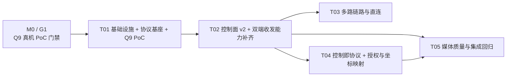

# UniLinker 重构方案与开发计划 · 选型总览

| 项 | 值 |
|---|---|
| 版本 | v0.1（草案，待用户选型） |
| 日期 | 2026-11-12 |
| 汇编 | 齐活林（交付总监，主理人）；专业产出来自许清楚（产品）、高见远（架构）、寇豆码（工程）、严过关（QA） |
| 状态 | **方案待选型，未进入实现** |
| 本轮边界 | 只产出方案与开发文档；**未修改任何 `src/` / `android/` / `web/` / `tests/` 源码** |

---

## 1. 这一轮回答了什么

用户要求：「先列出计划，可以重构，可以提供更好设计覆盖原来的，可以阅读前沿论文落地最新技术，但是记得编写详细开发文档。给我几个方案。」

本系列文档给出：① 基于真实代码的可行性基线；② 增量 PRD 与统一评分尺子；③ **3 套差异化重构方案 + 22 条可核查论文/技术来源 + 加权打分与推荐**；④ 推荐方案的详细架构、接口契约与任务分解；⑤ 可开工的详细开发文档；⑥ 测试与验收策略。

**一句话结论**：架构上做得到，且「零移动数据」是最好满足的一条；但 v3.1 现有代码只能跑 Windows 采集 → 局域网 WebRTC → 浏览器/Android 接收这一条单向链路，四大能力（Android 采集发送、Android 本地信令服务端、Windows 接收渲染、设备控制全栈）必须从零补齐。详细实证见 `00-feasibility-baseline.md`。

---

## 2. 三个方案（回编号选做）

| 编号 | 方案 | 一句话定位 | 加权总分 | 排名 |
|:---:|---|---|:---:|:---:|
| **①** | **保守渐进 · 补洞不换骨** | 最大限度复用 WGC / OpenH264 / SIPSorcery / 9527 / mDNS / 插件 / Compose，只把四大缺口逐一补上，最快跑通 P0 验收线 | **3.24** | 2 |
| **②** | **传输与架构升级 · 换芯不换壳** ⭐ | 保留 UI 与插件骨架、mDNS 与 9527 控制面，替换/增强编码与媒体传输层，引入多路链路、对称角色协议、零信任配对、控制即协议 | **3.80** | **1** |
| **③** | **跨端统一 Core · 重铸内核** | 共享内核覆盖 C#/Kotlin 双实现，可插拔传输、硬编优先、三端 Viewer 统一，允许换栈；覆盖原有最彻底但代价最大 | **2.90** | 3 |

### 打分矩阵（产品经理 D1~D9，权重合计 100；5 分制，高分=更优）

| 方案 | D1 覆盖度 18 | D2 零流量 14 | D3 跨端对称 14 | D4 画质延迟 10 | D5 控制可达 12 | D6 成本 10 | D7 复用 8 | D8 前沿 6 | D9 风险 8 | 总分 |
|---|:---:|:---:|:---:|:---:|:---:|:---:|:---:|:---:|:---:|:---:|
| ① | 4 | 3 | 2 | 2 | 3 | 5 | 5 | 2 | 3 | **3.24** |
| ② | 5 | 4 | 4 | 3 | 4 | 2 | 4 | 4 | 3 | **3.80** |
| ③ | 3* | 3* | 5 | 3* | 3* | 1 | 1 | 4* | 2 | **2.90** |

\* 标注「待验证」：方案 ③ 无增量可验收版本，按 PM 规则「无证据取 2」严格执行时 D1=2 会命中 V4「不得推荐」，但两种口径下 ③ 均排末位。三套均通过 V1~V5 红线否决检查（详见 `02` §6.1）。

**灵敏度**：②−① = 0.56；Q13 判目标档硬性、Q9 两种结论、Q11 改必须 Wi-Fi Direct、严格无证据取 2 等情形下 **推荐均不翻转**。唯一翻转条件是把「成本+复用」权重抬到 D6 ≥ 30（几乎放弃质量与跨端对称性）→ ① 反超。③ 在任何合理权重下不反超。

### 推荐与落地策略

**推荐方案 ② 作为目标架构**，但实施采用「**① 起步 → ② 演进**」两阶段：把 ① 的 T01（零流量合规 + 协议对齐 + Q9 真机 PoC）作为 ② 的 Phase-0 先做。矩阵选的是**目标架构**，起步顺序是**实施策略**，两者不矛盾。

> 需要你回的编号：**①**（只做保守渐进，最快见效） / **②**（按推荐目标架构，① 起步再演进） / **③**（重铸内核，代价最大） / 或「先只做 M0/G1 真机 PoC 再定」。

---

## 3. 前沿技术落地结论

调研 22 条来源（R1~R22），全部给可核查出处；2 条明确「未找到可核查来源」（R21 Rust/UniFFI），3 条年份未核实已标注。分级结论：

| 级别 | 代表 | 处置 |
|---|---|---|
| **成熟可落地（可进方案）** | R1 Google GCC（MMSys'16，libwebrtc 内置）、R6 QUIC/RFC 9221（P1 可选传输）、R10 RFC 7742（强制约束，修 `PeerConnection.cs:54` fmtp）、R11 Meta AV1 for RTC（≥20% 码率降低，仅 P1）、R16 WifiP2pManager API、R17 dispatchGesture、R18 MediaProjection、R19 scrcpy（参考架构）、R22 SDP munging `42e01f` | 进 `02` §5 白名单，必须**可插拔、可一键回退**（PR-6） |
| **需验证 / 仅参考** | R2 SCReAM、R3 NADA、R8 WebTransport（需 HTTPS 安全上下文，与明文 9527 冲突）、R12/R13 AV1 厂商数据、R15 Wi-Fi Aware/NAN、R20 KMP（与 .NET 非一等互操作） | 不进 P0，列试验位 |
| **研究阶段不建议落地** | R4 Copa、R5 PCC Vivace、R7 RoQ（草案已过期）、R9 L4S、R14 DCVC 神经视频压缩 | 写入「明确不做」 |

**「看着好但不该上」清单**（`02` §5.6）：RoQ/WebTransport 作 P0 主传输、自研 CC（PCC Vivace / Copa / NADA / SCReAM）、L4S、神经编码、Wi-Fi Aware 作 P0 发现、5G ProSe（与 C1/C4 冲突且无一手来源）、共享内核（Rust/UniFFI 或 KMP）、AV1 作 P0、复活 MediaFoundation SinkWriter（`CLAUDE.md:66` 明确禁止）。

---

## 4. 开发计划

### 任务链

T03 / T04 可并行。任务表（含依赖、文件相对路径、完成判据、对应需求编号 R0/R1）见 `03` §5，实现步骤见 `04`。

### 里程碑

| 里程碑 | 可验证验收内容 | 任务 |
|---|---|---|
| **M0 / G1** | 真机回答「Android v3.1 → Windows 9527 是否真实出帧」+ SDP 字段比对；结论归档并给 PoC 报告号。**未出结论不得进入 T02、不得输出 M1~M8 工期** | T01 |
| **M1** | 双 Android 同一 Wi-Fi LAN 单向投屏出帧，连续 10min 稳定，最低档分辨率帧率达标 | T01+T02 |
| **M2** | 手机热点自组 LAN 无路由器直连：发现→连接→投屏→控制；飞行模式 + 无 SIM；抓包无公网目的地址（判据 A/C/D） | T01+T03 |
| **M3** | 触控注入 + 坐标映射：4 种宽高比 × 横竖屏旋转各 20 次点击，落点误差 ≤1% 屏宽 | T04 |
| **M4** | 被控端显式授权 + ≤1s 撤销 + 常驻指示 + 超时断开；P0 安全底线（`sessionToken`/`sig` + CORS 收敛） | T04+T05 |
| **M5** | 端到端延迟 ≤150ms、3% 丢包自适应不花屏可恢复、判据 A~F 全复核 | T05 |
| M6 / M7 / M8 | P1：Android→Windows 反向流 / 系统键·剪贴板·音频 / 判据 E 仅 USB | T02+T05+T03 |

### 必须锁定的前置决策

| 编号 | 问题 | 当前默认（基于假设） |
|---|---|---|
| **Q9** | Android 现有接收链路是否真机可用 | 假定「不可用」，按重做信令对接估算；M0/G1 验证 |
| **Q11** | 无路由器直连能否用「一台开热点」 | 默认热点自组 LAN；Wi-Fi Direct 列 P1 |
| **Q13** | 1080p60 / ≤80ms 是否硬性 | 默认不硬性；按最低档 720p30/≤150ms 验收，硬编层条件性投入 |
| **Q14** | Windows 接收端形态 | 默认 WebView2 复用 `web/app.js`（保护浏览器观看与 SM01~SM05） |
| **Q18 / B-4** | 是否坚持「发送方=控制方」单向角色 | **口径冲突，需你拍板**：本轮按产品经理默认「不坚持单向、对称角色架构但 P0 业务流仍只单向」推进（支撑 D-01 强制废弃硬编码角色、② 的 D3=4）。若你要求坚持单向，需重打 D1/D3/D6/D9 |

其余 Q1~Q19 默认答案见 `01` §6；基线修订 B-1~B-4 见 `00` §12。

---

## 5. 文档索引

| 文件 | 职责 | 产出 |
|---|---|---|
| `00-feasibility-baseline.md` | 上一轮可行性评审归档：源码实证、四大缺口、零流量结论、硬瓶颈、证据索引、§12 修订记录 | 主理人汇编 |
| `01-product-requirements.md` | 增量 PRD、用户故事、需求池 R0/R1/R2、**D1~D9 评分矩阵与 V1~V5 否决规则**、K1~K8 兼容红线、PR-1~PR-6 | 许清楚 |
| `02-options-and-research.md` | **3 套方案详细设计 + 22 条论文/技术调研 + 打分矩阵 + 推荐 + 灵敏度 + 黑名单** | 高见远 |
| `03-architecture-and-plan.md` | 推荐方案详细架构、**§2 唯一协议契约**、时序图、状态机、T01~T05 任务分解、里程碑、风险、硬约束 | 高见远 |
| `04-implementation-guide.md` | **详细开发文档**：环境构建、文件清单、接口签名与 JSON schema、协议规范、分任务实现步骤、踩坑、迁移回滚、调试诊断、明确不做 | 寇豆码 |
| `05-test-strategy.md` | 测试分层、**判据 A~F 自动化**、用例矩阵、坐标/授权/性能/互通专项、E2E 扩展、里程碑出口、设备矩阵、报告模板 | 严过关 |

契约优先级：**`03` §2 > 其他文档**；`00` §12 修订记录 > `00` 正文；冲突时以此为准并由主理人裁决。

---

## 6. 边界与已知限制

- 本轮为**规划与文档**，未改源码；`git status` 仅有 `?? docs/` 与项目数据目录 `?? .workbuddy/`（后者不纳入版本控制）。
- 平台级不可行项：无 ROOT 下安全锁屏 / `FLAG_SECURE` / BiometricPrompt 不可注入；Windows UAC 安全桌面不可注入；Android 投屏（MediaProjection）与被控（无障碍）是两套独立授权。
- 「去 STUN 后纯 host candidate 在 LAN 可建连」已由 B-1 降级为 **M0 门禁验证项**，不是既成事实。
- 方案 ③ 的 Rust/UniFFI 共享内核未找到可核查来源，不作为选型依据。

---

## 7. 一致性裁决记录（权威源）

> 本轮 7 份文档由 4 位成员并行产出，交叉复核共发现 17 处跨文档口径冲突：**C-1~C-9**（04 提出）与 **D-1~D-8**（05 提出）。全部由主理人齐活林于 2026-11-12 裁决。**本节是唯一权威结论**；单份文档里残留的「需裁决 / 待确认 / 待架构师确认」表述，一律以本节为准。所有裁决均**不改变三套方案定位、D1~D9 打分（① 3.24 / ② 3.80 / ③ 2.90）与推荐结论**。

### 7.1 C-1~C-9（04 开发文档提出）

| 编号 | 裁决结论 | 落地 |
|---|---|---|
| C-1 | 插件 ABI **不断裂**：原签名不变，走扩展接口（`IChannelV2`/`IPeerMeshV2` 或默认接口方法），外部 `plugins/` DLL 无需重编译。D7=4 的代价改述为 v1/v2 协议并存期 + `web/app.js` 同步 E2E 回归 + Android 死代码合并，**分数与排名不变** | `02` §3.6/§3.7/§6.4/§9.3、`03` §7/§10.1、`04` §10.2、`05` TC-072 |
| C-2 | P0 安全模型：`sessionToken` 由服务端在 hello/首连签发，`sig` 基于**会话密钥**（非配对密钥），`PairingProof.method="none"`；PIN/QR 完整配对列 P1/M7，不作 M1/M4 退出条件 | `03` §2.3、`04` §5.4/§6.10 |
| C-3 | `MediaFeedback` 补两个 **optional** 字段 `frameTimestampUs` / `renderCompleteAtUs`，不改既有字段；不新增独立消息名 | `03` §2.5、`04` §5.5/§11.3、`05` §11.3 |
| C-4 | 前沿白名单统一为决策 12 的 **9 项** R1/R6/R10/R11/R16/R17/R18/R19/R22；分级仍以 `02` §5 为准，不因进白名单升级（R22 需验证、R11 仅 P1、R19 不作默认路径） | `02` §6.6、`03` §10.1、`04` §12.1 |
| C-5 | `ITransport` / `ILinkManager` **纳入正式契约**（`03` 新增 §2.6），三端字段名与方法语义必须一致；只固定「可插拔传输 + 链路仲裁」最小公共面，内部实现属实现层自由 | `03` §2.6、`04` §5.6/§5.7 |
| C-6 | 文档编号以本 README 文档索引为权威；`01` §1 的早期规划编号作废 | 全局 |
| C-7 | `03` §5.1 依赖图的 T01 直连边是「唯一根节点的传递依赖起点」，与任务表直接依赖集合无实质冲突 → 记录，不改动 | 不改 |
| C-8 | 0/90/180/270 换算公式照 `03` §2.4，但**旋转方向约定与 `contentRect` 基准是 Q22 待 T04 真机四点标定的参数**，两端共用同一标定结果 | `03` §2.4/§8、`04` §6.9、`05` §6.6 |
| C-9 | SM05 证明的是 localhost 带 STUN 的浏览器观看全链路，**不是判据 D 的充分证据**；零 STUN 跨设备建连是 M0/G1 门禁验证项（B-1） | `00` §12 B-1 + §4 内联标注、`05` §2/§4 |

### 7.2 D-1~D-8（05 测试策略提出）

| 编号 | 裁决结论 | 状态 |
|---|---|---|
| D-1 | 文档编号以 README 索引为准，`01` §1 早期规划图作废 | 已裁决，不改 01 |
| D-2 | B-1 修订已回写 `00` §12，并在 `00` §4 加内联标注 | **已落地** |
| D-3 | 判据 E 统一口径「**现状不可达；目标态 P1/M8 可达**」；M0~M7 标 `[X] NOT-TESTABLE`，02/03 不改 | 已裁决，由本节声明 |
| D-4 | 采纳最严格坐标口径：**320 次落点**（16 组合 × 20 次，320/320 全 ≤1% 屏宽，不取平均/不剔离群点）+ **80 组手势**（16 × 5） | 已裁决，05 写法正确 |
| D-5 | `03` §6 标题改「里程碑 M0~M8（M6~M8 为 P1）」 | 已派发修订 |
| D-6 | `03` §3.1 时序图加注「PIN/QR 为 P1 可选分支，P0 走 `sessionToken`/`sig`」；M1/M4/M7 退出条件不变 | 已裁决，05 写法正确 |
| D-7 | `tests/UniLinker.E2E.Tests/README.md` 漏列 SM05、exe 路径写成 `19041.0`（实际 `22621.0`）→ **本轮边界内不改测试资产** | **遗留项**：后续独立 docs 提交 |
| D-8 | **延迟打点时基锁定**：`frameTimestampUs` 源自 `SystemRelativeTime` 单调相对时基（µs），非 UTC 墙钟；`renderCompleteAtUs` 必须由接收端用单向 RTT/2 + offset 校准（或本地 NTP 对同一参考时钟）折算到**同一单调域**；禁止墙钟直接相减；报告须注明折算方法与校准误差上界；未折算的报告判为无效 | 已裁决，落 `03` §2.5 / `04` §11.3 / `05` §8.1·§11.3·§14 RK-9 |

### 7.3 遗留项与放行前置（明确列出，不隐藏）

1. **D-7**：测试资产 README 漏列 SM05 与 TFM 路径错误 —— 本轮只出设计文档，未动 `tests/`，留作后续 docs 提交。
2. **M0/G1（Q9）**：Android 现有接收链路是否真机出帧，未验证前不得进入 T02、不得输出 M1~M8 工期。
3. **Q22 四点标定**：M3 签字前置，旋转方向约定与 `contentRect` 基准待真机标定。
4. **Q1~Q19 待用户拍板**：本轮全部按 `01` §6 默认答案推进并标注「基于默认假设」；其中 **Q18/B-4**（是否坚持单向角色）是唯一与 D-01 强制废弃硬编码角色冲突的口径，需用户显式确认。
5. 本轮**未修改任何 `src/` / `android/` / `web/` / `tests/` 源码**，也未写实现代码。
